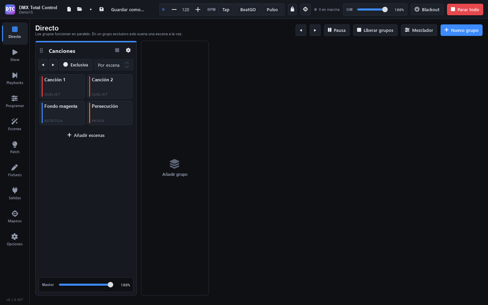

# DMX Total Control

Software de control de iluminación DMX, libre y de código abierto, con una interfaz moderna pensada para el directo.

- **Directo por grupos**: las escenas se agrupan en grupos que funcionan en paralelo. En un grupo *exclusivo* solo suena una escena a la vez, y al pulsar otra hace crossfade. Cada grupo tiene su propio master y su tiempo de fundido.
- **Programador**: seleccionas fixtures, ajustas dimmer, color, posición y cualquier canal en vivo, con paletas por referencia, línea de comandos con teclado en pantalla y FX por parámetro (cada luminaria puede tener su forma, tamaño y sentido sobre el mismo reloj). El programador tiene prioridad sobre todo hasta que lo limpias.
- **Escenas**: estáticas, pasos, FX, super escenas con línea de tiempo y audio, y cuelists con tracking.
- **Playbacks**: páginas de faders con GO, pausa y flash para cuelists y escenas, también desde una Akai APC mini, APC mini mk2 o APC40 mkII.
- **Show y remoto**: una pantalla táctil que montas a tu medida con botones, faders y paneles, también en el móvil o la tablet por wifi.
- **Hardware**: interfaces **DMX USB** (Enttec Open/Pro, Eurolite, DMXKing, uDMX, Peperoni, Velleman…), Art-Net, sACN/E1.31, MIDI y OSC, y una biblioteca de miles de fixtures, más la Open Fixture Library y la importación de GDTF.

Los shows se guardan en formato `.qxw`, compatible con QLC+: puedes abrir shows de QLC+, y QLC+ puede leer la parte del motor de los nuestros.

> Estado: **en desarrollo**. Consulta la [hoja de ruta](ROADMAP.md).

## Descargar

**Windows 10/11 (64 bits)**: descarga el instalador `DMXTotalControl-Setup-….exe` de la [última versión](https://github.com/joseramos1999/DMXTotalControl/releases/latest) y ejecútalo. Se instala para tu usuario, sin pedir permisos de administrador. Como el instalador no está firmado, Windows SmartScreen puede avisar: **Más información** → **Ejecutar de todas formas**.

El programa avisa de las versiones nuevas y las instala él mismo después de comprobar la huella SHA-256 que GitHub publica del instalador (Opciones › Actualizaciones, donde también se puede desactivar).



## Estructura

| Carpeta | Contenido |
|---|---|
| `dtc/` | **La aplicación DMX Total Control**: backend C++ (`dtc/src`), interfaz QML (`dtc/qml`), remoto (`dtc/remote`), icono (`dtc/icons`) y pruebas (`dtc/test`) |
| `engine/` | Motor DMX (universos, fixtures, escenas, chasers, efectos, matrices RGB, cuelists…) |
| `plugins/` | Plugins de entrada/salida (DMX USB, Art-Net, E1.31, MIDI, OSC…) |
| `resources/` | Biblioteca de fixtures, perfiles de entrada, scripts RGB, fuentes |
| `qmlui/`, `ui/` | Interfaces originales del proyecto del que parte el motor. No se compilan por defecto; se conservan para facilitar los merges con upstream |

## Compilar en Windows

**Lo más rápido:** con MSYS2 y sus paquetes instalados (paso 1) y [Inno Setup 6](https://jrsoftware.org/isinfo.php), haz doble clic en `compilar-e-instalar.bat`. Compila en Release, crea el instalador y lo ejecuta: instala en `%LOCALAPPDATA%\Programs\DMXTotalControl`, con accesos directos en el escritorio y el menú Inicio, igual que el instalador publicado. Con `compilar-e-instalar.bat debug` compila en modo depuración.

1. Instala [MSYS2](https://www.msys2.org/) y, desde la shell **MINGW64**, los paquetes:

   ```bash
   pacman -S --needed mingw-w64-x86_64-{gcc,cmake,ninja,pkgconf,libusb,libftdi,libmad,libsndfile,fftw} mingw-w64-x86_64-qt6-{base,declarative,3d,multimedia,serialport,websockets,imageformats,svg,tools,shadertools}
   ```

   MSYS2 está retirando el entorno MINGW64 y ya no ofrece en él `libusb` ni `libftdi`: si instalas MSYS2 de cero, usa la shell **UCRT64** y los mismos paquetes con el prefijo `mingw-w64-ucrt-x86_64-` (como la CI de GitHub). Los scripts funcionan en los dos entornos.

2. Prepara el SDK D2XX de FTDI, necesario para las interfaces DMX USB basadas en FTDI:

   ```bash
   mkdir -p /c/projects/D2XXSDK && cd /c/projects/D2XXSDK
   curl -LO https://qlcplus.org/misc/CDM-v2.12.36.20-WHQL-Certified.zip && unzip CDM-*.zip
   cd amd64 && gendef - ftd2xx64.dll > ftd2xx.def && dlltool -k --input-def ftd2xx.def --dllname ftd2xx64.dll --output-lib libftd2xx.a
   ```

3. Compila e instala en `dist/`:

   ```bash
   ./build-windows.sh
   ```

4. Ejecuta `dist\dmxtotalcontrol.exe`. Opciones: `--locale en_US` para la interfaz en inglés, o un archivo `.qxw` para abrirlo al arrancar.

5. El instalador (necesita Inno Setup 6): `./build-installer.sh` deja una instalación limpia en `dist/` y crea `build/installer/DMXTotalControl-Setup-<versión>.exe` a partir de `dtc/installer/DMXTotalControl.iss`.

Pruebas: después de compilar, `./.github/run-tests.sh` pasa las de los grupos (`dtc_zone_test`) y las del backend (`dtc_backend_test`), las mismas que la CI de GitHub en cada cambio.

El icono sale de `dtc/icons/dtc-icon.svg` (y `dtc-icon-small.svg` para 16 y 20 px): si cambias los SVG, `dtc/icons/make-icons.sh` rehace los PNG y el `.ico` (necesita `rsvg-convert` y `perl`).

## Compilar en Linux / macOS

```bash
cmake -S . -B build -G Ninja -DCMAKE_BUILD_TYPE=Release
cmake --build build
sudo cmake --install build
```

Necesitas Qt 6 (base, declarative, 3d, multimedia, serialport, websockets, svg, tools), libusb, libftdi, libsndfile, libmad y fftw.

## Publicar una versión

1. Sube la versión en `variables.cmake` (`APPVERSION`, la de DMX Total Control) y anota la versión en el [ROADMAP](ROADMAP.md).
2. Crea y sube la etiqueta: `git tag v0.14.0 && git push origin v0.14.0`. Con guion (`v0.14.0-beta.1`) es una versión de prueba.
3. GitHub Actions (`.github/workflows/release.yml`) compila sin la marca «GIT», pasa las pruebas, crea el instalador y lo publica en una Release. Los programas instalados la encuentran solos.

## Sincronizar con upstream

El repositorio conserva el proyecto original del motor como remoto `upstream`:

```bash
git fetch upstream
git merge upstream/master
```

Para que los merges sigan siendo sencillos, el código nuevo va en `dtc/`. Los cambios en `engine/` y `plugins/` se limitan a lo imprescindible.

## Licencia y créditos

Apache License 2.0. Consulta [COPYING](COPYING) y [NOTICE](NOTICE).

DMX Total Control parte del motor y los plugins de [Q Light Controller Plus (QLC+)](https://github.com/mcallegari/qlcplus), de Massimo Callegari, Heikki Junnila y los colaboradores de QLC+, que conservan sus avisos de copyright. Fixtures adicionales de la [Open Fixture Library](https://open-fixture-library.org). DMX Total Control no está afiliado ni respaldado por el proyecto QLC+.
