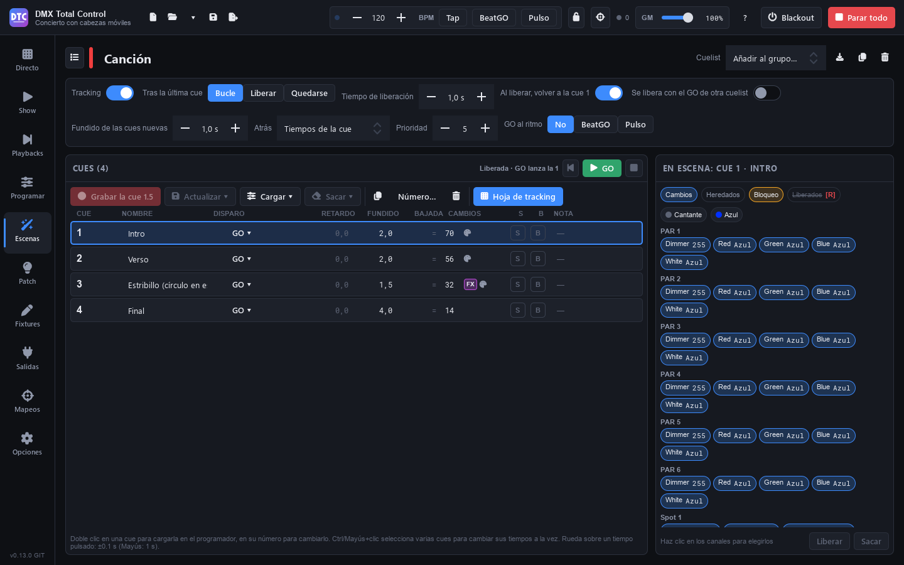

# Szenen

**Szenen** (F4) ist die Bibliothek für alles, was Sie aufgenommen haben: statische Szenen, Schritte, FX, Farbeffekte, Racks, Superszenen und Cuelists. Links steht die Liste, rechts der Editor der gewählten Szene, je nach Typ verschieden.

Fast alles wird aus dem Programmer erstellt: Neue Effekte übernehmen die unter [Programmieren](programar.md) ausgewählten Fixtures, Schritte und Cues seine Werte.

## Die Szenenliste

- **„Suchen…“**: filtert nach Name (oder nach dem Namen des Ordners).
- **„Ordner“** / **„Gruppen“**: die Szenen nach [Ordnern](escenas.md#ordner) anzeigen oder nach den Live-Gruppen, in denen sie sind („In keiner Gruppe“ für den Rest).
- **Alle einklappen** / **Alle ausklappen**: die Taste rechts.
- **Filter nach Typ**: „Alle“, „Statisch“, „Schritte“, „Cuelists“, „FX“, „Colour FX“, „Racks“ und „Superszenen“.
- **Strg+Klick** und **Umschalt+Klick** wählen mehrere Szenen aus, um sie in einen Ordner zu verschieben („In Ordner…“).

Jede Szene hat einen Streifen in der Farbe ihres Typs. Klicken Sie auf eine, um sie im Editor zu öffnen.

## Eine Szene erstellen

Drücken Sie **„Neu“**:

| Option | Was sie erstellt |
|---|---|
| **Statisch (aus dem Programmer)** | Eine statische Szene mit den Werten des Programmers. |
| **Schritte (Programmer = erster Schritt)** | Eine Schritte-Szene. |
| **Cuelist (Programmer = Cue 1)** | Eine Cuelist. |
| **FX (im Programmer)** | Bringt Sie zu Programmieren › FX: FX werden dort erstellt und mit „Aufnehmen…“ aufgenommen. |
| **Colour FX (ausgewählte Fixtures)** | Ein Farbeffekt auf den ausgewählten Fixtures, in ihrer Reihenfolge. |
| **Mapping auf dem 2D-Plan (ausgewählte Fixtures)** | Ein Farbeffekt, der dort liegt, wo die Fixtures im 2D-Plan stehen. |
| **Effekt-Rack** | Ein leeres Rack. |
| **Superszene (Zeitleiste mit Audio)** | Eine leere Superszene. |
| **Aus einer Datei importieren…** | Szenen und Effekte, die aus einer anderen Show exportiert wurden (siehe [Importieren und exportieren](escenas.md#importieren-und-exportieren)). |
| **Cue-Listen von QLC+…** | Cuelists aus den Chasern, Sequenzen und Cue-Listen einer QLC+-Show (siehe [Cue-Listen von QLC+](escenas.md#cue-listen-von-qlc)). |

## Der Kopf des Editors

- **Der Name**: Klicken Sie darauf, um ihn zu ändern.
- **Der Ordner** (Ordnersymbol): die Szene in einen Ordner verschieben.
- **„Testen“** / **„Stopp“**: spielt sie jetzt ab, außerhalb der Gruppen. Cuelists haben ihr eigenes GO.
- **„In Gruppe…“**: fügt sie einer Live-Gruppe hinzu.
- **In Schritte umwandeln** (Racks, FX, Colour FX, Move FX, Curve FX und Chaser): nimmt einen Zyklus in eine neue Schritte-Szene auf, nur mit den Kanälen, denen die Szene einen Wert gibt: Die anderen kommen nicht in die Schritte, auch wenn sie einen Standardwert haben (Pan oder Zoom in der Mitte bei vielen Moving Heads). Hat ein FX Verzögerungen, wird der Zyklus aufgenommen, wenn alle seine Fixtures gestartet sind.
- **In eine Cuelist umwandeln** (Schritte und Chaser): siehe [Cuelists](escenas.md#cuelists).
- **„QLC+“** (Cuelists): speichert eine Kopie der Show für QLC+; siehe [Cuelists und QLC+](escenas.md#cuelists-und-qlc).
- **Exportieren**, **„Duplizieren“** und **„Löschen“** (die Szene wird auch aus ihren Gruppen und Racks entfernt).

## Wie eine Szene läuft

Unter dem Kopf liegt der Wiedergabebereich. Er zeigt, was für den jeweiligen Typ sinnvoll ist:

- **„Einblendung“** und **„Ausblendung“**.
- **„Zykluszeit“** (oder **„Schrittzeit“** bei einem Colour FX) und **„Tempo“** (von einem Zyklus pro Minute bis zehn pro Sekunde; Doppelklick: ein Zyklus pro Sekunde), mit **×½** und **×2**.
- **„Staffelung“** (statische Szenen und Schritte): Jedes Fixture beginnt seine Überblendung so viel später als das vorherige, in Auswahlreihenfolge.
- **„Gesteuert durch“**: **„Dauer“** (die normalen Zeiten), **„BPM“** (die Zeiten werden zu Beats und folgen dem Tempo der Show, auch die Überblendungen jedes Schritts; die Überblendzeit einer Gruppe in Live und die Ein- und Ausblendungen der Blöcke einer Superszene bleiben in Sekunden), **„BeatGO“** oder **„Puls“** (schaltet mit der Taste BeatGO oder mit den Spitzen des Audioeingangs weiter). Mit BeatGO oder Puls: **„Unterteilungen“** (/2, ×2).
- **„Tap-Rhythmus“** (Sequenzen, Chaser und FX-Szenen mit FX auf „BPM der Show“): der Rhythmus, den Sie durch mehrmaliges Drücken ihrer Taste vorgegeben haben ([Live](directo.md#rhythmus-einer-szene-mit-schritten)), in BPM. Solange sie ihn hat, laufen ihre Schritte in diesem Rhythmus statt nach ihren Zeiten; bei einer FX-Szene machen ihre FX auf „BPM der Show“ einen Zyklus auf jeden Schlag, statt den BPM der Show zu folgen. **„Entfernen“** kehrt zu ihren Zeiten zurück (oder zu den BPM der Show). Mit „BPM“ ist ein Beat ein Schritt dieses Rhythmus: Eine Überblendung von 0,5 b dauert einen halben Schritt.
- **„Start“**: **„Läuft“** oder **„Pausiert, erneut drücken zum Abspielen“**.
- **„Läuft“**: **„Immer“** oder **„N-mal“**, **„dann“** **„Freigeben“** oder **„Letztes Bild halten“**, **„und abspielen“** „Nichts“, „Nächste Szene der Gruppe“, „Vorherige Szene der Gruppe“ oder jede andere Szene.

## Szenentypen

### Statisch

Speichert feste Werte. Zeigt, wie viele Kanäle und Fixtures sie hat und welche Paletten sie verwendet („Verwendet diese Paletten: ändern sie sich, ändert sich auch die Szene“).

So ändern Sie sie:

1. Drücken Sie **„Im Programmer bearbeiten“**: Sie wird unter Programmieren geladen.
2. Ändern Sie, was Sie möchten.
3. Gehen Sie zurück zu Szenen und drücken Sie **„Programmer in dieser Szene speichern“**.

Speichern Sie FX in einer statischen Szene, wird sie zu einer FX-Szene.

### Schritte

Eine Folge von Looks, jeder mit seiner **Einblendung**, seiner **Haltezeit** und seiner **Ausblendung**.

- **„Schritt hinzufügen“**: Der Programmer wird zu einem neuen Schritt nach dem ausgewählten.
- **„In Schritt speichern“**: speichert den Programmer im ausgewählten Schritt.
- **„Schritt laden“** (oder Doppelklick auf einen Schritt): lädt ihn in den Programmer, um ihn zu sehen und zu ändern.
- **Duplizieren**, **▲ ▼** zum Umordnen und **Löschen** des Schritts.
- Die Taste **∞** der Haltezeit lässt den Schritt auf ein GO warten („Bis GO“).

**Strg+Klick** und **Umschalt+Klick** wählen mehrere Schritte aus: Ändern Sie eine Zeit, ändert sie sich bei allen. Schritte verwenden Paletten **per Referenz**, wie Szenen und Cues: Aktualisieren Sie eine Palette, ändern sich die damit aufgenommenen Schritte (der laufende sofort). Das Palettensymbol eines Schritts zeigt, welche er verwendet.

### FX

Eine FX-Szene hat **Grundwerte** und eine oder mehrere **FX-Ebenen**. Sie entsteht, wenn Sie aus dem Programmer mit FX aufnehmen (siehe [FX](programar.md#fx)).

- Links die Liste der FX: Parameter, Fixtures und Tempo (auf „BPM der Show“ der Tap-Rhythmus der Szene, wenn sie einen hat). Der Papierkorb entfernt eine Ebene.
- Rechts die Regler der gewählten Ebene (dieselben wie unter Programmieren) und ihre animierte Vorschau. Änderungen wirken live, während die Szene läuft.
- **„Verknüpfen“**: Verknüpfte Ebenen teilen Tempo und Timing.
- Machen einige Fixtures den FX auf eigene Weise, erscheint ein Hinweis: Ändern Sie hier Form, Größe, Richtung oder Phase, tun danach alle dasselbe.
- **„Pro Fixture“**: Versatz und Verzögerung jedes Fixtures, auch live. Hier gelten „… verteilen“ und „Ohne Versatz und Verzögerung“ für alle (siehe [Versatz und Verzögerung pro Fixture](programar.md#versatz-und-verzögerung-pro-fixture)).
- Um Ebenen hinzuzufügen oder die Grundwerte zu ändern: **„Im Programmer bearbeiten“** und danach **„Programmer in dieser Szene speichern“**.

### Colour FX und Mappings

Ein **Colour FX** ist ein Pixeleffekt (über 60: Verläufe, Feuer, Meteore, Stroboskope, Wellen…), der die Fixtures in Auswahlreihenfolge durchläuft.

- **„Effekt“**: welcher.
- **„Wirkt auf“**: „Farbe (RGB)“, „Weiß“, „Amber“, „UV“, „Dimmer (Wert)“ oder „Shutter“.
- **„Farben“**: bis zu 5, je nach Effekt. Klicken Sie auf eine Farbe, um sie zu ändern (Farbfelder oder Farbton), oder „Keine Farbe“.
- **„Text“**: bei Texteffekten der Text, der über die Fixtures läuft.
- **„Bild“** und **„Animation“**: bei Bildeffekten die Datei und „Statisch“, „Seitlich scrollen“, „Auf und ab scrollen“ oder „Animiert (GIF)“.
- **„Anordnung“**: **„In einer Reihe“** (in Auswahlreihenfolge) oder **„Auf dem 2D-Plan“** (dort, wo die Fixtures stehen).
- **„Parameter“**: die eigenen Parameter jedes Effekts.
- **„Auswahl des Programmers verwenden“**: ersetzt seine Fixtures durch die ausgewählten.

Oben sehen Sie die tatsächliche Farbe jedes Kopfes, während der Effekt läuft (drücken Sie „Testen“, um sie zu sehen).

Ein **Mapping auf dem 2D-Plan** ist ein Colour FX, der schon mit der Anordnung auf dem Plan entsteht: Effekt, Text oder Bild liegen so auf der Bühne, wie die Fixtures stehen.

### Move FX und Curve FX

Das sind Effekte aus dem früheren Modul: **Move FX** bewegen Pan/Tilt in einer Form, und **Curve FX** geben Kanälen eine Welle (Sinus, Dreieck, Rampen, Rechteck, Zufall, Stroboskop…). Sie finden sie in alten Shows oder in Shows von QLC+; über „Neu“ werden sie nicht mehr erstellt.

Sie laufen weiter wie bisher und haben ihren Editor (Form, Breite, Höhe, Drehung, Position, Phase, Verteilung auf die Fixtures, symmetrisch, relativ…). Ein Hinweis bietet **„In FX umwandeln“** an: Sie wechseln zum FX-Editor, auch im Programmer, und Gruppen, SHOW-Tasten und Zuordnungen behalten sie. Die Phase eines Move FX wird zur „Phase“ des FX, und der Startversatz jedes Fixtures zu seinem „Versatz“ ([Versatz und Verzögerung pro Fixture](programar.md#versatz-und-verzögerung-pro-fixture)).

### Effekt-Rack

Mehrere Szenen und Effekte, die zusammen wie eine einzige laufen, jede auf ihren eigenen Fixtures.

- Klicken Sie unter **„Hinzufügen“** (rechts) auf eine Szene, um sie ins Rack zu legen.
- Unter **„Im Rack (N)“** entfernt das **×** sie.

Ein Rack kann keine Szene enthalten, die es selbst abspielt.

### Chaser

Chaser aus QLC+-Shows laufen normal, haben aber keinen Editor: Wandeln Sie sie mit den Tasten im Kopf in Schritte (zeichnet einen Zyklus auf) oder in eine Cuelist um.

## Superszenen

Eine **Superszene** ist eine Zeitleiste mit Spuren für Szenen und Audio. Sie wird wie jede Szene gestartet (in einer Gruppe, in der SHOW, mit einer Zuordnung). Ihr Editor füllt die ganze Seite; die Listentaste oben links führt zurück zur Szenenliste.

### Die Werkzeugleiste

- **„Abspielen“** / **„Stopp“** (**Leertaste**): ab dem Cursor. **⏮** geht zum Anfang zurück. Daneben sehen Sie die Zeit (und den Takt).
- Die Pfeile **Rückgängig** und **Wiederherstellen** (**Strg+Z** / **Strg+Y**). Siehe [Rückgängig machen](escenas.md#rückgängig-machen).
- **„Einfügen“** (**Strg+V**): die kopierten Blöcke, am Cursor und ab der ausgewählten Spur. Siehe [Kopieren und einfügen](escenas.md#kopieren-und-einfügen).
- **„Zeit“** / **„Takte“**: das Raster. Bei Takten: die **BPM**, die Taktart (**4/4**, **3/4**, **2/4**) und **„Takt 1 hier“**, damit der erste Takt am Cursor beginnt und zur Musik passt.
- **„Einrasten“**: Blöcke und Punkte rasten am Raster ein.
- **„Ende hier“**: Die Superszene endet am Cursor (das **×** entfernt die Marke: Sie endet mit ihrem letzten Block). **„Schleife“**: beginnt von vorn.
- **„+ Spur“** und **„+ Audio“** (eine Audiodatei auf der ausgewählten Spur, am Cursor).
- **„Statische Werte“**: **„Werte des Programmers übernehmen“** (sie laufen, solange die Superszene läuft) oder **„Statische Werte löschen“**.
- **Zoom** − und +.

### Szenen auf die Zeitleiste legen

1. Drücken Sie **„+ Spur“**, wenn es noch keine gibt.
2. Ziehen Sie eine Szene aus der Liste links auf eine Spur. Oder wählen Sie eine Spur aus, setzen Sie den Cursor und **doppelklicken** Sie auf die Szene: Sie wird am Cursor eingefügt.

Blöcke dürfen sich überlappen.

Eine **„Timecode“**-Cuelist mit eigener Uhr in einem Block folgt der Zeitleiste: Die 00:00 ihrer Uhr ist der Anfang des Blocks. Legen Sie sie auf eine andere Spur, neben den Audioblock des Songs und ab demselben Punkt: Jeder Cue spielt in seinem Moment des Songs. Spielen Sie ab einem anderen Punkt, geht die Cuelist direkt zum Cue dieser Zeit. Gestreckt läuft ihre Uhr schneller oder langsamer, damit die Cuelist so lange wie der Block dauert.

### Mit den Blöcken arbeiten

- **Ziehen** Sie einen Block, um ihn zu verschieben, auch auf eine andere Spur. Ziehen Sie seine **Ränder**, um seine Dauer zu ändern.
- Ist nur ein Block ausgewählt, sind die **Griffe** an den oberen Ecken seine Ein- und Ausblendung.
- Verlängern Sie einen Block, **wiederholt sich die Szene in einer Schleife** (bei jedem Durchlauf sind Markierungen zu sehen) oder sie wird **gestreckt**, sodass ein Zyklus den ganzen Block dauert. Das ändern Sie im Menü des Blocks oder in der unteren Leiste („Schleife“ / „Gestreckt“).
- **Rechtsklick**: „Szene im Block wiederholen“ / „Szene auf den Block strecken“, „Kopieren“, „Ausschneiden“, „Duplizieren“, „Sperren“ / „Entsperren“, „Szene öffnen“ und „Löschen“. Auf einem Block der Auswahl wirkt das Menü auf die ganze Auswahl; „Szene öffnen“ öffnet die Szene des angeklickten Blocks.
- Ein **Doppelklick** auf einen Block öffnet seine Szene. **Entf** (oder die **Rücktaste**) löscht die ausgewählten Blöcke; die auf gesperrten Spuren bleiben. **Strg+D** dupliziert sie direkt dahinter: jede Kopie auf ihrer Spur.
- Die untere Leiste zeigt den ausgewählten Block: **Start**, **Länge**, **Einblendung**, **Ausblendung**. Bei mehreren zeigt sie, wie viele es sind. Bei einem oder mehreren bietet sie **Kopieren**, **Ausschneiden**, **Duplizieren** und **Löschen**.

### Mehrere Blöcke auswählen

- **Klick** auf einen Block: nur dieser. Seine Spur wird die ausgewählte Spur.
- **Strg+Klick** fügt einen Block der Auswahl hinzu oder entfernt ihn.
- **Umschalt+Klick** wählt vom zuletzt gewählten Block bis zu diesem aus: die Blöcke der Spuren dazwischen, vom frühesten Start bis zum spätesten Ende.
- **Ziehen auf einer leeren Stelle** der Spuren zeichnet ein Rechteck, das die berührten Blöcke auswählt. Mit **Strg** oder **Umschalt** kommen sie zur Auswahl hinzu.
- **Strg+A** wählt alle Blöcke der sichtbaren Spuren aus. Die Blöcke einer Spur, die Sie ausblenden, verlassen die Auswahl.
- Ein Klick auf eine leere Stelle hebt die Auswahl auf (und bewegt den Cursor). Mit Strg oder Umschalt bleibt die Auswahl.

Wenn Sie einen ausgewählten Block **ziehen**, bewegt sich die ganze Auswahl:

- Alle verschieben sich zeitlich um denselben Betrag: Der gezogene Block rastet am Raster ein, die anderen behalten ihre Abstände. Der erste hält bei 0 an.
- Sie gehen um dieselbe Anzahl Spuren nach oben oder unten. Die Zielspuren leuchten auf.
- Gesperrte Blöcke und Blöcke auf gesperrten Spuren bleiben, wo sie sind.
- Würde einer außerhalb der Spuren oder auf einer gesperrten Spur landen, verschieben sie sich nur zeitlich.
- Ränder und Blenden ändern nur den Block unter der Maus.

Einen Block der Auswahl drücken und ohne Bewegung loslassen lässt nur ihn ausgewählt. Jede Aktion auf der Auswahl ist ein einziger Schritt von [Rückgängig machen](escenas.md#rückgängig-machen) („3 Blöcke verschieben“).

### Kopieren und einfügen

- **Strg+C** kopiert die ausgewählten Blöcke. **Strg+X** schneidet sie aus: Es kopiert sie und entfernt sie. Blöcke auf gesperrten Spuren werden kopiert, bleiben aber.
- **Strg+V** oder **„Einfügen“** fügt sie am Cursor ein, ab der ausgewählten Spur (ohne ausgewählte Spur ab der ersten).
- **Rechtsklick** auf eine leere Stelle einer Spur: **„Hier einfügen“** fügt an dieser Stelle und auf dieser Spur ein. **„Alles auswählen“** wirkt wie **Strg+A**.
- Der erste Block landet am Cursor, die anderen behalten ihre Abstände in der Zeit. Der Block der obersten Spur kommt auf die ausgewählte Spur, die anderen behalten ihre Abstände in Spuren.
- Fehlende Spuren werden am Ende hinzugefügt. Eine ausgeblendete Spur, die Blöcke bekommt, wird eingeblendet.
- Eingefügte Blöcke behalten ihre Länge, ihre Ein- und Ausblendung, Schleife oder Strecken und ihre Farbe. Sie kommen entsperrt an, wie beim Duplizieren.
- Das Eingefügte bleibt ausgewählt und der Cursor springt an sein Ende: Drücken Sie noch einmal **Strg+V**, und die nächste Kopie kommt direkt dahinter.
- Sie können in eine andere Superszene derselben Show einfügen: Öffnen Sie sie und fügen Sie ein. Szenen werden nicht kopiert: Der eingefügte Block spielt dieselbe Szene.
- Ein Audioblock, der in dieselbe Superszene eingefügt wird, spielt dasselbe Audio. In einer anderen Superszene bekommt er sein eigenes Audio aus derselben Datei: Wenn Sie ihn dort löschen, verschwindet nie das Original. Haben Sie den Block ausgeschnitten, wird sein Audio erneut aus der Datei gelesen.
- Auf eine gesperrte Spur wird nichts eingefügt, ebenso keine Szene, die diese Superszene abspielt (zum Beispiel ein Rack, das sie enthält). Eine Meldung weist darauf hin.
- Das Kopierte bleibt erhalten, solange die Show geöffnet ist. Eine andere Show zu öffnen oder eine neue zu beginnen leert es. Eine Szene, die Sie aus der Liste löschen, fällt heraus.
- Einfügen und Ausschneiden sind ein einziger Schritt von [Rückgängig machen](escenas.md#rückgängig-machen). Was Sie einfügen, während die Superszene läuft, ist ab dem nächsten „Abspielen“ zu hören.

### Audio

Audioblöcke (wav, flac, ogg, aiff und mp3, wenn das System es unterstützt) zeigen ihre **Wellenform**, die im Hintergrund berechnet wird. Zum Hinzufügen brauchen Sie eine nicht gesperrte Spur.

### Spuren und Automation

Im Kopf jeder Spur:

- **M**: stummschalten (die Spur läuft nicht).
- **Schloss**: sperren (ihre Blöcke und Punkte bewegen sich nicht).
- **D**: die Automationslinie des **Dimmers** (bei einer Audiospur die Lautstärke).
- **φ**: die Automationslinie der **Phase** ihrer Effekte.
- **⋯**: „Umbenennen“ (auch per Doppelklick auf den Namen), „Nach oben“, „Nach unten“, „Automation dieser Bahn löschen“ und „Spur löschen“.
- Der Pfeil rechts blendet die Spur aus oder ein.

Auf einer Automationslinie: **Klick** fügt einen Punkt hinzu, **Ziehen** verschiebt ihn, **Doppelklick** löscht ihn und **Rechtsklick** wechselt zwischen gerader Linie und weicher Kurve. Ohne Punkte steht der Dimmer auf voll und die Phase auf 0.

### Auf der Zeitleiste navigieren

- Klick oder Ziehen auf dem **Lineal** bewegt den Cursor; ein **Doppelklick** auf das Lineal spielt ab dort ab. Ein Klick auf eine leere Spur bewegt den Cursor ebenfalls.
- **Strg+Mausrad**: Zoom. **Umschalt+Mausrad**: in der Zeit scrollen. Das Mausrad allein scrollt durch die Spuren.

### Rückgängig machen

- **Strg+Z** macht die letzte Änderung rückgängig. **Strg+Y** (oder **Strg+Umschalt+Z**) stellt sie wieder her. Die Pfeile der Werkzeugleiste tun dasselbe; mit der Maus darüber zeigen sie, welche Änderung sie rückgängig machen oder wiederherstellen.
- Jede Superszene hat ihren eigenen Verlauf mit bis zu 100 Schritten. Er bleibt, solange die Show geöffnet ist: Speichern löscht ihn nicht, eine andere Show öffnen oder eine neue beginnen schon.
- Es zählen Änderungen an Spuren, Blöcken, Automation, Raster, BPM, Ende, Schleife und statischen Werten. Mehrere Änderungen desselben Felds der unteren Leiste (oder der BPM) innerhalb einer Sekunde sind ein einziger Schritt.
- Nicht zählen: Spuren aus- oder einblenden, der Zoom, der Cursor, „Einrasten“ und die Auswahl.
- Während Sie in einem Feld tippen, macht Strg+Z das Getippte im Feld rückgängig.
- Es funktioniert, während die Superszene läuft. Ein entfernter Block hört auf; ein Block, der zurückkommt, spielt ab dem nächsten „Abspielen“.
- Ein Audioblock kommt mit seinem Audio zurück, das erneut aus seiner Datei gelesen wird.
- Die Blöcke einer Szene, die aus der Liste gelöscht wurde, kommen nicht zurück.

## Cuelists

Eine **Cuelist** ist eine Liste von Cues, die mit GO weiterschalten. Sie arbeitet mit **Tracking**: Jeder Cue speichert **nur, was sich ändert**, und der Rest bleibt von den vorherigen Cues. Ein GO ändert nur die Kanäle, die sich ändern: keine Einbrüche und kein erneutes Anfahren dessen, was unberührt bleibt.

Bei anderen Cuelists und Szenen gleicher Priorität kommt jeder Kanal, der keine Intensität ist (Position, Gobo, Farbrad…), von dem, der ihn zuletzt geändert hat: Der GO, der ihn ändert, übernimmt ihn, und was die Cuelist nur aus früheren Cues behält, holt sie sich nicht zurück. Wird er freigegeben, blendet er zu dem über, der ihn vorher hatte. Siehe [Prioritäten](directo.md#prioritäten).

Cuelists werden aus dem Programmer aufgenommen, unter [Playbacks](playbacks.md) bedient und hier bearbeitet.

### Optionen der Cuelist

Oben im Editor:

- **„Typ“**: wie die Cuelist abspielt. Eine Zeile neben den Tasten sagt, was der gewählte Typ tut. In Playbacks und in diesem Editor trägt eine Cuelist eines anderen Typs ihr Kennzeichen: **SUB**, **CHASE**, **TC** oder **OVR**.
  - **„Normal“** (Standard): Jedes GO startet den nächsten Cue.
  - **„Chase“**: Die Cues folgen von selbst aufeinander, in einer Schleife, in einem Tempo (siehe unten).
  - **„Timecode“**: Jeder Cue spielt zu seiner Zeit auf einer Uhr (siehe unten).
  - **„Submaster“**: Der Fader ihres Playbacks bestimmt (siehe unten).
  - **„Override“**: Ihr Fader blendet alles, was sie hält, zwischen dem, was darunter liegt, und ihrem Cue über (siehe unten).
- **„Tracking“**: An: Jeder Cue speichert nur, was sich ändert. Aus: Jeder Cue steht für sich.
- **„Nach dem letzten Cue“**: **„Schleife“** (zurück zum ersten), **„Freigeben“** oder **„Bleiben“**.
- **„Freigabezeit“**: die Überblendung beim Freigeben der Cuelist.
- **„Bei Freigabe zurücksetzen“**: Nach dem Freigeben beginnt GO wieder beim ersten Cue.
- **„Freigabe durch anderes GO“**: ein Song, der endet, wenn der nächste beginnt.
- **„Überblendung neuer Cues“**: die Überblendung des ersten aufgenommenen Cues; die folgenden übernehmen die Zeiten des vorherigen.
- **„Zurück“**: die Zeiten von BACK: **„Cue-Zeiten“** oder **„Feste Zeit“**.
- **„Priorität“**.
- **„GO im Takt“**: „Aus“, „BeatGO“ oder „Puls“; mit BeatGO oder Puls kommt bei jeder Unterteilung ein GO.
- **„Tap-Rhythmus“**: der Rhythmus, den Sie durch mehrmaliges Drücken ihrer Taste vorgegeben haben, in BPM: ein GO auf jeden Schlag. Solange sie ihn hat, zählen ihre Zeiten für Folgen und Warten nicht. **„Entfernen“** kehrt zu ihren Zeiten zurück.
- **„Im Dunkeln bewegen“**: Wenn ein Cue fertig ist, nehmen die dunklen Fixtures, die der nächste Cue einschaltet, schon seine Position, Farbe und seinen Strahl ein. Beim GO blenden sie nur noch auf. **„Nach“** ist die Wartezeit nach dem Ende des Cues (standardmäßig 0 s). **„Zeit“** ist die Dauer dieser Bewegungen (standardmäßig 2 s).
  - Ein Fixture, das ein anderes Playback oder der Cue selbst beleuchtet, wird nicht bewegt.
  - Bei einem Fixture ohne Dimmer ist sein RGB sein Licht: Nur seine anderen Attribute werden vorbereitet.
  - Die Kanäle eines FX werden nicht vorbereitet: Das FX startet mit seinem GO.
  - Wählen Sie einen anderen Cue für das nächste GO („Weiter“ in [Playbacks](playbacks.md)), wird dieser vorbereitet.
  - Gilt nicht in einer „Chase“- oder „Override“-Cuelist.

In einem schmalen Fenster wird ein Teil der Optionen eingeklappt: **„Mehr Optionen“** zeigt sie.

Eine **„Submaster“**-Cuelist bestimmt der Fader ihres [Playbacks](playbacks.md#der-fader):

- Ziehen Sie den Fader von null hoch, startet sie auf ihrem nächsten Cue, auf dem Pegel des Faders und nie voll.
- Ziehen Sie ihn auf null, wird sie mit ihrer Freigabezeit freigegeben. Das lässt sich in den [Eigenschaften](playbacks.md#eigenschaften-eines-playbacks) des Playbacks ändern.
- Während sie läuft, wechseln GO und Zurück den Cue auf dem Pegel des Faders.
- Freigegeben wählen GO und Zurück nur den Cue, mit dem sie starten wird (auch Pause/Zurück und „Los“). Das Playback zeigt ihn als nächsten („▸ 3“). Nach dem letzten Cue geht GO zurück zum ersten; mit „Bleiben“ bleibt es beim letzten.
- Haben Sie sie mit dem Fader oben freigegeben, ziehen Sie den Fader auf null und wieder hoch, um sie zu starten.
- Der Flash bringt sie auf voll, solange Sie ihn drücken.
- In einer Gruppe von Live und auf einer Taste der SHOW spielt sie wie eine normale Cuelist. Ebenso, wenn sie auf keinem Playback liegt oder ihr Fader sie nicht startet („Der Fader startet es“ aus).

Eine **„Chase“**-Cuelist spielt ihre Cues von selbst, in einer Schleife:

- **„Tempo“**: ein Schritt auf jeden Schlag, in BPM (von 10 bis 600; Standard 120). Mit **„BPM der Show“** folgt sie dem Tempo der Show. **×¼**, **×½**, **×1**, **×2** und **×4** multiplizieren es.
- **„Überblendung“**: der Teil des Schritts, den der Wechsel dauert, in %. Mit 0 (Standard) ist es ein harter Schnitt. Mit **„Cue-Zeiten“** nutzt jeder Cue seine eigene Verzögerung und Überblendung.
- **„Richtung“**: **„Vorwärts“**, **„Rückwärts“**, **„Hin und zurück“** (wendet am ersten und am letzten Cue) oder **„Zufall“** (spielt nie einen Schritt zweimal hintereinander).
- GO geht sofort zum nächsten Schritt, und die nächsten zählen von dort. Zurück geht einen Schritt in die andere Richtung. Pause hält sie an, wo sie ist.
- Ein **„Tap-Rhythmus“** geht ihrem Tempo vor; **„Entfernen“** kehrt dazu zurück. Mit BeatGO oder Puls geht sie nur bei jeder Unterteilung weiter.
- Das [Cue-Tempo](playbacks.md#cue-tempo) und das Live-Tempo machen sie auch schneller oder langsamer.
- Tracking gilt weiter: Ein Schritt kann nur die Farbe ändern und den Rest behalten.
- Sie fängt immer wieder von vorn an: Sie hat keine Spalte **AUSLÖSER** und kein **„Nach dem letzten Cue“**, und die Verknüpfungen der Cues zählen nicht. Mit einer Überblendung in % sind die Zeiten der Cues ausgegraut: Sie werden nicht genutzt.
- In einer Superszene dauert ein Block ihre Schritte mal die Länge eines Schritts. Bei „Hin und zurück“ hin und zurück.

Bei einer **„Override“**-Cuelist mischt der Fader ihres [Playbacks](playbacks.md#der-fader) sie mit dem, was darunter liegt:

- Der Fader blendet alles über, was sie hält: Intensitäten, Farben, Positionen und Gobos. In der Mitte stehen die Moving Heads auf halbem Weg. Auf null ist alles, als wäre sie nicht da.
- Auf voll ersetzt ihr Cue, was darunter liegt, auch bei den Intensitäten: Ein Blau über einem Rot ergibt Blau, nicht Magenta.
- Cues, GOs und Überblendungen funktionieren wie in einer normalen Cuelist. Die Überblendung eines Cues und der Fader multiplizieren sich.
- Geben Sie sie frei, blendet alles mit ihrer Freigabezeit zu dem zurück, was darunter liegt. Mit dem Fader auf null bleibt sie geladen, wie jede Cuelist.
- Wählen Sie „Override“, geht eine Cuelist mit der Standardpriorität (5) auf 10. Der Programmer bleibt darüber.
- Eine Cuelist oder Szene derselben Priorität, die nach ihr gestartet wird, mischt sich wie immer darüber: Bei den Intensitäten gewinnt der höchste Wert.
- Ein Kanal mit ausgeschalteten **Überblendungen** in den [Grenzen des Fixtures](patch.md#grenzen) springt auf seinen Wert, sobald der Fader null verlässt.
- Ihre FX spielen wie in einer normalen Cuelist: Der Fader blendet sie nicht so über.
- Läuft die Cuelist schon, gilt der Wechsel zu „Override“ (oder von „Override“) ab ihrem nächsten Start.
- Typische Einsätze: ein Blinder oder das Saallicht, eine feste Position für ein Solo, ein Notlicht auf einem Fader.

Eine **„Timecode“**-Cuelist startet jeden Cue zu seiner Zeit auf einer Uhr:

- Jeder Cue hat seine **ZEIT** (Stunden:Minuten:Sekunden.Hundertstel). Die Spalte **ZEIT** ersetzt **AUSLÖSER**. Geben Sie die Zeit ein („00:01:23.40“, „1:23.4“ oder „83.4“), oder verwenden Sie das Mausrad. Löschen Sie sie, hat der Cue keine Zeit, und die Uhr startet ihn nicht.
- **„Uhr“**: **„Eigene Uhr“** oder **„MIDI-Timecode (MTC)“** (siehe unten). Mit der eigenen Uhr startet GO die Cuelist und ihre Uhr bei 00:00 oder bei der Zeit des Cues, auf dem sie steht (dem mit „Zu Cue gehen“ gewählten oder, mit „Bei Freigabe zurücksetzen“ aus, dem nächsten nach einer Freigabe).
- Es spielt der letzte Cue der Liste, dessen Zeit gekommen ist. Vor der Zeit des ersten Cues gibt die Cuelist nichts aus.
- Beim Wechsel zum nächsten Cue macht der Cue seine Überblendung. Ein Sprung (zurück oder über mehrere Cues) geht ohne Überblendung direkt zum Bild dieser Zeit.
- GO geht mit seiner Überblendung zum nächsten Cue, und die Uhr springt auf seine Zeit. Zurück geht ohne Überblendung zum vorherigen Cue und seiner Zeit (mit einer festen Zeit bei **„Zurück“** in dieser Zeit). „Zu Cue gehen“ stellt die Uhr auf seine Zeit. Bei einem Cue ohne Zeit läuft die Uhr weiter wie bisher.
- Pause hält die Uhr an. Das [Cue-Tempo](playbacks.md#cue-tempo) und das Live-Tempo machen sie schneller oder langsamer.
- Ihre Folgen, Warten und Verknüpfungen zählen nicht. „Nach dem letzten Cue“ gilt für GO auf dem letzten Cue.
- Der Kopfbereich und ihr Playback zeigen die Uhr: **„TC 00:01:23.4“**.
- **„Auf die Uhr setzen“** (die Uhr in der Werkzeugleiste) setzt den ausgewählten Cue auf die Zeit der Uhr, während die Cuelist spielt.
- Ein Cue, der aufgenommen wird, während die Uhr läuft, bekommt ihre Zeit. Ist die Cuelist freigegeben oder pausiert, bekommt er die Zeit des vorherigen Cues plus 5 s.
- Ein Dreieck warnt vor einem Cue, dessen Zeit vor der des Cues davor liegt. Von den beiden spielt nur der letzte.
- Wählen Sie „Timecode“, bekommen die Cues ohne Zeit eine: 00:00 der erste und 5 s mehr als der vorherige die anderen.
- In einer [Superszene](escenas.md#superszenen) ist die Zeitleiste die Uhr.

Mit **„MIDI-Timecode (MTC)“** folgt die Cuelist dem Timecode, den eine DAW, ein Videoplayer oder ein Timecode-Generator an einen MIDI-Eingang sendet:

- Schalten Sie den Eingang des MIDI-Geräts in [Zuordnungen › Geräte](mapeos.md#geräte) ein. Eine Zuordnung ist nicht nötig.
- **„Versatz“**: der Timecode, bei dem die 00:00 der Cuelist liegt, in Stunden:Minuten:Sekunden:Frames (zum Beispiel „01:00:00:00“). Vor dieser Zeit gibt die Cuelist nichts aus.
- Daneben steht der Timecode, der ankommt, **„MTC 01:00:12:05 · 25 fps“**, oder **„Kein MIDI-Timecode“**.
- Bildraten: 24, 25, 29,97 Drop-Frame und 30.
- Beim Start wartet die Cuelist auf den Timecode und geht direkt zum Cue dieser Zeit. Ist es der erste Cue, macht der Cue seine Überblendung.
- Hält der Timecode an oder bricht er ab, bleibt die Cuelist auf ihrem Cue. Kommt er von einer anderen Zeit zurück (Zurückspulen oder ein Sprung), geht die Cuelist ohne Überblendung direkt zum Cue dieser Zeit.
- GO, Zurück und „Zu Cue gehen“ tun nichts: Der Timecode bestimmt. GO auf der freigegebenen Cuelist startet sie.
- Das Cue-Tempo bewegt die Uhr nicht; es ändert nur die Überblendungen.
- Auch in einer Superszene ist der Timecode die Uhr.

### Die Cue-Tabelle

| Spalte | Was sie ist |
|---|---|
| **CUE** | Die Nummer. Dezimalstellen sind erlaubt: 2.5 liegt zwischen 2 und 3. Doppelklick, um sie zu ändern. Ein Stift zeigt an, dass der Cue in den Programmer geladen ist. |
| **NAME** | Sein Name. |
| **AUSLÖSER** | **GO** (wartet auf ein GO), **Folgen** (wenn der vorherige Cue fertig ist, plus eine Zeit) oder **Warten** (eine Zeit nach dem GO des vorherigen Cues). |
| **ZEIT** | Nur in einer „Timecode“-Cuelist, statt AUSLÖSER: die Zeit des Cues auf der Uhr. Ein Dreieck warnt, wenn sie vor der des Cues davor liegt. |
| **VERZÖG.** | Wie lange der Cue wartet, bevor seine Überblendung beginnt. |
| **ÜBERBL.** | Die Überblendzeit. |
| **AUSBL.** | Die Überblendung der Dimmer, die abwärts gehen. „=“ ist gleich der Überblendung. |
| **ÄNDERUNGEN** | Wie viele Kanäle er ändert, sowie die Markierungen **FX**, **[R]** (freigegebene Werte), das Palettensymbol, wenn er Paletten verwendet, eine Uhr, wenn er eigene Zeiten oder eine Kurve hat, ein Kettenglied, wenn er eine Verknüpfung hat, und ein Blitz, wenn er Aktionen hat (mit der Maus darüber sehen Sie sie). |
| **S** | **Überspringen** (nur dieser Cue): Was er ändert, geht nicht in die folgenden Cues über. |
| **B** | **Block**: Aufnehmen und Aktualisieren speichern auch die Werte, die den übernommenen gleichen. |
| **MIB** | Nur mit „Im Dunkeln bewegen“: Der Cue wird vorbereitet, während seine Fixtures dunkel sind. Ohne Haken sind seine Bewegungen bei seinem GO zu sehen. |
| **NOTIZ** | Eine Notiz für Sie. |

Um eine Zeit zu ändern, klicken Sie darauf und geben Sie die Sekunden ein, oder verwenden Sie das **Mausrad** über der angeklickten Zeit: ±0,1 s (mit Umschalt 1 s). Mit **Strg+Klick** oder **Umschalt+Klick** wählen Sie mehrere Cues aus und ändern ihre Zeiten, ihren Auslöser oder ihre Markierungen gleichzeitig.

Der laufende Cue trägt einen grünen Balken mit dem Fortschritt der Überblendung, der nächste einen grünen Rand. Oben sehen Sie den Status („Q 3 · Strophe ▸ 4“, mit „↺ 1/3“, wenn der nächste Cue ein Sprung einer Verknüpfung ist, oder „Freigegeben · GO startet 1“) und die Tasten **Zurück**, **GO** und **Freigeben**, dieselben wie bei seinem Playback.

Während ein Cue überblendet, zeigt der Kopf auch **„Live-Zeit“**: die Zeit dieses Cues, die Sie ändern können, während er läuft (durch Eingabe einer anderen, mit **„×½“**, **„×2“** oder **„Jetzt“**), und die Taste, die sie im Cue speichert. Es funktioniert wie bei [Playbacks](playbacks.md#live-zeit).

### Cues aufnehmen und bearbeiten

- **„Cue N aufnehmen“**: Der Programmer wird zu einem neuen Cue nach dem ausgewählten, nur mit dem, was sich gegenüber den übernommenen Werten ändert.
- **„Aktualisieren ▾“**: führt den Programmer mit dem ausgewählten Cue zusammen: **„Cue N aktualisieren (auch für die folgenden Cues)“** oder **„Nur dieser Cue (die folgenden Cues behalten ihren Look)“**.
- **„Laden ▾“** (oder Doppelklick auf einen Cue): lädt ihn in den Programmer: **„Was die Bühne bei Cue N zeigt“** oder **„Nur, was Cue N ändert“**. Aktualisieren Sie ihn danach über die Leiste „Cue … wird bearbeitet“ unter Programmieren.
- **„Entfernen ▾“**: mit den Kanälen des Programmers **„Kanäle des Programmers aus Cue N entfernen (sie werden wieder übernommen)“** oder **„Kanäle des Programmers in Cue N [freigeben]“** (ab diesem Cue kehren sie zu dem zurück, was darunter liegt: andere Szenen oder ihr Ruhewert).
- **Kopieren** ans Ende: **„Kopieren, was Cue N ändert“** oder **„Ganzen Look von Cue N kopieren (Block-Cue)“**.
- **„Nummer…“**: eine andere Nummer für den ausgewählten Cue. Das Verschieben eines Cues ändert, was die folgenden Cues übernehmen.
- **Löschen**: Ist **„Look der folgenden Cues beibehalten“** angehakt, geht, was der Cue ändert, in den nächsten über, und die folgenden sehen gleich aus.

In einer schmalen Liste (oder in einer Sprache mit langen Wörtern) zeigen „Aktualisieren“, „Laden“ und „Entfernen“ nur ihr Symbol und ihren Pfeil **▾**; fahren Sie mit der Maus darüber, um ihren Namen zu sehen.

Der Rechtsklick auf einen Cue bietet **„Zu Cue N gehen“**, die beiden Arten zu laden, **„Mit dem Programmer aktualisieren“**, **„Zeiten…“**, **„Verknüpfung und Aktionen…“**, **„Nummer…“** und **„Löschen…“**.

Cues können **Paletten per Referenz** verwenden und **FX-Ebenen** enthalten, die von Cue zu Cue übernommen werden.

### Die Tracking-Tabelle

**„Cue-Details“** hat drei Reiter: **„Tracking“**, **„Zeiten“** und **„Verknüpfung und Aktionen“**. Ist das Fenster breit, erscheint der Bereich von selbst neben den Cues.

**„Tracking“** zeigt, was die Bühne beim ausgewählten Cue enthält, Fixture für Fixture („Cue N auf der Bühne“).

- Die farbigen Kacheln zeigen, was jeder Wert ist: **„Änderungen“** (dieser Cue ändert ihn), **„Übernommen“** (stammt von einem früheren Cue, der angegeben wird: „Q2“), **„Block“** und **„Freigegeben“** (durchgestrichen, mit [R]).
- Oben sehen Sie die Paletten, die der Cue verwendet.
- Klicken Sie auf Kanäle, um sie zu wählen, und drücken Sie **„Freigeben“** (setzt sie ab diesem Cue auf [RELEASE]) oder **„Entfernen“** (sie werden wieder von den vorherigen Cues übernommen).

### Zeiten des Cues

In einem Cue kann jedes Attribut und jedes Fixture eine eigene Verzögerung und eine eigene Überblendung haben. Wählen Sie einen Cue (oder mehrere) und öffnen Sie **„Cue-Details“** › **„Zeiten“**, oder Rechtsklick › **„Zeiten…“**. Bei mehreren ausgewählten Cues gelten die Änderungen für alle.

- **„Zeiten pro Attribut“**: **Intensität**, **Farbe**, **Position** und **Beam**, jeweils mit VERZÖG. und ÜBERBL. Leer oder „=“ ist die Zeit des Cues. Das Stroboskop gehört zu Intensität; Gobo, Prisma, Zoom, Fokus und Iris gehören zu Beam.
- **„Zeiten pro Fixture“**: **„+ Ausgewählte Fixtures“** fügt die unter Programmieren ausgewählten Fixtures hinzu, mit den Zeiten des Cues. Ändern Sie danach ihre Zeiten. **×** entfernt eines, **„Entfernen“** alle.
- Die Zeit eines Fixtures geht vor der seines Attributs, die Zeit eines Attributs vor der des Cues.
- Dimmer, die abwärts gehen, nehmen die Überblendung ihres Fixtures, wenn es eine hat. Sonst die AUSBL.-Zeit des Cues; mit „=“ die Überblendung von Intensität.
- Ein Cue dauert so lange wie seine längste Zeit: Folgen, der grüne Balken und die Länge in einer Superszene zählen sie. Auch die Zeit eines Attributs, das der Cue nicht ändert, zählt.
- Eine Zeit für alles, wie bisher: die Einblendung einer Gruppe oder eines Superszenen-Blocks beim ersten Cue und eine feste **„Zurück“**-Zeit. Mit **„Cue-Zeiten“** nimmt BACK alle Zeiten des Cues, zu dem es zurückgeht.
- FX-Ebenen blenden mit der Überblendung des Cues ein.
- Ein neuer Cue übernimmt die Attributzeiten des vorherigen Cues, aber nicht dessen Fixture-Zeiten. Beim Kopieren eines Cues werden alle seine Zeiten kopiert.

Beispiel: Cue 2 ändert Farbe und Position mit Überblendung 0, und Position hat 1 s Verzögerung und 3 s Überblendung. Bei GO wechselt die Farbe sofort; eine Sekunde später bewegen sich die Moving Heads 3 s lang.

**Kurven.** **„Kurve der Überblendungen“** legt fest, wie die Überblendungen des Cues verlaufen:

- **Linear** (Standard): immer gleich schnell.
- **Weich**: langsam am Anfang und am Ende.
- **Langsamer Start**: bewegt sich anfangs kaum und wird zum Ende schneller.
- **Schneller Start**: ist fast sofort da und kommt dann zur Ruhe.

Die Kurve gilt für alles, was der Cue überblendet: Dimmer, die auf- und abwärts gehen, Farben, Bewegungen und die Kanäle, die er freigibt. Jedes Attribut hat auch seine **KURVE**; „=“ ist die des Cues. Die Freigabezeit der Cuelist, eine feste **„Zurück“**-Zeit, die Einblendung einer Gruppe und FX-Ebenen sind immer linear. Die Uhr in der Spalte ÄNDERUNGEN erscheint auch, wenn die Kurve des Cues nicht linear ist.

**Zeitfächer.** Unter **„Zeiten pro Fixture“** verteilt **„Fächer“** eine Verzögerung oder eine Überblendung auf mehrere Fixtures:

- Wählen Sie **Verzögerung** oder **Überblendung** und die Zeiten **von** und **bis**.
- Wählen Sie die Form: **Nacheinander**, **Von der Mitte** oder **Von den Enden**.
- Wählen Sie die Fixtures: **„In Programmieren ausgewählt“**, in der Reihenfolge, in der Sie sie ausgewählt haben, oder **„Aus diesem Cue, nach Nummer“**.
- **„Anwenden“** gibt jedem Fixture seine Zeit in den ausgewählten Cues. Seine andere Zeit bleibt.

Mit 5 Fixtures und einer Verzögerung von 0 bis 2 s ergibt **Nacheinander** 0; 0,5; 1; 1,5 und 2 s. **Von der Mitte** ergibt 2; 1; 0; 1 und 2 s. **Von den Enden** ergibt 0; 1; 2; 1 und 0 s. Ist „von“ größer als „bis“, kehrt sich die Reihenfolge um. Der Fächer schreibt feste Zeiten, keine Regel: Danach können Sie jede Zeile ändern.

### Verknüpfungen und Aktionen

Wählen Sie einen Cue und öffnen Sie **„Cue-Details“** › **„Verknüpfung und Aktionen“**, oder Rechtsklick › **„Verknüpfung und Aktionen…“**. Bei mehreren ausgewählten Cues bearbeiten Sie den zuletzt gewählten.

**Verknüpfung.** **„Nach diesem Cue“** legt fest, welcher Cue danach läuft: **„Der nächste Cue“** (der Normalfall) oder ein anderer Cue der Liste. **„Anzahl“** legt fest, wie oft die Verknüpfung springt, bevor die Liste weitergeht; 0 heißt immer. Eine neue Verknüpfung beginnt mit 1.

- Mit Cue 5 → Cue 2, 3-mal, spielen die GOs 1 2 3 4 5, 2 3 4 5, 2 3 4 5, 2 3 4 5 und 6: Die Cues 2 bis 5 laufen 4-mal. Darunter erklärt es ein Satz: „Die Cues 2 bis 5 laufen 4-mal, dann Cue 6.“
- Mit 0 (immer) wiederholen sich die Cues, bis Sie zu einem anderen Cue gehen.
- Eine Verknüpfung nach vorn überspringt Cues; eine Verknüpfung auf den Cue selbst wiederholt ihn.
- Es gilt der Auslöser des Ziel-Cues: Hat Cue 2 Folgen, läuft die Schleife von selbst weiter.
- Dieser Cue ist überall der nächste: der grüne Rand der Tabelle, die Kopfzeile („▸ 2 ↺ 1/3“: der erste von drei Sprüngen; nur „↺“, wenn immer), die Playbacks, die SHOW, das Smartphone und die LEDs des Controllers.
- BACK und „Zu Cue gehen“ zählen keine Sprünge. Die Cuelist freigeben oder neu starten beginnt die Zählung von vorn.
- Sind alle Sprünge gemacht, geht die Liste nach dem Cue weiter. Beim nächsten Mal beginnt die Zählung von vorn.
- Beim letzten Cue kommt die Verknüpfung vor **„Nach dem letzten Cue“**.
- In einer „Chase“- oder „Timecode“-Cuelist zählen Verknüpfungen nicht: Der Reiter sagt es. Die Verknüpfung bleibt erhalten, für den Fall, dass die Liste wieder „Normal“ wird.
- Löschen Sie den Ziel-Cue, verschwindet die Verknüpfung, und eine Meldung sagt es.

**Aktionen beim Start.** **„+ Aktion hinzufügen ▾“** fügt hinzu, was der Cue beim Start tut:

- **„GO einer Cuelist“**, **„Zu einem Cue…“** einer anderen Cuelist und **„Cuelist freigeben“**.
- **„Szene starten“** und **„Szene stoppen“**, in ihrer Gruppe, falls sie eine hat (wie die Tasten der SHOW). Sie ändern die ausgewählte Szene nicht.
- **„Gruppe freigeben“** (oder alle) und **„Alle Playbacks freigeben“**.
- **„BPM setzen“**, von 20 bis 300.

Jede Zeile wird direkt dort geändert; **×** entfernt sie. Die Aktionen laufen der Reihe nach, wenn der Cue mit GO, Folgen, Warten oder „Zu Cue gehen“ startet, auch beim ersten Cue, wenn die Cuelist startet. Sie laufen nicht mit BACK, nicht wenn eine Bearbeitung den Cue erneut anwendet und nicht, wenn eine Superszene die Cuelist mittendrin startet.

- Die Cuelist selbst steht nicht in der Liste: Dafür ist die Verknüpfung da.
- Eine Aktion auf eine gelöschte Szene oder Cuelist zeigt „(gelöscht)“ und tut nichts.
- Starten sich zwei Cuelists gegenseitig, stoppt die Schleife: Eine Cuelist, die eine Aktion gestartet hat, startet mit ihren Aktionen keine Cuelist, die in dieser Kette vor ihr kommt. Außerdem wiederholt derselbe Cue seine Aktionen nicht innerhalb von 200 ms.
- Beim Kopieren eines Cues werden Verknüpfung und Aktionen nicht kopiert.

### Rückgängig

Die Pfeile **Rückgängig** und **Wiederherstellen** nach dem Papierkorb machen die Änderungen der Cuelist eine nach der anderen rückgängig und stellen sie wieder her. **Strg+Z** und **Strg+Y** (oder **Strg+Umschalt+Z**) tun dasselbe. Fahren Sie mit der Maus darüber, um zu sehen, was sie rückgängig machen: „Rückgängig: Cue 3 aufnehmen“.

- Alles, was die Cues oder die Optionen der Cuelist ändert, lässt sich rückgängig machen: Aufnehmen (auch aus Programmieren, von einem Playback oder von der Befehlszeile), Aktualisieren, Entfernen, Freigeben, Kopieren, Löschen, die Nummer, die Zeiten, der Auslöser, der Name, die Notiz, die Markierungen S und B, die Verknüpfung, die Aktionen und die Optionen oben, außer „GO im Takt“ und „Tap-Rhythmus“.
- Jede Cuelist behält ihre letzten 50 Schritte.
- Mehrere Mausrad-Rasten (oder getippte Werte) auf derselben Zeit mit weniger als 2 Sekunden Abstand sind ein Schritt. Kehren Sie zum Ausgangswert zurück, verschwindet der Schritt.
- Nach dem Rückgängigmachen ist der erste Cue ausgewählt, der sich ändert. Läuft die Cuelist, ändert sich die Bühne sofort.
- In einem Feld mit getipptem Text macht Strg+Z zuerst diesen Text rückgängig.
- Das Anlegen der Cuelist und das Umwandeln von Schritten in eine Cuelist lassen sich nicht rückgängig machen. Rückgängig behält die aktuellen Werte der Paletten und holt die Kanäle gelöschter Fixtures nicht zurück.
- Eine Priorität oder eine Freigabezeit, die anderswo geändert wurde (Live, Playbacks), bleibt, wie sie ist.
- Der Verlauf wird nicht mit der Show gespeichert. Neu und Öffnen leeren ihn, ebenso das Löschen der Cuelist.

### Schritte oder einen Chaser in eine Cuelist umwandeln

In einer Schritte-Szene wandelt die Taste **„In eine Cuelist umwandeln“** im Kopf jeden Schritt in einen Cue mit dem um, was er gegenüber dem vorherigen ändert; Schritte mit Zeit werden mit **Warten** verkettet. Ihre Gruppen, SHOW-Tasten und Zuordnungen spielen danach die Cuelist ab. Die Schritte entfallen. Die Cues verwenden weiter die Paletten der Schritte.

In einem Chaser enthält jeder Cue die Szene seines Schritts (Move FX werden zu FX) und gibt frei, was der vorherige Schritt hatte und dieser nicht; Schritte, die weder Szenen noch Effekte sind, ergeben einen leeren Cue mit einer Notiz. Seine Szenen bleiben.

Ein Ping-Pong läuft hin und zurück; eine zufällige Reihenfolge läuft der Reihe nach. Zeiten in Beats werden mit dem BPM dieses Moments zu Sekunden. Die Schritte einer Kopie für QLC+ kommen mit der Nummer, dem Namen und der Notiz jedes Cues zurück.

### Cuelists und QLC+

QLC+ liest keine Cuelists: Öffnen Sie diese Show in QLC+, fehlen sie dort. Um sie nach QLC+ zu bringen, drücken Sie **„QLC+“** im Kopf einer Cuelist. **„Eine Kopie für QLC+ speichern“** schreibt eine andere `.qxw`, in der jede markierte Cuelist eine Schrittliste von QLC+ ist:

- **Sequence** (Standard): ein einziges Element in QLC+.
- **Chaser**: eine Szene pro Cue, in einem Ordner mit dem Namen der Cuelist.

Ist **„Eine Cue-Liste für jede in der Virtuellen Konsole“** markiert, öffnet sich die Kopie in der Virtuellen Konsole von QLC+, mit einem Rahmen „Cuelists“ und einer Cue-Liste pro Cuelist: „Weiter“ ist das GO, „Vorherige“ das BACK, und „Stopp“ gibt sie frei. Ihre Show ändert sich nicht.

Ist **„Mit ihren Tastatur- und Controller-Tasten“** markiert, bekommt jede Cue-Liste die Tastatur- und Controller-Tasten ihrer Cuelist: GO, Zurück, Pause/Zurück und Freigeben werden „Weiter“, „Vorherige“, „Wiedergabe“ und „Stopp“. Es zählen die Zuordnungen der Cuelist und die des Playbacks, das sie auf der aktuellen Seite hat. Jede Taste der Cue-Liste nimmt eine Tastaturtaste und einen Eingang. OSC-Bedienelemente und die eines nicht aktivierten Geräts gehen nicht mit; das Fenster sagt es.

Jeder Schritt enthält alles, was die Bühne bei diesem Cue zeigt, und seine Notiz nennt Nummer und Namen („Q2.5 · Strophe“). Die Überblendung des Cues wird zur Einblendung des Schritts, die Ausblendung zu seiner Ausblendzeit. GO lässt den Schritt auf „Weiter“ warten; Warten und Folgen werden zu einer Zeit. In einer „Chase“-Cuelist laufen die Schritte von selbst, in einer Schleife und in ihrer Richtung: Jeder dauert einen Schritt ihres Tempos, mit seiner Überblendung. In einer „Timecode“-Cuelist dauert jeder Schritt bis zur Zeit des nächsten Cues. Die Schritte behalten die ID der Cuelist: Superszenen und Racks, die sie abspielen, spielen die Schritte ab.

Unter jeder Cuelist zeigt das Fenster, was nicht mitkommt:

- „Chase“ mit „BPM der Show“ oder mit einem Tap-Rhythmus: Die Schritte behalten ein festes BPM, mal ihrem Multiplikator: das der Show in diesem Moment mit „BPM der Show“, sonst das der Cuelist. Dem Tap-Rhythmus folgen sie nicht.
- „Timecode“: Die Schritte laufen ab dem ersten GO; sie folgen weder dem MIDI-Timecode noch der Zeitleiste einer Superszene. Der erste Schritt spielt beim GO, nicht zur Zeit seines Cues. Bei einem Cue ohne Zeit halten sie bis zu einem GO.
- „Submaster“: Die Schritte starten mit einem GO, nicht mit dem Fader.
- „Override“: Die Schritte mischen sich wie alle anderen mit dem, was darunter liegt.
- FX: nur ihre Grundwerte.
- Die Verzögerung, auch die eines Attributs oder eines Fixtures: Der Schritt beginnt sofort.
- Eine Ausblendung, die von der Überblendung abweicht: nur ungefähr.
- Die Zeiten pro Attribut und pro Fixture: nur die Überblendung des Cues.
- Die Kurven der Überblendungen: nur linear.
- Ein Warten, das kürzer als die Überblendung ist, oder bei „Chase“ und „Timecode“ ein Schritt, der kürzer als seine Überblendung ist: Der nächste Schritt wartet, bis die Überblendung fertig ist.
- Verknüpfungen: Die Schritte spielen der Reihe nach. Ist der letzte Cue immer mit dem ersten verknüpft, beginnen die Schritte von vorn.
- Die Aktionen der Cues: Sie werden nicht ausgeführt.
- In einer Sequence gehen freigegebene Werte auf ihren Ruhewert. In einem Chaser bleiben sie QLC+ überlassen.
- Mit „Bleiben“ stoppt GO auf dem letzten Cue die Schritte.
- GO im Takt und Tap-Rhythmus: Die Schritte folgen nicht dem Takt.
- „Im Dunkeln bewegen“: Die Fixtures bewegen sich, während sie aufblenden.
- „Freigabe durch anderes GO“: Diese Listen kommen in einen Rahmen „Cuelists (jeweils eine)“, in dem das Starten einer Liste die anderen stoppt.

Eine Cuelist, die schon ihre Cue-Liste in der Virtuellen Konsole hat (eine QLC+-Show, deren Schritte Sie in eine Cuelist umgewandelt haben), bekommt keine weitere: Die alte startet sie wieder. Testen Sie die Kopie in QLC+, bevor Sie sie live einsetzen: QLC+ blendet auf seine eigene Art über.

### Cue-Listen von QLC+

**„Neu“ › „Cue-Listen von QLC+…“** wandelt die Chaser, Sequenzen und Cue-Listen der Virtuellen Konsole einer QLC+-Show in Cuelists um: aus der offenen Show oder aus einer anderen („Aus einer anderen Show…“). Markieren Sie die, die Sie umwandeln möchten. Zuerst kommen die Cue-Listen der Virtuellen Konsole, markiert; danach die Chaser und Sequenzen, die keine Liste verwendet. Die, für die es schon eine Cuelist mit ihrem Namen gibt, sind nicht markiert.

Jeder Schritt wird ein Cue mit dem, was er ändert; Schritte mit Zeit folgen einander mit Warten, und die, die warten, werden GO. Eine Cue-Liste der Virtuellen Konsole gibt der Cuelist ihren Namen.

- **„Die Originale ersetzen“** (nur in der offenen Show): Die Cuelist nimmt ihren Platz und ihre ID ein. Ihre Gruppen, SHOW-Tasten und Zuordnungen gehen an die Cuelist, aber QLC+ sieht sie nicht mehr. Ohne Haken bleiben die Originale, und die Show läuft in QLC+ wie bisher.
- **„Auf die freien Playbacks dieser Seite legen“**. Passen nicht alle, sagt die Meldung, wie viele draußen bleiben.
- **„Ihre Tastatur- und Controller-Tasten als Zuordnungen übernehmen“**: „Weiter“, „Vorherige“, „Wiedergabe“ und „Stopp“ jeder Cue-Liste werden GO, Zurück, Pause/Zurück und Freigeben ihrer Cuelist. Nicht übernommen werden OSC-Bedienelemente, Tasten mit Strg, Alt oder Umschalt, Eingänge eines Universums ohne Controller in dieser Show und Bedienelemente, die schon eine Zuordnung haben. Die Meldung sagt, wie viele Zuordnungen erstellt werden und welche Bedienelemente draußen bleiben. Eine Taste einer Akai APC bringt ihre LEDs mit, wie wenn Sie sie lernen.

Aus einer anderen Show kommen nur die Cuelists herein, auf die Fixtures dieser Show, die zu ihren passen (zuerst gleiche Adresse und gleiches Modell). Die Meldung sagt, wie viele Fixtures fehlen.

Nicht übernommen werden: die zufällige Reihenfolge (sie laufen der Reihe nach), Beats (sie werden mit dem aktuellen BPM zu Sekunden), der seitliche Fader der Cue-Listen und Schritte, die weder Szenen noch Effekte sind. Cue-Listen im alten QLC+-Format lassen sich nicht umwandeln: Öffnen und speichern Sie sie zuerst in QLC+.

Öffnen Sie eine QLC+-Show mit Cue-Listen und ohne Cuelists, erinnert die Meldung „… geöffnet“ daran, wo Sie sie umwandeln.

## Ordner

Ordner sortieren die Szenenliste (auch in der SHOW, in den Superszenen, in den Racks und beim Hinzufügen von Szenen zu einer Gruppe).

- **Erstellen**: die Ordnertaste mit **+** neben der Suche oder **„Neuer Ordner…“** im Menü einer Szene.
- **Szenen hineinlegen**: Ziehen Sie sie auf den Ordner oder wählen Sie Rechtsklick › **„In Ordner verschieben“**. Funktioniert mit mehreren ausgewählten Szenen.
- **Herausnehmen**: Rechtsklick › **„Aus dem Ordner nehmen“**.
- **Umbenennen oder löschen**: die Taste **⋯** des Ordners (oder Rechtsklick): **„Ordner umbenennen“** und **„Ordner löschen (Szenen bleiben)“**.
- Klicken Sie auf den Kopf eines Ordners, um ihn ein- oder auszuklappen.

Ordner werden mit der Show gespeichert.

## Importieren und exportieren

- **Exportieren**: Die Exporttaste im Kopf speichert die Szene in einer `.dtcfx`-Datei („Effekte von DMX Total Control“), um sie in anderen Shows zu laden. Funktioniert auch mit Racks.
- **Importieren**: **„Neu“ › „Aus einer Datei importieren…“**. Die Fixtures werden denen dieser Show zugeordnet; fehlt eines aus der Datei, wird sein Teil ausgelassen, und ein Hinweis erscheint.
- **Die Szenen einer ganzen anderen Show**: unter [Patch › Importieren](patch.md#aus-einer-anderen-show-importieren), „Szenen einer anderen Show…“.
- **Für QLC+**: „QLC+“ im Kopf einer Cuelist ([Cuelists und QLC+](escenas.md#cuelists-und-qlc)).
- **Aus QLC+**: „Neu“ › „Cue-Listen von QLC+…“ ([Cue-Listen von QLC+](escenas.md#cue-listen-von-qlc)).
