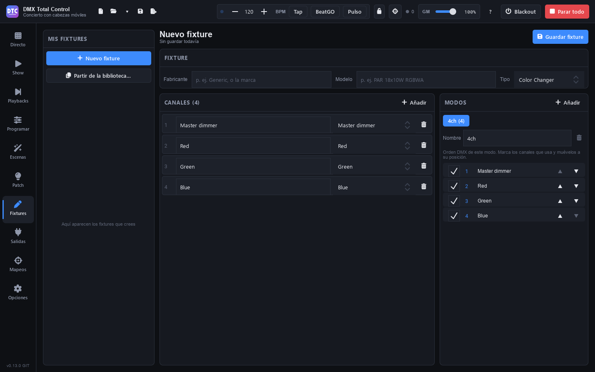

# Fixtures

Um ein Gerät zu patchen, braucht das Programm seine **Definition**: welche Kanäle es hat, was jeder tut und in welchen Modi es arbeitet. Diese Seite erklärt, woher die Definitionen kommen und wie Sie auf der Seite **Fixtures** (F6) eigene erstellen.

## Die Fixture-Bibliothek

Beim Hinzufügen von Fixtures im [Patch](patch.md#fixtures-hinzufügen) wählen Sie aus all diesen Definitionen:

- **Die integrierte Bibliothek**: Tausende Fixtures vieler Hersteller, im Format `.qxf`.
- **Die generischen Fixtures**: 16 Basis-Fixtures beim Hersteller **Generic** (LED-PAR RGB, RGBA, RGBW, RGBWA, RGBWA+UV und Weiß, LED-Bar mit 8 Segmenten, Spot-, Beam- und Wash-Moving-Heads, Scanner, Stroboskop, Blinder, Laser, Nebelmaschine und Hazer), dazu der **Generic Dimmer**.
- **Die Open Fixture Library**, wenn Sie sie herunterladen.
- **Die GDTF-Fixtures**, die Sie von GDTF-Share herunterladen oder importieren.
- **Ihre Fixtures**: die Sie auf dieser Seite erstellen oder importieren.

Unter [Optionen › Fixture-Bibliothek](opciones.md#fixture-bibliothek) sehen Sie, wie viele Definitionen verfügbar sind, und finden alles, um die Bibliothek zu erweitern.

> **Tipp:** Damit Programmieren, die FX und die Paletten die Funktion jedes Kanals erkennen (Dimmer, Rot, Pan, Gobo…), muss die Definition die Gruppe oder das Preset des Kanals enthalten. Die Definitionen der Bibliothek haben sie; wählen Sie bei Ihren eigenen das Preset jedes Kanals sorgfältig.

## Ein Fixture erstellen

Die Seite **Fixtures** ist der Fixture-Editor. Links listet **„Meine Fixtures“** die von Ihnen erstellten auf; rechts ist der Editor.

1. Drücken Sie **„Neues Fixture“** oder **„Vorlage aus der Bibliothek…“**, um mit einer Kopie eines vorhandenen Fixtures zu beginnen (es heißt gleich, mit „(Kopie)“).
2. Geben Sie unter **Fixture** den **Hersteller** (zum Beispiel `Generic` oder die Marke) und das **Modell** (`PAR 18x10W RGBWA`) ein und wählen Sie den **Typ**.
3. Fügen Sie die **Kanäle** hinzu (siehe unten).
4. Legen Sie die **Modi** an.
5. Drücken Sie **„Fixture speichern“**.

Das Fixture steht sofort im Patch zur Verfügung, unter seinem Hersteller. Oben sehen Sie seinen Status: „Ungespeicherte Änderungen“, „In Ihren Fixtures gespeichert“ oder „Noch nicht gespeichert“. Öffnen Sie ein anderes Fixture, während es ungespeicherte Änderungen gibt, wird gefragt, ob sie verworfen werden sollen („Weiter bearbeiten“ / „Änderungen verwerfen“).

### Kanäle

Unter **Kanäle** bietet die Taste **„Hinzufügen“** die häufigsten Kanäle an (Dimmer, Rot, Grün, Blau, Weiß, Amber, UV, Pan und Pan fein, Tilt und Tilt fein, Stroboskop, Farbrad, Goborad, Pan/Tilt-Geschwindigkeit) sowie **„Eigener Kanal“**.

Bei jedem Kanal:

- Sein **Name** und sein **Preset** (die Auswahlliste): Das Preset sagt, was der Kanal tut. Ein Wechsel des Presets ändert auch den Namen, außer Sie haben ihm einen eigenen gegeben.
- Der Papierkorb löscht ihn.

Ein Kanal **„Benutzerdefiniert“** hat außerdem:

- **Gruppe**: seine allgemeine Funktion (Intensität, Farbe, Gobo, Beam…).
- **Farbe**: bei einem Intensitätskanal, welche Farbe er ist (Rot, Grün…), oder „Keine“ für einen Dimmer.
- **Fein**: Er ist der Feinkanal (16 Bit) eines anderen.
- **„Bereiche (N)“**: was jeder Bereich von DMX-Werten tut, zum Beispiel 0-7 Geschlossen, 8-255 Stroboskop. Drücken Sie **„Bereich hinzufügen“** und geben Sie seine **Beschreibung** ein. Bereiche dürfen sich nicht überlappen. Sie sind die Presets, die Sie später unter Programmieren als Tasten sehen.

Neue Kanäle werden am Ende des gerade geöffneten Modus hinzugefügt.

### Modi

Unter **Modi** erstellt **„Hinzufügen“** einen Modus mit allen Kanälen. Jeder Tab ist ein Modus:

- **Name** des Modus und der Papierkorb zum Löschen (einer bleibt immer).
- Die Liste ist die **DMX-Reihenfolge** des Modus: Haken Sie die verwendeten Kanäle an und schieben Sie sie mit **▲ ▼** an ihre Position. Die Zahl links ist ihr DMX-Kanal innerhalb des Modus.

### Ein eigenes Fixture löschen

Öffnen Sie das Fixture unter „Meine Fixtures“ und drücken Sie **„Löschen“**. Es verschwindet beim nächsten Start aus der Bibliothek.

Ihre Fixtures werden als `.qxf`-Dateien im Ordner für Benutzer-Fixtures gespeichert (unter Optionen › „Ordner für Benutzer-Fixtures“ › „Ordner öffnen“).

## Open Fixture Library

Die Open Fixture Library ist eine offene Bibliothek mit Tausenden zusätzlicher Fixtures (MIT-Lizenz).

1. Öffnen Sie **Optionen** (F9).
2. Drücken Sie unter **Fixture-Bibliothek › Open Fixture Library** **„Herunterladen“**. Dafür ist Internet nötig.
3. Warten Sie, bis der Fortschrittsbalken fertig ist („Abbrechen“ stoppt ihn).

Am Ende wird angezeigt, wie viele Fixtures heruntergeladen wurden und wie viele neu sind. Danach sehen Sie an derselben Stelle, wie viele sie enthält und wann sie heruntergeladen wurde.

Zum Aktualisieren drücken Sie **„Aktualisieren“** (dieselbe Taste). Ist unter Optionen „Beim Start nach Updates suchen“ aktiviert, prüft das Programm einmal täglich auf GitHub, ob die Bibliothek seit Ihrem Download neue oder verbesserte Fixtures hat, weist Sie darauf hin und hebt die Taste hervor; „Nach Updates suchen“ prüft es sofort. Die Aktualisierung:

- fügt die neuen Fixtures hinzu (sie werden darunter aufgelistet);
- ändert die verbesserten, auch die von Ihnen gepatchten (passt ihr neuer Modus nicht an ihre Stelle, behalten sie die vorherige Version, bis Sie sie erneut patchen);
- behält die Fixtures, die es in der Bibliothek nicht mehr gibt, falls eine Show sie verwendet;
- lässt Ihre Fixtures und die der integrierten Bibliothek unberührt: Haben sie denselben Hersteller und dasselbe Modell, bleibt Ihres (bzw. das integrierte).

Ein Download, der sich nicht lesen lässt oder abbricht, ändert nichts.

## GDTF-Share

GDTF-Share ist die Website, auf der die Hersteller ihre Fixtures im GDTF-Format veröffentlichen. Das Programm nutzt sie mit Ihrem eigenen kostenlosen Konto.

Sie öffnen es mit **„GDTF-Share…“** unter **Optionen › Fixture-Bibliothek › GDTF-Fixtures** oder mit **„Auf GDTF-Share suchen…“** unter **Patch › Fixtures hinzufügen**. Unten öffnet **„gdtf-share.com“** die Website.

### Das Konto

Drücken Sie **„Anmelden“** und geben Sie Benutzername und Passwort von gdtf-share.com ein. Sie werden nur an gdtf-share.com gesendet. Haben Sie kein Konto, öffnet **„Kostenloses Konto erstellen“** die Website.

- Ohne **„Auf diesem Computer merken“** bleibt das Passwort nur im Speicher, bis Sie das Programm schließen: Es wird einmal pro Sitzung abgefragt.
- Mit dieser Option wird es verschlüsselt für Ihren Windows-Benutzer gespeichert: Wer dieses Windows-Konto verwendet, kann sich damit anmelden.
- Der Benutzername wird immer gemerkt.

Nach der Anmeldung zeigt die Taste Ihren Benutzernamen. Ihr Menü hat **„Abmelden“** (das gespeicherte Passwort bleibt für das nächste Mal) und, falls Sie es gespeichert haben, **„Gespeichertes Passwort vergessen“**, das es vom Computer löscht. Nach dem Abmelden mit gespeichertem Passwort öffnet die Taste **„Anmelden“** dieses Menü: **„Anmelden“** und **„Gespeichertes Passwort vergessen“**.

### Suchen

Die Liste von GDTF-Share wird auf dem Computer gespeichert und funktioniert ohne Internet. Ihr Datum steht oben („Liste vom…“). Sie wird erneut heruntergeladen, wenn sie älter als 20 Stunden ist, oder mit **„Liste aktualisieren“** (die Pfeile). Sendet GDTF-Share eine leere Liste, bleibt die vorherige.

- Geben Sie einen Teil des Herstellers oder des Namens ein, in beliebiger Reihenfolge.
- Die Filter: **„Alle“**, **„Von Herstellern“** (vom Hersteller selbst hochgeladen), **„In meiner Bibliothek“** und **„Aktualisierungen“** (die Ihrer Bibliothek mit einer neueren Revision).
- Links die Hersteller dessen, was Sie finden, und wie viele Fixtures jeder hat.
- Jedes Fixture zeigt, wer es hochgeladen hat (**Hersteller** oder **Benutzer**), seine Bewertung und ob es **In der Bibliothek** ist, eine **Neuere Revision** hat oder Sie es **Aus einer Datei** importiert haben.
- Es werden höchstens 400 angezeigt: Geben Sie mehr ein, um die Liste einzugrenzen.

### Herunterladen und importieren

Wählen Sie ein Fixture: Rechts stehen seine Details (wer es hochgeladen hat, die Revision, die GDTF-Version, die Größe und die Kanäle jedes Modus).

1. Für eine ältere Revision wählen Sie diese unter **Revisionen**.
2. Drücken Sie **„Herunterladen und importieren“**. Es wird heruntergeladen und wie mit „GDTF importieren“ konvertiert, mit einem Fortschrittsbalken. **„Abbrechen“** stoppt es. Laden Sie mehrere auf einmal herunter, werden die bereits angekommenen trotzdem importiert. Die ursprüngliche `.gdtf` wird aufbewahrt (siehe „Erneut konvertieren“ weiter unten).
3. Aus „Fixtures hinzufügen“ wählt **„Patchen“** das Fixture zum Patchen aus (auch eines, das schon in Ihrer Bibliothek war).

Ist das Fixture schon in Ihrer Bibliothek, heißt die Taste **„Auf diese Revision aktualisieren“** oder **„Erneut herunterladen“**. Haben Sie einen anderen Upload desselben Fixtures, weist ein Hinweis darauf hin: Der neue ersetzt ihn.

### Neuere Revisionen

Ein Fixture Ihrer Bibliothek hat eine neuere Revision, wenn GDTF-Share eine spätere Revision desselben Fixtures hat. Gezählt werden die Fixtures, die Sie von GDTF-Share heruntergeladen haben, und die aus einer Datei importierten, deren letzte Revision denselben Text hat wie genau eine Revision auf GDTF-Share.

- In GDTF-Share listet **„Aktualisierungen“** sie auf, und **„Alle aktualisieren“** lädt die neueste Revision jedes Fixtures herunter. Die damit gepatchten Fixtures erhalten sie.
- Unter **Optionen › Fixture-Bibliothek** zeigt die Zeile **„Neuere Revisionen auf GDTF-Share“**, wie viele es sind, und **„Aktualisieren“** öffnet GDTF-Share mit „Aktualisierungen“.
- Mit gespeichertem Passwort und eingeschaltetem **„Beim Start nach Updates suchen“** ([Optionen](opciones.md#updates)) meldet sich das Programm einmal täglich beim Start selbst an, lädt die Liste herunter und zeigt, ob die von GDTF-Share heruntergeladenen Fixtures neuere Revisionen haben. Jede Revision wird einmal gemeldet. Klappt es nicht, meldet es nichts.

### Erneut konvertieren

Das Programm bewahrt die `.gdtf` jedes Fixtures auf, das Sie von GDTF-Share herunterladen. **„Erneut konvertieren“** unter **Optionen › Fixture-Bibliothek › Von GDTF-Share heruntergeladene Fixtures** konvertiert sie mit Ihrer Programmversion neu, ohne sie herunterzuladen: So erhalten sie die Verbesserungen einer neuen Version. Die damit gepatchten Fixtures erhalten die Änderung. Die Zeile erscheint, wenn es von GDTF-Share heruntergeladene Fixtures gibt.

## GDTF importieren

GDTF ist das offene Format, das die Hersteller auf GDTF-Share veröffentlichen (mit kostenlosem Konto).

1. Laden Sie die `.gdtf`-Dateien Ihrer Geräte von gdtf-share.com herunter (oder die `.zip` des Sammel-Downloads). Wie Sie sie im Programm suchen und herunterladen, steht oben unter GDTF-Share.
2. Drücken Sie unter **Optionen › Fixture-Bibliothek › GDTF-Fixtures** **„GDTF importieren…“** und wählen Sie die Dateien, Ordner oder die `.zip`.
3. Sie werden im Hintergrund umgewandelt, mit einem Fortschrittsbalken. **„Stopp“** hält den Import an.

Am Ende wird angezeigt, wie viele umgewandelt wurden und, falls sich eines nicht lesen ließ, warum. Ist dasselbe Fixture bereits in einer anderen Bibliothek, wird das GDTF-Fixture als „(GDTF)“ hinzugefügt, und Sie können beide verwenden. Ein erneuter Import aktualisiert es.

Ein Modus mit mehreren *DMX-Breaks* (zwei DMX-Eingänge oder ein Teil in einem anderen Universum) wird zu mehreren Modi. Der erste Break behält den Namen des Modus. Jeder weitere ist ein eigener Modus, zum Beispiel „Standard (DMX break 2)“, nur mit seinen Kanälen, ab Adresse 1. Patchen Sie ihn als weiteres Fixture an einer eigenen Adresse: **„Fixtures hinzufügen“** erinnert Sie daran, wenn Sie den Modus wählen.

Virtuelle Kanäle (ohne DMX) werden ausgelassen. Sie sind nicht nötig: Ein RGB-Fixture ohne Dimmer leuchtet über seine Farben, und der Grand Master senkt sie.

Manche Kanäle ändern ihre Funktion je nach dem Wert eines anderen Kanals (zum Beispiel dreht die Prismenrotation nur, wenn das Prisma auf „Rotation“ steht). Bei ihnen werden die Funktionen ausgelassen, die nichts tun, und wo es mehrere gibt, trägt jeder Abschnitt ihre Namen zusammen (zum Beispiel „0 deg / Stop“).

Um diese Änderungen bei einem früher importierten Fixture zu sehen, importieren Sie seine `.gdtf` erneut. Bei den von GDTF-Share heruntergeladenen drücken Sie „Erneut konvertieren“.

## Fixture-Dateien importieren

**Optionen › Fixture-Dateien importieren › „Importieren…“** akzeptiert `.qxf`-Definitionen (das Format von QLC+), `.gdtf`-Dateien oder eine `.zip`, die sie enthält. Sie werden der Bibliothek hinzugefügt, und es wird angezeigt, wie viele neu sind.

### Meine QLC+-Fixtures importieren

Haben Sie auf diesem Computer Fixtures in QLC+ erstellt, kopiert **Optionen › „Meine QLC+-Fixtures importieren“ › „Importieren“** sie zu Ihren Fixtures.

## Formate, die sich nicht importieren lassen

Bibliotheken anderer Programme in geschlossenen oder verschlüsselten Formaten lassen sich nicht importieren. Die meisten Fixtures gibt es in der Open Fixture Library oder auf GDTF-Share, das Sie im Programm durchsuchen können; fehlende erstellen Sie auf dieser Seite.
