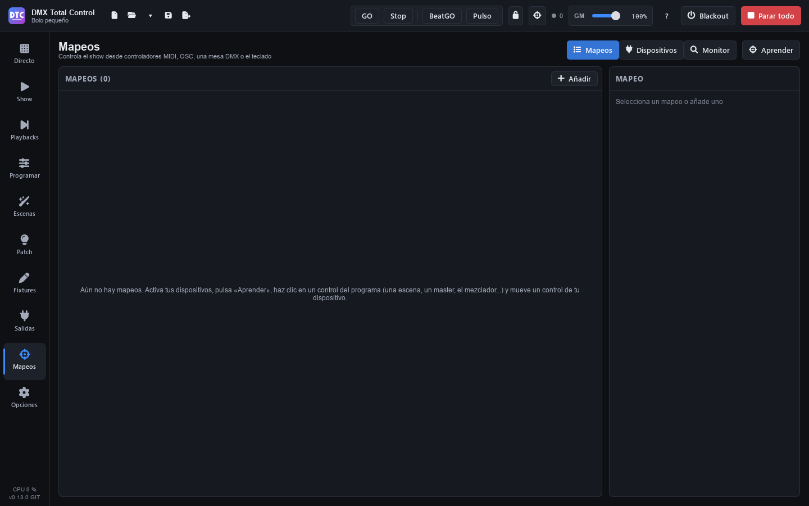

# Zuordnungen

**Zuordnungen** (F8) dient dazu, die Show von außen zu steuern: mit **MIDI**-Controllern, **OSC** aus einer anderen Anwendung, einem Pult über den **DMX-Eingang** oder der **Tastatur**. Eine Zuordnung verbindet ein Bedienelement Ihres Geräts (ein Pad, einen Fader, eine Taste…) mit etwas im Programm (einer Szene, einem Master, einem GO…). Zuordnungen werden mit der Show gespeichert.

Die Seite hat drei Tabs: **„Zuordnungen“**, **„Geräte“** und **„Monitor“**, und die Taste **„Lernen“**.

## Geräte

Unter **„Geräte“** erscheinen die Eingabegeräte, die das Programm findet, mit ihrem Typ (MIDI, OSC oder DMX), ihrem Namen und dem Universum, das sie verwenden. Zuerst kommen die Controller (MIDI und OSC) und die Geräte, die Sie schon verwenden, unter **„Controller und verwendete Geräte“**; danach, unter **„DMX-Eingänge: Interfaces und Netzwerk“**, die übrigen DMX-Eingänge, mit einer Zeile pro Netzwerkkarte.

1. Schließen Sie den Controller an und drücken Sie, falls er nicht erscheint, **„Erneut suchen“**.
2. Aktivieren Sie seinen **„Eingang“**.
3. Hat das Gerät einen Ausgang, aktivieren Sie **„Feedback (LEDs)“**, damit das Programm seine LEDs leuchten lässt oder seine Motorfader bewegt.

Eine Zuordnung für ein Gerät, das nicht angeschlossen ist, bleibt erhalten: Sie funktioniert wieder, sobald Sie es anschließen.

## Lernmodus

Am schnellsten erstellen Sie Zuordnungen mit dem **Lernmodus**:

1. Aktivieren Sie den Eingang Ihres Geräts unter „Geräte“.
2. Drücken Sie die **Zielscheibe** in der oberen Leiste (oder **„Lernen“** auf dieser Seite). Die zuordenbaren Bedienelemente werden **violett** markiert; eine Zahl in der Ecke zeigt, wie viele Zuordnungen sie schon haben.
3. Klicken Sie auf ein Bedienelement des Programms: eine Szene unter Live, einen Master, eine Taste des Mischers, ein Playback…
4. Die violette Leiste zeigt „Bewegen Sie einen Regler Ihres Geräts oder drücken Sie eine Taste für: …“. Bewegen Sie den Fader, drücken Sie das Pad oder drücken Sie eine Taste.
5. Das Programm meldet „Zugeordnet: …“. Machen Sie mit dem nächsten Bedienelement weiter.
6. Drücken Sie **„Fertig“** (oder Esc), um den Modus zu verlassen.

Im Lernmodus bedient **Umschalt+Klick** das Bedienelement weiterhin, statt es zuzuordnen. **Esc** bricht das ausstehende Bedienelement ab; ein weiteres Esc verlässt den Modus. Die Taste „Zuordnungen“ in der violetten Leiste bringt Sie auf diese Seite.

Ein Bedienelement des Programms kann mehrere Zuordnungen haben (zum Beispiel ein Pad eines Controllers und eine Taste).

> **Tipp:** Wenn Sie eine Taste einer Akai APC lernen, bringt die Zuordnung bereits die LEDs mit, die grün leuchten, solange das Element läuft.

### Was sich zuordnen lässt

- **Obere Leiste**: GO, Stop, BeatGO, Grand Master, Blackout und Alles stoppen.
- **Live**: jede Szene, ◀ ▶, Pause und Gruppen freigeben im Kopf, und in jeder Gruppe Freigeben, vorherige, nächste und Master.
- **Mischer**: in jedem Kanalzug der Dimmer, der Farbton, die Sättigung, das Stroboskop und sein Tempo, sowie die Tasten Voll, Blackout, Flash, Flash exkl. und Voll exkl.
- **Programmieren**: die Paletten.
- **Playbacks**: die Seitennamen, ◀ ▶ der Seiten, „Alle freigeben“, „Zurück“, das große GO, und bei jedem Playback sein ×, sein Name (auswählen), seine drei Tasten und sein Fader.
- **SHOW**: die Tasten und Fader (der ganze Fader, mit all seinen Elementen) und ◀ ▶ der Playback-Bereiche.

## Die Liste der Zuordnungen

Unter **„Zuordnungen“** zeigt jede Zeile das Bedienelement des Geräts, was es steuert, und sein Verhalten. Ein violetter Punkt steht für eine Taste, ein blauer für einen Fader. Klicken Sie auf eine Zuordnung, um sie rechts zu bearbeiten, oder drücken Sie **„Hinzufügen“**, um eine leere zu erstellen.

## Eine Zuordnung bearbeiten

### Bedienelement

- **Der Typ**: **MIDI**, **OSC**, **„DMX-Eingang“** oder **„Tastatur“**.
- **Gerät**: ein bestimmtes oder **„Beliebiges Gerät“**.
- **MIDI**: **CC** oder **Note**, ihre Nummer (0–127) und der MIDI-**Kanal** (1–16).
- **OSC**: der Pfad, zum Beispiel `/scene/1`.
- **DMX-Eingang**: der **Kanal** (1–512).
- **Tastatur**: die Taste, zum Beispiel `Q` oder `F9`.
- **„Bedienelement lernen“**: Drücken Sie darauf und bewegen Sie das Bedienelement des Geräts, um alles oben Genannte auszufüllen.

### Steuert

Was die Zuordnung tut. Die **Tasten**:

| Ziel | Was es tut |
|---|---|
| Szene starten | Die gewählte Szene, in ihrer Gruppe. |
| Szene N einer Gruppe | Die Szene, die an dieser Stelle der Gruppe steht (**Szenennummer**). |
| Gruppe freigeben / Nächste Szene einer Gruppe / Vorherige Szene einer Gruppe | In einer Gruppe oder in „Alle Gruppen“. |
| Blackout, Alles stoppen, Alles pausieren, Tap-Tempo, BeatGO, GO, Stop | Wie ihre Tasten (GO und Stop wählen den Modus, wie in der oberen Leiste: Eine der beiden ist immer an). |
| Palette | Die Palette auf ihren eigenen Fixtures oder auf einer Fixture-Gruppe. |
| Mischer: Voll, Blackout, Flash, Flash exklusiv, Voll exklusiv, Stroboskop | Im gewählten Kanalzug des Mischers. |
| Playback: GO, Zurück, Pause / Zurück, Flash, Freigeben, Auswählen | Auf einem Playback. |
| Playback: zu einem Cue | Springt zum angegebenen **Cue** (1 ist der erste in der Liste). |
| GO des ausgewählten Playbacks / Zurück des ausgewählten Playbacks | Wie das große GO und „Zurück“ unter Playbacks. |
| Playback-Seite N / nächste / vorherige | Wechselt die Playback-Seite. |
| Alle Playbacks freigeben | Wie „Alle freigeben“. |

Die **Fader**:

| Ziel | Was er bewegt |
|---|---|
| Grand Master | Den GM. |
| Master einer Gruppe | Den Master dieser Gruppe. |
| Live-Dimmer einer Szene / Live-Tempo einer Szene | Ihre Live-Schieberegler. |
| BPM | Das Tempo. |
| Mischer: Dimmer, Farbton, Sättigung, Stroboskop-Tempo | Im gewählten Kanalzug. |
| Fader der SHOW | Einen ganzen SHOW-Fader. |
| Playback: Fader | Den Fader eines Playbacks. |

Für die Playbacks wählen Sie die **Seite** („Aktuelle Seite (folgt)“, die der angezeigten Seite folgt, oder eine feste) und die Nummer des **Playbacks**. Mit **„Oder eine Cuelist oder Szene, egal wo“** wirkt die Zuordnung auf diese Cuelist oder Szene auf jedem Playback, auf dem sie liegt. Bei „zu einem Cue“ sehen Sie, zu welchem Cue es gerade führt („Jetzt: Cue 3 von Song 1“).

### Verhalten

Bei den **Tasten**:

- **„Umschalten: jeder Druck an / aus“**: Jeder Druck schaltet ein oder aus. Bei einer Szene heißt dieser Modus **„Drücken: je nach GO / Stop“** und startet oder stoppt sie je nach GO und Stop in der oberen Leiste.
- **„Flash: solange gedrückt“**.
- **„Nur an“** / **„Nur aus“**.

Die Playback-Tasten wirken beim Drücken, außer Flash, und haben diese Option nicht.

Bei den **Fadern**:

- **„Absolut: folgt dem Fader“**.
- **„Inkrementell: jeder Druck ein Schritt“** (für Tasten, die hoch- oder herunterzählen).
- **„Relativ: Endlos-Encoder“** und **„Relativ: Encoder, 1 auf und 127 ab“** (Endlos-Encoder).
- **„Von“** … **„bis“**: der Bereich, von 0 bis 100 %. **„Invertieren“** kehrt ihn um.
- **„Schritt %“** und **„Schleife“** (inkrementell und relativ).
- **„Fader abholen (ohne Motor)“** (absolut): Der Fader des Controllers steuert den Pegel erst, nachdem er ihn erreicht hat, ohne Sprünge.

### Feedback

Bei MIDI oder OSC sorgt **„Feedback“** dafür, dass das Programm **die Taste des Geräts beleuchtet** oder **seinen Motorfader bewegt**. Gesendet wird nur, was sich ändert.

Für die LEDs der MIDI-Tasten:

1. Wählen Sie unter **„LEDs von“** **„Beliebiger Controller (Zahlen)“** oder Ihren Controller: **Akai APC mini**, **Akai APC mini mk2** oder **Akai APC40 mkII**.
2. Wählen Sie für **„An“**, **„Aus“** und **„Pausiert“** die Farbe in den Farbfeldern (bei einer APC) oder geben Sie bei jedem anderen Controller den Wert ein (0–127).
3. Wählen Sie bei den RGB-Pads der APC mini mk2 auch, wie sie leuchten: **„Gedimmt“**, **„Voll“**, **„Pulsierend“** oder **„Blinkend“** (bei der APC40 mkII **„Dauerhaft“**). Ohne Auswahl leuchtet „An“ **„Voll“** und „Aus“ **„Gedimmt“**.

Die LEDs des Controllers gehen aus, wenn Sie das Programm schließen, eine Zuordnung löschen oder einem anderen Bedienelement zuweisen, eine andere Show öffnen oder das Gerät oder sein Feedback deaktivieren.

### Duplizieren und löschen

**„Duplizieren“** erstellt eine Kopie der Zuordnung (nützlich für ein anderes Gerät oder einen anderen Kanal), und **„Löschen“** entfernt sie.

## Tastatur

Tastaturzuordnungen funktionieren auf jeder Seite und haben Vorrang vor Tastenkürzeln des Programms, die dieselbe Taste verwenden. Sie lösen nicht aus, während Sie in ein Textfeld schreiben (unter Programmieren, solange die Befehlszeile die Tastatur hat), und auch nicht bei gedrückter Strg- oder Alt-Taste. Die SHOW-Tasten haben außerdem ihre eigene Tastaturtaste, die nur auf der Seite Show funktioniert (siehe [Show](show.md#optionen-einer-taste)).

## Vorlagen für Akai APC

**„Alles zuordnen“** weist einen ganzen Controller auf einmal zu. Sie finden es bei jedem MIDI-Gerät im Tab „Geräte“:

1. Drücken Sie **„Alles zuordnen“** bei Ihrem Controller.
2. Wählen Sie die Vorlage:
   - **„Akai APC mini → Gruppen“** / **„Akai APC mini mk2 → Gruppen“**
   - **„Akai APC mini → Playbacks“** / **„Akai APC mini mk2 → Playbacks“**
   - **„Akai APC40 mkII → Playbacks“**
3. Lesen Sie, was jedes Bedienelement tut, und drücken Sie **„Zuordnen“**. Die bisherigen Zuordnungen dieses Geräts werden ersetzt; war sein Eingang aus, wird er aktiviert.

**→ Gruppen** (APC mini und mk2): Jede Pad-Spalte startet die Szenen einer Gruppe (grün: läuft; gelb: bereit; aus: keine Szene). Die Fader sind die Master der Gruppen und der letzte der Grand Master. Die Tasten unter den Pads geben die Gruppen frei; die rechten sind Blackout, Alles stoppen, Pause, Tap, BeatGO, vorherige, nächste und Flash.

**→ Playbacks** (APC mini und mk2): Jede Spalte ist ein Playback 1-8 der aktuellen Playback-Seite: sein Fader (holt den Pegel ab) und, von unten, GO, Pause/Zurück, Flash und seine ersten 5 Cues (Cue 1 oben). Die Taste unter den Pads gibt es frei. Der letzte Fader ist der Grand Master; die rechten Tasten sind vorherige und nächste Seite, GO und Zurück des ausgewählten Playbacks, Blackout, Tap, BeatGO und Alles stoppen.

**→ Playbacks** (APC40 mkII): Jede Spur ist ein Playback 1-8 der aktuellen Seite: sein Fader, GO auf der Track-Taste, Pause/Zurück auf S, Flash auf Record Arm, Auswählen und Freigeben, und seine ersten 5 Cues auf den Clips. Die Scene-Tasten wechseln zu den Seiten 1-5, die Bank-Tasten ändern Seite und Gruppe, und Play und Record sind GO und Zurück des ausgewählten Playbacks. Die Device-Regler sind die Fader der Playbacks 9-16, die Track-Regler die Master der ersten Gruppen.

> **Tipp:** Nach „Alles zuordnen“ erscheint jedes Bedienelement als normale Zuordnung in der Liste: Sie können jede einzelne ändern oder löschen, ohne die anderen zu berühren.

## Monitor

**„Monitor“** zeigt die **ein- und ausgehenden Nachrichten**: Uhrzeit, **IN** oder **OUT**, das Gerät (oder „Tastatur“), die Nachricht und ihren Wert. Bewegen Sie ein Bedienelement eines aktivierten Geräts, um zu sehen, was es sendet. **„Leeren“** leert die Liste.

Die grüne Kontrollleuchte der Zielscheibe in der oberen Leiste blinkt bei jeder eingehenden Nachricht.

## Alt+Klick

Außerhalb des Lernmodus bringt **Alt+Klick** auf ein zuordenbares Bedienelement dieses in die SHOW: siehe [Show](show.md#jedes-bedienelement-in-die-show-holen).
