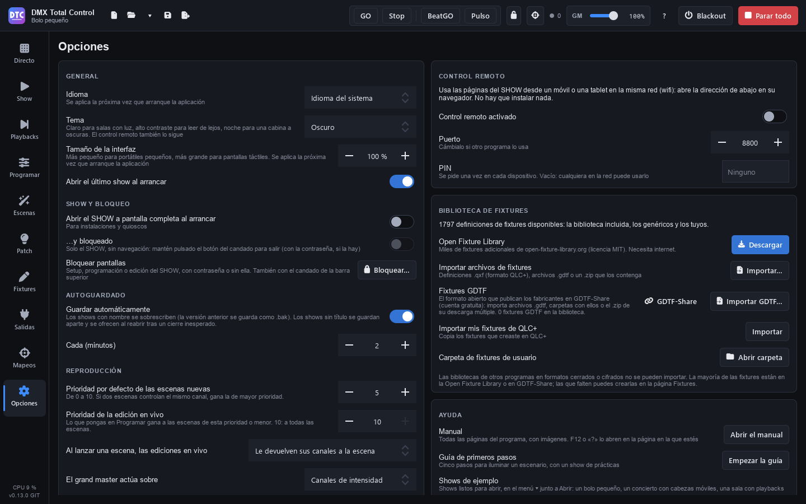

# Optionen

**Optionen** (F9) bündelt die Einstellungen des Programms. Links stehen die allgemeinen Einstellungen, der Start, die Sperre, das automatische Speichern, die Wiedergabe und das Audio; rechts die Fernsteuerung, die Fixture-Bibliothek, die Updates, die Hilfe und „Über“.

Die Einstellungen dieser Seite gehören zum Computer, nicht zur Show: Sie gelten für alle Shows, die Sie öffnen.

## Allgemein

- **Sprache**: „Systemsprache“, Español, English, Português, Français, Italiano oder Deutsch. Wird beim nächsten Start des Programms übernommen.
- **Design**: **Dunkel**, **Hell**, **Hoher Kontrast** oder **Nacht (gedimmt)**. Ändert sich sofort. Hell für helle Räume; Hoher Kontrast zum Lesen aus der Ferne; Nacht, sehr dunkel und in Rot, für einen dunklen Regieplatz, ohne geblendet zu werden. Die [Fernsteuerung](remoto.md) folgt demselben Design.
- **Größe der Oberfläche**: von 80 % bis 150 %, kleiner für kleine Laptops und größer für Touchscreens. Wird beim nächsten Start des Programms übernommen.
- **Letzte Show beim Start öffnen**.

> **Tipp:** Das Design Hell eignet sich besser für Proben bei Tag oder im Freien; Hoher Kontrast, wenn viel Licht um den Bildschirm herum ist.

## SHOW und Sperre

- **SHOW beim Start im Vollbild öffnen**: für Installationen und Kiosks. Das Programm startet auf der Seite Show im Vollbild.
- **…und gesperrt**: Es startet außerdem gesperrt: nur die SHOW, ohne Navigation. Zum Verlassen halten Sie die Sperrtaste gedrückt (mit dem Passwort, falls es eines gibt). Siehe [Show](show.md#vollbild-und-sperre).
- **Bildschirme sperren**: **„Sperren…“** / **„Entsperren…“**. Das ist dasselbe wie das Schloss in der oberen Leiste.

### Bildschirme sperren

Die Sperre verhindert, dass sich während der Show etwas versehentlich ändert. Live und die SHOW funktionieren weiter, und die Playbacks laufen weiter.

1. Drücken Sie das **Schloss** in der oberen Leiste (oder hier „Sperren…“).
2. Wählen Sie, was gesperrt werden soll:
   - **Setup**: Patch, Fixtures, Ausgänge, Zuordnungen und Optionen. Außerdem lässt sich keine andere Show öffnen oder anlegen.
   - **Programmierung**: Programmieren und Szenen. Unter Playbacks lässt sich nicht aufnehmen, aktualisieren oder zuweisen.
   - **SHOW-Bearbeitung**: Die SHOW-Seiten werden bedient, nicht geändert.
3. Wenn Sie möchten, geben Sie ein **Passwort** ein (es ist optional).
4. Drücken Sie **„Sperren“**.

Gesperrte Seiten tragen in der Seitenleiste ein Schloss. Öffnen Sie eine, wird das Passwort abgefragt (falls es eines gibt), und alles wird entsperrt. Zum Entsperren drücken Sie das Schloss in der oberen Leiste. **„Passwort entfernen“** finden Sie im selben Fenster, beim Sperren.

## Automatisches Speichern

- **Wiederherstellungskopie speichern**, **Intervall (Minuten)**: von 1 bis 60.

Das automatische Speichern verändert die Show-Datei nicht: Alle paar Minuten speichert es bei ungespeicherten Änderungen eine separate Wiederherstellungskopie, und der Punkt **●** bleibt. Nur **Speichern** schreibt die Datei; die Version vor dem ersten Speichern jeder Sitzung bleibt als `.bak` erhalten. Die Kopie wird gelöscht, wenn Sie speichern, wenn Sie schließen (mit oder ohne Speichern) und wenn Sie eine andere Show öffnen. Wird das Programm unerwartet beendet, bietet es beim nächsten Start die Kopie an („Ungespeicherte Show wiederherstellen?“), mit dem Namen der Show und der Uhrzeit der Kopie: Beim Wiederherstellen öffnet sich diese Show mit ihren Änderungen, noch ungespeichert; speichern Sie sie, um sie zu behalten. Währenddessen ist die letzte Show schon so geöffnet, wie sie gespeichert war (mit „Letzte Show beim Start öffnen“): „Verwerfen“ lässt sie so. In der oberen Leiste sehen Sie die Uhrzeit der letzten Kopie („Wiederherstellungskopie …“); schlägt sie fehl (volle Festplatte), erscheint ein Hinweis in Rot.

## Wiedergabe

- **Standardpriorität neuer Szenen**: von 0 bis 10. Steuern zwei Szenen denselben Kanal, gewinnt die mit der höheren Priorität (siehe [Prioritäten](directo.md#prioritäten)).
- **Priorität der Live-Änderungen**: Was Sie unter Programmieren einstellen, hat Vorrang vor den Szenen dieser oder niedrigerer Priorität. Mit 10 vor allen Szenen.
- **Beim Start einer Szene: Live-Änderungen**:
  - **„Geben der Szene ihre Kanäle zurück“**: Die Kanäle, die die Szene berührt, sind nicht mehr im Programmer.
  - **„Bleiben immer“**.
  - **„Werden alle zurückgesetzt“**: Der Programmer wird geleert.
- **Grand Master wirkt auf**: **„Intensitätskanäle“** (das Licht: die Dimmer und die Farben der Fixtures ohne Dimmer) oder **„Alle Kanäle“**.

## Audio

- **Audioeingang**: das Mikrofon oder der Line-Eingang, den **Puls** und die Audio-Matrizen abhören. **„Systemstandard“** verwendet den des Betriebssystems. Puls wechselt den Eingang sofort; eine Audio-Matrix, die schon läuft, bei ihrem nächsten Start. Ein gewählter Eingang, der gerade nicht verbunden ist, erscheint als „(nicht verbunden)“, und solange wird der Standardeingang verwendet.

## Letzte Shows

Die Liste der zuletzt geöffneten Shows (auch im Pfeil **▾** in der oberen Leiste). **„Liste leeren“** löscht sie.

## Fernsteuerung

Um die SHOW-Seiten von einem Smartphone oder Tablet im selben WLAN zu bedienen, ohne etwas zu installieren:

- **Fernsteuerung an**.
- **Port**: Ändern Sie ihn, wenn ein anderes Programm ihn nutzt (standardmäßig 8800). Ist er belegt, erscheint ein Hinweis in Rot.
- **PIN**: wird auf jedem Gerät einmal abgefragt. Leer: Jeder im Netzwerk kann die Fernsteuerung nutzen.
- **Name im Netzwerk**: Das Smartphone öffnet die Fernsteuerung mit `http://dmxtotalcontrol.local:8800/`, auch wenn sich die Adresse des Computers ändert (iPhone, iPad und neuere Android-Smartphones). Nutzt ein anderer Computer den Namen schon, nimmt dieser `dmxtotalcontrol-2`. Leer: kein Name. Ist der Netzwerkport 5353 nicht verfügbar oder nutzen andere Computer den Namen und `-2` bis `-9`, erscheint ein Hinweis in Rot.
- Die **Adressen**, die Sie im Browser des Smartphones öffnen müssen, mit einer Taste zum Kopieren. Vor jeder steht der Name ihres Netzwerks, wie Windows es nennt („WLAN“, „Ethernet 2“). Zuerst kommt die Adresse **„Über den Namen“**, dann das WLAN, dann das Kabel (Ethernet) und zuletzt virtuelle Adapter und VPNs. Die Liste aktualisiert sich von selbst wenige Sekunden, nachdem ein Netzwerk verbunden oder getrennt wurde. Ist der Computer in keinem Netzwerk, erscheint stattdessen ein Hinweis.
- Ein **QR-Code** der umrandeten Adresse (anfangs die erste numerische), um sie mit der Kamera des Smartphones zu öffnen. Klicken Sie auf eine andere Adresse, um sie zu wechseln. Gibt es eine PIN, steckt sie im Code und das Smartphone kommt ohne Abfrage hinein. **„Größer“** zeigt ihn groß.
- Wie viele Geräte verbunden sind.

Siehe [Fernsteuerung](remoto.md).

## Fixture-Bibliothek

Zeigt, wie viele Fixture-Definitionen verfügbar sind (die integrierte Bibliothek, die generischen Fixtures und Ihre eigenen), und erlaubt, die Bibliothek zu erweitern:

- **Open Fixture Library**: **„Herunterladen“** (braucht Internet). Ist sie heruntergeladen, sehen Sie, wie viele Fixtures sie enthält und wann sie heruntergeladen wurde, und die Taste wird zu **„Aktualisieren“**: Sie holt die neuen und verbesserten Fixtures und behält Ihre Fixtures sowie die, die es in der Bibliothek nicht mehr gibt. Gibt es Neues, wird darauf hingewiesen und die Taste hervorgehoben (siehe [Fixtures](fixtures.md#open-fixture-library)).
- **Fixture-Dateien importieren**: **„Importieren…“** von `.qxf`-Definitionen (dem Format von QLC+), `.gdtf`-Dateien oder einer `.zip` damit.
- **GDTF-Fixtures**: **„GDTF-Share…“** sucht Fixtures auf GDTF-Share, lädt sie herunter und importiert sie (siehe [Fixtures](fixtures.md#gdtf-share)); **„GDTF importieren…“** importiert Dateien, Ordner oder die `.zip` des Sammel-Downloads. Zeigt, wie viele GDTF-Fixtures in der Bibliothek sind.
- **Von GDTF-Share heruntergeladene Fixtures**: erscheint, wenn es welche gibt. **„Erneut konvertieren“** konvertiert sie mit dieser Programmversion neu, aus der aufbewahrten `.gdtf` (siehe [Fixtures](fixtures.md#erneut-konvertieren)).
- **Neuere Revisionen auf GDTF-Share**: erscheint, wenn GDTF-Fixtures der Bibliothek eine neuere Revision auf GDTF-Share haben. **„Aktualisieren“** zeigt sie in GDTF-Share, wo **„Alle aktualisieren“** die neueste jedes Fixtures herunterlädt und konvertiert: Die damit gepatchten Fixtures erhalten sie. Gezählt werden die Fixtures, die Sie von GDTF-Share heruntergeladen haben. Eine von Hand importierte Datei zählt, wenn der Text ihrer letzten Revision genau einer Revision auf GDTF-Share entspricht. Grundlage ist die letzte GDTF-Share-Liste, die das Programm hat (siehe [Fixtures](fixtures.md#neuere-revisionen)).
- **Meine QLC+-Fixtures importieren**: **„Importieren“** kopiert die Fixtures, die Sie in QLC+ erstellt haben.
- **Ordner für Benutzer-Fixtures**: **„Ordner öffnen“**.

All das wird unter [Fixtures](fixtures.md) erklärt.

## Updates

- **Beim Start nach Updates suchen**: einmal täglich, auf GitHub: das Programm und, falls Sie die Open Fixture Library heruntergeladen haben, ob sie neue Fixtures hat (ein Hinweis zeigt es an). Falls Sie Ihr GDTF-Share-Konto gespeichert haben, meldet es sich auch bei GDTF-Share an und zeigt, ob die dort heruntergeladenen Fixtures neuere Revisionen haben (jede Revision wird einmal gemeldet). Ohne Ihre Zustimmung wird nichts heruntergeladen oder installiert. Ohne Internet stört es nicht.
- **Testversionen einbeziehen**: Neuerungen früher, weniger getestet.

Darunter sehen Sie den Status („Sie haben die neueste Version“, „Version … ist erschienen“) und die Tasten:

- **„Nach Updates suchen“**: prüft jetzt (auch die Open Fixture Library).
- **„Neuigkeiten“**: was in dieser Version neu ist.
- **„Herunterladen und installieren“**: lädt den Installer herunter und prüft seinen SHA-256-Hash, bevor er gespeichert wird. Veröffentlicht eine Version keinen Hash, kann sie nur über ihre Seite heruntergeladen werden („Auf GitHub öffnen“).
- **„Jetzt installieren“**: Das Programm wird beendet (vorher fragt es, ob die Show gespeichert werden soll), die neue Version wird installiert, und das Programm startet neu.
- **„Beim Beenden“** / **„Nicht beim Beenden“**: die Version installieren, wenn Sie das Programm schließen.
- **„Auf GitHub öffnen“**: die Seite der Version.

Gibt es eine neue Version, erscheint auch ein Hinweis über den Seiten, mit denselben Tasten. **„Später“** blendet den Hinweis für diese Version aus; sie bleibt hier verfügbar.

## Hilfe

- **Handbuch**: **„Handbuch öffnen“** öffnet dieses Handbuch bei seinem Inhalt. F12 oder die Taste **„?“** in der oberen Leiste öffnen es auf der Seite, auf der Sie gerade sind. Es erscheint in der Sprache des Programms (Spanisch, Englisch, Portugiesisch, Französisch, Italienisch oder Deutsch); die Screenshots stammen aus der spanischen Version.
- **Einstiegsanleitung**: **„Anleitung starten“** öffnet die Anleitung erneut (siehe [Erste Schritte](primeros-pasos.md#die-anleitung)).
- **Beispielshows**: Sie finden sie im Pfeil **▾** neben „Öffnen“ in der oberen Leiste, unter „Beispiele“ (siehe [den Inhalt](index.md#die-anleitung-und-die-beispielshows)).

## Über

Die Version des Programms, seine Lizenz (freie Software, Apache 2.0) und die Credits.
