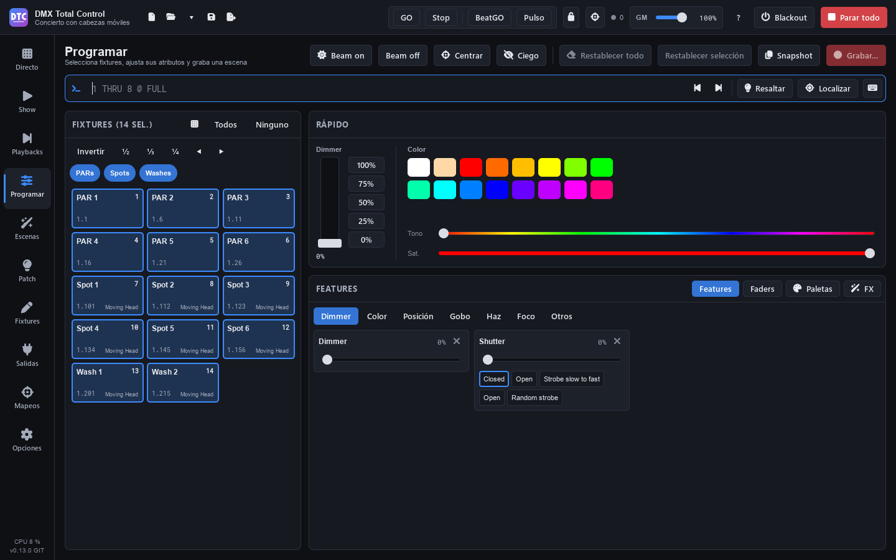

# Programmieren

**Programmieren** (F3) ist der Programmer: Sie wählen Fixtures aus, geben ihnen Dimmer, Farbe, Position, Gobos oder jeden anderen Kanal, setzen FX und Paletten ein und nehmen das Ergebnis als Szene, Cuelist oder Cue auf.

Was Sie in den Programmer geben, **wird sofort ausgegeben und hat Vorrang vor allem** (Szenen, Gruppen und Playbacks), bis Sie ihn leeren. Der Untertitel der Seite erinnert Sie daran: „N Kanäle im Programmer — sie haben Vorrang vor den Playbacks, bis Sie den Programmer leeren“.

Die Seite enthält von oben nach unten: den Kopf mit seinen Tasten, die [Befehlszeile](programar.md#befehlszeile), links den Bereich **Fixtures** und rechts den Bereich **Schnell** und den Bereich **Features / Fader / Paletten / FX**.

## Der Kopf

- **„Beam on“**: Dimmer voll und Shutter offen in der Auswahl.
- **„Beam off“**: Dimmer auf null in der Auswahl.
- **„Zentrieren“**: Pan und Tilt in die Mitte.
- **„Blind“**: siehe [Blind](programar.md#blind).
- **„Alles zurücksetzen“**: gibt alle Live-Änderungen frei (Werte und FX). Die Szenen sind wieder zu sehen.
- **„Auswahl zurücksetzen“**: gibt nur die Änderungen der ausgewählten Fixtures frei.
- **„Parken“**: parkt die Programmer-Werte der ausgewählten Fixtures am Ausgang (siehe [Parken](programar.md#parken)).
- **„Snapshot“** und **„Aufnehmen…“**: siehe [Aufnehmen](programar.md#aufnehmen).

In einem schmalen Fenster zeigen einige Tasten nur ihr Symbol; fahren Sie mit der Maus darüber, um ihren Namen zu sehen.

## Fixtures auswählen

Der Bereich **„Fixtures (N ausgew.)“** zeigt eine Kachel pro Fixture mit Name, Nummer (für die Befehlszeile), Adresse (Universum.Adresse) und Typ.

- **Klick** auf eine Kachel: wählt nur diese aus.
- **Strg+Klick**: fügt sie der Auswahl hinzu oder entfernt sie. **Umschalt+Klick**: wählt alle Kacheln von der zuletzt angeklickten bis zu dieser aus (in dieser Richtung, die die Reihenfolge der Auswahl ist); **Strg+Umschalt+Klick** fügt sie hinzu.
- **„Alle“** und **„Keine“**, im Kopf des Bereichs.
- **„Invertieren“**: wählt die aus, die nicht ausgewählt waren.
- **½**, **⅓**, **¼**: behält jedes zweite, dritte oder vierte.
- **◀ ▶**: verschiebt die Auswahl nach links oder rechts.

**Die Reihenfolge zählt**: Die Reihenfolge, in der Sie die Fixtures auswählen, ist die Reihenfolge, der Fächer, FX und Colour FX folgen. Im 2D-Plan zeigt jedes ausgewählte Fixture seine Nummer in dieser Reihenfolge.

> **Tipp:** Sie können auch per Eingabe auswählen: `1 THRU 8` und Eingabe. Siehe [die Befehlszeile](programar.md#befehlszeile).

### Fixture-Gruppen und Auswahlen

Über den Kacheln erscheinen die [Fixture-Gruppen](patch.md#fixture-gruppen) aus dem Patch als runde Beschriftungen:

- **Klick** auf eine Gruppe: wählt ihre Fixtures aus. **Strg+Klick** oder **Umschalt+Klick**: fügt sie hinzu.
- Die Beschriftung leuchtet auf, wenn alle ihre Fixtures ausgewählt sind. Fahren Sie mit der Maus darüber, um ihre Nummer für die Befehlszeile zu sehen („GROUP 2 in der Befehlszeile“).
- Die **Auswahlen** einer Gruppe (geordnete Teile, mit eigenem Symbol) wählen ihre Fixtures in ihrer Reihenfolge aus.
- Bei vielen Gruppen sind drei Reihen von Beschriftungen zu sehen, die mit dem Mausrad scrollen: **„Alle Gruppen (N)“** öffnet sie (bis zur halben Höhe des Felds), **„Weniger“** klappt sie wieder ein. So bleiben die Kacheln der Fixtures im Blick.

### 2D-Plan

Die Rastertaste im Kopf des Bereichs („2D-Plan“) ersetzt die Kacheln durch den Bühnenplan:

- **Klick** auf ein Fixture wählt es aus; **Strg+Klick** oder **Umschalt+Klick** fügt es hinzu oder entfernt es.
- **Ziehen** Sie über die leere Bühne, um mit einem Rechteck auszuwählen. Ein Klick ins Leere hebt die Auswahl auf.
- Das **Mausrad** zoomt; Ziehen mit der **rechten** oder mittleren Maustaste verschiebt die Ansicht, und ein Doppelklick mit diesen Tasten zentriert sie wieder.

Unter Programmieren ist der Plan immer **live**: Jedes Fixture zeigt seine Farbe, seinen Dimmer, sein Stroboskop (es blinkt) und sein Gobo, und jeder Pixel der Bars und Matrizen ist zu sehen. Die Fixtures werden im [2D-Plan des Patch](patch.md#2d-plan) platziert. Geschützte Spezialeffekte tragen ihr Schild und geparkte Fixtures ihr Schloss, wie im Patch.

## Der Bereich Schnell

### Dimmer

Der Fader **Dimmer** und die Tasten **100%**, **75%**, **50%**, **25%** und **0%** geben der Auswahl Intensität. Bei einem Fixture mit mehreren Dimmern geben sie seinem Hauptdimmer und den Dimmern, die Licht sind (jeder Kopf, jede Lampe, jedes Pixel, der Hintergrund), Intensität, nicht dem Blitz eines Stroboskops, einem Effekt, dem Nebel einer Nebelmaschine mit LEDs oder einer Lampensteuerung.

### Farbe

Klicken Sie auf eines der 16 Farbfelder oder bewegen Sie **Farbton** und **Sätt.** Die Farbe wird in den RGB-Kanälen jedes Fixtures gemischt (der Weißanteil geht auf den Weißkanal, falls das Fixture einen hat) oder in den CMY-Kanälen. Für Farbräder verwenden Sie deren Presets unter [Features](programar.md#features) › Farbe.

> **Tipp:** Für einen Dimmer-Fächer verwenden Sie die Befehlszeile: `@ 0 THRU 100` geht von 0 % beim ersten bis 100 % beim letzten. Der Fächer für die Position ist unter [Features › Position](programar.md#position-xy-feld-und-fächer).

## Features

**Features** zeigt die Kanäle der Auswahl in Tabs: **Dimmer**, **Farbe**, **Position**, **Gobo**, **Beam**, **Fokus** und **Sonstige**. Tabs ohne Kanäle in der Auswahl sind deaktiviert.

Jeder Kanal ist eine Karte mit Name, Wert in %, einem Schieberegler und seinen **Presets** als Tasten (mit ihrer Farbe oder dem Bild ihres Gobos, wenn das Profil sie mitbringt). Klicken Sie auf ein Preset, um es zu setzen. Die Karte wird orange markiert, wenn der Kanal im Programmer ist; ihr **×** gibt ihn frei.

Die Kanäle werden **nach Funktion** gruppiert, nicht nach Name: „Red“, „R“ oder „Rot“ verschiedener Fixtures sind derselbe Regler, ebenso Dimmer, Pan/Tilt, CMY, Farbrad, Gobo, Shutter, Iris, Zoom, Fokus, Prisma… Jeder Kopf einer Bar behält seine eigenen Kanäle. Bei einem Fixture mit mehreren Dimmern ist sein Hauptdimmer der, der zum Dimmer der anderen Fixtures gehört.

### Farbe: Farbwähler und Favoriten

Im Tab **Farbe** gibt das Feld links den Farbton (von Seite zu Seite) und die Sättigung (von oben nach unten) vor. Ziehen Sie das Fadenkreuz, um es zu platzieren, oder ziehen Sie an einer anderen Stelle des Felds für eine Feineinstellung.

Darunter **„Favoriten“**: Das **+** speichert die aktuelle Farbe; ein Klick auf einen Favoriten setzt ihn; ein Rechtsklick entfernt ihn. Die Favoriten gelten für alle Shows.

### Position: XY-Feld und Fächer

Der Tab **Position** bewegt nur **Pan** und **Tilt** (mit ihren Feinkanälen, in 16 Bit). Die Endlosrotation von Pan oder Tilt und ihre Geschwindigkeit finden Sie unter **Sonstige**.

- Ziehen Sie das **Fadenkreuz**, um es zu platzieren, oder ziehen Sie an einer anderen Stelle des Felds für eine langsame, feine Bewegung.
- Der Balken links ist der **Tilt**, der unten der **Pan**.
- Bei mehreren Fixtures ist jedes ein Punkt im Feld.
- **„Zentrieren“** bringt Pan und Tilt in die Mitte.

Rechts ist der **Fächer**: Er fächert die Position der Auswahl in ihrer Reihenfolge auf, jedes Fixture ausgehend von seiner bisherigen Position.

- **„Offen“**: von einem Ende zum anderen (das erste zur einen Seite, das letzte zur anderen, das mittlere bleibt stehen).
- **„V-Form“**: Die Enden öffnen sich, die Mitte bleibt stehen.
- **„Ab dem ersten“**: Das erste bleibt stehen, jedes weitere bewegt sich etwas mehr.
- **Pan** und **Tilt**: wie weit sich jeder öffnet (von −100 bis 100 %; Doppelklick: auf 0). Bei 100 % bewegen sich die Enden um ein halbes Feld.
- **„Kein Fächer“**: Die Fixtures kehren an ihre Position zurück.
- Die Taste **„Fächer“** unter dem Feld sorgt dafür, dass Ziehen im Feld den Fächer öffnet, statt zu bewegen: seitlich der Pan, auf und ab der Tilt.

Bewegen Sie danach das Fadenkreuz, verschiebt sich die Mitte, und der Fächer bleibt. Ändert sich die Position auf anderem Weg (eine Palette, eine andere Auswahl, „Alles zurücksetzen“), geht der Fächer auf 0 zurück und beginnt neu, von dort, wo die Fixtures gerade stehen.

### Follow: auf einen Punkt zielen

Die Taste **„Follow“** unter dem Feld ersetzt den Fächer durch einen Bühnenplan. Klicken oder ziehen Sie darauf: **Alle ausgewählten Moving Heads zielen auf diesen Punkt**, jeder mit seinem eigenen Pan und Tilt, und eine Linie führt von jedem zum Punkt.

- **„Höhe des Punkts“**: 0 m ist der Boden; erhöhen Sie sie, um zum Beispiel auf das Gesicht der singenden Person zu zielen (1,6 m).
- Jeder Kopf berechnet Pan und Tilt aus seinem Platz im Plan, seiner Höhe, ob er hängt oder steht und wohin er schaut. All das stellen Sie unter [Patch › 2D-Plan › „Höhe und Ausrichtung“](patch.md#höhe-und-ausrichtung-follow) ein.
- Beim Ziehen nimmt jeder Kopf den kurzen Weg von dort, wohin er zielte, ohne die lange Runde zu drehen.
- Die Werte bleiben im Programmer wie jeder Pan und Tilt: Nehmen Sie sie in einer Szene, einem Cue oder einer Palette auf.
- Darunter steht, wie viele Köpfe zielen, welche den Punkt nicht erreichen (sie bleiben so nah wie möglich), welchen der Pan- und Tilt-Bereich in ihrer Definition fehlt (es werden 540° und 270° verwendet) und welche Scanner sich nicht bewegen (ihr Spiegel folgt dieser Geometrie nicht).
- Invertierungen, Grenzen und das Tauschen von Pan und Tilt aus dem [Patch](patch.md#grenzen) werden bereits berücksichtigt.

Bewegen Sie das Fadenkreuz, den Fächer oder „Zentrieren“, oder ändern Sie die Auswahl, verschwindet der Punkt.

> **Nicht mit echten Geräten getestet:** Jeder Hersteller richtet seine Köpfe auf seine eigene Weise aus. Zielt einer falsch, passen Sie seine Ausrichtung an oder kehren Sie seinen Pan oder Tilt unter „Höhe und Ausrichtung“ um.

## Fader

**Fader** zeigt jeden Kanal der Auswahl als senkrechten Fader, mit Name, Gruppe und Wert (0–255). Die Listentaste öffnet seine **Presets** („Name (min–max)“), und das **×** gibt ihn frei.

> **Tipp:** Nachdem Sie auf einen Fader oder Schieberegler geklickt haben, bewegen ihn die Pfeiltasten ↑ ↓ um je einen Schritt und Bild↑ / Bild↓ um je zehn. Ein Doppelklick setzt ihn auf seinen Ruhewert zurück (normalerweise null).

## Blind

Ist **„Blind“** aktiv, bearbeitet der Programmer, **ohne etwas an die Scheinwerfer auszugeben**: Die Bühne zeigt weiter, was läuft, und Sie bereiten den nächsten Look vor. Der Untertitel warnt: „Blind: die Scheinwerfer zeigen nicht, was Sie programmieren“. Sie können ganz normal aufnehmen. Schalten Sie es aus, wird der Inhalt des Programmers ausgegeben.

## Geschützte Spezialeffekte

Der Programmer sendet nie einen [geschützten Spezialeffekt](directo.md#geschützte-spezialeffekte) (ein CO2, eine Flamme…) hinaus, auch nicht bei scharf geschalteten Effekten:

- Bei einer Auswahl, die geschützte Effekte mit anderen Fixtures mischt, gibt der Programmer ihnen nichts: kein `@ FULL`, keine Pegel, Farben, Fader, „Lokalisieren“, „Beam on“ oder „Beam off“, „Alles“-Paletten, FX oder Makros. Ihre Fader erscheinen nicht, also enthält eine aus dieser Auswahl aufgenommene Szene sie nie.
- Bei einer Auswahl **nur aus geschützten Effekten** werden die Werte behalten, damit Sie eine CO2-Szene programmieren können, aber sie gehen nie hinaus, scharf geschaltet oder nicht. Der Untertitel sagt „N Spezialeffekt-Kanäle: werden aufgezeichnet, nicht gesendet“, und ihre Fader und Karten tragen ein rotes Schild „gesperrt“. Die Szene, die Sie aufnehmen, löst sie aus der SHOW, von einem Pad oder vom Smartphone aus, wenn die Effekte scharf geschaltet sind.
- Laden Sie eine Szene, einen Schritt oder einen Cue mit einem CO2, bleiben seine Werte, und erneutes Speichern verliert sie nicht. Ihre FX auf geschützten Effekten bleiben in der Szene, laufen aber im Programmer nicht.
- „Snapshot“ lässt sie aus, auch während sie auslösen; „Hervorheben“ schaltet sie nie ein. FX und FX-Makros laufen nie auf ihnen, und eine Meldung sagt es („1 geschützter Spezialeffekt bleibt außerhalb des FX“). Follow richtet keinen geschützten Flammenkopf aus, der zusammen mit anderen Fixtures ausgewählt ist.

## Hervorheben und Lokalisieren

In der Leiste der Befehlszeile:

- **„Hervorheben“**: die Auswahl voll in offenem Weiß, über allem, um zu sehen, welche Fixtures es sind. Wird nicht aufgenommen. Drücken Sie erneut, um es aufzuheben. Geschützte Spezialeffekte schaltet es nie ein.
- **„Lokalisieren“**: setzt die Auswahl voll, in offenem Weiß, zentriert und mit offenem Strahl, **in den Programmer** (diese Werte werden aufgenommen).
- **◀ ▶** (PREV / NEXT): geht die Auswahl **einzeln** durch: Nur ein Fixture bleibt ausgewählt, und Sie sehen, bei welchem Sie sind („2/8“). **„Alle“** kehrt zur ganzen Auswahl zurück (ALL).

## Paletten

Eine **Palette** speichert einen Intensitäts-, Positions-, Farb- oder Beam-Wert für jedes Fixture, oder **alles** auf einmal. Szenen, Cues und Schritte, die mit einer Palette aufgenommen wurden, verwenden sie **per Referenz**: Aktualisieren Sie die Palette, ändern sie sich von selbst (die Live-Änderungen ebenfalls).

Unter **Paletten** gibt es fünf Spalten: **Intensität**, **Position**, **Farbe**, **Beam** und **Alles**.

### Eine Palette aufnehmen

1. Wählen Sie Fixtures aus und geben Sie ihnen den Wert (zum Beispiel eine Farbe).
2. Drücken Sie in der Spalte **Farbe** **„+ Aufnehmen“**.

Die Palette wird mit einem Namen und einer Nummer erstellt („Farbe 1“, COL 1). Ab diesem Moment folgt ihr alles, was Sie mit ihr aufnehmen.

### „Alles“-Paletten

Die Spalte **Alles** nimmt auf einmal alle Werte auf, die die Auswahl im Programmer hat (Dimmer, Farbe, Position, Gobos, Zoom…), außer den Wartungskanälen (Lampe, Reset). Sie wird als „Alles 1“, PAL 1, erstellt. Werte, die von einer anderen Palette kamen (zum Beispiel von POS 1), kommen dann von dieser: Eine Palette enthält keine anderen Paletten.

Angewendet setzt sie all das. Auf einem anderen Fixture-Typ mischt sie ihre Farbe, und der Rest geht nach Attributen, wie bei den anderen Paletten. In der Befehlszeile heißt sie `PAL 1` (oder PALETA 1), denn `ALL` und `TODO` wählen schon alle Fixtures.

### Eine Palette verwenden

Wählen Sie Fixtures aus und klicken Sie auf die Palette: Sie wird auf die Auswahl angewendet. Eine Palette wird markiert, wenn sie in der Auswahl gesetzt ist (stärker, wenn sie in der ganzen Auswahl gesetzt ist). Bei einem Fixture, das nicht in der Palette aufgenommen wurde, verwendet sie die Werte eines anderen Fixtures desselben Typs (verteilt, wenn es ein Fächer ist, siehe unten) oder seine Attribute: Eine Farbe wird in RGB oder CMY gemischt oder geht auf den ähnlichsten Platz des Farbrads.

Auch: `COL 2`, `POS 1`, `BEAM 3`, `INT 4` oder `PAL 5` (die „Alles“-Palette) in der Befehlszeile.

### Fächer in einer Palette

Nehmen Sie eine Palette mit unterschiedlichen Werten auf jedem Fixture auf (ein Positionsfächer, eine Dimmer-Rampe, ein Regenbogen), merkt sich die Palette die Reihenfolge, in der Sie die Fixtures ausgewählt haben. Wenden Sie sie auf Fixtures an, die nicht aufgenommen wurden, **verteilt sich der Fächer auf sie in der Reihenfolge der Auswahl**: Das erste bekommt die Werte des ersten aufgenommenen Fixtures, das letzte die des letzten, und die dazwischen, was dazwischen liegt. Pan, Tilt, Dimmer, Farben und Zoom gehen fließend über; Räder und Gobos nehmen den Wert des nächstgelegenen aufgenommenen Fixtures. Bei einem anderen Fixture-Typ ist die Farbe die Mischung an seinem Platz, und der Rest kommt vom nächstgelegenen aufgenommenen Fixture.

Jedes Fixture merkt sich seinen Platz im Fächer, auch wenn Sie die Palette später mit einer anderen Auswahl anwenden. Szenen, Cues und Schritte, die mit ihr aufgenommen wurden, folgen der Palette, und erneutes Anwenden ergibt dieselben Werte. Um sie anders zu verteilen, wählen Sie die Fixtures in der neuen Reihenfolge aus und wählen **„Neu über die Auswahl verteilen“**. Auf einer Gruppe der SHOW oder einer Zuordnung wird sie in der Reihenfolge der Gruppe verteilt.

Eine Palette, die auf nur einem Fixture je Typ oder mit denselben Werten auf allen aufgenommen wurde, funktioniert wie bisher.

### Das Menü einer Palette

Rechtsklick auf eine Palette:

- **„Auf die Auswahl anwenden“**.
- **„Fixtures der Palette in den Programmer laden“**.
- **„Neu über die Auswahl verteilen“**: gibt den ausgewählten Fixtures einen neuen Platz im Fächer der Palette, in der Reihenfolge der Auswahl. Was sie verwendet, ändert sich ebenfalls.
- **„Mit dem Programmer aktualisieren“**: fügt die Werte des Programmers der Palette hinzu oder ändert sie. Die Szenen, die sie verwenden, ändern sich ebenfalls.
- **„Neu aufnehmen“**: nimmt sie erneut auf, nur mit dem, was jetzt im Programmer ist.
- **„Umbenennen…“**, **„Nummer ändern…“** und **„Löschen“** (die Szenen behalten die Werte).

Ein Verknüpfungssymbol auf der Palette zeigt an, dass Szenen sie verwenden; der Text beim Darüberfahren sagt, wie viele, und auf wie viele weitere Fixtures sie verteilt ist.

> **Tipp:** Paletten lassen sich in die [SHOW](show.md) (Aktion „Eine Palette“), in die [Fernsteuerung](remoto.md) und in eine [Zuordnung](mapeos.md) legen, auf ihre eigenen Fixtures oder auf eine Gruppe, als Live-Änderung. Alt+Klick auf eine Palette bringt sie in die SHOW.

## FX

Ein **FX** bewegt einen Parameter der Auswahl (den Dimmer, das Rot, den Zoom, Pan und Tilt zusammen…) um seinen Wert im Programmer oder, wenn er keinen Wert hat, um das, was die Szenen darunter senden. Er läuft sofort und wird mit der Szene aufgenommen. Ein FX ohne Grundwert bleibt über den statischen Szenen derselben Priorität, auch wenn Sie diese später starten. Bei einem Fixture mit mehreren Köpfen (eine Pixelleiste, ein Blinder mit zwei Lampen) machen es, wenn der Parameter keinen Kanal des ganzen Fixtures hat, alle Köpfe zugleich, als ein einziger Platz der Welle.

Unter **FX** gibt es drei Zonen: links die Parameter und die laufenden FX, in der Mitte die Regler des FX und rechts die Makros.

### Einen FX setzen

1. Wählen Sie Fixtures aus.
2. Wählen Sie unter **Parameter**, was bewegt werden soll. Standardmäßig ist der zuletzt berührte Parameter gewählt. Parameter, die in der Auswahl schon einen FX haben, tragen die Markierung „FX“. **Pan / tilt** und **Pan** oder **Tilt** bewegen dieselben Kanäle: Startet man einen, verlassen diese Fixtures den anderen.
3. Drücken Sie **„FX starten“** oder klicken Sie auf ein **Makro**.
4. Stellen Sie die Regler ein: Der FX ändert sich live.

Fixtures ohne Dimmer (nur RGB, RGBW…) haben auch **Dimmer**, markiert mit „virtuell“: Der FX dimmt ihre Farbe, wie es ein Dimmer täte, alle Köpfe zusammen. Die Intensitäts-Makros (Lauflicht, Puls, Stroboskop…) funktionieren auch bei ihnen. CMY, Farbräder und die Kanäle, deren Option **Dimmer** im Patch aus ist, ändern sich nicht. Das gilt nur für FX: Der Fader **Dimmer** im Bereich Schnell und `@` finden bei diesen Fixtures weiterhin keinen Dimmer.

Hat ein Fixture mehrere eigene Dimmer (ein Stroboskop mit Blitz und farbiger Aura, ein Wash mit Hintergrund-Dimmer, eine Nebelmaschine mit LEDs), ist **Dimmer** sein Hauptdimmer, nicht der des Blitzes, des Hintergrunds oder des Nebels: Er wird an seinem Namen erkannt („Master dimmer“, „Dimmer“, „Aura dimmer“…), auch wenn er nicht der erste Kanal ist. Die anderen erscheinen meist unter **Parameter** mit dem Namen ihres Kanals, jeweils mit einem eigenen FX. Intensitäts-Paletten und Colour FX, die auf „Dimmer (Wert)“ wirken, nutzen ebenfalls den Hauptdimmer.

### Die Regler des FX

- **Die Figur oder der Modus** (die Zeichnung links): Klicken Sie darauf, um eine andere zu wählen. Für Pan/Tilt gibt es **12 Figuren** (Kreis, Acht, Quadrat, Dreieck, Diamant, Pan-Linie, Tilt-Linie, Diagonale, Kleeblatt, Lissajous, Ballyhoo und Kreuz). Für alles andere **22 Modi**: Die gepunktete Linie ist der Grundwert, und die Welle geht darüber, darunter oder zu beiden Seiten; die Modi 9 bis 12 sind für Lauflichter, mit Schritt. Die Modi mit einem Pfeil (←) laufen vom letzten Fixture zum ersten: 2, 4, 6, 8, 10, 12, 14 und 20 (14 ist 7 rückwärts).
- **Amplitude** (von 0 bis 250 %). Bei Pan/Tilt **„Pan-Amplitude“** und **„Tilt-Amplitude“** getrennt.
- **Tempo**, in BPM. **½** und **×2** halbieren oder verdoppeln es. **„BPM der Show“** lässt es dem Tempo und dem Schlag der Show folgen (ein BPM-Fader oder -Drehregler der SHOW oder eine BPM- oder Tap-Zuordnung): Die FX auf „BPM der Show“, egal wann gestartet, laufen auf demselben Schlag wie die Chases und die Szenen im BPM-Modus, und jeder Tap-Druck bringt sie wieder darauf. In einer FX-Szene aufgenommen, folgt es stattdessen dem Rhythmus, den Sie mit der Taste der Szene vorgeben, wenn sie einen hat ([Live](directo.md#rhythmus-einer-szene-mit-schritten)), und das Panel zeigt es an. **„Multiplikator“**: von ×⅛ bis ×8, mit ×⅓ und ×⅔; ein Wert, der nicht in der Liste steht (von einem umgewandelten Move FX), erscheint so, wie er ist.
- Nur Pan/Tilt: **„Pan invertieren“**, **„Tilt invertieren“**, **„Rückwärts“** und **„Drehen“** (0–359°).
- Nur bei einem Dimmer-FX mit Fixtures ohne Dimmer: **„Virtueller Dimmer“**, der Pegel, von dem aus ihre Farbe gedimmt wird (0–100 %). Mit **„Auto“** ist es der Pegel der Dimmer desselben FX oder, wenn es keine gibt, voll. Wenn Sie den Pegel bewegen, bleibt er fest; die Taste daneben stellt wieder „Auto“ ein. Die Farbe darunter (die des Programmers, die der Szene oder das, was die Szenen darunter senden) ist ihre Basis, und ein Farb-FX auf demselben Fixture addiert sich dazu.

### FX-Timing

Wie sich der FX auf die Fixtures verteilt:

- **„Welle pro X“**: Die Form verteilt sich über X Fixtures (oder Sätze), jedes etwas später.
- **„Schritt pro X“**: ein Fixture (oder Satz) nach dem anderen, jeweils X.
- **„Gruppierung“**: „Aus“, „Jedes X-te“, „Blöcke zu X“, „In X teilen“ (X Teile, höchstens ein Fixture Unterschied), „Von außen nach innen“ oder „Nach Gruppe“ (Fixture-Gruppe).
  - **„Von außen nach innen“** nimmt das erste und das letzte Fixture zusammen, dann das zweite und das vorletzte und so weiter bis zur Mitte: Die Welle oder der Schritt läuft von außen nach innen. X ist, wie viele Fixtures jeder Satz hat, die Hälfte von jedem Ende (bei 2 das erste mit dem letzten). Es invertiert nichts; für einen Spiegel siehe [„Der Spiegel“](programar.md#der-spiegel). Es wird wie das frühere „Spiegeln“ gespeichert, ältere Shows laufen also gleich.
  - **„Nach Gruppe“** nimmt die Gruppen des Patch, die die Fixtures des FX ohne Überschneidung aufteilen. Eine Gruppe, die alle enthält, zählt nicht (zum Beispiel eine mit allen Beams neben den Gruppen jeder Reihe). Lassen sie sich auf mehrere Arten aufteilen, gewinnt die mit den meisten Gruppen, dann die, die weniger Fixtures allein lässt, dann die mit den kleineren Gruppen und zuletzt die Reihenfolge der Gruppen im Patch. Ein Fixture, das in keiner dieser Gruppen ist, bildet einen Satz für sich. „Pro Fixture“ zeigt die Gruppe jedes einzelnen.
- **„Reihenfolge“**: „Auswahl“, „Umgekehrt“, „Zufällig“ (mit einer Taste für eine andere Zufallsfolge) oder „Nach Nummer“ (nach den Fixture-Nummern des Patch).
- **„Wartezeit“**: Zeit auf dem Grundwert nach jedem Durchlauf. Auf „BPM der Show“ dauert der Durchlauf mit seiner Wartezeit die nächste ganze Zahl von Schlägen (mindestens der Durchlauf ohne Wartezeit), so beginnt jeder Durchlauf auf einem Schlag. Außerhalb des Schlags der Show (eigenes Tempo oder Tap-Rhythmus) macht eine Änderung von Tempo, BPM oder Multiplikator dort weiter, wo der Durchlauf gerade ist; auf dem Schlag der Show setzt ein neuer Multiplikator ihn wieder auf den Schlag.
- **„Phase“**.

Für einen Versatz oder eine Verzögerung jedes einzelnen Fixtures siehe [„Pro Fixture“](programar.md#versatz-und-verzögerung-pro-fixture).

Darunter zeichnet eine animierte Vorschau, wie sich jedes Fixture bewegt: Während der FX läuft, dort, wo er wirklich ist, mit der Bewegungsgeschwindigkeit der SHOW und seinen Verzögerungen.

### Laufende FX, verknüpfen und stoppen

- **„Laufende FX (N)“** listet die FX des Programmers. Ein Klick wählt ihre Fixtures und ihren Parameter aus; das **×** stoppt den ganzen FX mit den damit verknüpften FX und lässt die Auswahl, wie sie ist.
- **„Verknüpfen“**: Verknüpfte FX teilen Tempo und Timing, laufen auf derselben Uhr und stoppen gemeinsam. Ein FX, den Sie später verknüpfen, setzt sich dorthin, wo die bereits verknüpften gerade sind. „Verknüpfen“ fügt ihn der Verknüpfungsgruppe eines anderen FX der Auswahl hinzu oder, wenn es keinen gibt, der zuletzt verknüpften; ein Makro mit mehreren verknüpften FX bildet eine eigene Gruppe, getrennt von Ihren. Bei mehreren Gruppen zeigt „Laufende FX“ die Nummer jeder Gruppe. Das Bewegungstempo der SHOW gilt für die ganze Gruppe eines Pan/Tilt-FX.
- **„Stopp“** nimmt die ausgewählten Fixtures aus dem FX (sind alle ausgewählt, den ganzen FX), auch aus den damit verknüpften FX; ein verknüpfter FX auf anderen Fixtures läuft weiter (das **×** in „Laufende FX“ stoppt alles); **„Alle FX stoppen“** stoppt alle.
- Ein neuer FX startet auf der Uhr dessen, was schon läuft. Auf Fixtures, die aus einem laufenden FX desselben Parameters kommen (ein Makro auf einem Teil davon), macht er dort weiter, wo dieser FX war. Läuft auf anderen Fixtures ein anderer FX des Parameters mit demselben Tempo und demselben Multiplikator, setzt er sich dorthin, wo dieser ist: So ergibt „Pan invertieren“ auf einer zweiten Gruppe einen Spiegel in Phase. Ein FX mit Verzögerungen beginnt bei 0.

„Alles zurücksetzen“ entfernt die FX ebenfalls aus dem Programmer. „Alles stoppen“ in der oberen Leiste entfernt sie nicht: Sie sind Live-Änderungen.

### Eigene FX einzelner Fixtures

Ein FX bleibt **ein einziger**, auch wenn Sie einen Teil seiner Fixtures ändern. Wählen Sie nur einige der Fixtures eines FX aus und ändern Sie **Form, Größe, Richtung („Rückwärts“), Invertierungen, Drehung oder Phase**, ist die Änderung **eigen für diese Fixtures**, auf derselben Uhr: Sie bleiben mit den anderen synchron. **Tempo und Timing** gelten immer für den ganzen FX.

- Der Bereich weist darauf hin: „Dieser FX läuft auch auf anderen Fixtures…“.
- Sind alle seine Fixtures ausgewählt, gilt die Änderung für den ganzen FX.
- Machen die ausgewählten Fixtures nicht alle dasselbe, erscheinen **„Pan invertieren“**, **„Tilt invertieren“** und **„Rückwärts“** halb (mit einem halben Farbbalken unten), und ein Klick schaltet sie bei allen ein; Figur oder Modus, Amplitude, Drehung und Phase zeigen „gemischt“.
- Wählen Sie Fixtures aus, die in keinem FX des Parameters waren, schließen sie sich dem FX an (dem ersten, wenn es mehrere gibt), jedes an seinem Platz nach seiner Fixture-Nummer. Umfasst die Auswahl mehrere FX desselben Parameters (zum Beispiel einen pro Reihe), sagt der Bereich es („Die Auswahl umfasst N FX“), und eine Änderung geht an jeden: Jeder FX behält seine Welle und seinen Spiegel. **„Zu einem FX zusammenführen“** macht einen daraus, auf der Uhr des ersten: Jedes Fixture behält seine Form, aber nicht seinen Platz in der Welle seines FX.
- Unter „Laufende FX“ sehen Sie, wie viele etwas Eigenes haben („N eigene“).
- **„Wie der Rest“** entfernt das Eigene der ausgewählten Fixtures: Sie tun wieder dasselbe wie der FX.

### Versatz und Verzögerung pro Fixture

Unter den Reglern eines laufenden FX listet **„Pro Fixture“** (mit seinem Pfeil aufklappen) seine Fixtures in der Reihenfolge des FX: Nummer, Name, sein Platz in der Welle oder im Schritt (mit „Gruppierung: Nach Gruppe“ auch die Gruppe seines Satzes) und zwei Felder, die Sie von Hand ändern. Die ausgewählten Fixtures sind hervorgehoben. Eine Änderung wirkt sofort, auf derselben Uhr.

- **„Versatz“** (0–1440°): wie weit es in der Welle hinter den anderen läuft. 360° sind ein ganzer Zyklus, bei einem FX mit Schritten ein Platz. Der Versatz kommt zur Welle und zur Phase hinzu.
- **„Verzögerung“** (bis 60 s): wie viel später es den FX macht. Beim Start des FX (seine Szene oder seine Cue startet, oder ein neuer FX im Programmer) wartet es so lange auf seinem Grundwert, sodass die Fixtures nacheinander starten. Danach bleibt es um diese Zeit zurück. Sie gilt in Sekunden, auch wenn der FX dem BPM der Show folgt; um dem Tempo zu folgen, nehmen Sie den Versatz.
- **„Versatz verteilen…“** und **„Verzögerung verteilen…“** fragen nach dem Wert des letzten und verteilen ab 0 über die ausgewählten Fixtures, in der Reihenfolge des FX.
- **„Ohne Versatz und Verzögerung“** entfernt beides bei den ausgewählten Fixtures.
- **„Nach Nummer ordnen“** bringt die Fixtures des FX in die Reihenfolge ihrer Nummern im Patch, zum Beispiel wenn eines am Ende einer Reihe gelandet ist. Ihre Plätze in der Welle und ihre Gegenstücke im Spiegel folgen ihr.

Phase oder Timing zu ändern behält sie bei, und „Wie der Rest“ lässt sie unverändert. Das ist nicht dasselbe wie die eigene Phase einiger Fixtures: Diese Phase ersetzt die des FX; der Versatz kommt zu ihr hinzu. Ist eine Verzögerung länger als die Zeit, die der FX schon läuft, wartet das Fixture auf seinem Grundwert, bis sie erreicht ist. Versatz und Verzögerung werden mit der Szene oder der Cue aufgenommen.

### Der Spiegel

Liegen die Fixtures mit eigenem invertiertem Pan (oder die rückwärts laufen, oder mit eigenem invertiertem Tilt) **alle in einer Hälfte** des FX, folgt jedes der Welle seines Gegenstücks auf der anderen Seite, sodass auch die Welle gespiegelt läuft. Der Bereich zeigt das mit „Spiegeln: …“ an.

Beispiel mit 6 Beams im Kreis mit Welle:

1. Wählen Sie alle 6 aus, wählen Sie **Pan / Tilt**, drücken Sie **„FX starten“**, Figur **Kreis** und **„Welle pro X“** auf „Alle“.
2. Wählen Sie nur die letzten 3 aus und aktivieren Sie **„Pan invertieren“**.

Die letzten 3 bewegen sich spiegelbildlich zu den ersten 3 und folgen der Welle des 3., des 2. und des 1.: ein synchroner Spiegel, mit jeder Figur. **„Rückwärts“** ergibt nur bei den in Pan symmetrischen Figuren einen Spiegel (Kreis, Quadrat, Dreieck, Diamant, Kleeblatt und Pan-Linie); bei einer Acht, einer Diagonale, einer Lissajous-Figur, einer Tilt-Linie, einem Ballyhoo oder einem Kreuz geht jedes rückwärts laufende Fixture nach oben, wenn sein Gegenstück nach unten geht, und der Bereich zeigt kein „Spiegeln“. Invertieren Sie abwechselnde (2, 4 und 6), ist das kein Spiegel: Jedes behält seinen Platz in der Welle.

Pan oder Tilt im Patch zu invertieren (unter [„Grenzen“](patch.md#grenzen)) ist eine physische Korrektur, für kopfüber hängende oder gedrehte Köpfe: Sie lässt sie sich wie die anderen bewegen und zählt daher nicht für den Spiegel des FX. Der Spiegel entsteht im FX.

Ein FX hat nur einen Spiegel, zwischen seinen beiden Hälften. Für einen Spiegel innerhalb jeder Reihe, mit einer Welle in jeder Reihe, machen Sie einen FX pro Reihe und verknüpfen Sie sie (**„Verknüpfen“**): jeder mit seiner Welle und seiner invertierten Hälfte, alle auf derselben Uhr.

### FX-Makros

Rechts die mitgelieferten **FX-Makros** nach Kategorien: **Position** (Kreis, Kreiswelle, Acht, Ballyhoo, Pan-Schwenk, Cancan, Pan gespiegelt, Quadrat, Dreieck, Kleeblatt), **Intensität** (Dimmer-Welle, Lauflicht, Zufällig, Puls, Atmen, Stroboskop, Von außen nach innen), **Farbe** (Regenbogen, Rot / Blau, Feuer, Cyan / Magenta) und **Beam** (Zoom, Iris, Fokus). Ein Klick wendet das Makro auf die Auswahl an. „Pan gespiegelt“ invertiert den Pan der zweiten Hälfte der Auswahl: ein Spiegel mit jeder Anzahl von Köpfen. Die Farbmakros schalten aus, was sie nicht bewegen: Weiß, Amber und UV (und Gelb bei Cyan / Magenta), damit ein Weiß darunter sie nicht pastellig macht.

**„Als Makro speichern…“** speichert die FX des Programmers als Ihr eigenes Makro, unter **„Meine“**, für alle Shows. Rechtsklick auf eines Ihrer Makros: **„Umbenennen“** oder **„Löschen“**. Zwei FX desselben Parameters (ein Kreis auf einigen Fixtures und eine Acht auf anderen) gehen als einer hinein, jedes Fixture mit seinem; liefen sie nicht mit derselben Geschwindigkeit oder demselben Timing, behält das Makro die des ersten und sagt es.

Ein eigenes Makro behält, was jedes Fixture des FX gemacht hat, nach seinem Platz im FX (der Reihenfolge, in der Sie sie ausgewählt haben):

- seine Grundwerte: ein Fächer von Positionen, verschiedene Farben;
- was es auf eigene Weise gemacht hat: die Form, die Größe, die Richtung, die Umkehrungen (ein Spiegel);
- seinen Versatz und seine Verzögerung.

Beim Anwenden bekommt das erste ausgewählte Fixture, was das erste hatte, das zweite, was das zweite hatte, und so weiter. Mit mehr oder weniger Fixtures bekommen das erste und das letzte, was das erste und das letzte hatten, und die dazwischen werden verteilt: Fächer, Verzögerungen und Hälften werden gestreckt, und der Spiegel bleibt ein Spiegel. Was sich alle 2 oder 3 Fixtures wiederholt (jedes zweite rückwärts, zwei abwechselnde Farben), wiederholt sich genauso bei jeder Anzahl von Fixtures. Farb- und Goborad, Prisma und Shutter werden nicht verteilt: Jedes Fixture nimmt den Wert des nächstgelegenen Platzes. Hatten alle dieselben Werte und nichts auf eigene Weise, passt das Makro auf jede Auswahl, wie die mitgelieferten. Fixture für Fixture gespeicherte Makros tragen die Marke **1·2·3**; fahren Sie mit der Maus darüber, um zu sehen, wie viele Fixtures es waren.

## Befehlszeile

Die Befehlszeile funktioniert wie die eines Lichtpults. Beim Öffnen von Programmieren empfängt sie die Tastatur: Tippen Sie und drücken Sie **Eingabe**. Daneben sehen Sie, was sie getan hat, oder warum sie den Befehl nicht versteht.

| Befehl | Was er tut |
|---|---|
| `1 THRU 8` | Wählt die Fixtures 1 bis 8 aus (auch `1 > 8` oder `1 / 8`). `8 THRU 1` in umgekehrter Reihenfolge. |
| `1 + 3 - 2` | Fügt hinzu und entfernt. `1,3,5` ist dasselbe wie `1 + 3 + 5`. Beginnt der Befehl mit `+ 5` oder `- 5`, ändert er die bestehende Auswahl. |
| `GROUP 2` | Die Fixture-Gruppe 2 (in der Reihenfolge des Patch). `GROUP 1 THRU 3`: die Gruppen 1 bis 3. |
| `ALL` | Alle Fixtures, nach Nummer geordnet (nach NEXT / PREV zurück zur ganzen Auswahl). |
| `@ 50` | Dimmer auf 50 %. `@ 5` ist 50 % (eine einzelne Ziffer steht für Zehner). |
| `@ FULL` / `@ OUT` | Dimmer voll oder auf null. `@ @` ist ebenfalls voll. |
| `@ 0 THRU 100` | Dimmer-Fächer, von 0 % beim ersten bis 100 % beim letzten. |
| `@ + 10` / `@ - 10` | Erhöht oder senkt den Dimmer um 10 %. |
| `POS 1`, `COL 2`, `BEAM 3`, `INT 4`, `PAL 5` | Wendet die Positions-, Farb-, Beam-, Intensitäts- oder „Alles“-Palette mit dieser Nummer an. |
| `LOCATE` | Lokalisieren. |
| `HIGHLIGHT` | Hervorheben (umschalten). |
| `NEXT` / `PREV` | Einzeln durch die Auswahl. |
| `REL` | Gibt die Änderungen der Auswahl frei. |
| `CLEAR` | Leert den Programmer. |

Befehle lassen sich verketten: `1 THRU 4 @ FULL COL 2` wählt aus, setzt den Dimmer auf voll und wendet die Farbpalette 2 an.

Die Wörter funktionieren auch auf Spanisch: HASTA, GRUPO, TODO, LLENO, TOPE, CERO, INTENSIDAD, POSICION, COLOR, HAZ, PALETA, LIMPIAR, RESALTAR, LOCALIZAR, SIGUIENTE, ANTERIOR, LIBERAR, IR, ATRÁS, GRABAR, ACTUALIZAR, ELIMINAR… und abgekürzt: THR, FL, GRP (oder G), CLR, LOC, HI, SIG, ANT, REL.

### Cuelist-Befehle

Sie wirken auf die **ausgewählte Cuelist**: die des ausgewählten Playbacks, die Sie unter Szenen geöffnet haben, oder die zuletzt erstellte.

| Befehl | Was er tut |
|---|---|
| `GO` | Der nächste Cue. |
| `BACK` | Der vorherige Cue. |
| `GO CUE 3` | Springt zu Cue 3. |
| `CUE 3` | Lädt Cue 3 in den Programmer (was die Bühne bei diesem Cue zeigt), um ihn zu ändern. |
| `REC` | Nimmt den nächsten Cue auf. `REC CUE 2.5` nimmt Cue 2.5 auf (zwischen 2 und 3). |
| `UPD` | Aktualisiert den in den Programmer geladenen Cue oder, wenn keiner geladen ist, den laufenden. `UPD CUE 4`: Cue 4. |
| `DELETE CUE 4` | Löscht Cue 4 und behält den Look der folgenden Cues bei. |
| `PB 3` | Wählt Playback 3 der aktuellen Seite aus (und seine Cuelist). |

Bricht ein Befehl auf halbem Weg ab (zum Beispiel weil es die Palette nicht gibt), bleibt das bereits Ausgeführte bestehen, und in der Zeile bleibt nur der Teil stehen, der noch zu korrigieren ist.

### Verlauf und Bildschirmtastatur

- **↑ ↓** blättern durch die letzten Befehle.
- **Esc** leert die Zeile (bei leerer Zeile ist Esc „Alles stoppen“).
- Die Taste **Tastenfeld** öffnet eine Bildschirmtastatur für Touchscreens, mit Zahlen, THRU, @, FULL, OUT, GROUP, INT, POS, COL, BEAM, PAL, HIGHLIGHT, REL, CLEAR, NEXT, PREV, ALL, LOCATE, CLR und den Cuelist-Tasten (CUE, Dezimalpunkt, REC, UPD, GO, BACK, DELETE, PB). CLR leert die Zeile, CLEAR den Programmer. Sie bleibt offen, während Sie Fixtures wählen.

## Aufnehmen

### Das Fenster „Aufnehmen“

Drücken Sie **„Aufnehmen…“**:

1. Wählen Sie unter **Aufnehmen in**:
   - **„Neue Szene“**: eine statische Szene oder, wenn der Programmer FX enthält, eine FX-Szene mit ihren Grundwerten und ihren FX.
   - **„Neue Cuelist“**: Der Programmer wird zu Cue 1 einer neuen Cuelist. Ist **„Auf das erste freie Playback legen“** angehakt, erscheint sie auch unter Playbacks.
   - **Eine bestehende Cuelist**: Der Programmer wird als Cue dieser Cuelist aufgenommen. Die ausgewählte Cuelist ist standardmäßig gewählt.
2. Geben Sie unter **Name** einen Namen ein (und bei einem Cue die Nummer unter **Cue**: leer ist die nächste; `2.5` liegt zwischen 2 und 3).
3. Für eine neue Szene oder Cuelist: **„Zur Gruppe hinzufügen“** (oder „Keine Gruppe“) und **„Priorität (0-10)“**.
4. Für einen Cue: **„Nur dieser Cue (was er ändert, geht nicht in die folgenden Cues über)“** und **„Alle Werte (Block-Cue)“** (auch die Werte, die den übernommenen gleichen, damit er gleich aussieht, egal was die Cues davor tun).
5. Drücken Sie **„Aufnehmen“** (oder „Cue N aufnehmen“).

Ein Cue speichert nur, was der Programmer gegenüber dem ändert, was die vorherigen Cues auf der Bühne hinterlassen. Gibt es die Cue-Nummer schon, wird gefragt, was geschehen soll: **„Zusammenführen“** (der Programmer geht in den Cue ein), **„Ersetzen“** (der Cue enthält nur den Inhalt des Programmers; Name und Zeiten bleiben) oder **„Danach einfügen“** (ein neuer Cue zwischen diesem und dem nächsten).

**„Programmer nach dem Aufnehmen leeren“** leert den Programmer nach jeder Aufnahme und Aktualisierung. Die Option wird gespeichert.

### Snapshot

Das Menü **„Snapshot“** enthält:

- **„Änderungen in einer Szene speichern“**: übernimmt die Werte des Programmers in eine bestehende statische Szene. Die FX kommen nicht hinein (eine statische Szene hat keine), und ein Hinweis sagt es; um sie zu behalten, nehmen Sie **„Aufnehmen…“**.
- **„Alles auf der Bühne in eine neue Szene…“**: Alles, was die Scheinwerfer jetzt zeigen (Szenen, Live-Änderungen und der Mischer, ohne Grand Master), wird zu einer neuen statischen Szene, auf jedem Fixture mit Licht. Ist „Hervorheben“ aktiv, müssen Sie es vorher ausschalten („Hervorheben aus“). Geschützte Spezialeffekte lässt es aus, auch während sie auslösen.
- **„Nur die Änderungen in eine neue Szene…“**: auch mit FX (die neue Szene ist eine FX-Szene).

### Szenen und Cues bearbeiten

- **Eine statische oder FX-Szene**: Unter Live oder Szenen lädt **„Im Programmer bearbeiten“** sie in den Programmer. Ändern Sie, was Sie möchten, und drücken Sie unter [Szenen](escenas.md) **„Programmer in dieser Szene speichern“**.
- **Ein Cue**: Wenn Sie ihn laden (Doppelklick auf den Cue unter Szenen, „Laden“ oder `CUE 3`), erscheint eine Leiste „Cue 3 von ‚Song 1‘ wird bearbeitet“. Ändern Sie die Werte und drücken Sie **„Aktualisieren ▾“**: **„Cue 3 aktualisieren (auch für die folgenden Cues)“** oder **„Nur dieser Cue (die folgenden Cues behalten ihren Look)“**. Das **×** beendet die Bearbeitung des Cues (der Programmer behält seine Werte).

## Den Programmer leeren

- **„Alles zurücksetzen“** (oder `CLEAR`): gibt den ganzen Programmer frei, Werte und FX.
- **„Auswahl zurücksetzen“** (oder `REL`): nur die ausgewählten Fixtures.
- Das **×** einer Karte oder eines Faders: nur diesen Kanal.

Was mit den Live-Änderungen geschieht, wenn eine Szene gestartet wird, und welche Priorität sie gegenüber den Szenen haben, legen Sie unter [Optionen](opciones.md#wiedergabe) fest.

## Parken

**„Parken“** im Kopf (nach „Auswahl zurücksetzen“) parkt die Werte, die der Programmer auf den ausgewählten Fixtures hat: Sie gehen mit ihren [Grenzen](patch.md#grenzen) (ohne Grand Master) über allem an den Ausgang, und der Programmer gibt sie frei. Die Werte der anderen Fixtures bleiben im Programmer, und die FX des Programmers werden nicht geparkt. Die Taste ist deaktiviert, wenn die Auswahl keine Werte hat. Ändern Sie danach die Grenzen, ändert sich das Geparkte nicht. Ein geschützter Spezialeffekt wird ausgeschaltet geparkt. Zum Entparken nutzen Sie das Fixture-Menü im Patch (Rechtsklick): siehe [Kanäle parken](patch.md#kanäle-parken).
