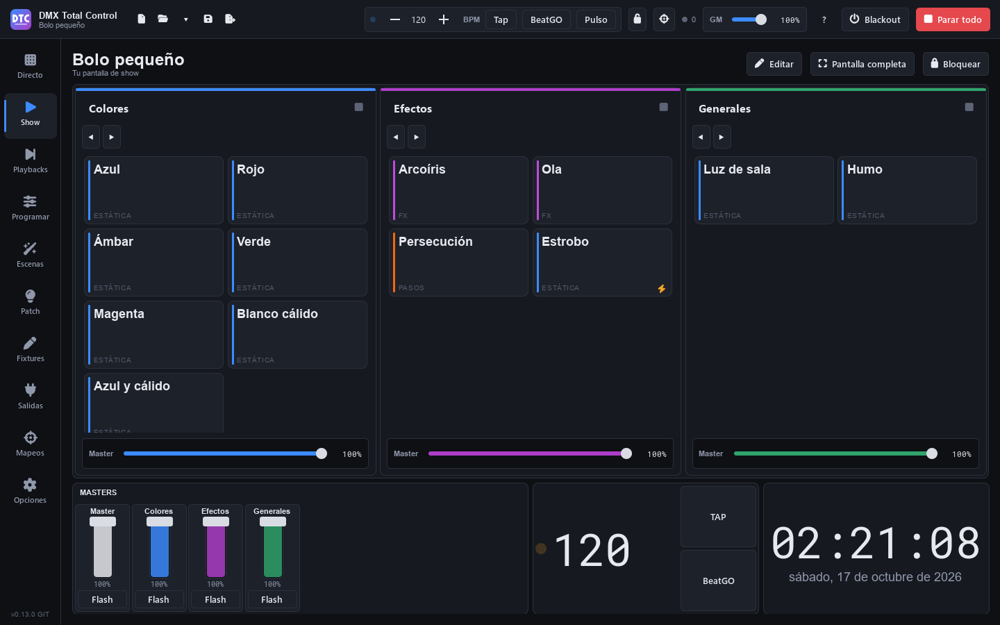

# Show

Die Seite **Show** (F2) ist Ihr Bedienbildschirm: Sie bauen ihn selbst, nach Ihren Wünschen, mit Tasten, Fadern, Drehreglern, Gruppen, Playbacks, Uhr, Notizen… Sie ist für Touchscreens gedacht, für den Vollbildbetrieb während der Show und auch für die Bedienung vom Smartphone mit der [Fernsteuerung](remoto.md). Sie wird mit der Show gespeichert.

Eine SHOW hat **Seiten**. Jede Seite besteht aus **Bereichen**, die den Bildschirm füllen. Jeder Bereich lässt sich in zwei Hälften teilen, nebeneinander oder übereinander, so oft Sie möchten, und jeder Bereich zeigt eine Sache: eine Tabelle mit Tasten, eine Tabelle mit Fadern, eine Gruppe, eine Uhr…

## Loslegen

Bei einer neuen Show ist die Seite leer und bietet zwei Tasten:

- **„Neue Seite“**: erstellt eine Seite mit einer Tastentabelle und wechselt in den Bearbeitungsmodus.
- **„Aus meinen Gruppen erstellen“**: erstellt die Seite „Gruppen“ mit all Ihren Live-Gruppen oben und darunter eine Fader-Tabelle „Master“ (der Grand Master und die Master der ersten Gruppen), einen Rhythmus-Bereich und eine Uhr. Erscheint nur, wenn Sie schon Gruppen haben.

## Der Bearbeitungsmodus

Drücken Sie **„Bearbeiten“**, um den Bildschirm zu bauen, und **„Fertig“**, um ihn wieder zu benutzen. Im Bearbeitungsmodus:

- Klicken Sie auf einen Bereich, um ihn **auszuwählen** (bei einer Tabelle auf eine ihrer Zellen oder auf sein Etikett oben rechts). Seine Eigenschaften erscheinen rechts unter **„Eigenschaften“**.
- Wenn die Maus über einem Bereich ist, und beim ausgewählten, erscheint oben rechts ein Etikett mit seinem Typ und drei Tasten: **in zwei Hälften nebeneinander teilen**, **übereinander teilen** und **diesen Bereich entfernen** (bei einem Bereich mit Titel stehen sie in seiner Titelleiste). Dieselben finden Sie in den Eigenschaften: „Nebeneinander“, „Übereinander“ und „Bereich entfernen“.
- Die Bereiche behalten ihre Höhe: Beim Bearbeiten bekommen sie keine Leiste dazu. Mit den Eigenschaften rechts werden sie nur so weit schmaler, wie ihre Tabellen ohne Scrollen hineinpassen; reicht das nicht, scrollt die Seite mit der Leiste unten seitwärts (höchstens ist sie so breit wie ohne die Eigenschaften).
- Ziehen Sie den **Trenner** zwischen zwei Hälften, um ihre Größe zu ändern. Er rastet von selbst bei Vierteln, Dritteln und Hälften ein.
- Ein Bereich **„Leer“** zeigt Tasten mit allen Typen: Klicken Sie auf einen, um zu wählen, was er zeigt. Ist der Bereich klein und passen sie nicht hinein, bleibt eine einzige Taste, **„Was er zeigt ▾“**, mit der Liste.

### Bereichstypen

| Typ | Was er zeigt |
|---|---|
| **Tasten** | Eine Tabelle mit Tasten (Spalten × Zeilen). |
| **Fader** | Eine Reihe von Fadern. |
| **Eine Gruppe** | Eine Live-Gruppe mit großen Tasten. |
| **Alle Gruppen** | Alle Live-Gruppen, nebeneinander. |
| **Playbacks** | Die Playbacks der Seite Playbacks, mit GO, Tasten und Fader. |
| **Live-Mischer** | Der [Mischer](directo.md#mischer) von Live. |
| **Uhr** | Die Uhrzeit, wahlweise mit Sekunden und Datum. |
| **Timer** | Eine Stoppuhr oder ein Countdown. |
| **Rhythmus: GO und Stop** | Große Tasten **GO** und **Stop** wie die in der oberen Leiste (sie ändern, was die Szenentasten tun), und **BeatGO**. Die Tasten von Szenen mit Schritten, Cuelists oder FX auf „BPM der Show“ enthalten ihren Rhythmusbalken. |
| **Notizen** | Ein Text von Ihnen, in beliebiger Größe. |
| **Läuft gerade** | Was gerade läuft, mit einer Taste zum Stoppen. |
| **Drehregler und Räder** | Eine Tabelle mit Drehreglern oder Endlosrädern. |
| **Farbrad** | Ein Rad, um einer Fixture-Gruppe Farbe zu geben. |
| **XY-Feld (Pan und Tilt)** | Eine Fläche, um Moving Heads zu bewegen. |
| **Bild** | Ein Bild (ein Logo, ein Plan…). |
| **DMX-Pegel** | Die 512 Kanäle eines Universums, live. |
| **Leer** | Nichts (im Bearbeitungsmodus die Liste der Typen). |

### Eigenschaften des Bereichs

Je nach Typ zeigen die Eigenschaften:

- **Zeigt**: den Bereichstyp.
- **Titel**: den Text seiner Titelleiste. Ohne Titel hat der Bereich keine Leiste, auch nicht im Bearbeitungsmodus.
- **Hintergrund**: die Hintergrundfarbe des Bereichs, aus denselben Farben wie die Tasten, oder **∅** (die des Designs). Sie erscheint als Tönung, beim Bearbeiten, beim Spielen und auf dem Handy, und der Text darauf bleibt lesbar.
- **Farbe aller Tasten** (aller Fader, aller Drehregler): gibt allen in der Tabelle auf einmal diese Farbe. Leere Zellen bleiben leer.
- **Spalten** und **Zeilen**: die Größe der Tabelle (bis 32). Tasten, Fader und Drehregler füllen ihre Zellen. In einem Bereich, der für seine Tabelle zu klein ist, schrumpfen die Zellen nicht unter eine lesbare und bedienbare Größe: Die Tabelle lässt sich scrollen (mit dem Mausrad oder durch Ziehen).
- **Mit den Szenen einer Gruppe füllen** (Tasten): legt auf einmal eine Taste für jede Szene dieser Gruppe an.
- **Gruppe** (eine Gruppe): welche angezeigt wird.
- **Fixtures** (Farbrad und XY-Feld): auf welche Fixture-Gruppe sie wirken, oder „Alle Fixtures mit Farbe“ / „Alle Moving Heads“.
- **Bild** (Bild): die Datei, und „Ganzes Bild“ oder „Bereich füllen“.
- **Sekunden** und **Datum** (Uhr).
- **Zählt** (Timer): „Aufwärts (Stoppuhr)“ oder „Abwärts (Countdown)“, mit seinen **Minuten**.
- **Text** und **Größe** (Notizen).
- **Universum** (DMX-Pegel).
- **Playback-Seite**, **Playbacks** und **Erstes Playback** (Playbacks): siehe [Playbacks in der SHOW](show.md#playbacks-in-der-show).

## Tasten

1. Wählen Sie einen Tastenbereich aus und klicken Sie auf eine leere Zelle (die mit dem **+**).
2. Drücken Sie **„Hier eine Taste hinzufügen“**.
3. Wählen Sie ihre **Aktion** und was sie braucht (die Szene, die Gruppe, die Palette…).

Am schnellsten füllen Sie eine Tabelle, indem Sie **Szenen** aus der Liste unter den Eigenschaften („Ziehen Sie eine Szene auf eine Zelle:“) in die Zellen **ziehen**: Jede Szene wird zu einer Taste, die sie startet.

### Aktionen einer Taste

| Aktion | Was sie tut |
|---|---|
| **Szene abspielen** | Startet die Szene in ihrer Gruppe (oder allein, wenn sie in keiner Gruppe ist). Mehrmals hintereinander gedrückt, gibt sie den [Rhythmus](directo.md#rhythmus-einer-szene-mit-schritten) einer Szene mit Schritten, einer Cuelist oder einer FX-Szene mit FX auf „BPM der Show“ vor. Mit **Stop** in der oberen Leiste stoppt sie die Szene. |
| **Nächste Szene einer Gruppe** / **Vorherige Szene einer Gruppe** | In einer Gruppe oder in „Alle Gruppen“. |
| **Gruppe freigeben** | Eine Gruppe oder alle. |
| **Blackout** | Schaltet den Blackout ein oder aus. |
| **Alles stoppen** | Wie die Taste in der oberen Leiste. |
| **Tap-Tempo** | Gibt das Tempo der Show vor (das der FX und der Szenen im BPM-Modus). |
| **BeatGO (nächste Unterteilung)** | Wie die Taste BeatGO in der oberen Leiste. |
| **Eine Palette** | Setzt die Palette auf die Fixtures, mit denen sie aufgenommen wurde („Eigene Fixtures“), oder auf eine Fixture-Gruppe, als Live-Änderung im Programmer: Sie liegt über den Szenen, bis Sie erneut drücken. |
| **Cuelist-GO** / **Cuelist zurück** / **Cuelist freigeben** | Auf die Cuelist, die Sie unter **Cuelist** wählen. |
| **Zu einem Cue…** | Springt zu dem **Cue**, den Sie in dieser Cuelist wählen. |

Eine mit Alt+Klick von einer anderen Seite geholte Taste zeigt „Ein Element auf einer anderen Seite“ und darunter, was sie tut („Macht: …“).

### Optionen einer Taste

- **Beschriftung**: ihr Text. Ist sie leer („Automatisch“), zeigt die Taste den Namen der Szene, der Palette oder der Aktion.
- **Verhalten** (Szene, Blackout und Palette): **„Umschalten: an / aus“** oder **„Flash: solange gedrückt“**. Flash-Tasten tragen einen Blitz in der Ecke. Bei einer Szene steht statt „Umschalten“ **„Drücken: je nach GO / Stop“**: Die Taste startet oder stoppt sie je nach **GO** und **Stop** in der oberen Leiste.
- **Tastaturtaste**: eine Taste der Tastatur, die sie drückt, solange Sie auf der Seite Show sind. Der Buchstabe steht in der Ecke der Taste.
- **Farbe**, **Symbol** und **Bild** als Hintergrund (das Bild erscheint abgedunkelt, solange die Taste aus ist).

Eine eingeschaltete Taste füllt sich mit ihrer Farbe.

### Verschieben und entfernen

Ziehen Sie im Bearbeitungsmodus eine Taste, einen Fader oder einen Drehregler in eine andere Zelle desselben Bereichs, um sie zu verschieben. Zum Entfernen wählen Sie das Element aus und drücken **Entf** (oder „Taste entfernen“ / „Fader entfernen“ in den Eigenschaften). **Esc** hebt die Auswahl auf.

## Fader

Ein Fader der SHOW kann **mehrere Dinge gleichzeitig** steuern. In seinen Eigenschaften ist unter **Steuert** jedes Element eines davon:

| Element | Was der Fader tut |
|---|---|
| **Szene abspielen (ihre Intensität)** | Beim Hochziehen ab 0 startet die Szene in ihrer Gruppe; bei 0 stoppt sie; dazwischen ist er ihre Intensität. Der Fader fügt seine Szene hinzu: Er stoppt keine andere (weder die seiner Gruppe, auch nicht in einer exklusiven, noch die, die ihr Modus „Beim Start freigeben“ stoppen würde), und kein anderer Fader stoppt seine; Sie können also mehrere gleichzeitig hochziehen. Solange er oben ist, stoppt sie nichts anderes: weder die Tasten der Gruppe noch ihre eigene, weder „Gruppen freigeben“ noch „Alles stoppen“; nur ihn ganz herunterzuziehen (auch das Schließen oder Wechseln der Show stoppt sie). Auf gemeinsamen Kanälen gilt bei gleicher Priorität die höchste Intensität, der Rest (Farbe, Position…) kommt von der zuletzt hochgezogenen; ziehen Sie sie herunter, kommt die andere zurück. Bei unterschiedlicher Priorität gewinnt die höhere ([Prioritäten](directo.md#prioritäten)). |
| **Dimmer einer Szene (ohne sie abzuspielen)** | Dimmt die Szene, egal wer sie startet (ihre Gruppe, ein Playback, eine Taste, eine Superszene). Er startet oder stoppt sie nicht. Sein Pegel wird mit der Show gespeichert und gilt, solange es einen Dimmer-Fader oder -Drehregler für diese Szene gibt: Entfernen Sie ihn, geht die Szene auf 100 % zurück. |
| **Master einer Gruppe** | Der Master dieser Live-Gruppe. |
| **Grand Master** | Der GM der oberen Leiste. |
| **Dimmer von Fixtures** | Der Mischer-Dimmer aller Fixtures oder einer Fixture-Gruppe. |
| **Bewegungstempo der Moving Heads** | Das Tempo dessen, was die Moving Heads bewegt (alle oder die einer Gruppe): ihre Pan/Tilt-FX, die des Programmers und die Schritte, die sie bewegen. Unten ×0,1, in der Mitte das normale Tempo (×1), oben ×10; der Fader zeigt den Faktor, ein Doppelklick setzt ihn auf ×1 zurück. Ein FX mit Pan/Tilt und Farbe ändert nur das Tempo der Bewegung, eine Cuelist das ihrer FX. Der Geschwindigkeitskanal der Motoren bleibt unberührt. |
| **Tempo einer Szene** | Das Live-Tempo dieser Szene (×0,1 bis ×10, wie das Bewegungstempo). |
| **Szene abspielen (ihr Tempo)** | Wie „Szene abspielen (ihre Intensität)“, aber der Fader ist ihr Tempo: Ganz unten ist die Szene gestoppt; beim Hochziehen startet sie in ihrer Gruppe, und der Weg ist ihr Tempo, ×0,1 knapp über unten, ×1 in der Mitte und ×10 oben. Der Text zeigt „Gestoppt“, solange sie nicht läuft, und der Fader folgt der Szene, wenn sie anderswo gestoppt oder gestartet wird. Das Tempo gilt nur für diesen Durchlauf: Gestoppt kehrt die Szene zu ihrem vorherigen Tempo zurück (das Tempo in Live ändert sich nicht). Ein Doppelklick setzt sie auf ×1 (und startet sie, wenn sie gestoppt war). Wie der Intensitäts-Fader fügt er seine Szene ihrer Gruppe hinzu und hält sie: Mehrere gleichzeitig laufen zusammen (auch mehrere Szenen derselben exklusiven Gruppe auf einem Fader), und nur ganz Herunterziehen stoppt sie. |
| **BPM** | Das Tempo der Show, von 20 bis 300. |

Der Unterschied zwischen den beiden Szenen-Elementen: **„Szene abspielen (ihre Intensität)“** ist die Szene selbst und startet und stoppt sie; **„Dimmer einer Szene (ohne sie abzuspielen)“** dimmt sie nur, auch wenn sie von woanders gestartet wird. Beide lassen sich zusammen verwenden: Mit dem Dimmer auf 50 % und dem startenden Fader auf 80 % läuft die Szene mit 40 %.

Drücken Sie **„Weiteres Element hinzufügen“**, um ein weiteres hinzuzufügen, und das Papierkorbsymbol, um es zu entfernen. Ziehen Sie eine Szene auf eine Fader-Zelle, entsteht ein Fader, der sie startet.

Mit **Bereich**, **Von** … **bis** … (von 0 bis 100 %) deckt der Weg des Faders nur diesen Teil dessen ab, was er steuert, bei all seinen Elementen. Zum Beispiel das Tempo einer Szene von 20 bis 80 % oder ein Dimmer von 0 bis 60 %, damit er nicht darüber geht. Ist „Von“ größer als „bis“, oder mit **„Invertieren“**, arbeitet der Fader umgekehrt. Ein Fader, der eine Szene startet, stoppt sie an dem Ende, an dem der Wert am niedrigsten ist (ganz unten; ganz oben, wenn er invertiert ist), auch wenn „Von“ nicht 0 ist.

Der Text des Faders zeigt den tatsächlichen Wert (die %, die BPM oder, wenn er nur Tempi steuert, den Faktor ×), nicht die Stellung des Faders. Bringt ein anderes Bedienelement den Wert außerhalb des Bereichs, bleibt der Fader am Ende stehen. Ein Fader, der nur Tempi steuert (der Bewegung oder von Szenen, eines oder mehrere), kehrt mit einem Doppelklick auf ×1 zurück.

Unter jedem Fader gibt es eine Taste **„Flash“**: Sie bringt ihn ganz an das obere Ende seines Wegs, solange Sie sie drücken, und stellt beim Loslassen genau das wieder her, was vorher war. Sie wird mit dem Schalter „Flash-Taste: voll, solange gedrückt“ in seinen Eigenschaften ein- oder ausgeblendet.

> **Tipp:** Ein Fader mit „Master einer Gruppe“ Ihrer Washes und „Dimmer von Fixtures“ der PARs auf der Publikumsseite gibt Ihnen einen einzigen Fader, um das ganze Frontlicht herunterzuziehen.

## Drehregler und Räder

Drehregler steuern dasselbe wie Fader (die Tabelle oben), mit demselben **Bereich**. Jeder Drehregler kann sein:

- Ein **Drehregler**: durchläuft seinen ganzen Bereich in einer Dreivierteldrehung. Ein Doppelklick bringt ihn an den Anfang seines Wegs (den Wert von „Von“, oder den von „bis“, wenn er invertiert ist); steuert er die BPM, auf 90, oder auf das nächste Ende des Bereichs, wenn 90 außerhalb liegt; steuert er nur Tempi, auf ×1.
- Ein **inkrementelles Rad** („Inkrementelles Rad: dreht endlos, jede Raste addiert oder subtrahiert einen Schritt“): dreht endlos, und jede Raste addiert den **Schritt** (von 1 bis 25 %) zum aktuellen Wert oder subtrahiert ihn. Der Schritt ist ein % des Werts, nicht des Wegs, und das Rad verlässt den Bereich nicht; drehen Sie es bei gestoppter Szene nach oben, startet es sie bei „Von“. Der Bogen außen herum zeigt den Pegel.

Zum Drehen ziehen Sie mit der Maus oder dem Finger um die Mitte herum, oder nahe der Mitte nach oben und unten. Jeder Schritt des Mausrads dreht ihn ein wenig (bei einem inkrementellen Rad eine Raste).

## Farbrad und XY-Feld

- **Farbrad**: Berühren Sie das Rad, um den Fixtures des Bereichs Farbton und Sättigung zu geben (Weiß in der Mitte), oder drücken Sie eines der Farbfelder darunter.
- **XY-Feld (Pan und Tilt)**: Ziehen Sie den Punkt, um die Köpfe zu bewegen. **„Mitte“** bringt sie in die Mitte.

Beide wirken wie eine Live-Änderung im Programmer: Sie liegen über den Szenen, bis Sie **„Freigeben“** drücken; dann geben die Szenen wieder Farbe bzw. Position vor.

## Gruppen und Mischer

Die Bereiche **Eine Gruppe** und **Alle Gruppen** zeigen die Spalten von [Live](directo.md) mit großen Tasten, ihrer Taste für vorherige/nächste Szene, ihrer Freigabetaste und ihrem Master, ohne Bearbeitungsoptionen. **Live-Mischer** zeigt die Kanalzüge des Mischers, an die Breite angepasst.

Gruppen lassen sich auch hier **einklappen**, mit dem Pfeil neben ihrem Namen: In **Alle Gruppen** wird die Gruppe zu einem schmalen Streifen, und die anderen teilen sich die Breite; ein Bereich **Eine Gruppe**, der eine Hälfte der Seite einnimmt, klappt auf seinen Streifen ein (oder auf seine Kopfzeile, wenn die Hälften übereinander liegen), und die andere Hälfte wird größer. Ihre Szenen laufen weiter, und das Einklappen wird mit der Seite gespeichert (unabhängig vom Einklappen unter Live). In einer gesperrten SHOW lässt sich nichts einklappen.

## Playbacks in der SHOW

Der Bereich **Playbacks** zeigt Streifen wie die der Seite [Playbacks](playbacks.md):

- **Playback-Seite**: **„Der aktuellen Seite folgen“** (die Titelleiste zeigt ◀ den Namen der Seite ▶, um sie zu wechseln) oder eine feste Seite.
- **Playbacks**: wie viele zu sehen sind (bis 20), und **Erstes Playback**: ab welchem.
- Drei Schalter, um die **zweite Taste (Pause / Zurück)**, die **dritte Taste (Flash)** und **den laufenden Cue und den nächsten** ein- oder auszublenden.

Legen Sie im Bearbeitungsmodus eine Szene auf einem Streifen ab, um sie auf dieses Playback zu legen.

## Hilfsmittel

- **Uhr**: Uhrzeit und Datum des Computers.
- **Timer**: **„Starten“** / **„Pause“** und **„Zurücksetzen“**. Als Countdown wird er in der letzten Minute orange und bei null rot. Er zählt weiter, auch wenn Sie die Seite wechseln.
- **Rhythmus**: **GO**, **Stop** und **BeatGO**.
- **Notizen**: der Text, den Sie in ihre Eigenschaften schreiben (der Ablaufplan, Hinweise für den Operator…).
- **Läuft gerade**: was läuft, mit der Stopptaste neben jeder Szene.
- **DMX-Pegel**: ein Raster mit den 512 Kanälen des gewählten Universums.
- **Bild**: ganz oder den Bereich füllend.

## Seiten

- Im Bearbeitungsmodus fügt **„+ Seite“** eine Seite hinzu.
- Klicken Sie auf den Namen einer Seite, um sie zu sehen. Die Seiten-Tabs erscheinen, wenn es mehr als eine gibt.
- Im Bearbeitungsmodus benennt ein Doppelklick auf einen Tab ihn um; ein Rechtsklick öffnet **„Umbenennen…“**, **„Nach links“**, **„Nach rechts“** und **„Seite löschen…“**. Beim Löschen erscheint ein Hinweis, wie viele Bereiche und Bedienelemente mit ihr verschwinden: Das lässt sich nicht rückgängig machen.

## Jedes Bedienelement in die SHOW holen

**Alt+Klick** auf fast jedes Bedienelement des Programms kopiert es auf die SHOW-Seite, die Sie geöffnet haben: eine Szene unter Live, den Master einer Gruppe, eine Taste des Mischers, den Grand Master, den Blackout, eine Palette unter Programmieren, die Tasten und den Fader eines Playbacks… Das Programm meldet „Zur SHOW hinzugefügt, Seite ‚…‘“.

Das neue Bedienelement kommt in die erste freie Zelle einer Tasten- oder Fader-Tabelle dieser Seite. Gibt es keine, wird ein leerer Bereich zu einer solchen Tabelle (mit dem Titel „Touch“), oder der letzte Bereich wird geteilt.

## Vollbild und Sperre

- **„Vollbild“** (F11) und **„Vollbild beenden“**.
- **„Sperren“**: blendet die Seitenleiste aus und lässt nur die SHOW übrig, ohne Bearbeitung und Navigation. Zum Verlassen **halten Sie „Entsperren“ gedrückt** (unter der Taste füllt sich ein Balken). Gibt es ein Sperrpasswort, wird es abgefragt.

### Sperre und Kiosk-Modus

- Unter Optionen › „SHOW und Sperre“ öffnet **„SHOW beim Start im Vollbild öffnen“** direkt die SHOW. Mit **„…und gesperrt“** startet sie außerdem gesperrt: nur die SHOW, wie ein Kiosk.
- Sperren Sie die **„SHOW-Bearbeitung“** mit dem Schloss in der oberen Leiste, verschwindet die Taste „Bearbeiten“: Die Seiten werden bedient, aber nicht geändert.

Siehe [Optionen](opciones.md#show-und-sperre).

## Tastaturtasten, Zuordnungen und Fernsteuerung

- Die **Tastaturtasten** der SHOW-Tasten funktionieren nur auf der Seite Show. Deshalb löst die Taste G auf dieser Seite kein BeatGO aus.
- Im Lernmodus lassen sich die Tasten und Fader der SHOW einem Controller zuordnen; ein MIDI-Bedienelement kann einen ganzen SHOW-Fader bewegen, mit all seinen Elementen (siehe [Zuordnungen](mapeos.md)).
- Die SHOW-Seiten lassen sich mit der [Fernsteuerung](remoto.md) auf dem Smartphone oder Tablet ansehen und bedienen.
