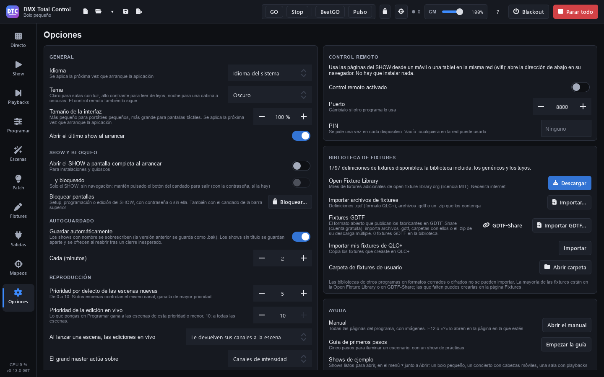

# Options

**Options** (F9) brings together the program settings. On the left are the general settings, startup, lock, autosave, playback and audio; on the right, the remote control, the fixture library, updates, help and “About”.

The settings on this page belong to the computer, not to the show: they apply to every show you open.

## General

- **Language**: “System language”, Español, English, Português, Français, Italiano or Deutsch. It is applied the next time the program starts.
- **Theme**: **Dark**, **Light**, **High contrast** or **Night (dimmed)**. It changes at once. Light, for rooms with light; High contrast, for reading from a distance; Night, very dark and in red, for a dark booth without dazzling you. The [remote control](remoto.md) follows the same theme.
- **Size of the interface**: from 80 % to 150 %, smaller for small laptops and bigger for touch screens. It is applied the next time the program starts.
- **Open the last show at startup**.

> **Tip:** the Light theme works better for daytime rehearsals or outdoors; High contrast, when there is a lot of light around the screen.

## SHOW and lock

- **Open the SHOW full screen at startup**: for installations and kiosks. The program starts on the Show page in full screen.
- **…and locked**: it also starts locked: only the SHOW, with no navigation. To leave, hold down the padlock button (with the password, if there is one). See [Show](show.md#full-screen-and-lock).
- **Lock screens**: **“Lock…”** / **“Unlock…”**. It is the same as the padlock in the top bar.

### Locking screens

Locking stops anything from changing by mistake during the show. Live and the SHOW keep working, and the playbacks keep playing.

1. Press the **padlock** in the top bar (or “Lock…” here).
2. Choose what to lock:
   - **Setup**: Patch, Fixtures, Outputs, Mappings and Options. You cannot open or create another show either.
   - **Programming**: Program and Scenes. In Playbacks you cannot record, update or assign.
   - **SHOW editing**: the SHOW pages are used, not changed.
3. If you like, type a **password** (it is optional).
4. Press **“Lock”**.

Locked pages have a padlock in the sidebar. When you open one, it asks for the password (if there is one) and everything is unlocked. To unlock, press the padlock in the top bar. **“Remove the password”** is in the same window, when you lock.

## Autosave

- **Save a recovery copy**, **Every (minutes)**: from 1 to 60.

The autosave doesn't touch the show file: every few minutes, if there are unsaved changes, it saves a recovery copy apart, and the dot **●** stays. Only **Save** writes the file; the version there was before the first save of each session is kept as `.bak`. The copy is deleted when you save, when you close (saving or not) and when you open another show. If the program closes unexpectedly, when you open it again it offers the copy (“Recover the unsaved show?”) with the name of the show and the time of the copy: recovering it opens that show with its changes, still unsaved; save it to keep them. Meanwhile the last show is already open as it was saved (with “Open the last show at startup”): “Discard” leaves it so. The top bar shows the time of the last copy (“recovery copy …”); if it fails (a full disk), a warning appears in red.

## Playback

- **Default priority of new scenes**: from 0 to 10. If two scenes control the same channel, the one with the higher priority wins (see [Priorities](directo.md#priorities)).
- **Priority of the live edits**: what you set in Program beats the scenes with this priority or lower. With 10, all the scenes.
- **When a scene starts, the live edits**:
  - **“Give the scene its channels back”**: the channels that the scene touches leave the programmer.
  - **“Always stay”**.
  - **“Are all reset”**: the programmer is cleared.
- **Grand master acts on**: **“Intensity channels”** (the light: the dimmers and the colours of fixtures without a dimmer) or **“All channels”**.

## Audio

- **Audio input**: the microphone or line input that **Pulse** and the audio matrices listen to. **“System default”** uses the one set in the operating system. Pulse changes input at once; an audio matrix that is already playing, the next time it starts. A chosen input that is not connected now shows as “(not connected)”, and meanwhile the default one is used.

## Recent shows

The list of the last shows you opened (also in the **▾** arrow of the top bar). **“Clear list”** clears it.

## Remote control

To use the SHOW pages from a phone or a tablet on the same Wi-Fi network, without installing anything:

- **Remote control on**.
- **Port**: change it if another program uses it (8800 by default). If it is in use, you are warned in red.
- **PIN**: asked once on each device. If it is empty, anyone on the network can use it.
- The **addresses** to open in the phone's browser, with a button to copy them.
- How many devices are connected.

See [Remote control](remoto.md).

## Fixture library

It tells you how many fixture definitions are available (the built-in library, the generic fixtures and your own) and lets you extend it:

- **Open Fixture Library**: **“Download”** (needs internet access). Once downloaded, you see how many fixtures it has and when it was downloaded, and the button becomes **“Update”**: it brings the new and improved fixtures, and keeps your fixtures and the ones the library no longer has. If there is something new, you are told and the button is highlighted (see [Fixtures](fixtures.md#open-fixture-library)).
- **Import fixture files**: **“Import…”** `.qxf` definitions (the QLC+ format), `.gdtf` files or a `.zip` with them.
- **GDTF fixtures**: **“GDTF-Share”** opens its website; **“Import GDTF…”** imports files, folders or the `.zip` of its multiple download. It tells you how many GDTF fixtures are in the library.
- **Import my QLC+ fixtures**: **“Import”** copies the fixtures you created in QLC+.
- **User fixtures folder**: **“Open folder”**.

All of this is explained in [Fixtures](fixtures.md).

## Updates

- **Check for updates at startup**: once a day, on GitHub: the program and, if you downloaded the Open Fixture Library, whether it has new fixtures (a notice tells you). Nothing is downloaded or installed without asking you. With no internet, it does not bother you.
- **Include test versions**: the new features earlier, less tested.

Below, you see the status (“You have the latest version”, “Version … is out.”) and the buttons:

- **“Check for updates”**: checks now (the Open Fixture Library too).
- **“What's new”**: what is new in that version.
- **“Download and install”**: downloads the installer and checks its SHA-256 digest before saving it. If a version does not publish its digest, it can only be downloaded from its page (“Open on GitHub”).
- **“Install now”**: the program closes (it first asks whether to save the show), the new version is installed and the program opens again.
- **“When closing”** / **“Not when closing”**: install it when you close the program.
- **“Open on GitHub”**: the page of the version.

When there is a new version, a notice also appears above the pages with the same buttons. **“Later”** hides the notice for that version; the version is still available here.

## Help

- **Manual**: **“Open the manual”** opens this manual at its contents. F12 or the **“?”** button in the top bar open it on the page you are on. It opens in the language of the program (Spanish, English, Portuguese, French, Italian or German); the screenshots are those of the Spanish version.
- **First steps guide**: **“Start the guide”** opens the guide again (see [First steps](primeros-pasos.md#the-guide)).
- **Example shows**: they are in the **▾** arrow next to “Open” in the top bar, in “Examples” (see [the contents page](index.md#the-guide-and-the-example-shows)).

## About

The version of the program, its licence (free software, Apache 2.0) and the credits.
