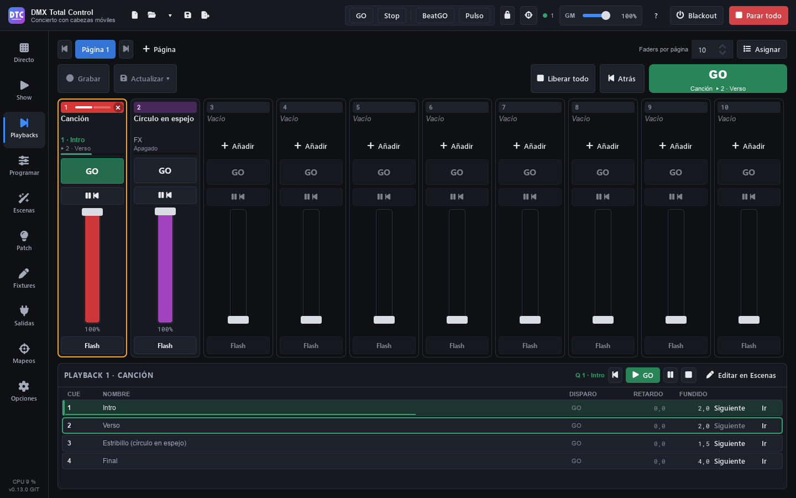

# Playbacks

**Playbacks** (F10) is a fader desk. Each **playback** plays a cuelist or any scene, and has a **GO**, a **Pause/Back** button, a **Flash** button and a **fader** that is its intensity. Playbacks are organised in **pages** of 8 to 20 (10 by default).

It is the most comfortable way to run a show with cuelists: you record the cues from the programmer straight onto a playback and play them with GO or the space bar.

## The playback strip

From top to bottom:

- **The number** on the colour of the playback. It lights up while it plays. The **×** on the right releases it. A cuelist of another type shows its tag: **SUB** (submaster), **CHASE**, **TC** (timecode) or **OVR** (override).
- **The name**: click it to **select** the playback (orange border). A playback with nothing on it shows “Empty”.
- **The cue it plays and the next one** (“3 · Verse”, “▸ 4 · Bridge”) and a bar with the progress of the fade. When the next cue is a jump of a link of the cue, it has **↺** and the number of the jump: “▸ 2 ↺ 1/3” is the first of three (see [Cuelists](escenas.md#cuelists)). A chase shows its speed first: “♩ 120 ▸ 4”. A timecode cuelist shows its clock first: “TC 00:01:23.4 · 3 · Verse”. A stopped cuelist shows “Released”; a scene shows its type and whether it is “On”, “Off” or “Paused”.
- **Button 1 (GO)**: the next cue; if the playback is off, it starts it.
- **Button 2 (Pause / Back)**: pauses a running fade; if there is no fade, goes back to the previous cue.
- **The fader** and its percentage. An A/B fader shows “A/B” and how far its fade is.
- **Button 3 (Flash)**: at full while you press it (see [The flash](playbacks.md#the-flash)).

The buttons light up according to the state: **GO** in green while it plays (it blinks fast during a fade or a wait and slowly when paused), **Pause/Back** in orange when paused and **Flash** in orange while it is pressed and until its decay ends.

### The flash

While you press **Flash**, the playback goes to full. When you let go, it goes back to the level of its fader. If it was off, the flash starts it and releases it when you let go.

With an **attack** and a **decay** in its [properties](playbacks.md#playback-properties), the change is not instant:

- When you press, it goes up to full in the attack time, from where it is. A playback that is off comes up from zero.
- When you let go, it goes back to the fader level in the decay time. A playback the flash started goes down to zero and is released when the decay ends.
- If you press again during the decay, it goes up from where it is, without dipping first.
- If you move the fader during the decay, the decay ends at the new level.
- A GO during the decay keeps it on: the decay ends at the fader level.

Channels that are not intensity (position, colour wheel) come in at once, as always.

### The fader

The fader is the intensity of what the playback plays:

- When you **raise it from zero**, the playback starts.
- When you **lower it to zero**, a scene is released; a cuelist stays on its cue (you can change this in the [properties](playbacks.md#playback-properties)).
- A **GO with the fader down** plays at full.

In a **submaster** cuelist, the fader rules: raising it from zero starts it at the level of the fader, never at full, and lowering it to zero releases it. While it is released, GO and Back only choose the cue it will start on (see [Cuelist options](escenas.md#cuelist-options)).

In an **override** cuelist, the fader crossfades everything it holds, colours, positions and gobos too, between what is below and its cue. At full, its cue replaces what is below (see [Cuelist options](escenas.md#cuelist-options)).

In a normal cuelist, the fader can be a **crossfade (A/B)** (“Fader” in the [properties](playbacks.md#playback-properties)). Then it is not the intensity: the playback plays at the level it had, and each travel of the fader from one end to the other is a GO whose fade you make by hand.

- As soon as it leaves its end, the next cue starts and its fade follows the fader: 40 % of the travel is 40 % of the fade. Delays, down fades and the times of attributes and fixtures follow in proportion.
- At the other end, the cue is complete. The next travel, the other way, plays the cue after it.
- If you go back to the end you started from, it is cancelled and the cue before comes back. If that travel started the cuelist, it is released.
- A stopped cuelist starts on the cue of a GO, which comes in with the fader. A cue with no time fades linearly over the travel.
- The FX of the cue start with their own time.
- **GO** (the button, Main GO or a mapping) plays the next cue with its time. In the middle of a travel, it finishes that fade with its own time and plays no other cue.
- Follow and Wait of the next cue wait until the travel ends. Cue speed and live time don't change the fade you make by hand.

A double click on the fader takes it to full or to zero. On an A/B fader, that is a whole travel: the cue is complete at once.

## Putting something on a playback

There are several ways:

- **Recording from the programmer**: see [Recording on a playback](playbacks.md#recording-on-a-playback).
- **“Add”** on an empty playback: **“New cuelist from the programmer”** or **“Put a scene here…”**.
- **Assign**: press **“Assign”** in the header. The list of scenes appears on the right: drag them onto the playbacks (while the list is open, a scene dropped on a playback in use replaces what it had) or double-click one to put it on the first free playback.
- **Right click › “Assign a scene…”**: choose the cuelist or the scene in the list and press **“Put it on playback N”** (or double-click it).

From Program you can also record a new cuelist and put it on the first free playback (see [Recording](programar.md#recording)).

QLC+ cue lists can also reach the playbacks: see [Scenes › QLC+ cue lists](escenas.md#qlc-cue-lists).

## GO, Back and the selected playback

On the right of the header you have the controls of the **selected playback**:

- **GO** (the big green button, or **Space**): the next cue of the selected playback. It shows its name and which cue comes next (“Song 1 ▸ 3 · Bridge”).
- **“Back”** (**Shift+Space**): the previous cue.
- **“Release all”**: releases all the playbacks and all the cuelists that are playing.
- **“Cue speed”**: the speed of every cuelist (see [Cue speed](playbacks.md#cue-speed)).

Space and Shift+Space work on this page as long as you are not typing in a text field. Each press gives a single GO: holding the key down does not run through the cues.

### The selected playback panel

At the bottom you see the selected playback (“Playback N · name”), its state and its buttons: back, **GO**, pause / resume, release and **“Edit in Scenes”**.

If it is a cuelist, the list of its cues appears (CUE, NAME, TRIGGER, DELAY, FADE). The playing cue has a green bar and the next one a green border. On each row:

- **“Next”**: that cue will be the one of the next GO.
- **“Go”**: jumps to that cue now.

A click on a row only marks it: it does not play anything by mistake.

## Cue speed and live time

### Cue speed

**“Cue speed”**, in the header, changes the speed of every cuelist at once: its fades, delays, Follow and Wait, its tapped rhythm and the steps of a chase. It goes from ×0.1 to ×10, with ×1 in the middle.

- It acts at once, also on the fades that are running: they speed up or slow down from where they are, without jumps.
- The value turns orange when it is not ×1. A double click puts it back at ×1.
- It does not change FX or the other scenes.
- It is not saved: every show opens at ×1.

It is also on the faders of the [SHOW](show.md#faders) and in the [mappings](mapeos.md#drives).

### Live time

While a cue is fading, the selected playback panel shows **“Live time”**: the delay plus the fade of that cue (for example, “4.0 s”). You can change it while it runs:

- Type another time, or press **“×½”** or **“×2”**: the fade goes on from where it is and ends in the new time.
- **“Now”** ends the fade at once.
- If the next cue has **Follow**, it waits for the new end.

The change is for this run only: the next cue uses its own times. “Live time” turns orange when the time is not the one of the cue. **“Store in the cue”** stores the changed times in the cue (also those of its attributes and fixtures). It can’t when the cue runs with a BACK time or with the fade-in of a group or a block, which are not its own times. It is undone like any other edit of the cuelist.

The same bar is in the header of the cuelist in [Scenes](escenas.md#the-cue-table). From a controller, use the mappings “Live time of a playback” or “Live time of the selected playback” (see [Mappings](mapeos.md#drives)).

## Recording on a playback

1. Build a look in [Program](programar.md).
2. In Playbacks, press **“Record”**: it blinks in red and each playback shows what will happen when you click it.
3. Click a playback:
   - **Empty** (“New cuelist”): a new cuelist is created with the programmer as cue 1.
   - **With a cuelist** (“Record cue N”): its next cue is recorded, with only what changes compared with what it tracks.
   - **With a scene** (“Holds a scene”): you cannot record on it.

**Esc** cancels the armed recording, and it is also disarmed when you leave the page.

### Updating a cue

Change the values in the programmer, select the playback and press **“Update ▾”**:

- **“Update cue N (the next cues follow)”**: the change goes on to the next cues that track those channels.
- **“Only this cue (the next cues keep their look)”**.

The cue that is updated is the one loaded in the programmer or, if there is none, the one that is playing. The right click menu of each playback also has **“Record cue N”**, **“Update the current cue (the next cues follow)”** and **“Update only the current cue”**.

> **Tip:** when you finish recording, press “Reset all” in Program (or tick “Clear the programmer after recording”): while the programmer holds values, it overrides what you play.

## Pages

- Click the name of a page to see it. **◀ ▶** (or **PgUp** / **PgDn**) go to the previous or the next one.
- **“+ Page”** adds a page.
- **“Faders per page”**: 8, 10, 12, 16 or 20 playbacks per page.
- A double click on a page renames it. Right click: **“Rename…”**, **“Move left”**, **“Move right”** and **“Delete page…”** (with more than one page). When you delete it, its playbacks are emptied; what they play keeps playing and the cuelists and scenes stay in Scenes.

## Playback properties

Right click › **“Properties…”**. Changes are applied at once.

- **Label**: the name it shows (empty: the name of the scene).
- **Colour**: a swatch, or the **A** for the colour of its scene type.
- **Button 1**, **Button 2** and **Button 3**: what each one does: “Nothing”, “GO”, “Back”, “Pause”, “Pause / Back”, “Release”, “Flash”, “Flash + GO” (at full while pressed, and the next cue), “On / off” or “Select” (so that Main GO, Record and Update act on it).
- **Flash attack** and **Flash decay**: how long the flash takes to go up to full and to come back when you let go, from 0 to 10 s (0 = at once). They apply to its Flash or Flash + GO button, the mappings, the SHOW and the remote (see [The flash](playbacks.md#the-flash)).
- **Fader**: “Intensity” (the default) or “Crossfade (A/B)”, only on a normal cuelist (see [The fader](playbacks.md#the-fader)). In A/B the next two options are hidden: the fader always starts it and never releases it.
- **The fader starts it**: whether raising the fader starts the playback.
- **The fader at zero releases it**: “Default” (yes for a scene and a submaster cuelist; no for the other cuelists: they keep their cue), “Yes” or “No”.

The same menu has **“Edit in Scenes”**, **“Release”** and **“Clear the playback”** (removes it from the playback; the cuelist or the scene stays in Scenes).

## Releasing

- The **×** on the number of a playing playback, or **“Release”** in its menu.
- **“Release all”** in the header.

Releasing a playback also releases that scene if it is playing in a Live group.

## Akai APC controllers

In [Mappings](mapeos.md#templates-for-akai-apc) › “Devices”, **“Map it all”** assigns a whole controller to the playbacks in one go:

- **Akai APC mini** and **APC mini mk2** → Playbacks: each column is a playback 1-8 of the current page: its fader and, from the bottom, GO, Pause/Back, Flash and its first 5 cues. The button under the pads releases it, the last fader is the grand master and the buttons on the right are previous and next page, GO and Back of the selected playback, blackout, tap, BeatGO and stop all.
- **Akai APC40 mkII** → Playbacks: each track is a playback 1-8, with its first 5 cues on the clips (the next one pulses green); the device knobs are the faders of playbacks 9-16.

The LEDs show the state of each playback.

## Playbacks in the SHOW and on the remote

- The [SHOW](show.md#playbacks-in-the-show) can have a playbacks section that follows the current page or shows a fixed one.
- On the [remote control](remoto.md), when any playback holds something, a “Playbacks” page appears with its strips.

## With programming locked

If you lock **“Programming”** with the padlock in the top bar, the playbacks keep working (GO, faders, flash), but you cannot record, update, assign or change the pages or the properties.
