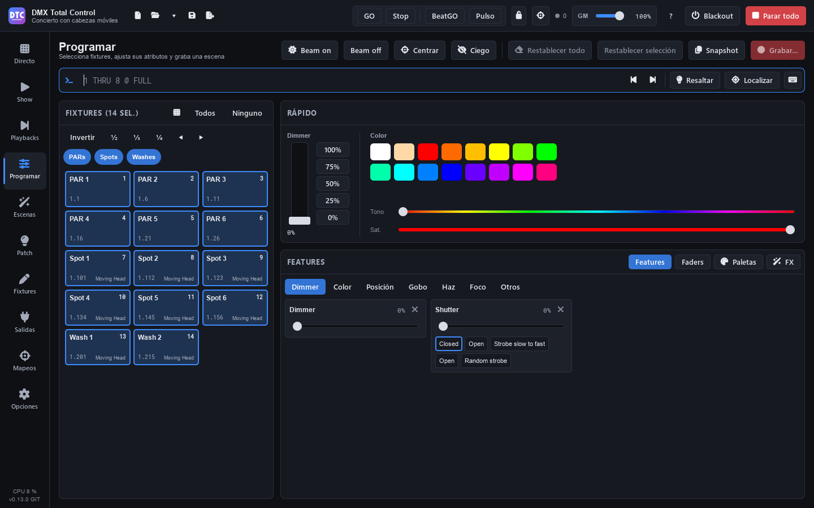

# Program

**Program** (F3) is the programmer: you select fixtures, give them dimmer, colour, position, gobos or any other channel, add FX and palettes, and record it all as a scene, a cuelist or a cue.

What you set in the programmer **goes out at once and overrides everything** (scenes, groups and playbacks) until you clear it. The page subtitle reminds you: “N channel(s) in the programmer — they override the playbacks until you clear them”.

From top to bottom, the page has: the header with its buttons, the [command line](programar.md#command-line), the **fixtures** panel on the left and, on the right, the **Quick** panel and the **Features / Faders / Palettes / FX** panel.

## The header

- **“Beam on”**: dimmer at full and shutter open on the selection.
- **“Beam off”**: dimmer to zero on the selection.
- **“Centre”**: pan and tilt to the centre.
- **“Blind”**: see [Blind](programar.md#blind).
- **“Reset all”**: releases all the live edits (values and FX). The scenes show again.
- **“Reset selected”**: releases only those of the selected fixtures.
- **“Park”**: parks the programmer's values of the selected fixtures at the output (see [Parking](programar.md#parking)).
- **“Snapshot”** and **“Record…”**: see [Recording](programar.md#recording).

In a narrow window some buttons show only their icon; hover over them to see their name.

## Selecting fixtures

The **“Fixtures (N selected)”** panel shows a tile for each fixture with its name, its number (for the command line), its address (universe.address) and its type.

- **Click** a tile: selects only that one.
- **Ctrl+click**: adds it to the selection or removes it. **Shift+click**: selects all the tiles from the last one you clicked to that one (in that direction, which is the order of the selection); **Ctrl+Shift+click** adds them.
- **“All”** and **“None”**, in the panel header.
- **“Invert”**: selects the ones that were not selected.
- **½**, **⅓**, **¼**: keeps one of every two, three or four.
- **◀ ▶**: shifts the selection to the left or to the right.

**Order matters**: the order in which you select the fixtures is the order that fans, FX and Colour FX follow. On the 2D plan each selected fixture shows its order number.

> **Tip:** you can also select by typing: `1 THRU 8` and Enter. See [the command line](programar.md#command-line).

### Fixture groups and selections

Above the tiles, the [fixture groups](patch.md#fixture-groups) of the Patch appear as round labels:

- **Click** a group: selects its fixtures. **Ctrl+click** or **Shift+click**: adds them.
- The label lights up when all its fixtures are selected. Hover over it to see its number for the command line (“GROUP 2 in the command line”).
- The **selections** of a group (ordered parts, with their icon) select their fixtures in their order.
- With many groups you see three rows of labels, which scroll with the wheel: **“All the groups (N)”** opens them (up to half the panel) and **“Fewer”** closes them. This keeps the fixture tiles in sight.

### 2D plan

The grid button in the panel header (“2D plan”) swaps the tiles for the stage plan:

- **Click** a fixture to select it; **Ctrl+click** or **Shift+click** adds it or removes it.
- **Drag** on the empty stage to select with a box. A click on an empty spot clears the selection.
- The **wheel** zooms; dragging with the **right button** or the middle one moves the view, and a double click with those buttons centres it again.

In Program the plan is always **live**: each fixture shows its colour, its dimmer, its strobe (it blinks) and its gobo, and every pixel of bars and matrices. Fixtures are placed on the [2D plan of the Patch](patch.md#2d-plan). Protected special effects carry their shield and parked fixtures their padlock, as in the Patch.

## The Quick panel

### Dimmer

The **Dimmer** fader and the **100%**, **75%**, **50%**, **25%** and **0%** buttons give intensity to the selection. On a fixture with several dimmers they set its main dimmer and the ones that are light (each head, lamp, pixel or background), not the flash of a strobe, an effect, the fog of a fogger with LEDs or a lamp control.

### Colour

Click one of the 16 swatches, or move **Hue** and **Sat**. The colour is mixed on the RGB channels (the white part goes to the white channel if the fixture has one) or on the CMY channels of each fixture. For colour wheels, use their presets in [Features](programar.md#features) › Colour.

> **Tip:** for a dimmer fan, use the command line: `@ 0 THRU 100` goes from 0 % on the first fixture to 100 % on the last one. The position fan is in [Features › Position](programar.md#position-xy-grid-and-fan).

## Features

**Features** shows the channels of the selection in tabs: **Dimmer**, **Colour**, **Position**, **Gobo**, **Beam**, **Focus** and **Others**. The tabs with no channels in the selection are disabled.

Each channel is a card with its name, its value in %, a slider and its **presets** as buttons (with their colour or the image of their gobo if the profile includes them). Click a preset to set it. The card is marked in orange when the channel is in the programmer; its **×** releases it.

Channels are grouped **by function**, not by name: “Red”, “R” or “Rojo” on different fixtures are the same control, and the same goes for dimmer, pan/tilt, CMY, colour wheel, gobo, shutter, iris, zoom, focus, prism… Each head of a bar keeps its own channels. On a fixture with several dimmers, the one that goes with the other fixtures' dimmer is its main dimmer.

### Colour: picker and favourites

In the **Colour** tab, the square on the left gives the hue (from side to side) and the saturation (from top to bottom). Drag the cross to place it, or drag somewhere else in the square for a fine adjustment.

Below it, **“Favourites”**: the **+** saves the current colour; a click on a favourite sets it; a right click removes it. Favourites work for all your shows.

### Position: XY grid and fan

The **Position** tab only moves **pan** and **tilt** (with their fine channels, in 16 bits). Continuous pan or tilt rotation and its speed are in **Others**.

- Drag the **cross** to place it, or drag somewhere else on the grid for a slow, fine movement.
- The bar on the left is the **tilt** and the one at the bottom is the **pan**.
- With several fixtures, each one is a dot on the grid.
- **“Centre”** takes pan and tilt to the centre.

On the right is the **Fan**: it spreads the position of the selection, in its order, each fixture from where it was.

- **“Open”**: from one end to the other (the first to one side, the last to the other, the middle one still).
- **“V”**: the ends spread out and the centre stays still.
- **“From the first”**: the first one still and each one a bit more.
- **Pan** and **Tilt**: how much each one spreads (from −100 to 100 %; double click, to 0). At 100 %, the ends move half the grid.
- **“No fan”**: the fixtures go back to where they were.
- The **“Fan”** button under the grid makes dragging on the grid spread the fan instead of moving: sideways, the pan; up and down, the tilt.

If you then move the cross, the centre moves and the fan is kept. If the position changes some other way (a palette, another selection, “Reset all”), the fan goes back to 0 and starts again from wherever they are.

### Follow: aiming at a point

The **“Follow”** button under the grid swaps the fan for a stage plan. Click or drag on it: **all the selected moving heads aim at that point**, each one with its own pan and tilt, and a line goes from each one to the point.

- **“Height of the point”**: 0 m is the floor; raise it to aim, for example, at the singer's face (1.6 m).
- Each head works out its pan and tilt from its place on the plan, its height, whether it is hung or standing and which way it faces. All of that is set in [Patch › 2D plan › “Height and facing”](patch.md#height-and-facing-follow).
- When you drag, each head takes the short way from where it was aiming, without going the long way round.
- The values stay in the programmer like any other pan and tilt: record them in a scene, a cue or a palette.
- Below it, you see how many heads are aiming, which ones cannot reach (they stay as close as they can), which ones do not have their pan and tilt travel in their definition (540° and 270° are used) and the scanners, which do not move (their mirror does not follow this geometry).
- The inversions, the limits and the pan and tilt swap of the [Patch](patch.md#limits) are already taken into account.

If you move the cross, the fan or “Centre”, or change the selection, the point disappears.

> **Not tested with real fixtures:** each manufacturer orients its heads in its own way. If one aims wrong, adjust its facing or set its pan or its tilt to turn the other way in “Height and facing”.

## Faders

**Faders** shows each channel of the selection as a vertical fader, with its name, its group and its value (0–255). The list button opens its **presets** (“Name (min–max)”) and the **×** releases it.

> **Tip:** after you click a fader or a slider, the ↑ ↓ arrows move it one by one and PgUp / PgDn ten by ten. A double click returns it to its rest value (usually zero).

## Blind

With **“Blind”** on, the programmer edits **without sending anything to the lights**: the stage keeps showing what is playing and you prepare the next look. The subtitle warns you: “Blind: the lights don't show what you program”. You can record as usual. When you turn it off, what is in the programmer goes out.

## Protected special effects

The programmer never sends a [protected special effect](directo.md#protected-special-effects) (a CO2, a flame…) out, not even with the effects armed:

- On a selection that mixes protected effects with other fixtures, the programmer gives them nothing: no `@ FULL`, no levels, colours, faders, “Locate”, “Beam on” or “Beam off”, “All” palettes, FX or macros. Their faders don't show, so a scene recorded from that selection never has them.
- On a selection **of protected effects only**, the values are kept so that you can program a CO2 scene, but they never go out, armed or not. The subtitle says “N special effect channels: recorded, not sent”, and their faders and cards have a red shield “not sent”. The scene you record fires them from the SHOW, a pad or the phone with the effects armed.
- When you load a scene, a step or a cue with a CO2, its values stay, and saving it again doesn't lose them. Its FX on protected effects are kept in the scene, but don't play in the programmer.
- “Snapshot” leaves them out, even while they fire; “Highlight” never lights them. FX and FX macros never play on them, and a message says so (“1 protected special effect left out of the FX”). Follow doesn't aim a protected flame head selected together with other fixtures.

## Highlight and locate

In the command line bar:

- **“Highlight”**: the selection at full in open white, over everything, to see which fixtures they are. It is not recorded. Press it again to remove it. It never lights protected special effects.
- **“Locate”**: sets the selection at full, in open white, centred and with the beam open, **in the programmer** (these values are recorded).
- **◀ ▶** (PREV / NEXT): goes through the selection **one by one**: only one fixture stays selected and you see which one you are on (“2/8”). **“All”** goes back to the whole selection (ALL).

## Palettes

A **palette** stores an intensity, position, colour or beam value for each fixture, or **all** of them at once. Scenes, cues and steps recorded with a palette use it **by reference**: if you update the palette, they change by themselves (live edits too).

In **Palettes** there are five columns: **Intensity**, **Position**, **Colour**, **Beam** and **All**.

### Recording a palette

1. Select fixtures and give them the value (for example, a colour).
2. In the **Colour** column, press **“+ Record”**.

The palette is created with a name and a number (“Colour 1”, COL 1). From then on, whatever you record with it follows it.

### “All” palettes

The **All** column records at once every value the selection has in the programmer (dimmer, colour, position, gobos, zoom…), except the maintenance channels (lamp, reset). It is created as “All 1”, PAL 1. Values that came from another palette (for example from POS 1) now come from this one: a palette doesn’t keep other palettes.

Applying it puts all of that. On another type of fixture, it mixes its colour and the rest goes by attribute, like the other palettes. In the command line it is `PAL 1` (or PALETTE 1), because `ALL` and `TODO` already select every fixture.

### Using a palette

Select fixtures and click the palette: it is applied to the selection. A palette is marked when it is set on the selection (brighter if it is set on all of it). On a fixture that was not recorded in the palette, it uses the values of another fixture of the same type (spread out if it is a fan, see below) or its attributes: a colour is mixed in RGB or CMY, or goes to the closest slot of the colour wheel.

You can also type `COL 2`, `POS 1`, `BEAM 3`, `INT 4` or `PAL 5` (the “All” one) in the command line.

### A fan in a palette

If you record a palette with different values on each fixture (a position fan, a dimmer ramp, a rainbow), the palette keeps the order you selected them in. When you apply it to fixtures that were not recorded, the fan **is spread over them in the order of the selection**: the first one takes the values of the first recorded fixture, the last one those of the last, and the ones in between, what lies between them. Pan, tilt, dimmer, colours and zoom change smoothly; wheels and gobos take the value of the nearest recorded fixture. On another type of fixture, the colour is the blend at its place and the rest comes from the nearest recorded fixture.

Each fixture remembers its place in the fan, even if you later apply the palette with another selection. The scenes, cues and steps recorded with it follow the palette, and applying it again gives the same values. To spread it another way, select the fixtures in the new order and choose **“Spread again over the selection”**. On a group of the SHOW or of a mapping, it is spread in the order of the group.

A palette recorded on one fixture of each type, or with the same values on all of them, works as before.

### The palette menu

Right click a palette:

- **“Apply to the selection”**.
- **“Load its fixtures in the programmer”**.
- **“Spread again over the selection”**: gives the selected fixtures a new place in the fan of the palette, in the order of the selection. What uses them changes too.
- **“Update with the programmer”**: adds or changes the values of the programmer in the palette. The scenes that use it change too.
- **“Record over it”**: records it again with only what is there now.
- **“Rename…”**, **“Change its number…”** and **“Delete”** (the scenes keep the values).

A link icon on the palette shows that there are scenes that use it; the hover text says how many, and over how many more fixtures it is spread.

> **Tip:** palettes can be put in the [SHOW](show.md) (the “A palette” action), on the [remote control](remoto.md) and in a [mapping](mapeos.md), on their fixtures or on a group, as a live edit. Alt+click on a palette takes it to the SHOW.

## FX

An **FX** moves a parameter of the selection (the dimmer, the red, the zoom, pan and tilt together…) around its value in the programmer or, if it has no value, around what the scenes below send. It plays at once and is recorded with the scene. An FX without a base value stays above the static scenes of its own priority, even when you start them later. On a fixture with several heads (a pixel bar, a two-lamp blinder), when the parameter has no channel of the whole fixture, every head does it at once, as a single place of the wave.

In **FX** there are three areas: the parameters and the running FX on the left, the FX controls in the centre and the macros on the right.

### Starting an FX

1. Select fixtures.
2. In **Parameter**, choose what to move. By default, the last parameter you touched is chosen. The ones that already have an FX on the selection carry the “FX” mark. **Pan / tilt** and **Pan** or **Tilt** move the same channels: starting one takes those fixtures out of the other.
3. Press **“Start FX”**, or click a **macro**.
4. Adjust the controls: the FX changes live.

Fixtures without a dimmer (RGB only, RGBW…) also have **Dimmer**, marked “virtual”: the FX dims their colour as a dimmer would, all their heads together. The intensity macros (chase, pulse, strobe…) work on them too. CMY, colour wheels and the channels whose **Dimmer** option is off in the Patch don't change. It is for FX only: the **Dimmer** fader of the Quick panel and `@` still find no dimmer on these fixtures.

If a fixture has several dimmers of its own (a strobe with its flash and a colour aura, a wash with a background dimmer, a fogger with LEDs), **Dimmer** is its main dimmer, not the flash, background or fog dimmer: it is recognised by its name (“Master dimmer”, “Dimmer”, “Aura dimmer”…), even when it is not the first channel. The others usually appear in **Parameter** with the name of their channel, each with an FX of its own. Intensity palettes and Colour FX that work on “Dimmer (value)” use the main one too.

### The FX controls

- **The figure or the mode** (the drawing on the left): click it to choose another one. For pan/tilt there are **12 figures** (circle, eight, square, triangle, diamond, pan line, tilt line, diagonal, leaf, lissajous, ballyhoo and cross). For the rest, **22 modes**: the dotted line is the base value and the wave goes above it, below it or on both sides; modes 9 to 12 are for chases, with a step. The modes with an arrow (←) go from the last fixture to the first: 2, 4, 6, 8, 10, 12, 14 and 20 (14 is 7 backwards).
- **Swing** (from 0 to 250 %). On pan/tilt, **“Swing pan”** and **“Swing tilt”** separately.
- **Speed**, in BPM. **½** and **×2** halve or double it. **“BPM of the show”** makes it follow the tempo and the beat of the show (a BPM fader or dial in the SHOW, or a BPM or Tap mapping): the FX at “BPM of the show”, started at any time, go on the same beat as the chases and the scenes in BPM mode, and each Tap press puts them back on it. Recorded in an FX scene, it follows instead the rhythm you tap by pressing the button of the scene, if it has one ([Live](directo.md#rhythm-of-a-scene-with-steps)), and the panel says so. **“Multiplier”**: from ×⅛ to ×8, with ×⅓ and ×⅔; a value that is not in the list (from a converted Move FX) shows as it is.
- Pan/tilt only: **“Invert pan”**, **“Invert tilt”**, **“Backwards”** and **“Rotate”** (0–359°).
- Only on a dimmer FX with fixtures without a dimmer: **“Virtual dimmer”**, the level their colour is dimmed from (0–100 %). With **“Auto”** it is the level of the dimmers of the same FX or, if there are none, full. Moving the level fixes it; the button next to it goes back to “Auto”. The colour underneath (the programmer's, the scene's or what the scenes below send) is its base, and a colour FX on the same fixture adds to it.

### FX timing

How the FX is spread over the fixtures:

- **“Wave per X”**: the shape is spread over X fixtures (or sets), each one a bit later.
- **“Step per X”**: one fixture (or set) after another, X at a time.
- **“Grouping”**: “Off”, “Every X”, “Blocks of X”, “Divide by X” (X parts, at most one fixture apart in size), “Outside in” or “By group” (of fixtures).
  - **“Outside in”** puts the first and the last fixture together, then the second and the one before the last, and so on to the centre: the wave or the step runs from the outside in. X is how many fixtures each set has, half from each end (with 2, the first with the last). It inverts nothing; for a mirror, see [“The mirror”](programar.md#the-mirror). It is saved as the old “Mirror”, so earlier shows play the same.
  - **“By group”** uses the groups of the Patch that split the fixtures of the FX without overlapping. A group that has them all does not count (for example, one with all the beams next to the groups of each row). If they can be split in several ways, the split with the most groups wins, then the one that leaves fewer fixtures alone, then the one with the smaller groups and, last, the order of the groups in the Patch. A fixture that is in none of those groups is a set of its own. “Per fixture” shows the group of each one.
- **“Order”**: “Selection”, “Reversed”, “Random” (with a button for another random order) or “By number” (by the fixture numbers of the Patch).
- **“Wait”**: time at the base after each run. At “BPM of the show”, the run with its wait lasts the nearest whole number of beats (at least the run without the wait), so each run starts on a beat. Off the beat of the show (a speed of its own or a tapped rhythm), a change of speed, BPM or multiplier goes on from where it is in the run; on the beat of the show, a new multiplier puts it back on the beat.
- **“Phase”**.

For a shift or a delay of each fixture, see [“Per fixture”](programar.md#per-fixture-shift-and-delay).

Below, an animated preview draws how each fixture moves: while the FX plays, where it really is, with the movement speed of the SHOW and its delays.

### Running FX, linking and stopping

- **“Running FX (N)”** lists the FX of the programmer. A click selects their fixtures and their parameter; the **×** stops the whole FX, with the FX linked to it, and leaves the selection as it is.
- **“Link”**: linked FX share the speed and the timing, go on the same clock and stop together. An FX you link later goes where the ones already linked are. “Link” joins it to the link group of another FX of the selection or, if there is none, to the last one you linked; a macro with several linked FX makes a group of its own, apart from yours. With several groups, “Running FX” shows the number of each one. The movement speed of the SHOW goes to the whole group of a pan/tilt FX.
- **“Stop”** takes the selected fixtures off the FX (with all of them, the whole FX) and off the FX linked to it too; a linked FX on other fixtures goes on (the **×** in “Running FX” stops it all); **“Stop all the FX”** stops them all.
- A new FX starts on the clock of what is already playing. On fixtures taken from a running FX of the same parameter (a macro on part of it), it goes on from where that FX was. On other fixtures, if another FX of the parameter runs at the same speed and with the same multiplier, it goes where that one is: so “Invert pan” on a second group gives a mirror in phase. An FX with delays starts from 0.

“Reset all” also removes the FX from the programmer. “Stop all” in the top bar does not remove them: they are live edits.

### Per-fixture FX

An FX is still **a single one** even if you change some of its fixtures. If you select only some of the fixtures of an FX and change the **shape, the size, the direction (“Backwards”), the inversions, the rotation or the phase**, the change **belongs to those fixtures**, on the same clock: they stay in sync with the others. The **speed and the timing** always belong to the whole FX.

- The panel warns you: “This FX is also on other fixtures…”.
- With all its fixtures selected, the change applies to the whole FX.
- If the selected fixtures don’t all do the same, **“Invert pan”**, **“Invert tilt”** and **“Backwards”** show half lit (with half a coloured bar at the bottom) and a click turns them on for all of them; the figure or the mode, the swing, the rotation and the phase say “mixed”.
- If you select fixtures that were in no FX of the parameter, they join the FX (the first one, if there are several), each one in its place by its fixture number. If the selection spans several FX of the same parameter (for example, one per row), the panel says so (“The selection spans N FX”) and a change goes to each one: each FX keeps its wave and its mirror. **“Merge into one FX”** joins them into one, on the clock of the first: each fixture keeps its shape, but not its place in the wave of its FX.
- In “Running FX” you see how many have something of their own (“N own”).
- **“Like the rest”** removes what is their own from the selected fixtures: they go back to doing the same as the FX.

### Per-fixture shift and delay

Under the controls of a running FX, **“Per fixture”** (unfold it with its arrow) lists its fixtures in the order of the FX: number, name, its place in the wave or the step (with “Grouping: By group”, also the group of its set), and two fields you change by hand. The selected fixtures are highlighted. A change plays at once, on the same clock.

- **“Shift”** (0–1440°): how far behind the others it goes in the wave. 360° is a whole cycle and, in an FX with a step, one place. It adds to the wave and to the phase.
- **“Delay”** (up to 60 s): how much later it does the FX. When the FX starts (its scene or its cue starts, or a new FX in the programmer), it waits that long at its base, so the fixtures start one after another. After that it stays that far behind. It is in seconds even when the FX follows the BPM of the show; to follow the tempo, use the shift.
- **“Fan the shift…”** and **“Fan the delay…”** ask for the value of the last one and spread from 0 over the selected fixtures, in the order of the FX.
- **“No shift or delay”** removes them from the selected fixtures.
- **“Reorder by number”** puts the fixtures of the FX in the order of their numbers in the Patch, for example when one ended up at the end of a row. Their places in the wave and their mirror twins follow it.

Changing the phase or the timing keeps them, and “Like the rest” does not touch them. It is not the same as the own phase of some fixtures: that phase replaces the phase of the FX; the shift adds to it. If you set a delay longer than the time the FX has been running, that fixture waits at its base until it gets there. The shift and the delay are recorded with the scene or the cue.

### The mirror

If the fixtures with their own inverted pan (or that go backwards, or with their own inverted tilt) are **all in one half** of the FX, each one follows the wave of its twin on the other side, so the wave also comes out mirrored. The panel shows it with “Mirror: …”.

An example with 6 beams in a circle with a wave:

1. Select all 6, choose **Pan / tilt**, press **“Start FX”**, figure **Circle** and **“Wave per X”** at “All”.
2. Select only the last 3 and turn on **“Invert pan”**.

The last 3 move as a mirror of the first 3 and follow the wave of the 3rd, the 2nd and the 1st: a synchronised mirror, with any figure. **“Backwards”** only gives a mirror on the figures that are symmetric in pan (circle, square, triangle, diamond, leaf and pan line); on an eight, a diagonal, a lissajous, a tilt line, a ballyhoo or a cross, each fixture that goes backwards goes up when its twin goes down, and the panel does not say “Mirror”. If you invert alternate ones (2, 4 and 6) it is not a mirror: each one keeps its place in the wave.

Inverting pan or tilt in the Patch (in [“Limits”](patch.md#limits)) is a physical correction, for heads hung upside down or rotated: it makes them move like the others, so it does not count for the mirror of the FX. The mirror is made in the FX.

An FX has a single mirror, between its two halves. For a mirror within each row, with a wave in each row, make one FX per row and link them (**“Link”**): each one with its wave and its inverted half, all on the same clock.

### FX macros

On the right, the built-in **FX macros** by category: **Position** (circle, circle wave, eight, ballyhoo, pan sweep, can-can, pan in mirror, square, triangle, leaf), **Intensity** (dimmer wave, chase, random, pulse, breathe, strobe, outside in), **Colour** (rainbow, red / blue, fire, cyan / magenta) and **Beam** (zoom, iris, focus). A click applies the macro to the selection. “Pan in mirror” inverts the pan of the second half of the selection: a mirror with any number of heads. The colour ones put out what they don't move: the white, the amber and the UV (and the yellow in cyan / magenta), so a white below doesn't turn them pastel.

**“Save as a macro…”** saves the FX of the programmer as a macro of your own, in **“Mine”**, for all your shows. Right click one of your macros: **“Rename”** or **“Delete”**. Two FX of the same parameter (a circle on some fixtures and an eight on others) go in as one, each fixture with its own; if they didn't go at the same speed or with the same timing, the macro keeps the first one's and says so.

A macro of your own keeps what each fixture of the FX did, by its place in it (the order you selected them in):

- its base values: a fan of positions, different colours;
- what it did its own way: the shape, the size, the direction, the inversions (a mirror);
- its shift and its delay.

When you apply it, the first selected fixture gets what the first one had, the second what the second one had, and so on. With more or fewer fixtures, the first and the last get what the first and the last had, and the ones in between are spread out: fans, delays and halves stretch, and a mirror stays a mirror. What repeats every 2 or 3 fixtures (every other one backwards, two alternating colours) repeats the same way on any number of fixtures. Colour and gobo wheels, the prism and the shutter are not spread: each fixture takes the value of its nearest place. If they all had the same values and nothing of their own, the macro works on any selection, like the built-in ones. Macros saved fixture by fixture carry the mark **1·2·3**; hover over one to see how many fixtures it had.

## Command line

The command line works like the one on a console. When you open Program it takes the keyboard: type and press **Enter**. Next to it you see what it has done, or why it does not understand.

| Command | What it does |
|---|---|
| `1 THRU 8` | Selects fixtures 1 to 8 (also `1 > 8` or `1 / 8`). `8 THRU 1`, in reverse order. |
| `1 + 3 - 2` | Adds and removes. `1,3,5` is the same as `1 + 3 + 5`. Starting with `+ 5` or `- 5` changes the selection you already have. |
| `GROUP 2` | Fixture group 2 (in the Patch order). `GROUP 1 THRU 3`: groups 1 to 3. |
| `ALL` | All the fixtures, in number order (after NEXT / PREV, it goes back to the whole selection). |
| `@ 50` | Dimmer at 50 %. `@ 5` is 50 % (a single digit means tens). |
| `@ FULL` / `@ OUT` | Dimmer at full or at zero. `@ @` is also full. |
| `@ 0 THRU 100` | Dimmer fan, from 0 % on the first to 100 % on the last. |
| `@ + 10` / `@ - 10` | Raises or lowers the dimmer by 10 %. |
| `POS 1`, `COL 2`, `BEAM 3`, `INT 4`, `PAL 5` | Applies the position, colour, beam, intensity or “All” palette with that number. |
| `LOCATE` | Locate. |
| `HIGHLIGHT` | Highlight (toggles). |
| `NEXT` / `PREV` | One at a time through the selection. |
| `REL` | Releases the edits of the selection. |
| `CLEAR` | Clears the programmer. |

You can chain them: `1 THRU 4 @ FULL COL 2` selects, sets the dimmer at full and applies colour palette 2.

The words also work in Spanish: HASTA, GRUPO, TODO, LLENO, TOPE, CERO, INTENSIDAD, POSICION, COLOR, HAZ, PALETA, LIMPIAR, RESALTAR, LOCALIZAR, SIGUIENTE, ANTERIOR, LIBERAR, IR, ATRÁS, GRABAR, ACTUALIZAR, ELIMINAR… and abbreviated: THR, FL, GRP (or G), CLR, LOC, HI, SIG, ANT, REL.

### Cuelist commands

They act on the **selected cuelist**: the one of the selected playback, the one you opened in Scenes or the last one you created.

| Command | What it does |
|---|---|
| `GO` | The next cue. |
| `BACK` | The previous cue. |
| `GO CUE 3` | Jumps to cue 3. |
| `CUE 3` | Loads cue 3 into the programmer (what the stage shows on it) to change it. |
| `REC` | Records the next cue. `REC CUE 2.5` records cue 2.5 (between 2 and 3). |
| `UPD` | Updates the cue loaded in the programmer or, if there is none, the one that is playing. `UPD CUE 4`, cue 4. |
| `DELETE CUE 4` | Deletes cue 4 and keeps the look of the next ones. |
| `PB 3` | Selects playback 3 of the current page (and its cuelist). |

If a command stops halfway (for example, the palette does not exist), what it already did stays done and only the part that still needs fixing is left on the line.

### History and on-screen keypad

- **↑ ↓** go through the last commands.
- **Esc** clears the line (with the line empty, Esc is “Stop all”).
- The **keypad** button opens an on-screen keypad for touch screens, with numbers, THRU, @, FULL, OUT, GROUP, INT, POS, COL, BEAM, PAL, HIGHLIGHT, REL, CLEAR, NEXT, PREV, ALL, LOCATE, CLR and the cuelist keys (CUE, the decimal point, REC, UPD, GO, BACK, DELETE, PB). CLR empties the line; CLEAR, the programmer. It stays open while you choose fixtures.

## Recording

### The “Record” window

Press **“Record…”**:

1. In **Record into**, choose:
   - **“New scene”**: a static scene or, if the programmer has FX, an FX scene with its base values and its FX.
   - **“New cuelist”**: the programmer will be cue 1 of a new cuelist. With **“Put it on the first free playback”** ticked, it also appears in Playbacks.
   - **A cuelist that already exists**: it is recorded as one of its cues. The selected cuelist is chosen by default.
2. Type the **Name** (and, for a cue, the number in **Cue**: empty, the next one; `2.5` goes between 2 and 3).
3. For a new scene or cuelist: **“Add to group”** (or “No group”) and **“Priority (0-10)”**.
4. For a cue: **“Only this cue (what it changes doesn't go on to the next cues)”** and **“All the values (block cue)”** (also the values that are equal to what it tracks, so that it looks the same whatever the previous cues do).
5. Press **“Record”** (or “Record cue N”).

A cue stores only what the programmer changes compared with what the previous cues leave on stage. If the cue number already exists, it asks what to do: **“Merge”** (the programmer goes into the cue), **“Replace”** (the cue stores only what is in the programmer; it keeps its name and its times) or **“Insert after”** (a new cue between this one and the next one).

**“Clear the programmer after recording”** clears the programmer after each recording and update. The option is remembered.

### Snapshot

The **“Snapshot”** menu has:

- **“Save the edits into a scene”**: puts the values of the programmer into a static scene that already exists. The FX don't go in (a static scene has none) and a notice says so; to keep them, use **“Record…”**.
- **“Everything on stage into a new scene…”**: everything the lights show now (scenes, live edits and the mixer, without the grand master) becomes a new static scene, on every fixture that has light. If “Highlight” is on, you have to turn it off first (“Highlight off”). It leaves protected special effects out, even while they fire.
- **“Only the edits into a new scene…”**: with FX too (the new scene is an FX scene).

### Editing scenes and cues

- **A static or FX scene**: from Live or Scenes, **“Edit in the programmer”** loads it into the programmer. Change what you want and, in [Scenes](escenas.md), press **“Save the programmer in this scene”**.
- **A cue**: when you load it (double click the cue in Scenes, “Load”, or `CUE 3`), a bar appears: “Editing cue 3 of “Song 1””. Change the values and press **“Update ▾”**: **“Update cue 3 (the next cues follow)”** or **“Only this cue (the next cues keep their look)”**. The **×** stops editing the cue (the programmer keeps its values).

## Clearing the programmer

- **“Reset all”** (or `CLEAR`): releases the whole programmer, values and FX.
- **“Reset selected”** (or `REL`): only the selected fixtures.
- The **×** of a card or of a fader: only that channel.

What happens to the live edits when you play a scene, and their priority over the scenes, is decided in [Options](opciones.md#playback).

## Parking

**“Park”**, in the header (after “Reset selected”), parks the values the programmer holds on the selected fixtures: they go to the output with their [limits](patch.md#limits) (without the grand master), above everything, and the programmer lets them go. The values of the other fixtures stay in the programmer, and the programmer's FX are not parked. It is disabled when the selection has no values. If you change the limits later, what is parked doesn't change. A protected special effect is parked off. To unpark, use the fixture menu in the Patch (right click): see [Parking channels](patch.md#parking-channels).
