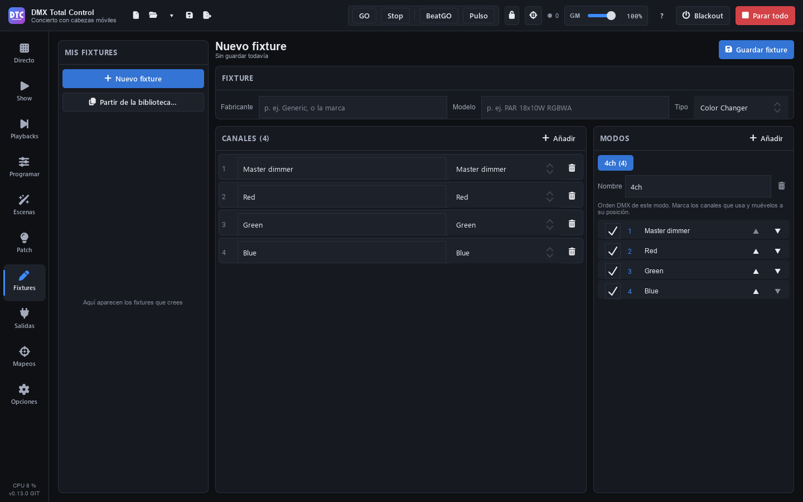

# Fixtures

Pour patcher un appareil, le programme a besoin de sa **définition** : les canaux qu’il a, ce que fait chacun et les modes dans lesquels il fonctionne. Cette page explique d’où viennent les définitions et comment créer les vôtres dans la page **Fixtures** (F6).

## La bibliothèque de fixtures

Quand vous ajoutez des fixtures dans le [Patch](patch.md#ajouter-des-fixtures), vous choisissez parmi toutes ces définitions :

- **La bibliothèque intégrée** : des milliers de fixtures de nombreux fabricants, au format `.qxf`.
- **Les génériques** : 16 fixtures de base sous le fabricant **Generic** (PAR LED RGB, RGBA, RGBW, RGBWA, RGBWA+UV et blanc, barre LED de 8 segments, lyres spot, beam et wash, scanner, stroboscope, blinder, laser, machine à fumée et hazer), plus le **Generic Dimmer**.
- **L’Open Fixture Library**, si vous la téléchargez.
- **Les fixtures GDTF** que vous importez.
- **Vos fixtures** : ceux que vous créez dans cette page ou que vous importez.

Dans [Options › Bibliothèque de fixtures](opciones.md#bibliothèque-de-fixtures), vous voyez combien de définitions sont disponibles et vous trouvez tout ce qu’il faut pour l’enrichir.

> **Conseil :** pour que Programmer, les FX et les palettes reconnaissent la fonction de chaque canal (dimmer, rouge, pan, gobo…), la définition doit fournir le groupe ou le preset du canal. Celles de la bibliothèque le fournissent ; dans les vôtres, choisissez bien le preset de chaque canal.

## Créer un fixture

La page **Fixtures** est le créateur de fixtures. À gauche, **« Mes fixtures »** liste ceux que vous avez créés ; à droite, l’éditeur.

1. Appuyez sur **« Nouveau fixture »**, ou sur **« Partir de la bibliothèque… »** pour partir d’une copie d’un fixture existant (il porte le même nom avec « (copie) »).
2. Dans **Fixture**, tapez le **Fabricant** (par exemple `Generic` ou la marque), le **Modèle** (`PAR 18x10W RGBWA`) et choisissez le **Type**.
3. Ajoutez les **canaux** (voir ci-dessous).
4. Préparez les **modes**.
5. Appuyez sur **« Enregistrer le fixture »**.

Le fixture est immédiatement disponible dans le Patch, sous son fabricant. En haut s’affiche son état : « Modifications non enregistrées », « Enregistré dans vos fixtures » ou « Pas encore enregistré ». Si vous ouvrez un autre fixture alors qu’il y a des modifications non enregistrées, le programme demande s’il faut les abandonner (« Continuer à modifier » / « Abandonner les modifications »).

### Canaux

Dans **Canaux**, le bouton **« Ajouter »** propose les canaux les plus courants (dimmer, rouge, vert, bleu, blanc, ambre, UV, pan et pan fin, tilt et tilt fin, stroboscope, roue de couleur, roue de gobos, vitesse de pan/tilt) et **« Canal personnalisé »**.

Pour chaque canal :

- Son **nom** et son **preset** (la liste déroulante) : le preset dit ce que fait le canal. Changer de preset change aussi le nom, sauf si vous lui en avez donné un vous-même.
- La corbeille le supprime.

Un canal **« Personnalisé »** a en plus :

- **Groupe** : sa fonction générale (intensité, couleur, gobo, faisceau…).
- **Couleur** : pour un canal d’intensité, la couleur qu’il représente (rouge, vert…) ou « Aucun » pour un dimmer.
- **Fin** : c’est le canal fin (16 bits) d’un autre canal.
- **« Plages (N) »** : ce que fait chaque plage de valeurs DMX, par exemple 0-7 Fermé, 8-255 Stroboscope. Appuyez sur **« Ajouter une plage »** et tapez sa **Description**. Les plages ne peuvent pas se chevaucher. Ce sont les presets que vous verrez ensuite en boutons dans Programmer.

Les nouveaux canaux s’ajoutent à la fin du mode ouvert.

### Modes

Dans **Modes**, **« Ajouter »** crée un mode avec tous les canaux. Chaque onglet est un mode :

- **Nom** du mode et la corbeille pour le supprimer (il en reste toujours un).
- La liste est l’**ordre DMX** du mode : cochez les canaux qu’il utilise et placez-les avec **▲ ▼** à leur position. Le numéro de gauche est son canal DMX dans le mode.

### Supprimer un de vos fixtures

Ouvrez le fixture dans « Mes fixtures » et appuyez sur **« Supprimer »**. Il disparaît de la bibliothèque au prochain démarrage.

Vos fixtures sont enregistrés en fichiers `.qxf` dans le dossier des fixtures utilisateur (dans Options › « Dossier des fixtures utilisateur » › « Ouvrir le dossier »).

## Open Fixture Library

L’Open Fixture Library est une bibliothèque ouverte avec des milliers de fixtures supplémentaires (licence MIT).

1. Ouvrez **Options** (F9).
2. Dans **Bibliothèque de fixtures › Open Fixture Library**, appuyez sur **« Télécharger »**. Il faut internet.
3. Attendez la fin de la barre de progression (« Annuler » l’arrête).

À la fin, le programme indique combien de fixtures ont été téléchargés et combien sont nouveaux. Ensuite, au même endroit, vous voyez combien elle en contient et quand elle a été téléchargée.

Pour la mettre à jour, appuyez sur **« Mettre à jour »** (le même bouton). Si « Rechercher les mises à jour au démarrage » est activé dans Options, le programme vérifie une fois par jour sur GitHub si la bibliothèque a de nouveaux fixtures ou des fixtures améliorés depuis votre téléchargement, vous prévient et met le bouton en évidence ; « Rechercher les mises à jour » vérifie sur-le-champ. La mise à jour :

- ajoute les nouveaux fixtures (ils sont listés en dessous) ;
- modifie ceux qui ont été améliorés, y compris ceux que vous avez patchés (si leur nouveau mode ne tient pas là où ils sont, ils gardent la version précédente jusqu’à ce que vous les patchiez à nouveau) ;
- conserve ceux que la bibliothèque n’a plus, au cas où un show les utilise ;
- ne touche ni à vos fixtures ni à ceux de la bibliothèque intégrée : s’ils ont le même fabricant et le même modèle, c’est le vôtre (ou celui de la bibliothèque intégrée) qui reste.

Un téléchargement illisible, ou interrompu, ne change rien.

## Importer GDTF

GDTF est le format ouvert que les fabricants publient sur GDTF-Share (avec un compte gratuit).

1. Téléchargez les `.gdtf` de vos appareils (ou le `.zip` du téléchargement groupé de GDTF-Share). Le bouton **« GDTF-Share »** des Options ouvre son site.
2. Dans **Options › Bibliothèque de fixtures › Fixtures GDTF**, appuyez sur **« Importer GDTF… »** et choisissez les fichiers, les dossiers ou le `.zip`.
3. Ils sont convertis en arrière-plan, avec une barre de progression. **« Arrêter »** interrompt l’import.

À la fin, le programme indique combien ont été convertis et, si certains n’ont pas pu être lus, pourquoi. Si le même fixture est déjà dans une autre bibliothèque, celui de GDTF est ajouté avec « (GDTF) » et vous pouvez utiliser les deux. L’importer à nouveau le met à jour.

De chaque mode, seul le premier *DMX break* est utilisé ; les canaux virtuels (sans DMX) sont ignorés.

## Importer des fichiers de fixtures

**Options › Importer des fichiers de fixtures › « Importer… »** accepte des définitions `.qxf` (le format de QLC+), des fichiers `.gdtf` ou un `.zip` qui les contient. Ils sont ajoutés à la bibliothèque et le programme indique combien sont nouveaux.

### Importer mes fixtures QLC+

Si vous avez créé des fixtures dans QLC+ sur cet ordinateur, **Options › « Importer mes fixtures QLC+ » › « Importer »** les copie dans vos fixtures.

## Formats qui ne s’importent pas

Les bibliothèques d’autres programmes dans des formats fermés ou chiffrés ne peuvent pas être importées. La plupart des fixtures existent dans l’Open Fixture Library ou sur GDTF-Share ; ceux qui manquent, créez-les dans cette page.
