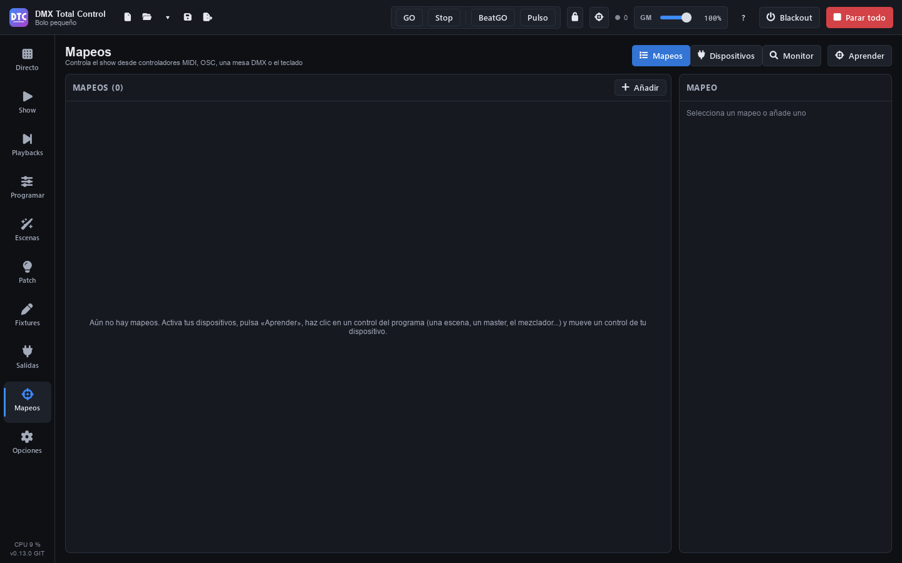

# Mappages

**Mappages** (F8) sert à piloter le show depuis l’extérieur : contrôleurs **MIDI**, **OSC** depuis une autre application, une console par **entrée DMX** ou le **clavier**. Un mappage relie un contrôle de votre appareil (un pad, un fader, une touche…) à un élément du programme (une scène, un master, un GO…). Les mappages sont enregistrés avec le show.

La page a trois onglets : **« Mappages »**, **« Appareils »** et **« Moniteur »**, et le bouton **« Apprendre »**.

## Appareils

Dans **« Appareils »** apparaissent les appareils d’entrée que le programme trouve, avec leur type (MIDI, OSC ou DMX), leur nom et l’univers qu’ils utilisent. Les contrôleurs (MIDI et OSC) et les appareils que vous utilisez déjà viennent d’abord, sous **« Contrôleurs et appareils utilisés »** ; ensuite, sous **« Entrées DMX : interfaces et réseau »**, les autres entrées DMX, avec une ligne par carte réseau.

1. Branchez le contrôleur et, s’il n’apparaît pas, appuyez sur **« Rechercher à nouveau »**.
2. Activez son **« Entrée »**.
3. Si l’appareil a une sortie, activez **« Feedback (LED) »** pour que le programme allume ses LED ou bouge ses faders motorisés.

Sur une Akai APC (APC mini, APC mini mk2 ou APC40 mkII) dont l’entrée et le feedback sont activés apparaît **« Préparer »**. Ce bouton met le contrôleur dans le mode qu’utilisent ses mappages et renvoie toutes ses LED. Utilisez-le après avoir éteint et rallumé le contrôleur ou après avoir changé son mode.

Le mappage d’un appareil non connecté est conservé : il fonctionne à nouveau quand vous le connectez.

L’entrée d’un appareil MIDI amène aussi son timecode MIDI (MTC) aux [cuelists « Timecode »](escenas.md#options-de-la-cuelist) qui le suivent. Il suffit d’activer son **« Entrée »** ; aucun mappage n’est nécessaire.

## Mode Mapper

Le moyen le plus rapide de créer des mappages est le **mode Mapper** (« Apprendre ») :

1. Activez l’entrée de votre appareil dans « Appareils ».
2. Appuyez sur la **cible** de la barre du haut (ou sur **« Apprendre »** dans cette page). Les contrôles qui peuvent être mappés sont marqués en **violet** ; un nombre dans le coin indique combien de mappages ils ont déjà.
3. Cliquez sur un contrôle du programme : une scène de Direct, un master, un bouton du mixeur, un playback…
4. La barre violette indique « Bougez un contrôle de votre appareil ou appuyez sur une touche pour : … ». Bougez le fader, appuyez sur le pad ou sur une touche.
5. Le programme confirme « Mappé : … ». Passez au contrôle suivant.
6. Appuyez sur **« Terminé »** (ou Échap) pour sortir.

En mode Mapper, **Maj+clic** utilise le contrôle au lieu de le mapper. **Échap** annule le contrôle en attente ; un autre Échap quitte le mode. Le bouton « Mappages » de la barre violette vous amène sur cette page.

Un contrôle du programme peut avoir plusieurs mappages (par exemple, un pad d’un contrôleur et une touche).

> **Conseil :** quand vous apprenez un bouton d’une Akai APC, le mappage arrive déjà avec les LED en vert pendant que l’élément joue.

### Ce qui peut être mappé

- **Barre du haut** : GO, Stop, BeatGO, grand master, Blackout et Tout arrêter.
- **Direct** : chaque scène, ◀ ▶, Pause et Libérer les groupes de l’en-tête, et dans chaque groupe sa libération, précédent, suivant et master.
- **Mixeur** : sur chaque bande, le dimmer, la teinte, la saturation, le stroboscope et sa vitesse, et les boutons Full, Blackout, Flash, Flash excl. et Full excl.
- **Programmer** : les palettes.
- **Playbacks** : les noms de page, ◀ ▶ de page, « Tout libérer », « Retour », le grand GO, et pour chaque playback sa ×, son nom (sélectionner), ses trois boutons et son fader.
- **SHOW** : les boutons et les faders (le fader entier, avec tous ses éléments), et ◀ ▶ des sections de playbacks.

## La liste des mappages

Dans **« Mappages »**, chaque ligne affiche le contrôle de l’appareil, ce qu’il pilote et son comportement. Un point violet indique un bouton et un point bleu un fader. Cliquez sur un mappage pour le modifier à droite, ou appuyez sur **« Ajouter »** pour en créer un vide.

Les touches et les boutons du contrôleur des listes de cues de QLC+ peuvent arriver comme mappages, et ceux de vos cuelists vont dans la copie pour QLC+ (voir [Scènes](escenas.md#cuelists-et-qlc)).

## Modifier un mappage

### Contrôle

- **Le type** : **MIDI**, **OSC**, **« Entrée DMX »** ou **« Clavier »**.
- **Appareil** : un appareil précis ou **« Tout appareil »**.
- **MIDI** : **CC** ou **Note**, son numéro (0–127) et le **Canal** MIDI (1–16).
- **OSC** : le chemin, par exemple `/scene/1`.
- **Entrée DMX** : le **Canal** (1–512).
- **Clavier** : la touche, par exemple `Q` ou `F9`.
- **« Apprendre le contrôle »** : appuyez dessus puis bougez le contrôle de l’appareil pour remplir tout ce qui précède.

### Pilote

Ce que fait le mappage. Les **boutons** :

| Destination | Ce qu’il fait |
|---|---|
| Lancer une scène | La scène choisie (ou « La scène sélectionnée »), dans son groupe. |
| Scène N d’un groupe | La scène qui occupe cette place dans le groupe (**Numéro de scène**). |
| Libérer un groupe / Scène suivante d’un groupe / Scène précédente d’un groupe | Dans un groupe ou dans « Tous les groupes ». |
| Blackout, Tout arrêter, Tout mettre en pause, Tap tempo, BeatGO, GO, Stop | Comme leurs boutons (GO et Stop choisissent le mode, comme dans la barre du haut : l’un des deux est toujours allumé). |
| Palette | La palette sur ses propres fixtures ou sur un groupe de fixtures. |
| Mixeur : full, blackout, flash, flash exclusif, full exclusif, stroboscope | Sur la bande choisie du mixeur. |
| Playback : GO, retour, pause / retour, flash, libérer, sélectionner | Sur un playback. |
| Playback : aller à une cue | Saute à la **Cue** indiquée (1 est la première de la liste). |
| GO du playback sélectionné / Retour du playback sélectionné | Comme le grand GO et « Retour » de Playbacks. |
| Page de playbacks N / suivante / précédente | Change la page de playbacks. |
| Libérer tous les playbacks | Comme « Tout libérer ». |

Les **faders** :

| Destination | Ce qu’il bouge |
|---|---|
| Grand master | Le GM. |
| Master d’un groupe | Le master de ce groupe. |
| Dimmer en direct d’une scène / Vitesse en direct d’une scène | Les curseurs en direct de la scène choisie (ou « La scène sélectionnée »). |
| BPM | Le tempo. |
| Mixeur : dimmer, teinte, saturation, vitesse du stroboscope | Sur la bande choisie. |
| Fader du SHOW | Un fader du SHOW entier. |
| Playback : fader | Le fader d’un playback. |
| Vitesse des cues (toutes les cuelists) | La [vitesse de toutes les cuelists](playbacks.md#vitesse-des-cues) : ×0,1 en bas, ×1 au milieu, ×10 en haut. |
| Temps en direct d’un playback / Temps en direct du playback sélectionné | Le [temps de la cue](playbacks.md#temps-en-direct) en cours de fondu. En fader : au milieu, le temps avec lequel elle a commencé ; en bas ×0,1 et en haut ×10. En encodeur ou par pressions : 10 % de plus ou de moins par pas. |

Pour les playbacks, vous choisissez la **page** (« Page actuelle (suit) », qui suit la page affichée, ou une page fixe) et le numéro de **Playback**. Avec **« Ou une cuelist ou une scène, où qu’elle soit »**, le mappage agit sur cette cuelist ou cette scène sur n’importe quel playback où elle se trouve. Dans « aller à une cue », vous voyez à quelle cue il mène maintenant (« Maintenant : cue 3 de Chanson 1 »).

### La scène sélectionnée

Dans « Lancer une scène », « Dimmer en direct d’une scène » et « Vitesse en direct d’une scène », la liste des scènes commence par **« La scène sélectionnée »**. Ce mappage agit sur la dernière scène sur laquelle vous avez appuyé.

- **Sélectionnent une scène** : appuyer dessus dans Direct, sur un bouton du SHOW, sur un contrôleur ou sur le téléphone, et la lancer avec « Scène suivante d’un groupe » ou « Scène précédente d’un groupe ».
- **Ne la changent pas** : les faders du SHOW, les playbacks, les actions des cues et « Essayer » dans Scènes.
- Elle reste sélectionnée quand elle s’arrête. Elle n’est pas enregistrée : à l’ouverture d’un show ou d’un nouveau show, il n’y en a aucune.
- Sous la liste, vous voyez laquelle c’est maintenant (« Maintenant : Couplet »). Sans aucune, le mappage ne fait rien et sa LED reste éteinte.
- Un bouton lance, arrête ou flashe la scène sélectionnée au moment où vous appuyez, dans son groupe et selon GO / Stop. Sa LED montre l’état de cette scène.
- Sur un fader absolu, **« Reprendre le fader (sans moteur) »** s’active : quand la scène change, le niveau ne saute pas. Le fader prend la main quand il rejoint le niveau de la nouvelle scène. Vous pouvez le désactiver.
- Dans Direct, la scène sélectionnée porte une fine barre sur son bord inférieur, tant qu’un mappage utilise « La scène sélectionnée » ou en mode Mapper.

Exemple : les pads de l’APC lancent des scènes, et ainsi les sélectionnent. Un bouton rotatif va sur « Vitesse en direct d’une scène » › « La scène sélectionnée ». Il change la vitesse de la dernière scène sur laquelle vous avez appuyé.

### Comportement

Pour les **boutons** :

- **« Bascule : chaque appui on / off »** : chaque appui allume ou éteint. Sur une scène, il s’appelle **« Appuyer : selon GO / Stop »** : il la lance ou l’arrête selon GO et Stop de la barre du haut.
- **« Flash : tant qu’on appuie »**.
- **« Allumer seulement »** / **« Éteindre seulement »**.

Les boutons de playback agissent à l’appui, sauf le flash, et n’ont pas cette option.

Le flash d’un playback utilise l’attaque et la retombée de ce playback (voir [Propriétés d’un playback](playbacks.md#propriétés-dun-playback)). Avec « Ou une cuelist ou une scène, où qu’elle soit », il utilise celles du premier playback qui la contient ; si elle n’est sur aucun playback, c’est immédiat. Avec « Bascule », un appui pendant la retombée le fait remonter.

Pour les **faders** :

- **« Absolu : suit le fader »**.
- **« Incrémental : un pas par appui »** (pour des boutons qui montent ou descendent).
- **« Relatif : encodeur sans fin »** et **« Relatif : encodeur, 1 monte et 127 descend »** (encodeurs sans fin).
- **« De »** … **« à »** : la plage, de 0 à 100 %. **« Inverser »** la retourne.
- **« Pas % »** et **« En boucle »** (incrémental et relatif).
- **« Reprendre le fader (sans moteur) »** (absolu) : le fader du contrôleur ne pilote le niveau qu’après l’avoir rejoint, sans sauts. Avec un fader motorisé, ce n’est pas nécessaire. Sur le fader A/B d’un playback, la première valeur reçue dit seulement où il est ; ensuite, le fader du contrôleur doit rejoindre celui de l’écran.

### Feedback

En MIDI ou OSC, **« Feedback »** fait que le programme **allume le bouton de l’appareil** ou **bouge son fader motorisé**. Seul ce qui change est envoyé.

Un fader motorisé (absolu) ne bouge pas pendant que vous le bougez. Le programme attend que vous le laissiez immobile 0,4 s et ne le corrige que si sa cible a fini à une autre valeur, par exemple parce qu’autre chose l’a changée. Tant que vous n’y touchez pas, l’écran, une autre page de playbacks ou un autre contrôle le bougent aussitôt. Les encodeurs et les boutons n’attendent pas.

Pour les LED des boutons MIDI :

1. Dans **« LED de »**, choisissez **« Tout contrôleur (numéros) »** ou votre contrôleur : **Akai APC mini**, **Akai APC mini mk2** ou **Akai APC40 mkII**.
2. Pour **« Activé »**, **« Désactivé »**, **« En pause »** et, sur les scènes, **« En fondu »**, choisissez la couleur dans les échantillons (sur une APC) ou tapez la valeur (0–127) pour tout autre contrôleur.
3. Sur les pads RGB, choisissez aussi comment ils s’allument : **« Atténué »**, **« Plein »**, **« Pulsé »** ou **« Clignotant »** sur l’APC mini mk2, et **« Fixe »**, **« Pulsé »** ou **« Clignotant »** sur l’APC40 mkII. En pulsé ou en clignotant, le pad alterne entre la couleur et le noir. Sans rien choisir, « Activé » s’allume en **« Plein »** (**« Fixe »** sur l’APC40 mkII), « Désactivé » en **« Atténué »** (**« Fixe »** sur l’APC40 mkII) et « En fondu » en **« Pulsé »**.

**« En fondu »** (sur « Lancer une scène » et « Scène N d’un groupe ») : activez **« Couleur propre pendant le fondu »** et le bouton prend cette couleur pendant que la scène entre avec son fondu et pendant qu’elle sort avec le sien. Sur une cuelist, il la prend pendant le fondu de sa cue. Sinon, à l’entrée il s’allume comme « Activé » et à la sortie comme « Désactivé ». Une scène en pause ou en attente s’allume comme « En pause ».

Les LED du contrôleur s’éteignent quand vous fermez le programme, quand vous effacez un mappage ou le déplacez vers un autre contrôle, quand vous ouvrez un autre show ou quand vous désactivez l’appareil ou son feedback.

### Dupliquer et supprimer

**« Dupliquer »** crée une copie du mappage (utile pour un autre appareil ou un autre canal) et **« Supprimer »** l’efface.

## Clavier

Les mappages de clavier fonctionnent sur n’importe quelle page et ont la priorité sur les raccourcis du programme qui utilisent la même touche. Ils ne se déclenchent pas pendant que vous tapez dans un champ de texte (dans Programmer, tant que la ligne de commande a le clavier) ni avec Ctrl ou Alt enfoncé. Les boutons du SHOW ont en plus leur propre touche, qui ne fonctionne que sur la page Show (voir [Show](show.md#options-dun-bouton)).

## Modèles pour Akai APC

**« Tout mapper »** assigne d’un coup un contrôleur entier. Ce bouton se trouve sur chaque appareil MIDI de l’onglet « Appareils » :

1. Appuyez sur **« Tout mapper »** sur votre contrôleur.
2. Choisissez le modèle :
   - **« Akai APC mini → Groupes »** / **« Akai APC mini mk2 → Groupes »**
   - **« Akai APC mini → Playbacks »** / **« Akai APC mini mk2 → Playbacks »**
   - **« Akai APC40 mkII → Playbacks »**
3. Lisez ce que fait chaque contrôle et appuyez sur **« Mapper »**. Les mappages que cet appareil avait sont remplacés ; si son entrée était désactivée, elle est activée.

**→ Groupes** (APC mini et mk2) : chaque colonne de pads lance les scènes d’un groupe (vert : en cours ; jaune : prête ; éteint : pas de scène). Les faders sont les masters des groupes et le dernier le grand master. Les boutons sous les pads libèrent les groupes ; ceux de droite sont blackout, tout arrêter, pause, tap, BeatGO, précédent, suivant et flash.

**→ Playbacks** (APC mini et mk2) : chaque colonne est un playback 1-8 de la page de playbacks actuelle : son fader (il reprend le niveau) et, depuis le bas, GO, Pause/Retour, Flash et ses 5 premières cues (la cue 1 en haut). Le bouton sous les pads le libère. Le dernier fader est le grand master ; les boutons de droite sont page précédente et suivante, GO et Retour du playback sélectionné, blackout, tap, BeatGO et tout arrêter. Si le fader d’un playback est en A/B (voir [Le fader](playbacks.md#le-fader)), chaque course du fader de l’APC est un GO dont vous faites le fondu à la main.

**→ Playbacks** (APC40 mkII) : chaque piste est un playback 1-8 de la page actuelle : son fader, GO sur le bouton de piste, Pause/Retour sur S, Flash sur l’armement d’enregistrement, sélectionner et libérer, et ses 5 premières cues sur les clips (vert : en cours ; vert pulsé : la suivante ; bleu atténué : les autres). Les boutons de scène vont aux pages 1-5, les boutons de banque changent la page et le groupe, et Play et Record sont GO et Retour du playback sélectionné. Les potentiomètres device sont les faders des playbacks 9-16 et les potentiomètres de piste, les masters des premiers groupes.

L’APC mini mk2 passe d’elle-même en mode Session, et l’APC40 mkII en mode Ableton : au démarrage du programme, à l’ouverture d’un show, quand vous activez son feedback et avec « Tout mapper ». En mode Note ou Batterie, les pads de la mk2 n’atteignent pas les mappages.

> **Conseil :** après « Tout mapper », chaque contrôle apparaît comme un mappage normal dans la liste : vous pouvez changer n’importe lequel, ou l’effacer, sans toucher aux autres.

## Moniteur

**« Moniteur »** affiche les **messages entrants et sortants** : l’heure, **IN** ou **OUT**, l’appareil (ou « Clavier »), le message et sa valeur. Bougez un contrôle d’un appareil activé pour voir ce qu’il envoie. **« Effacer »** vide la liste.

Le moniteur affiche en **OUT** les changements de mode envoyés par le programme : « SysEx · mode Session » sur l’APC mini mk2 et « SysEx · mode Ableton » sur l’APC40 mkII.

Le voyant vert de la cible, dans la barre du haut, clignote à chaque message reçu.

## Alt+clic

Hors du mode Mapper, **Alt+clic** sur un contrôle mappable l’envoie au SHOW : voir [Show](show.md#envoyer-nimporte-quel-contrôle-au-show).
