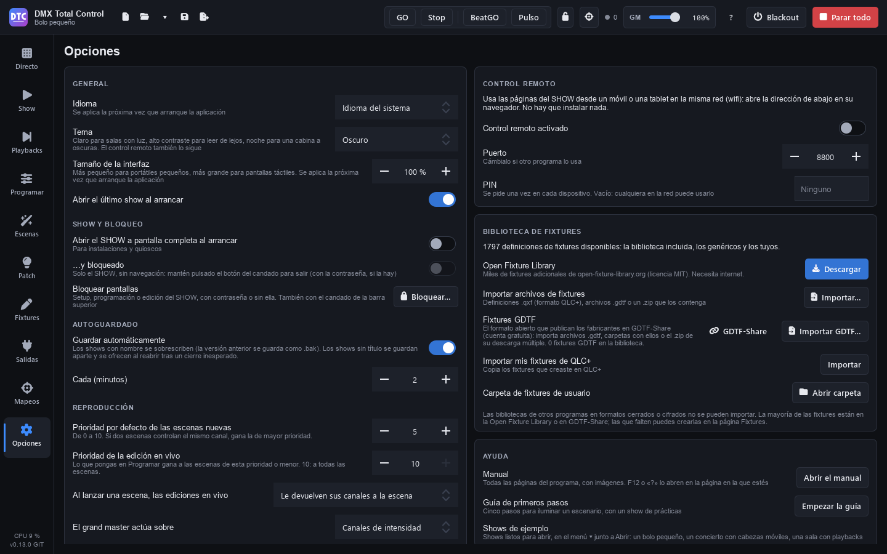

# Options

**Options** (F9) réunit les réglages du programme. À gauche se trouvent les réglages généraux, le démarrage, le verrouillage, la sécurité pendant le show, la sauvegarde automatique, la lecture et l’audio ; à droite, la télécommande, la bibliothèque de fixtures, les mises à jour, l’aide et « À propos ».

Les réglages de cette page appartiennent à l’ordinateur, pas au show : ils valent pour tous les shows que vous ouvrez. Seul l’arrêt du show (dans [Sécurité pendant le show](opciones.md#arrêt-du-show)) est enregistré avec le show.

## Général

- **Langue** : « Langue du système », Español, English, Português, Français, Italiano ou Deutsch. S’applique au prochain démarrage du programme.
- **Thème** : **Sombre**, **Clair**, **Contraste élevé** ou **Nuit (atténué)**. Il change immédiatement. Clair, pour les salles éclairées ; Contraste élevé, pour lire de loin ; Nuit, très sombre et en rouge, pour une régie dans le noir sans vous éblouir. La [télécommande](remoto.md) suit le même thème.
- **Taille de l’interface** : de 80 % à 150 %, plus petite pour les petits portables et plus grande pour les écrans tactiles. S’applique au prochain démarrage du programme.
- **Ouvrir le dernier show au démarrage**.

> **Conseil :** le thème Clair convient mieux aux répétitions de jour ou en plein air ; Contraste élevé, quand il y a beaucoup de lumière autour de l’écran.

## SHOW et verrouillage

- **Ouvrir le SHOW en plein écran au démarrage** : pour les installations et les bornes. Le programme démarre sur la page Show en plein écran.
- **…et verrouillé** : il démarre en plus verrouillé : seulement le SHOW, sans navigation. Pour sortir, maintenez le bouton du cadenas enfoncé (avec le mot de passe, s’il y en a un). Voir [Show](show.md#plein-écran-et-verrouillage).
- **Verrouiller les écrans** : **« Verrouiller… »** / **« Déverrouiller… »**. C’est la même chose que le cadenas de la barre du haut.

### Verrouiller les écrans

Le verrouillage évite que quelque chose change par erreur pendant le show. Direct et le SHOW continuent de fonctionner, et les playbacks continuent de jouer.

1. Appuyez sur le **cadenas** de la barre du haut (ou sur « Verrouiller… » ici).
2. Choisissez ce qu’il faut verrouiller :
   - **Configuration** : Patch, Fixtures, Sorties, Mappages et Options. Il n’est pas non plus possible d’ouvrir ou de créer un autre show.
   - **Programmation** : Programmer et Scènes. Dans Playbacks, il n’est pas possible d’enregistrer, de mettre à jour ni d’assigner.
   - **Modification du SHOW** : les pages du SHOW s’utilisent, elles ne se modifient pas.
3. Si vous le souhaitez, tapez un **mot de passe** (il est facultatif).
4. Appuyez sur **« Verrouiller »**.

Les pages verrouillées portent un cadenas dans la barre latérale. Quand vous en ouvrez une, le mot de passe est demandé (s’il y en a un) et tout est déverrouillé. Pour déverrouiller, appuyez sur le cadenas de la barre du haut. **« Supprimer le mot de passe »** se trouve dans la même fenêtre, au moment de verrouiller.

## Sécurité pendant le show

Ce qui protège le show pendant le direct (voir [Sécurité pendant le show](directo.md#sécurité-pendant-le-show)) :

- **Garder l’ordinateur éveillé** (activé par défaut) : tant que le programme est ouvert, Windows ne met pas l’ordinateur en veille et n’éteint pas l’écran. Quand vous fermez le programme, ou désactivez ce réglage, Windows recommence comme d’habitude. Rien ne change dans les réglages de Windows.
- **Mode show** (désactivé par défaut) : fermer le programme ou ouvrir un autre show demande de maintenir un bouton enfoncé. Verrouiller le SHOW l’active ; le déverrouiller ne le désactive pas. Le bouclier de la barre du haut l’active et le désactive aussi (voir [Mode show](directo.md#mode-show)).
- **Tout arrêter en fondu** : de 0 à 5 s (0 par défaut : tout de suite, comme toujours). Les fonctions baissent pendant cette durée ; Échap deux fois, tout de suite. Pendant 10 secondes, Ctrl+Z ramène ce qui a été arrêté (voir [Tout arrêter en fondu](directo.md#tout-arrêter-en-fondu)).
- **Désarmer les effets inutilisés après** : de 0 à 120 minutes sans déclenchement (10 par défaut ; 0, « Jamais »). Jamais pendant qu’un effet se déclenche (voir [Effets spéciaux protégés](directo.md#effets-spéciaux-protégés)).
- **Sur batterie** et **La suspension sélective USB est activée** n’apparaissent que quand c’est le cas. Le premier dit combien de batterie il reste ; le second a **« Comment la désactiver »**, qui ouvre la section [Suspension sélective USB](opciones.md#suspension-sélective-usb), plus bas.

### Arrêt du show

Ce qu’éclaire l’[arrêt du show](directo.md#arrêt-du-show), et à quel niveau. Ceci est enregistré avec le show, dans sa section de DMX Total Control (QLC+ ne le lit pas).

- **Fixtures** : **« Toutes les lumières »** (par défaut) ou **« Ces groupes… »**, qui ouvre la liste des groupes de fixtures du show pour les cocher (« Groupes qu’éclaire l’arrêt du show »). Sans aucun coché, toutes les lumières. Un groupe supprimé disparaît de lui-même. Des groupes choisis, seules les lumières s’allument : jamais leur fumée, leurs hazers, leurs stroboscopes ni leurs lasers.
- **Niveau** : de 0 à 100 % (100 par défaut).

S’allument les lyres, les scanners, les PAR et washes, les barres LED, les blinders et les dimmers. Un dimmer générique (Generic › Generic Dimmer) seulement quand son nom dit que c’est une lumière (PAR, FRESNEL, DIMMER, BLINDER, PROJECTEUR, DÉCOUPE, CONTRE, LUMIÈRE, SPOT, PC, SALLE…) ou que son icône sur le plan est celle d’une lumière. Ceux qui s’appellent VIDÉO, TRIGGER, DÉCLENCHEUR, RELAIS, MOTEUR, ÉCRAN, KABUKI, RIDEAU… restent tels quels, même dans un groupe choisi ; un PYRO… est un effet spécial protégé et s’éteint. Pour en éclairer un, donnez-lui une icône de lumière dans Patch › « Aspect » › « Icône ». Les dimmers de la bibliothèque s’allument comme toujours.

### Suspension sélective USB

Windows peut suspendre un port USB qui lui semble inactif pour économiser l’énergie, et l’interface DMX avec lui : la sortie s’arrête en plein show. C’est un réglage du mode de gestion de l’alimentation de Windows. Le programme ne fait que le lire au démarrage (et le signale par une barre bleue et sur cette page) : il ne le change jamais. Pour la désactiver :

1. Ouvrez le **Panneau de configuration** › **Matériel et audio** › **Options d’alimentation**.
2. À côté du mode que vous utilisez, cliquez sur **« Modifier les paramètres du mode »**, puis sur **« Modifier les paramètres d’alimentation avancés »**.
3. Ouvrez **« Paramètres USB »** › **« Paramètre de la suspension sélective USB »** et choisissez **« Désactivé »** pour **« Sur batterie »** et pour **« Sur secteur »** (sans batterie, il n’y a qu’une valeur).
4. Cliquez sur **« OK »**.

Si l’interface s’arrête encore, ouvrez le **Gestionnaire de périphériques** et, dans les propriétés de chaque **« Concentrateur USB racine »**, onglet **« Gestion de l’alimentation »**, décochez **« Autoriser l’ordinateur à éteindre ce périphérique pour économiser l’énergie »**. Les noms peuvent un peu changer selon la version de Windows.

> **Non testé avec du matériel réel :** les changements de batterie et d’alimentation, le pourcentage de batterie, l’effet réel de garder l’ordinateur éveillé et la lecture de la suspension sélective USB.

## Sauvegarde automatique

- **Enregistrer une copie de récupération**, **Toutes les (minutes)** : de 1 à 60.

La sauvegarde automatique ne touche pas au fichier du show : toutes les quelques minutes, s’il y a des modifications non enregistrées, elle enregistre à part une copie de récupération, et le point **●** reste affiché. Seul **Enregistrer** écrit le fichier ; la version d’avant le premier enregistrement de chaque session est gardée en `.bak`. La copie est supprimée quand vous enregistrez, quand vous fermez (en enregistrant ou non) et quand vous ouvrez un autre show. Si le programme se ferme de façon inattendue, il vous propose la copie à la réouverture (« Récupérer le show non enregistré ? »), avec le nom du show et l’heure de la copie : la récupérer ouvre ce show avec ses modifications, toujours non enregistrées ; enregistrez-le pour les garder. Pendant ce temps, le dernier show est déjà ouvert tel qu’il était enregistré (avec « Ouvrir le dernier show au démarrage ») : « Abandonner » le laisse ainsi. La barre du haut affiche l’heure de la dernière copie (« copie de récupération… ») ; si elle échoue (un disque plein), un avertissement apparaît en rouge.

## Lecture

- **Priorité par défaut des nouvelles scènes** : de 0 à 10. Si deux scènes contrôlent le même canal, la priorité la plus haute l’emporte (voir [Priorités](directo.md#priorités)).
- **Priorité des modifications en direct** : ce que vous réglez dans Programmer l’emporte sur les scènes de cette priorité et en dessous. Avec 10, sur toutes les scènes.
- **Quand une scène démarre, les modifications en direct** :
  - **« Rendent ses canaux à la scène »** : les canaux que touche la scène ne sont plus dans le programmeur.
  - **« Restent toujours »**.
  - **« Sont toutes réinitialisées »** : le programmeur est vidé.
- **Le grand master agit sur** : **« Canaux d’intensité »** (la lumière : les dimmers et les couleurs des fixtures sans dimmer) ou **« Tous les canaux »**.

## Audio

- **Entrée audio** : le micro ou l’entrée ligne qu’écoutent **Pulsation** et les matrices audio. **« Par défaut du système »** utilise celle du système d’exploitation. Pulsation change d’entrée immédiatement ; une matrice audio déjà en cours, à son prochain démarrage. Une entrée choisie qui n’est pas connectée pour l’instant apparaît comme « (non connectée) », et en attendant, celle par défaut est utilisée.

## Shows récents

La liste des derniers shows ouverts (aussi dans la flèche **▾** de la barre du haut). **« Vider la liste »** l’efface.

## Télécommande

Pour utiliser les pages du SHOW depuis un téléphone ou une tablette sur le même réseau Wi-Fi, sans rien installer :

- **Télécommande activée**.
- **Port** : changez-le si un autre programme l’utilise (par défaut, 8800). S’il est occupé, un avertissement apparaît en rouge.
- **PIN** : demandé une fois sur chaque appareil. Vide, tout le monde sur le réseau peut l’utiliser.
- **Nom sur le réseau** : le téléphone ouvre la télécommande avec `http://dmxtotalcontrol.local:8800/`, même quand l’adresse de l’ordinateur change (iPhone, iPad et téléphones Android récents). Si un autre ordinateur utilise déjà le nom, celui-ci prend `dmxtotalcontrol-2`. Vide, il n’y a pas de nom. Si le port réseau 5353 n’est pas disponible, ou si d’autres ordinateurs utilisent le nom et `-2` à `-9`, un avertissement apparaît en rouge.
- Les **adresses** à ouvrir dans le navigateur du téléphone, avec un bouton pour les copier. Devant chacune figure le nom de son réseau, tel que Windows l’appelle (« Wi-Fi », « Ethernet 2 »). L’adresse **« Par son nom »** vient en premier, puis le Wi-Fi, le câble (Ethernet), et enfin les adaptateurs virtuels et les VPN. La liste se met à jour toute seule quelques secondes après la connexion ou la déconnexion d’un réseau. Si l’ordinateur n’est sur aucun réseau, un avertissement apparaît à la place.
- Un **code QR** de l’adresse encadrée (au début, la première numérique), pour l’ouvrir avec l’appareil photo du téléphone. Cliquez sur une autre adresse pour la changer. S’il y a un PIN, le code le contient et le téléphone entre sans le demander. **« Plus grand »** l’affiche en grand.
- Le nombre d’appareils connectés.

Voir [Télécommande](remoto.md).

## Bibliothèque de fixtures

Indique combien de définitions de fixtures sont disponibles (la bibliothèque intégrée, les génériques et les vôtres) et permet de l’enrichir :

- **Open Fixture Library** : **« Télécharger »** (nécessite internet). Une fois téléchargée, vous voyez combien de fixtures elle contient et quand elle a été téléchargée, et le bouton devient **« Mettre à jour »** : il apporte les fixtures nouveaux et améliorés, et conserve vos fixtures et ceux que la bibliothèque n’a plus. S’il y a des nouveautés, le programme le signale et le bouton est mis en évidence (voir [Fixtures](fixtures.md#open-fixture-library)).
- **Importer des fichiers de fixtures** : **« Importer… »** des définitions `.qxf` (le format de QLC+), des fichiers `.gdtf` ou un `.zip` qui les contient.
- **Fixtures GDTF** : **« GDTF-Share… »** recherche, télécharge et importe des fixtures de GDTF-Share (voir [Fixtures](fixtures.md#gdtf-share)) ; **« Importer GDTF… »** importe des fichiers, des dossiers ou le `.zip` de son téléchargement groupé. Indique combien de fixtures GDTF se trouvent dans la bibliothèque.
- **Fixtures téléchargés depuis GDTF-Share** : apparaît quand il y en a. **« Convertir à nouveau »** les convertit de nouveau avec cette version du programme, à partir du `.gdtf` conservé (voir [Fixtures](fixtures.md#convertir-à-nouveau)).
- **Révisions plus récentes sur GDTF-Share** : apparaît quand des fixtures GDTF de la bibliothèque ont une révision plus récente sur GDTF-Share. **« Mettre à jour »** les affiche dans GDTF-Share, où **« Tout mettre à jour »** télécharge la plus récente de chacun et la convertit : les fixtures patchés avec eux la reçoivent. Compte ceux que vous avez téléchargés depuis GDTF-Share. Un fichier importé à la main compte si le texte de sa dernière révision correspond à une seule révision de GDTF-Share. Utilise la dernière liste de GDTF-Share que le programme possède (voir [Fixtures](fixtures.md#révisions-plus-récentes)).
- **Importer mes fixtures QLC+** : **« Importer »** copie les fixtures que vous avez créés dans QLC+.
- **Dossier des fixtures utilisateur** : **« Ouvrir le dossier »**.

Tout cela est expliqué dans [Fixtures](fixtures.md).

## Mises à jour

- **Rechercher les mises à jour au démarrage** : une fois par jour, sur GitHub : le programme et, si vous avez téléchargé l’Open Fixture Library, si elle a de nouveaux fixtures (un avis le signale). Si vous avez enregistré votre compte GDTF-Share, il se connecte aussi à GDTF-Share et signale si les fixtures que vous y avez téléchargés ont des révisions plus récentes (chaque révision est signalée une fois). Rien n’est téléchargé ni installé sans vous le demander. Sans internet, cela ne gêne pas.
- **Inclure les versions de test** : les nouveautés plus tôt, moins testées.

En dessous s’affichent l’état (« Vous avez la dernière version », « La version … est disponible ») et les boutons :

- **« Rechercher les mises à jour »** : vérifie maintenant (l’Open Fixture Library aussi).
- **« Nouveautés »** : ce qui est nouveau dans cette version.
- **« Télécharger et installer »** : télécharge l’installateur et vérifie son empreinte SHA-256 avant de l’enregistrer. Si une version ne publie pas son empreinte, elle ne peut être téléchargée que depuis sa page (« Voir sur GitHub »).
- **« Installer maintenant »** : le programme se ferme (il propose d’abord d’enregistrer le show), la nouvelle version s’installe et le programme se rouvre.
- **« À la fermeture »** / **« Pas à la fermeture »** : l’installer quand vous fermez le programme.
- **« Voir sur GitHub »** : la page de la version.

Quand une nouvelle version existe, un avis apparaît aussi au-dessus des pages avec les mêmes boutons. **« Plus tard »** masque l’avis pour cette version ; elle reste disponible ici.

## Aide

- **Manuel** : **« Ouvrir le manuel »** ouvre ce manuel sur son sommaire. F12 ou le bouton **« ? »** de la barre du haut l’ouvrent sur la page où vous êtes. Il s’affiche dans la langue du programme (espagnol, anglais, portugais, français, italien ou allemand) ; les captures d’écran sont celles de la version espagnole.
- **Guide de premiers pas** : **« Lancer le guide »** rouvre le guide (voir [Premiers pas](primeros-pasos.md#le-guide)).
- **Shows d’exemple** : ils sont dans la flèche **▾** à côté d’« Ouvrir » dans la barre du haut, dans « Exemples » (voir [le sommaire](index.md#le-guide-et-les-shows-dexemple)).

## À propos

La version du programme, sa licence (logiciel libre, Apache 2.0) et les crédits.
