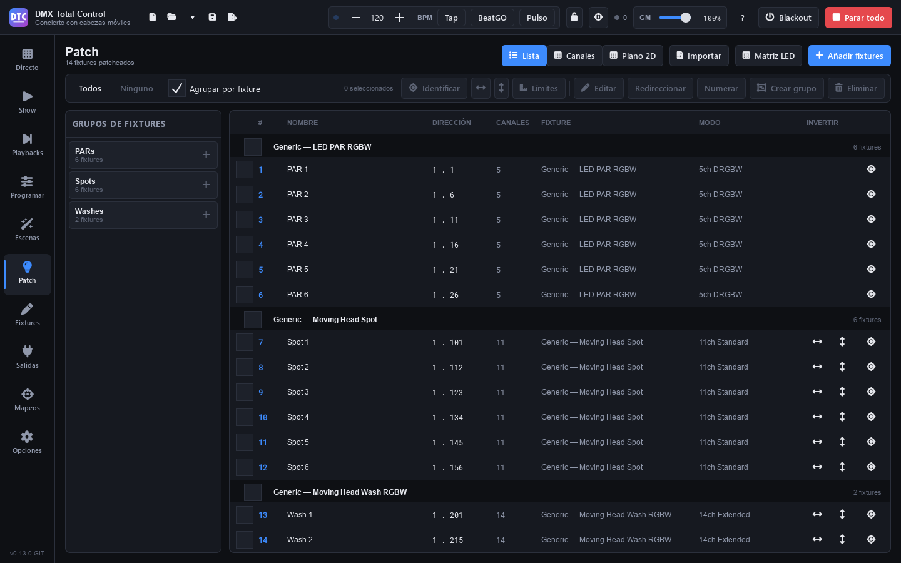

# Patch

**Patch** (F5) contient les fixtures de votre installation : ce qu’ils sont, dans quel univers et à quelle adresse ils se trouvent, leur numéro, les groupes de fixtures et leur place sur scène.

Dans l’en-tête, vous choisissez la vue et vous avez les outils pour ajouter :

- **« Liste »** : tous les fixtures par adresse.
- **« Canaux »** : les 512 canaux de chaque univers, avec les fixtures par-dessus.
- **« Plan 2D »** : la scène vue de dessus.
- **« Importer »**, **« Matrice LED »** et **« Ajouter des fixtures »**.

## Ajouter des fixtures

1. Appuyez sur **« Ajouter des fixtures »**.
2. Choisissez le **Fabricant** (tapez dans « Rechercher un fabricant… » pour filtrer) et le **Modèle**.
3. Dans le panneau **Patch** :
   - **Nom** : celui que vous verrez dans tout le programme (par défaut, celui du modèle).
   - **Mode** : le mode DMX, avec son nombre de canaux.
   - **Quantité** : combien de fixtures identiques.
   - **Univers** et **Adresse** : l’adresse se place toute seule sur la première libre de l’univers.
   - **Écart** : canaux libres entre un fixture et le suivant.
   - Avec plus d’un fixture, **« En faire un groupe »** et le nom du **Groupe**.
4. En bas, vous voyez les adresses qu’ils vont utiliser (« Utilise les adresses 1 à 20 »). S’ils ne tiennent pas dans ce qui reste de l’univers, ils passent au suivant. Si le mode a d’autres *DMX breaks* (un fixture GDTF avec deux entrées DMX), un avis vous demande de patcher aussi son mode « (DMX break 2) », à sa propre adresse.
5. Appuyez sur **« Patcher le fixture »** ou **« Patcher N fixtures »**.

La fenêtre reste ouverte pour continuer à ajouter, avec l’adresse déjà sur la suivante libre. Si quelque chose ne peut pas être patché (les adresses sont occupées, par exemple), la raison apparaît en rouge en bas. Appuyez sur **« Fermer »** quand vous avez terminé.

Pour des dimmers isolés, choisissez **Generic › Generic Dimmer** : au lieu d’un mode, vous indiquez combien de **Canaux**.

**« Rechercher sur GDTF-Share… »**, en bas, ouvre [GDTF-Share](fixtures.md#gdtf-share) : téléchargez le fixture et appuyez sur **« Le patcher »** pour qu’il soit choisi ici.

> **Conseil :** si vous ne trouvez pas votre fixture, cherchez-le sur GDTF-Share, téléchargez l’[Open Fixture Library](fixtures.md#open-fixture-library), importez son GDTF ou créez-le dans la page [Fixtures](fixtures.md).

## La liste

Colonnes : case de sélection, **#** (numéro), **NOM**, **ADRESSE** (univers . adresse), **CANAUX**, **FIXTURE** (fabricant et modèle), **MODE**, **INVERSER** (pan et tilt) et le bouton d’identification.

- **« Grouper par fixture »** les regroupe par modèle, avec une case pour sélectionner tous ceux de chaque modèle. Un clic sur l’en-tête d’un modèle le replie (masque ses fixtures) ou le déplie.
- Un **double-clic** sur un fixture le modifie.

## Sélectionner

Les outils de la barre agissent sur la sélection :

- **Clic** sélectionne ; **Ctrl+clic** ajoute ou retire ; **Maj+clic** sélectionne tous les fixtures depuis le dernier sur lequel vous avez cliqué jusqu’à celui-ci (dans ce sens, qui est l’ordre de la sélection), et **Ctrl+Maj+clic** les ajoute. **« Tout »** et **« Aucun »**. La case d’une ligne ajoute ou retire son fixture (comme Ctrl+clic) ; avec Maj, elle ajoute tous ceux depuis le dernier sur lequel vous avez cliqué.
- **« Identifier »** : les fixtures sélectionnés clignotent en blanc pour les repérer sur scène. **« Arrêter l’identification »** l’arrête (cela s’arrête aussi quand vous quittez la page). Le bouton de chaque ligne n’identifie que ce fixture. La liste reste là où elle était.
- **Inverser le pan** et **inverser le tilt** (les icônes de flèches) : pour les fixtures qui en ont.
- **« Limites »**, **« Modifier »**, **« Réadresser »**, **« Renuméroter »**, **« Créer un groupe »** et **« Supprimer »** : expliqués ci-dessous.

## Adresses et univers

- **Modifier un fixture** : sélectionnez-en un et appuyez sur **« Modifier »** (ou double-clic). Vous pouvez changer **Nom**, **Mode**, **Univers**, **Adresse** et **Numéro**, puis appuyer sur **« Appliquer »**.
- **Réadresser plusieurs fixtures** : sélectionnez-les et appuyez sur **« Réadresser »**. Choisissez **Univers**, **Adresse de départ** et **Écart** : ils reçoivent des adresses consécutives, dans l’ordre de la liste.
- **Faire glisser dans la vue Canaux** : choisissez l’univers en haut et faites glisser un fixture vers une autre adresse. L’ombre est verte s’il tient et rouge si les canaux ne sont pas libres. En haut, vous voyez combien des 512 canaux sont utilisés. Un double-clic sur un fixture le modifie.

Les univers se créent et se connectent aux interfaces dans [Sorties](salidas.md).

## Numéros de fixture

Chaque fixture a un **numéro**, celui qu’utilise la [ligne de commande](programar.md#ligne-de-commande) de Programmer (`1 THRU 8 @ FULL`). Un nouveau fixture reçoit le numéro qui suit le dernier.

- Changez-en un dans **« Modifier »** › **Numéro**.
- Pour numéroter plusieurs fixtures à la suite, sélectionnez-les, appuyez sur **« Renuméroter »** et tapez le **Premier numéro** : ils sont numérotés dans l’ordre des adresses.

## Groupes de fixtures

Les groupes de fixtures servent à sélectionner d’un clic dans Patch et dans Programmer (`GROUP 2` dans la ligne de commande), et chacun a sa bande dans le [mixeur](directo.md#mixeur). Ils servent aussi dans le SHOW (roue de couleur, grille XY, palettes, dimmer et vitesse de mouvement) et dans les mappages.

1. Sélectionnez les fixtures.
2. Appuyez sur **« Créer un groupe »** et tapez son nom (par exemple, `Wash face` ou `Spots`).

Le panneau **« Groupes de fixtures »** de gauche les affiche avec leur nombre de fixtures. Un clic sur un groupe sélectionne ses fixtures ; **Ctrl+clic** ou **Maj+clic** les ajoute. Clic droit :

- **« Renommer »**.
- **« Monter »** et **« Descendre »** : le déplacent dans la liste.
- **« Remplacer par la sélection »** : le groupe contient désormais les fixtures sélectionnés.
- **« Enregistrer la sélection ici… »** : voir [Sélections](patch.md#sélections).
- Motifs de sélection, dans l’ordre du groupe : **« Sélectionner les impairs »**, **« Sélectionner les pairs »**, **« Sélectionner dans l’ordre inverse »**, **« Sélectionner la première moitié »**, **« Sélectionner la seconde moitié »**, **« Sélectionner des extrémités vers le milieu »** et **« Sélectionner du milieu vers les extrémités »**.
- **« Supprimer le groupe »**.

**L’ordre des groupes**, c’est vous qui le choisissez : faites glisser un groupe par sa poignée (à gauche de son nom) vers un autre endroit de la liste, ou utilisez « Monter » et « Descendre ». **« A–Z »**, dans l’en-tête du panneau, les trie par ordre alphabétique (les nombres comme des nombres : « Truss 2 » avant « Truss 10 »). Les nouveaux groupes vont à la fin. L’ordre est enregistré avec le show, et c’est le même dans Programmer et dans les numéros de `GROUP` de la ligne de commande.

### Sélections

Une **sélection** est une partie ordonnée d’un groupe : par exemple, les spots d’un groupe de six pris des extrémités vers le milieu. L’ordre compte, car les éventails et les FX le suivent.

1. Sélectionnez les fixtures dans l’ordre voulu (ou avec un motif du menu du groupe).
2. Appuyez sur le **+** du groupe (ou « Enregistrer la sélection ici… ») et tapez un nom.

Les sélections apparaissent sous leur groupe. Un clic sélectionne leurs fixtures dans leur ordre, ici et dans Programmer. Clic droit : **« Renommer »** et **« Supprimer la sélection »**. La flèche à gauche du groupe masque ou affiche ses sélections.

## Plan 2D

Le plan montre la scène vue de dessus, avec le **PUBLIC** en bas. Il sert à sélectionner dans Programmer, à voir ce qui sort et pour les effets de couleur placés sur le plan.

Dans l’en-tête du plan :

- **« Largeur (m) »** et **« Profondeur (m) »** : la taille de la scène.
- **« Placement auto »** : répartit tous les fixtures.

Les outils (ils agissent sur la sélection, dans son ordre) :

- **« En direct »** : affiche la couleur, le dimmer, le stroboscope et le gobo de chaque fixture, ainsi que chaque pixel des barres et des matrices.
- **« Lasso »** : sélectionne en dessinant autour des fixtures au lieu d’un cadre.
- **« Sélectionner »** : clic ou cadre pour sélectionner.
- **« Déplacer »** : faites glisser les fixtures (toute la sélection bouge) ou la vue.
- **« Grille »** : « Libre », 10 cm, 25 cm, 50 cm ou 1 m : là où tombent les fixtures quand vous les déplacez.
- **« Aspect »** : l’apparence des fixtures sélectionnés : « Rond », « Carré » ou « Rectangle », et leur **« Icône »** (voir [Icônes, couleurs et légende](patch.md#icônes-couleurs-et-légende)).
- **« Placer »** : les place en « Ligne », « Ligne, d’avant en arrière », « Cercle », « Grille, par lignes », « Grille, en zigzag », « Grille, par colonnes » ou « Grille, en zigzag par colonnes », avec l’**Espacement (cm)** et les **Colonnes** à côté.
- **« Aligner »** : « Gauche », « Centre », « Droite », « Arrière », « Milieu », « Avant », « Répartir en largeur » et « Répartir en profondeur ».
- **15°** (clic droit : dans l’autre sens) et **90°** : font tourner la sélection.
- **« Hauteur et orientation »** : où sont accrochées les lyres sélectionnées, pour [Follow](patch.md#hauteur-et-orientation-follow).

Les lyres portent une petite flèche sur le bord (une encoche, quand le plan les montre petites) : la direction vers laquelle elles regardent. Les noms des fixtures très rapprochés sont masqués pour ne pas se chevaucher : zoomez pour les lire.

La **molette** zoome, le **bouton droit** ou celui du milieu déplacent la vue et un double-clic avec eux la recentre. Les boutons du coin zooment aussi.

> **Conseil :** placez les fixtures dans l’ordre dans lequel vous voulez que les effets se déplacent : sélectionnez-les de gauche à droite et utilisez « Placer › Ligne ».

### Icônes, couleurs et légende

Chaque fixture porte sur le plan l’icône de ce qu’il est : lyre, scanner, wash ou PAR, barre LED, stroboscope, blinder, dimmer ou traditionnel, laser, fumée, hazer, jet de CO2, flamme, étincelles froides, confettis, bulles, neige, ventilateur, effet ou autre. C’est son type de fixture qui le dit, sauf si le nom de son modèle en dit plus : un « Effect » appelé « CO2 Jet » est un jet de CO2 et un dimmer appelé « Blinder » est un blinder, mais une lyre appelée « Beam » ou « Wash » reste une lyre. Un dimmer générique, qui peut tenir la place de n’importe quel fixture, prend l’icône de son propre nom (« CO2 1 », « FLAME 3 », « BLINDER1 »). Les barres LED et les matrices montrent leurs cellules ; les autres fixtures à plusieurs cellules (un blinder à plusieurs lampes, un stroboscope à plusieurs segments) ont l’icône à côté de leurs cellules.

Pour la choisir à la main, sélectionnez les fixtures et utilisez **« Aspect » › « Icône »** ; **« Automatique »** revient à la sienne. L’icône choisie est enregistrée avec le show.

Chaque type de fixture du show a aussi sa couleur, sur l’icône et sur le bord, la même chaque fois que vous ouvrez le show : deux types avec la même icône se distinguent par leur couleur. Une icône choisie à la main sur un fixture de la bibliothèque ne change pas sa couleur. En direct, les fixtures allumés montrent leur lumière et ceux qui sont éteints, leur icône.

La **légende**, en haut à gauche du plan, liste les types de fixture avec leur icône, leur couleur et leur nombre (les dimmers génériques, d’après ce qu’ils remplacent). Un clic sur un type sélectionne tous ses fixtures, aussi sur le plan de Programmer ; **Ctrl+clic** ou **Maj+clic** les ajoute à la sélection. Un clic sur son titre la replie ou la déplie, et c’est mémorisé. La scène se place à côté ou en dessous de la légende, pour qu’elle ne cache aucun fixture.

### Hauteur et orientation (Follow)

Pour que [Follow](programar.md#follow-viser-un-point) oriente correctement toutes les lyres vers un point, chacune doit savoir où elle se trouve. Placez les lyres sur le plan là où elles sont réellement, sélectionnez-les et appuyez sur **« Hauteur et orientation »**. Ce que vous changez s’applique immédiatement à toutes les lyres sélectionnées et est enregistré avec le show :

| Champ | Ce que c’est |
|---|---|
| **Hauteur** | À combien de mètres du sol de la scène se trouve l’axe de la lyre (sans réglage : 4 m suspendue, 0 m posée). |
| **Montage** | **« Suspendue »** (à une perche ou un truss, tête en bas) ou **« Posée »** (au sol). |
| **Orientation** | La direction du faisceau avec le pan au centre et le tilt penché vers l’avant. 0° est vers le public et tourne dans le sens horaire ; c’est la même rotation que celle des boutons 15° et 90°, et la flèche du plan la montre. |
| **Course du pan** / **du tilt** | Les degrés que parcourt chaque axe. « Celle de la définition » utilise ceux de la définition du fixture ; si elle ne les fournit pas, 540° et 270° sont utilisés, avec un avertissement en orange. |
| **Pan inversé** / **Tilt inversé** | Si, avec Follow, une lyre tourne ou s’incline du mauvais côté. Cela n’agit que sur Follow ; les inversions du Patch sont dans [Limites](patch.md#limites). |

« (différentes) » indique que les lyres sélectionnées n’ont pas la même valeur ; si vous la changez, toutes prennent la nouvelle.

## Limites

Sélectionnez des fixtures et appuyez sur **« Limites »** :

- **Dimmer**, **Pan** et **Tilt** : la plage autorisée, de 0 à 100 %. Par exemple, un dimmer qui ne dépasse pas 80 % ou un tilt qui ne vise pas le public.
- **« Inverser le pan »**, **« Inverser le tilt »** et **« Permuter pan et tilt »** (pour des lyres suspendues à l’envers ou tournées).
- **« Réinitialiser »** : aucune limite, aucun axe inversé ou permuté.

Avec un seul fixture, la liste **Canaux** permet de décider pour chaque canal :

- **Fondus** : s’il suit les temps de fondu. Désactivé, il saute directement à sa valeur (utile pour les roues de couleur et de gobos).
- **Dimmer** : s’il est proportionnel au grand master, aux masters de groupe et aux dimmers de scène. Le grand master, en outre, ne règle que la lumière (voir [Masters](directo.md#masters)).

Les limites agissent sur la sortie : les scènes, les effets et les modifications en direct gardent leurs valeurs, mais ce qui sort les respecte. Avec plusieurs fixtures, les valeurs affichées sont celles du premier qui a chaque contrôle, et ce que vous changez s’applique à tous ceux qui l’ont.

## Matrices et rubans LED

**« Matrice LED »** patche d’un coup une matrice ou un ruban de pixels :

1. **Nom**, **Largeur (pixels)** et **Hauteur (pixels)** (hauteur 1 pour un ruban).
2. **Couleurs** : l’ordre de chaque pixel (RGB, GRB, BGR, BRG, GBR, RBG ou RGBW).
3. **Câblage** : « Lignes », « Lignes, en zigzag », « Colonnes » ou « Colonnes, en zigzag ».
4. **Pixel 1** : le coin où il commence (« En haut à gauche », etc.).
5. **Univers** et **Adresse**.
6. Vérifiez le résumé et l’aperçu de l’**ordre des pixels**, puis appuyez sur **« Patcher »**.

Un fixture est créé par ligne de pixels, avec un groupe pour les effets de couleur et sa place sur le plan. Si une ligne a besoin de plus d’un univers, raccourcissez-la ou câblez-la dans l’autre sens.

## Importer d’un autre show

**« Importer »** amène dans ce show une partie d’un autre show (de DMX Total Control ou de QLC+) :

- **« Patch d’un autre show… »** : ses fixtures. Ils vont aux mêmes adresses si elles sont libres ; sinon, aux suivantes.
- **« Scènes d’un autre show… »** : ses scènes, assignées aux fixtures de ce show qui correspondent (par adresse et modèle, par nom ou par modèle). Elles entrent dans des groupes du même nom.
- **« Patch et scènes d’un autre show… »** : les deux.
- **« Patch d’un logiciel de visualisation (CSV)… »** : la table de fixtures qu’exporte votre logiciel de visualisation ; voir [Importer un patch d’un logiciel de visualisation](patch.md#importer-un-patch-dun-logiciel-de-visualisation).

## Importer un patch d’un logiciel de visualisation

Si vous concevez l’installation dans un logiciel de visualisation, exportez sa table de fixtures (CSV) et importez-la : DMX Total Control patche les mêmes fixtures, dans les mêmes univers et aux mêmes adresses, avec leurs noms, leurs numéros et leur place sur le plan.

1. Appuyez sur **« Importer » › « Patch d’un logiciel de visualisation (CSV)… »** et choisissez le fichier.
2. La fenêtre **« Importer un patch »** indique combien de fixtures contient la table, de combien de types et dans quels univers. Rien ne change tant que vous n’appuyez pas sur **« Importer »**.
3. Dans **« Types de fixture »**, chaque type de la table (fixture, mode et canaux) indique ce qu’il devient et comment il a été trouvé dans la bibliothèque : **« Exact »** (le même modèle et le même mode), **« Par nombre de canaux »** (le mode avec ces canaux), **« Nom proche »**, **« Mémorisé »** ou **« Choisi à la main »**. Un **« Nom proche »** s’affiche en orange pour que vous le vérifiiez : c’est un modèle au nom proche, pas le même. S’il n’est pas dans la bibliothèque, il est patché comme **« Dimmer générique »** avec ses canaux, en orange : tout reste à ses adresses malgré tout. Chaque type montre aussi l’icône qu’auront ses fixtures sur le plan ; s’il est patché comme dimmer générique, il prend celle que dit son nom dans la table (un « CO2 Jet » apparaît comme jet de CO2 ; un « Flame », comme flamme).
4. **« Changer »** choisit un autre fixture et un autre mode (**« Choisir dans la bibliothèque… »**), un dimmer générique ou **« Ne pas importer »**. Ce que vous choisissez à la main est mémorisé pour la prochaine fois que vous importez ce type.
5. Dans **« Options »** :
   - **« Les placer sur le plan de scène »**, avec la **Vue** : **« Vue de dessus »** (le public en bas du plan) ou **« Vue de face »** (comme le public voit l’installation : les fixtures les plus hauts en haut). La vue de face est proposée quand l’installation est accrochée à des hauteurs différentes, et la dernière que vous avez utilisée est mémorisée. Le plan s’agrandit pour contenir l’installation (il ne rétrécit jamais).
   - **Groupes** : un par type de fixture, un par calque (si la table en a plus d’un) et ceux de la colonne « Groups » de la table.
6. Sous les types se trouvent les problèmes, avant d’importer : adresses déjà utilisées par un autre fixture ou une autre ligne (ces lignes ne sont pas importées), lignes sans univers ou sans adresse, univers au-delà de 128, adresses au-delà de 512, un second DMX break (non importé), numéros de fixture déjà pris par un autre fixture ou trop élevés (ils en reçoivent un autre), un pan ou tilt inversé qui n’est ni oui ni non, et les univers ajoutés au show.
7. Appuyez sur **« Importer N fixtures »**. Un message indique combien sont nouveaux et combien ont été mis à jour, et s’il reste un problème.

**De chaque ligne** sont importés le fixture et son mode, l’univers et l’adresse, le nom (la colonne « Unit ») et le numéro de fixture : celui de la colonne « Channel », sinon celui de l’autre colonne de numéro de fixture, sinon un numéro automatique. La hauteur de chaque lyre, si elle est posée (retournée dans la table) ou suspendue, et son pan ou tilt inversé vont à sa [hauteur et orientation](patch.md#hauteur-et-orientation-follow), que vous les placiez sur le plan ou non.

**Importer à nouveau** la table (après avoir changé l’installation dans le logiciel de visualisation) met à jour les mêmes fixtures : ils sont reconnus par l’identifiant de chaque ligne de la table, ou par le même nom et le même fixture, et leur mode, leur adresse, leur nom, leur numéro et leur place sur le plan changent. Ceux qui ne sont plus dans la table restent, sauf si vous cochez **« Supprimer les N fixtures importés avant qui ne sont plus dans la table »** (leurs noms s’affichent en dessous). Une icône que vous choisissez à la main ensuite est conservée, sauf si le fixture avec lequel son type est patché change.

> **Limites :** seul le premier DMX break de chaque fixture est importé, et des rotations on ne garde que le fait qu’une lyre soit retournée (l’orientation n’est pas importée). Vus de dessus, les fixtures accrochés l’un au-dessus de l’autre se retrouvent ensemble sur le plan : pour les voir séparés, utilisez la vue de face.

## Supprimer des fixtures

Sélectionnez-les et appuyez sur **« Supprimer »**. Le programme demande d’abord confirmation : leurs valeurs sont retirées de toutes les scènes.
