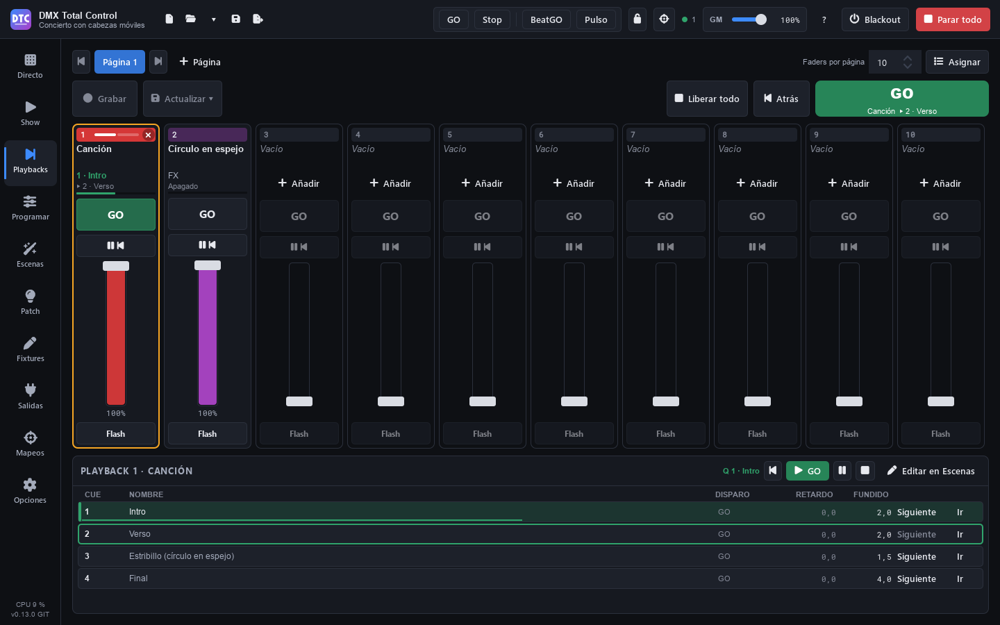

# Playbacks

**Playbacks** (F10) est une console de faders. Chaque **playback** joue une cuelist ou n’importe quelle scène, et a un **GO**, un bouton **Pause/Retour**, un bouton **Flash** et un **fader** qui est son intensité. Les playbacks sont organisés en **pages** de 8 à 20 (10 par défaut).

C’est la façon la plus confortable de mener un show avec des cuelists : vous enregistrez les cues depuis le programmeur directement sur un playback et vous les lancez avec GO ou avec la barre d’espace.

## La bande d’un playback

De haut en bas :

- **Le numéro** sur la couleur du playback. Il s’allume pendant qu’il joue. La **×** de droite le libère.
- **Le nom** : cliquez dessus pour **sélectionner** le playback (bord orange). Un playback sans rien affiche « Vide ».
- **La cue qu’il joue et la suivante** (« 3 · Couplet », « ▸ 4 · Pont ») et une barre avec l’avancement du fondu. Une cuelist arrêtée affiche « Libérée » ; une scène affiche son type et son état : « Activé », « Désactivé » ou « En pause ».
- **Bouton 1 (GO)** : la cue suivante ; si le playback est arrêté, il le lance.
- **Bouton 2 (Pause / Retour)** : met en pause un fondu en cours ; s’il n’y a pas de fondu, revient à la cue précédente.
- **Le fader** et son pourcentage.
- **Bouton 3 (Flash)** : à fond tant que vous appuyez.

Les boutons s’allument selon l’état : **GO** en vert pendant qu’il joue (il clignote vite pendant un fondu ou une attente, et lentement en pause), **Pause/Retour** en orange en pause et **Flash** en orange tant qu’il est enfoncé.

### Le fader

Le fader est l’intensité de ce que joue le playback :

- Quand vous le **montez depuis zéro**, le playback démarre.
- Quand vous le **descendez à zéro**, une scène est libérée ; une cuelist reste sur sa cue (cela se change dans les [propriétés](playbacks.md#propriétés-dun-playback)).
- Un **GO avec le fader en bas** joue à fond.

Un double-clic sur le fader le met à fond ou à zéro.

## Mettre quelque chose sur un playback

Il y a plusieurs façons :

- **Enregistrer depuis le programmeur** : voir [Enregistrer sur un playback](playbacks.md#enregistrer-sur-un-playback).
- **« Ajouter »** sur un playback vide : **« Nouvelle cuelist depuis le programmeur »** ou **« Mettre une scène ici… »**.
- **Assigner** : appuyez sur **« Assigner »** dans l’en-tête. La liste des scènes apparaît à droite : faites-les glisser sur les playbacks (tant que la liste est ouverte, une scène déposée sur un playback occupé le remplace) ou faites un double-clic sur l’une d’elles pour la mettre sur le premier playback libre.
- **Clic droit › « Assigner une scène… »** : choisissez la cuelist ou la scène dans la liste et appuyez sur **« La mettre sur le playback N »** (ou double-clic).

Depuis Programmer, vous pouvez aussi enregistrer une nouvelle cuelist et la mettre sur le premier playback libre (voir [Enregistrer](programar.md#enregistrer)).

## GO, Retour et le playback sélectionné

À droite de l’en-tête, vous avez les contrôles du **playback sélectionné** :

- **GO** (le grand bouton vert, ou **Espace**) : la cue suivante du playback sélectionné. Il affiche son nom et la cue qui vient (« Chanson 1 ▸ 3 · Pont »).
- **« Retour »** (**Maj+Espace**) : la cue précédente.
- **« Tout libérer »** : libère tous les playbacks et toutes les cuelists en cours.

Espace et Maj+Espace fonctionnent sur cette page tant que vous n’êtes pas en train de taper dans un champ de texte. Chaque appui donne un seul GO : maintenir la touche ne fait pas défiler les cues.

### Le panneau du playback sélectionné

En bas s’affichent le playback sélectionné (« Playback N · nom »), son état et ses boutons : retour, **GO**, pause / reprendre, libérer et **« Modifier dans Scènes »**.

Si c’est une cuelist, la liste de ses cues apparaît (CUE, NOM, DÉPART, DÉLAI, FONDU). La cue en cours porte une barre verte et la suivante un bord vert. Sur chaque ligne :

- **« Suivant »** : cette cue sera celle du prochain GO.
- **« Aller »** : saute à cette cue maintenant.

Un clic sur une ligne ne fait que la marquer : rien n’est lancé par erreur.

## Enregistrer sur un playback

1. Construisez un look dans [Programmer](programar.md).
2. Dans Playbacks, appuyez sur **« Enregistrer »** : il clignote en rouge et chaque playback indique ce qui se passera si vous cliquez dessus.
3. Cliquez sur un playback :
   - **Vide** (« Nouvelle cuelist ») : une nouvelle cuelist est créée avec le programmeur comme cue 1.
   - **Avec une cuelist** (« Enregistrer la cue N ») : sa cue suivante est enregistrée, seulement avec ce qui change par rapport à ce dont elle hérite.
   - **Avec une scène** (« Contient une scène ») : impossible d’y enregistrer.

**Échap** annule l’enregistrement armé, qui se désarme aussi quand vous quittez la page.

### Mettre à jour une cue

Changez les valeurs dans le programmeur, sélectionnez le playback et appuyez sur **« Mettre à jour ▾ »** :

- **« Mettre à jour la cue N (se propage aux suivantes) »** : le changement passe aux cues suivantes qui héritent de ces canaux.
- **« Cette cue seulement (les suivantes gardent leur aspect) »**.

La cue mise à jour est celle qui est chargée dans le programmeur ou, s’il n’y en a pas, celle qui joue. Le menu du clic droit de chaque playback contient aussi **« Enregistrer la cue N »**, **« Mettre à jour la cue actuelle (se propage aux suivantes) »** et **« Mettre à jour seulement la cue actuelle »**.

> **Conseil :** quand vous avez fini d’enregistrer, appuyez sur « Tout réinitialiser » dans Programmer (ou cochez « Vider le programmeur après l’enregistrement ») : tant que le programmeur contient des valeurs, il prime sur ce que vous lancez.

## Pages

- Cliquez sur le nom d’une page pour l’afficher. **◀ ▶** (ou **PgUp** / **PgDn**) passent à la précédente ou à la suivante.
- **« + Page »** ajoute une page.
- **« Faders par page »** : 8, 10, 12, 16 ou 20 playbacks par page.
- Un double-clic sur une page la renomme. Clic droit : **« Renommer… »**, **« Déplacer à gauche »**, **« Déplacer à droite »** et **« Supprimer la page… »** (avec plus d’une page). Quand vous la supprimez, ses playbacks sont vidés ; ce qu’ils jouent continue de jouer, et les cuelists et les scènes restent dans Scènes.

## Propriétés d’un playback

Clic droit › **« Propriétés… »**. Les changements s’appliquent immédiatement.

- **Étiquette** : le nom qu’il affiche (vide : celui de la scène).
- **Couleur** : un échantillon, ou le **A** pour la couleur de son type de scène.
- **Bouton 1**, **Bouton 2** et **Bouton 3** : ce que fait chacun : « Rien », « GO », « Retour », « Pause », « Pause / Retour », « Libérer », « Flash », « Flash + GO » (à fond tant qu’on appuie, et la cue suivante), « Allumer / éteindre » ou « Sélectionner » (pour que Main GO, Enregistrer et Mettre à jour agissent sur lui).
- **Le fader le lance** : si monter le fader lance le playback.
- **Le fader à zéro le libère** : « Par défaut » (une scène oui, une cuelist non : elle garde sa cue), « Oui » ou « Non ».

Le même menu contient **« Modifier dans Scènes »**, **« Libérer »** et **« Vider le playback »** (le retire du playback ; la cuelist ou la scène reste dans Scènes).

## Libérer

- La **×** du numéro d’un playback qui joue, ou **« Libérer »** dans son menu.
- **« Tout libérer »** dans l’en-tête.

Libérer un playback libère aussi cette scène si elle joue dans un groupe de Direct.

## Contrôleurs Akai APC

Dans [Mappages](mapeos.md#modèles-pour-akai-apc) › « Appareils », **« Tout mapper »** assigne d’un coup un contrôleur entier aux playbacks :

- **Akai APC mini** et **APC mini mk2** → Playbacks : chaque colonne est un playback 1-8 de la page actuelle : son fader et, depuis le bas, GO, Pause/Retour, Flash et ses 5 premières cues. Le bouton sous les pads le libère, le dernier fader est le grand master et les boutons de droite sont page précédente et suivante, GO et Retour du playback sélectionné, blackout, tap, BeatGO et tout arrêter.
- **Akai APC40 mkII** → Playbacks : chaque piste est un playback 1-8, avec ses 5 premières cues sur les clips ; les potentiomètres device sont les faders des playbacks 9-16.

Les LED montrent l’état de chaque playback.

## Playbacks dans le SHOW et sur la télécommande

- Le [SHOW](show.md#playbacks-dans-le-show) peut avoir une section de playbacks qui suit la page actuelle ou en affiche une fixe.
- Sur la [télécommande](remoto.md), quand un playback contient quelque chose, une page « Playbacks » apparaît avec ses bandes.

## Avec la programmation verrouillée

Si vous verrouillez la **« Programmation »** avec le cadenas de la barre du haut, les playbacks continuent de fonctionner (GO, faders, flash), mais vous ne pouvez plus enregistrer, mettre à jour, assigner ni changer les pages ou les propriétés.
