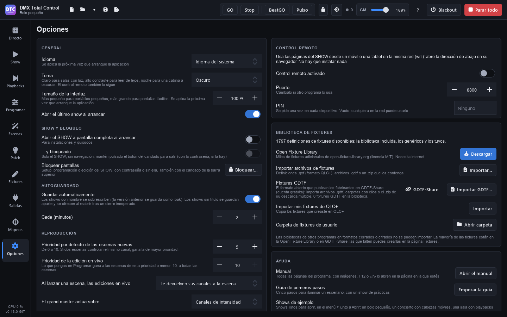

# Opzioni

**Opzioni** (F9) raccoglie le impostazioni del programma. A sinistra ci sono le impostazioni generali, l'avvio, il blocco, la sicurezza durante lo show, il salvataggio automatico, la riproduzione e l'audio; a destra, il controllo remoto, la libreria di fixture, gli aggiornamenti, l'aiuto e «Informazioni».

Le impostazioni di questa pagina sono del computer, non dello show: valgono per tutti gli show che apri. Solo l'arresto dello show (in [Sicurezza durante lo show](opciones.md#arresto-dello-show)) si salva con lo show.

## Generale

- **Lingua**: «Lingua del sistema», Español, English, Português, Français, Italiano o Deutsch. Si applica al prossimo avvio del programma.
- **Tema**: **Scuro**, **Chiaro**, **Alto contrasto** o **Notte (attenuato)**. Cambia subito. Chiaro, per sale illuminate; Alto contrasto, per leggere da lontano; Notte, molto scuro e in rosso, per una regia al buio senza abbagliarti. Il [controllo remoto](remoto.md) segue lo stesso tema.
- **Dimensione dell'interfaccia**: dall'80 % al 150 %, più piccola per i portatili piccoli e più grande per gli schermi touch. Si applica al prossimo avvio del programma.
- **Apri l'ultimo show all'avvio**.

> **Consiglio:** il tema Chiaro va meglio nelle prove di giorno o all'aperto; Alto contrasto, quando c'è molta luce intorno allo schermo.

## SHOW e blocco

- **Apri lo SHOW a schermo intero all'avvio**: per installazioni e chioschi. Il programma si avvia nella pagina Show a schermo intero.
- **…e bloccato**: inoltre si avvia bloccato: solo lo SHOW, senza navigazione. Per uscire, tieni premuto il tasto del lucchetto (con la password, se c'è). Vedi [Show](show.md#schermo-intero-e-blocco).
- **Blocca schermate**: **«Blocca…»** / **«Sblocca…»**. È lo stesso del lucchetto della barra superiore.

### Bloccare le schermate

Il blocco evita che qualcosa cambi per errore durante lo show. Live e lo SHOW continuano a funzionare, e i playback restano in riproduzione.

1. Premi il **lucchetto** della barra superiore (o «Blocca…» qui).
2. Scegli cosa bloccare:
   - **Setup**: Patch, Fixture, Uscite, Mappature e Opzioni. Non si può nemmeno aprire o creare un altro show.
   - **Programmazione**: Programma e Scene. In Playback non si può registrare, aggiornare né assegnare.
   - **Modifica dello SHOW**: le pagine dello SHOW si usano, non si modificano.
3. Se vuoi, scrivi una **password** (è facoltativa).
4. Premi **«Blocca»**.

Le pagine bloccate hanno un lucchetto nella barra laterale. Quando ne apri una, viene chiesta la password (se c'è) e si sblocca tutto. Per sbloccare, premi il lucchetto della barra superiore. **«Rimuovi la password»** si trova nella stessa finestra, al momento del blocco.

## Sicurezza durante lo show

Ciò che protegge lo show durante il live (vedi [Sicurezza durante lo show](directo.md#sicurezza-durante-lo-show)):

- **Tenere sveglio il computer** (attivo per impostazione predefinita): mentre il programma è aperto, Windows non sospende il computer né spegne lo schermo. Quando chiudi il programma, o disattivi questa opzione, Windows torna a farlo come sempre. Non cambia niente nelle impostazioni di Windows.
- **Modalità show** (disattivata per impostazione predefinita): chiudere il programma o aprire un altro show chiede di tenere premuto un tasto. Bloccare lo SHOW la attiva; sbloccarlo non la disattiva. Anche lo scudo della barra superiore la attiva e la disattiva (vedi [Modalità show](directo.md#modalità-show)).
- **Ferma tutto con dissolvenza**: da 0 a 5 s (0 per impostazione predefinita: subito, come sempre). Le funzioni scendono in quel tempo; Esc due volte, subito. Per 10 secondi, Ctrl+Z recupera ciò che ha fermato (vedi [Ferma tutto con dissolvenza](directo.md#ferma-tutto-con-dissolvenza)).
- **Disarma gli effetti non usati dopo**: da 0 a 120 minuti senza attivazioni (10 per impostazione predefinita; 0, «Mai»). Mai mentre uno si attiva (vedi [Effetti speciali protetti](directo.md#effetti-speciali-protetti)).
- **A batteria** e **La sospensione selettiva USB è attiva** compaiono solo quando succede. La prima dice quanta batteria resta; la seconda ha **«Come disattivarla»**, che apre la sezione [Sospensione selettiva USB](opciones.md#sospensione-selettiva-usb), più sotto.

### Arresto dello show

Cosa illumina l'[arresto dello show](directo.md#arresto-dello-show) e a che livello. Questo sì si salva con lo show, nella sua sezione di DMX Total Control (QLC+ non lo legge).

- **Fixture**: **«Tutte le luci»** (predefinito) o **«Questi gruppi…»**, che apre l'elenco dei gruppi di fixture dello show per spuntarli («Gruppi che l’arresto dello show illumina»). Senza nessuno spuntato, tutte le luci. Un gruppo eliminato si toglie da solo. Dei gruppi scelti si illuminano solo le luci: mai il loro fumo, i loro hazer, i loro strobo e i loro laser.
- **Livello**: da 0 a 100 % (100 per impostazione predefinita).

Si illuminano le teste mobili, gli scanner, i PAR e i wash, le barre LED, i blinder e i dimmer. Un dimmer generico (Generic › Generic Dimmer) solo quando il suo nome dice che è una luce (PAR, FRESNEL, DIMMER, BLINDER, PROIETTORE, SAGOMATORE, FARO, LUCE, CONTRA, SPOT, PC, SALA, PLATEA…) o la sua icona nella pianta è quella di una luce. Quelli che si chiamano VIDEO, TRIGGER, RELÈ, MOTORE, SCHERMO, KABUKI, SIPARIO… restano come sono, anche dentro un gruppo scelto; un PIRO… è un effetto speciale protetto e si spegne. Per illuminarne uno, dagli un'icona di luce in Patch › «Aspetto» › «Icona». I dimmer della libreria si illuminano come sempre.

### Sospensione selettiva USB

Windows può sospendere una porta USB che gli sembra inattiva per risparmiare energia, e con essa l'interfaccia DMX: l'uscita si ferma in pieno show. È un'impostazione della combinazione per il risparmio di energia di Windows. Il programma la legge soltanto all'avvio (e lo avvisa con una barra blu e in questa pagina): non la cambia mai. Per disattivarla:

1. Apri il **Pannello di controllo** › **Hardware e suoni** › **Opzioni risparmio energia**.
2. Accanto alla combinazione che usi, fai clic su **«Modifica impostazioni combinazione»** e poi su **«Cambia impostazioni avanzate risparmio energia»**.
3. Apri **«Impostazioni USB»** › **«Impostazione sospensione selettiva USB»** e scegli **«Disattivato»** per **«Alimentazione a batteria»** e per **«Alimentazione da rete»** (senza batteria c'è un solo valore).
4. Fai clic su **«OK»**.

Se l'interfaccia continua a fermarsi, apri **Gestione dispositivi** e, nelle proprietà di ogni **«Hub principale USB»**, nella scheda **«Risparmio energia»**, togli la spunta da **«Consenti al computer di spegnere il dispositivo per risparmiare energia»**. I nomi possono cambiare un po' secondo la versione di Windows.

> **Non provato con apparecchi reali:** i cambi di batteria e di alimentazione, la percentuale della batteria, l'effetto reale di tenere sveglio il computer e la lettura della sospensione selettiva USB.

## Salvataggio automatico

- **Salva una copia di recupero**, **Ogni (minuti)**: da 1 a 60.

Il salvataggio automatico non tocca il file dello show: ogni pochi minuti, se ci sono modifiche non salvate, salva a parte una copia di recupero, e il punto **●** resta. Solo **Salva** scrive il file; la versione che c'era prima del primo salvataggio di ogni sessione si conserva come `.bak`. La copia si cancella quando salvi, quando chiudi (salvando o no) e quando apri un altro show. Se il programma si chiude in modo inatteso, quando lo riapri ti propone la copia («Recuperare lo show non salvato?») con il nome dello show e l'ora della copia: recuperandola si apre quello show con le sue modifiche, ancora non salvate; salvalo per conservarle. Nel frattempo l'ultimo show è già aperto com'era salvato (con «Apri l'ultimo show all'avvio»): «Scarta» lo lascia così. Nella barra superiore si vede l'ora dell'ultima copia («copia di recupero…»); se non riesce (un disco pieno), compare un avviso in rosso.

## Riproduzione

- **Priorità predefinita delle nuove scene**: da 0 a 10. Se due scene controllano lo stesso canale, vince quella con priorità più alta (vedi [Priorità](directo.md#priorità)).
- **Priorità delle modifiche dal vivo**: ciò che metti in Programma vince sulle scene con questa priorità o inferiore. Con 10, su tutte le scene.
- **Quando parte una scena, le modifiche dal vivo**:
  - **«Restituiscono alla scena i suoi canali»**: i canali che la scena tocca escono dal programmatore.
  - **«Restano sempre»**.
  - **«Vengono tutte azzerate»**: il programmatore si svuota.
- **Il grand master agisce su**: **«Canali di intensità»** (la luce: i dimmer e i colori delle fixture senza dimmer) o **«Tutti i canali»**.

## Audio

- **Ingresso audio**: il microfono o l'ingresso di linea che ascoltano **Impulso** e le matrici audio. **«Predefinito del sistema»** usa quello del sistema operativo. Impulso cambia ingresso subito; una matrice audio già in riproduzione, al suo prossimo avvio. Un ingresso scelto che ora non è collegato appare come «(non collegato)», e nel frattempo si usa quello predefinito.

## Show recenti

L'elenco degli ultimi show aperti (anche nella freccia **▾** della barra superiore). **«Svuota elenco»** lo cancella.

## Controllo remoto

Per usare le pagine dello SHOW da un telefono o un tablet sulla stessa rete wifi, senza installare niente:

- **Controllo remoto attivo**.
- **Porta**: cambiala se un altro programma la usa (di default, 8800). Se è occupata, viene segnalato in rosso.
- **PIN**: viene chiesto una volta su ogni dispositivo. Se è vuoto, chiunque sulla rete può usarlo.
- **Nome sulla rete**: il telefono apre il remoto con `http://dmxtotalcontrol.local:8800/`, anche quando l'indirizzo del computer cambia (iPhone, iPad e telefoni Android recenti). Se un altro computer usa già il nome, questo prende `dmxtotalcontrol-2`. Se è vuoto, non c'è nessun nome. Se la porta di rete 5353 non è disponibile, o se altri computer usano il nome e da `-2` a `-9`, viene segnalato in rosso.
- Gli **indirizzi** da aprire nel browser del telefono, con un tasto per copiarli. Davanti a ognuno c'è il nome della sua rete, come lo chiama Windows («Wi-Fi», «Ethernet 2»). Prima viene l'indirizzo **«Per nome»**, poi il wifi, poi il cavo (Ethernet) e alla fine gli adattatori virtuali e le VPN. L'elenco si aggiorna da solo pochi secondi dopo aver collegato o scollegato una rete. Se il computer non è su nessuna rete, al loro posto compare un avviso.
- Un **codice QR** dell'indirizzo con il bordo (all'inizio, il primo numerico), per aprirlo con la fotocamera del telefono. Fai clic su un altro indirizzo per cambiarlo. Se c'è un PIN, il codice lo contiene e il telefono entra senza chiederlo. **«Più grande»** lo mostra in grande.
- Quanti dispositivi sono collegati.

Vedi [Controllo remoto](remoto.md).

## Libreria di fixture

Indica quante definizioni di fixture sono disponibili (la libreria integrata, le generiche e le tue) e permette di ampliarla:

- **Open Fixture Library**: **«Scarica»** (serve internet). Una volta scaricata, si vede quante fixture ha e quando è stata scaricata, e il tasto diventa **«Aggiorna»**: porta le fixture nuove e quelle migliorate, e conserva le tue fixture e quelle che la libreria non ha più. Se ci sono novità, viene segnalato e il tasto si evidenzia (vedi [Fixture](fixtures.md#open-fixture-library)).
- **Importa file di fixture**: **«Importa…»** definizioni `.qxf` (il formato di QLC+), file `.gdtf` o uno `.zip` che li contenga.
- **Fixture GDTF**: **«GDTF-Share…»** cerca, scarica e importa fixture da GDTF-Share (vedi [Fixture](fixtures.md#gdtf-share)); **«Importa GDTF…»** importa file, cartelle o lo `.zip` del suo download multiplo. Indica quante fixture GDTF ci sono nella libreria.
- **Fixture scaricate da GDTF-Share**: compare quando ce ne sono. **«Converti di nuovo»** le converte di nuovo con questa versione del programma, dal `.gdtf` conservato (vedi [Fixture](fixtures.md#converti-di-nuovo)).
- **Revisioni più recenti su GDTF-Share**: compare quando fixture GDTF della libreria hanno una revisione più recente su GDTF-Share. **«Aggiorna»** le mostra in GDTF-Share, dove **«Aggiorna tutte»** scarica la più recente di ciascuna e la converte: le fixture patchate con esse la ricevono. Conta quelle che hai scaricato da GDTF-Share. Un file importato a mano conta se il testo della sua ultima revisione coincide con una sola revisione di GDTF-Share. Usa l'ultima lista di GDTF-Share che il programma ha (vedi [Fixture](fixtures.md#revisioni-più-recenti)).
- **Importa le mie fixture di QLC+**: **«Importa»** copia le fixture che hai creato in QLC+.
- **Cartella delle fixture utente**: **«Apri cartella»**.

Tutto questo è spiegato in [Fixture](fixtures.md).

## Aggiornamenti

- **Cerca aggiornamenti all'avvio**: una volta al giorno, su GitHub: il programma e, se hai scaricato la Open Fixture Library, se ha fixture nuove (lo dice un avviso). Se hai salvato il tuo account GDTF-Share, accede anche a GDTF-Share e avvisa se le fixture che hai scaricato da lì hanno revisioni più recenti (ogni revisione viene segnalata una volta). Non si scarica né si installa niente senza chiederti. Senza internet, non dà fastidio.
- **Includi versioni di prova**: le novità prima, meno collaudate.

Sotto si vede lo stato («Hai l'ultima versione», «È disponibile la versione…») e i tasti:

- **«Cerca aggiornamenti»**: controlla ora (anche la Open Fixture Library).
- **«Novità»**: le novità di quella versione.
- **«Scarica e installa»**: scarica l'installer e verifica la sua impronta SHA-256 prima di salvarlo. Se una versione non pubblica la sua impronta, si può scaricare solo dalla sua pagina («Apri su GitHub»).
- **«Installa ora»**: il programma si chiude (prima chiede se salvare lo show), si installa la nuova versione e si riapre.
- **«Alla chiusura»** / **«Non alla chiusura»**: installarla quando chiudi il programma.
- **«Apri su GitHub»**: la pagina della versione.

Quando c'è una nuova versione, compare anche un avviso sopra le pagine con gli stessi tasti. **«Più tardi»** toglie l'avviso per quella versione; resta disponibile qui.

## Aiuto

- **Manuale**: **«Apri il manuale»** apre questo manuale sul suo indice. F12 o il tasto **«?»** della barra superiore lo aprono alla pagina in cui ti trovi. È nella lingua del programma (spagnolo, inglese, portoghese, francese, italiano o tedesco); le schermate sono quelle della versione spagnola.
- **Guida ai primi passi**: **«Avvia la guida»** riapre la guida (vedi [Primi passi](primeros-pasos.md#la-guida)).
- **Show di esempio**: si trovano nella freccia **▾** accanto ad «Apri» della barra superiore, in «Esempi» (vedi [l'indice](index.md#la-guida-e-gli-show-di-esempio)).

## Informazioni

La versione del programma, la sua licenza (software libero, Apache 2.0) e i crediti.
