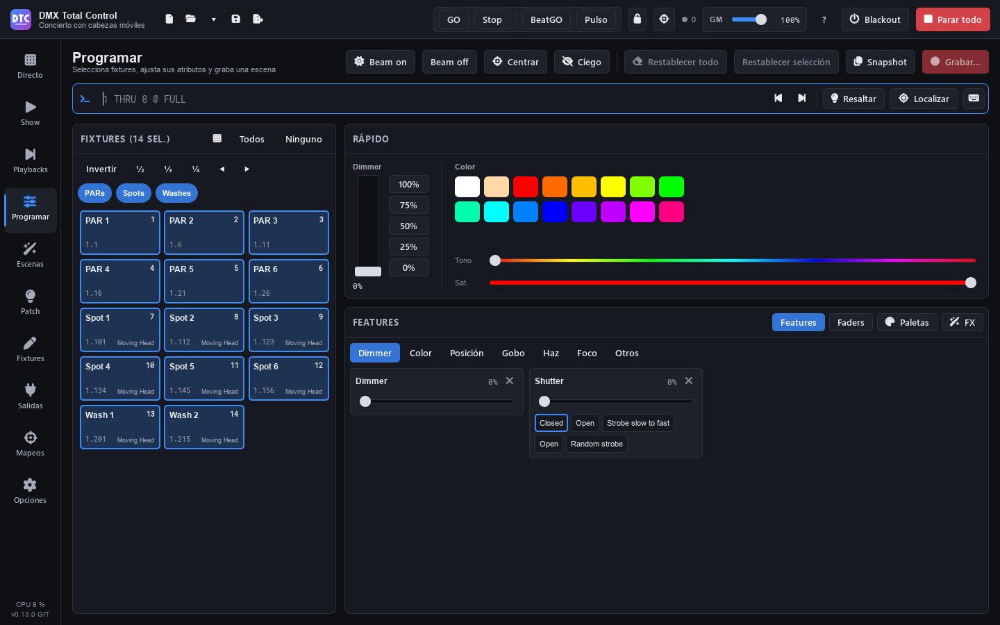

# Programma

**Programma** (F3) è il programmatore: selezioni le fixture, dai loro dimmer, colore, posizione, gobo o qualsiasi altro canale, aggiungi FX e palette, e registri il tutto come scena, cuelist o cue.

Ciò che metti nel programmatore **esce subito e prevale su tutto** (scene, gruppi e playback) finché non lo svuoti. Il sottotitolo della pagina te lo ricorda: «N canali nel programmatore — prevalgono sui playback finché non li togli».

La pagina ha, dall'alto in basso: l'intestazione con i suoi tasti, la [riga di comando](programar.md#riga-di-comando), il pannello delle **fixture** a sinistra e, a destra, il pannello **Rapido** e il pannello **Funzioni / Fader / Palette / FX**.

## L'intestazione

- **«Beam on»**: dimmer al massimo e shutter aperto sulla selezione.
- **«Beam off»**: dimmer a zero sulla selezione.
- **«Centra»**: pan e tilt al centro.
- **«Cieco»**: vedi [Cieco](programar.md#cieco).
- **«Azzera tutto»**: rilascia tutte le modifiche dal vivo (valori e FX). Le scene tornano visibili.
- **«Azzera selezione»**: rilascia solo quelle delle fixture selezionate.
- **«Snapshot»** e **«Registra…»**: vedi [Registrare](programar.md#registrare).

In una finestra stretta alcuni tasti mostrano solo la loro icona; passando il mouse se ne vede il nome.

## Selezionare le fixture

Il pannello **«Fixture (N sel.)»** mostra un riquadro per ogni fixture con il suo nome, il suo numero (per la riga di comando), il suo indirizzo (universo.indirizzo) e il suo tipo.

- **Clic** su un riquadro: seleziona solo quella.
- **Ctrl+clic**: la aggiunge o la toglie dalla selezione. **Maiusc+clic**: seleziona tutti i riquadri dall'ultimo che hai cliccato fino a quello (in quel senso, che è l'ordine della selezione); **Ctrl+Maiusc+clic** li aggiunge.
- **«Tutte»** e **«Nessuno»**, nell'intestazione del pannello.
- **«Inverti»**: seleziona quelle che non lo erano.
- **½**, **⅓**, **¼**: ne lascia una ogni due, tre o quattro.
- **◀ ▶**: sposta la selezione verso sinistra o destra.

**L'ordine conta**: l'ordine in cui selezioni le fixture è l'ordine seguito dai ventagli, dagli FX e dai Colour FX. Nella pianta 2D ogni fixture selezionata mostra il suo numero d'ordine.

> **Consiglio:** puoi anche selezionare scrivendo: `1 THRU 8` e Invio. Vedi [la riga di comando](programar.md#riga-di-comando).

### Gruppi di fixture e selezioni

Sopra i riquadri compaiono i [gruppi di fixture](patch.md#gruppi-di-fixture) del Patch come etichette rotonde:

- **Clic** su un gruppo: seleziona le sue fixture. **Ctrl+clic** o **Maiusc+clic**: le aggiunge.
- L'etichetta si illumina quando tutte le sue fixture sono selezionate. Passando il mouse si vede il suo numero per la riga di comando («GROUP 2 nella riga di comando»).
- Le **selezioni** di un gruppo (parti ordinate, con la loro icona) selezionano le sue fixture nel loro ordine.
- Con molti gruppi si vedono tre righe di etichette, che scorrono con la rotella: **«Tutti i gruppi (N)»** le apre (fino a metà del pannello) e **«Meno»** le richiude. Così i riquadri delle fixture restano in vista.

### Pianta 2D

Il tasto con la griglia nell'intestazione del pannello («Pianta 2D») sostituisce i riquadri con la pianta del palco:

- **Clic** su una fixture la seleziona; **Ctrl+clic** o **Maiusc+clic** la aggiunge o la toglie.
- **Trascina** sul palco vuoto per selezionare con un rettangolo. Un clic nel vuoto annulla la selezione.
- La **rotella** fa lo zoom; trascinare con il **tasto destro** o centrale sposta la vista, e un doppio clic con quei tasti la ricentra.

In Programma la pianta è sempre **dal vivo**: ogni fixture mostra il suo colore, il suo dimmer, il suo strobo (lampeggia) e il suo gobo, e ogni pixel delle barre e delle matrici. Le fixture si posizionano nella [pianta 2D del Patch](patch.md#pianta-2d).

## Il pannello Rapido

### Dimmer

Il fader **Dimmer** e i tasti **100%**, **75%**, **50%**, **25%** e **0%** danno intensità alla selezione.

### Colore

Fai clic su uno dei 16 campioni, o muovi **Tonalità** e **Sat**. Il colore si miscela nei canali RGB (la parte bianca va al canale bianco se la fixture ce l'ha) o CMY di ogni fixture. Per le ruote colori, usa i loro preset in [Funzioni](programar.md#funzioni) › Colore.

> **Consiglio:** per un ventaglio di dimmer, usa la riga di comando: `@ 0 THRU 100` va dallo 0 % sulla prima al 100 % sull'ultima. Il ventaglio della posizione è in [Funzioni › Posizione](programar.md#posizione-griglia-xy-e-ventaglio).

## Funzioni

**Funzioni** mostra i canali della selezione per schede: **Dimmer**, **Colore**, **Posizione**, **Gobo**, **Fascio**, **Fuoco** e **Altro**. Le schede senza canali nella selezione sono disattivate.

Ogni canale è un riquadro con il suo nome, il suo valore in %, un cursore e i suoi **preset** come tasti (con il loro colore o l'immagine del gobo se il profilo li fornisce). Fai clic su un preset per applicarlo. Il riquadro si segna in arancione quando il canale è nel programmatore; la sua **×** lo rilascia.

I canali si raggruppano **per funzione**, non per nome: «Red», «R» o «Rosso» di fixture diverse sono lo stesso controllo, e lo stesso vale per dimmer, pan/tilt, CMY, ruota colori, gobo, shutter, iris, zoom, fuoco, prisma… Ogni testa di una barra conserva i suoi canali.

### Colore: selettore e preferiti

Nella scheda **Colore**, il quadrato a sinistra dà la tonalità (da un lato all'altro) e la saturazione (dall'alto in basso). Trascina la croce per posizionarla, o trascina in un altro punto del quadrato per una regolazione fine.

Sotto, **«Preferiti»**: il **+** salva il colore attuale; un clic su un preferito lo applica; il clic destro lo rimuove. I preferiti valgono per tutti gli show.

### Posizione: griglia XY e ventaglio

La scheda **Posizione** muove solo il **pan** e il **tilt** (con i loro canali fini, a 16 bit). La rotazione continua di pan o tilt e la sua velocità sono in **Altro**.

- Trascina la **croce** per posizionarla, o trascina in un altro punto della griglia per un movimento lento e fine.
- La barra a sinistra è il **tilt** e quella in basso il **pan**.
- Con più fixture, ognuna è un punto sulla griglia.
- **«Centra»** porta pan e tilt al centro.

A destra c'è il **Ventaglio**: apre la posizione della selezione, nel suo ordine, ogni fixture da dove si trovava.

- **«Aperto»**: da un estremo all'altro (la prima da un lato, l'ultima dall'altro, quella centrale ferma).
- **«A V»**: gli estremi si aprono e il centro resta fermo.
- **«Dal primo»**: la prima ferma e ognuna un po' di più.
- **Pan** e **Tilt**: quanto si apre ciascuno (da −100 a 100 %; doppio clic, a 0). Al 100 %, gli estremi si spostano di mezza griglia.
- **«Senza ventaglio»**: le fixture tornano dov'erano.
- Il tasto **«Ventaglio»** sotto la griglia fa sì che trascinare su di essa apra il ventaglio invece di muovere: in orizzontale, il pan; in verticale, il tilt.

Se poi muovi la croce, il centro si sposta e il ventaglio si mantiene. Se la posizione cambia per un'altra via (una palette, un'altra selezione, «Azzera tutto»), il ventaglio torna a 0 e riparte da dove si trovano.

### Follow: puntare a un punto

Il tasto **«Follow»** sotto la griglia sostituisce il ventaglio con una pianta del palco. Fai clic o trascina su di essa: **tutte le teste mobili selezionate puntano a quel punto**, ognuna con il suo pan e il suo tilt, e una linea va da ciascuna al punto.

- **«Altezza del punto»**: 0 m è il pavimento; alzala per puntare, per esempio, al viso di chi canta (1,6 m).
- Ogni testa calcola il suo pan e il suo tilt in base alla sua posizione nella pianta, alla sua altezza, al fatto che sia appesa o in piedi e alla direzione in cui guarda. Tutto questo si regola in [Patch › Pianta 2D › «Altezza e orientamento»](patch.md#altezza-e-orientamento-follow).
- Trascinando, ogni testa segue il percorso breve da dove puntava, senza fare il giro lungo.
- I valori restano nel programmatore come qualsiasi pan e tilt: registrali in una scena, una cue o una palette.
- Sotto viene indicato quante puntano, quali non arrivano (restano il più vicino possibile), quali non hanno l'escursione di pan e tilt nella loro definizione (si usano 540° e 270°) e gli scanner, che non si muovono (il loro specchio non segue questa geometria).
- Le inversioni, i limiti e lo scambio di pan e tilt del [Patch](patch.md#limiti) sono già tenuti in conto.

Se muovi la croce, il ventaglio o «Centra», o cambi la selezione, il punto scompare.

> **Non provato con apparecchi reali:** ogni produttore orienta le sue teste a modo suo. Se una punta male, regola il suo orientamento o inverti il suo pan o il suo tilt in «Altezza e orientamento».

## Fader

**Fader** mostra ogni canale della selezione come un fader verticale, con il suo nome, il suo gruppo e il suo valore (0–255). Il tasto con l'elenco apre i suoi **preset** («Nome (min–max)») e la **×** lo rilascia.

> **Consiglio:** dopo aver fatto clic su un fader o un cursore, le frecce ↑ ↓ lo muovono di uno in uno e PgUp / PgDn di dieci in dieci. Il doppio clic lo riporta al suo valore di riposo (di solito zero).

## Cieco

Con **«Cieco»** attivo, il programmatore modifica **senza mandare niente alle luci**: il palco continua a mostrare ciò che è in riproduzione e tu prepari il look successivo. Il sottotitolo avvisa: «Cieco: le luci non mostrano ciò che programmi». Puoi registrare come sempre. Quando lo disattivi, ciò che c'è nel programmatore esce.

## Evidenziare e localizzare

Nella barra della riga di comando:

- **«Evidenzia»**: la selezione al massimo in bianco aperto, sopra tutto, per vedere quali fixture sono. Non viene registrato. Premi di nuovo per toglierlo.
- **«Localizza»**: mette la selezione al massimo, in bianco aperto, centrata e con il fascio aperto, **nel programmatore** (questi valori invece vengono registrati).
- **◀ ▶** (PREV / NEXT): percorre la selezione **una alla volta**: resta selezionata una sola fixture e si vede a quale sei («2/8»). **«Tutte»** torna a tutta la selezione (ALL).

## Palette

Una **palette** salva un valore di intensità, posizione, colore o fascio per ogni fixture. Le scene e le cue registrate con una palette la usano **per riferimento**: se aggiorni la palette, cambiano da sole (anche le modifiche dal vivo).

In **Palette** ci sono quattro colonne: **Intensità**, **Posizione**, **Colore** e **Fascio**.

### Registrare una palette

1. Seleziona le fixture e dai loro il valore (per esempio, un colore).
2. Nella colonna **Colore**, premi **«+ Registra»**.

La palette si crea con un nome e un numero («Colore 1», COL 1). Da quel momento, ciò che registri con essa la segue.

### Usare una palette

Seleziona le fixture e fai clic sulla palette: si applica alla selezione. Una palette si segna quando è applicata alla selezione (più marcata se lo è su tutta). Su una fixture che non è stata registrata nella palette, usa i valori di un'altra dello stesso tipo o i suoi attributi: un colore si miscela in RGB o CMY, o va alla posizione più simile della ruota colori.

Anche: `COL 2`, `POS 1`, `BEAM 3` o `INT 4` nella riga di comando.

### Il menu di una palette

Clic destro su una palette:

- **«Applica alla selezione»**.
- **«Carica le sue fixture nel programmatore»**.
- **«Aggiorna con il programmatore»**: aggiunge o cambia i valori del programmatore nella palette. Cambiano anche le scene che la usano.
- **«Registra sopra»**: la registra di nuovo solo con ciò che c'è adesso.
- **«Rinomina…»**, **«Cambia numero…»** e **«Elimina»** (le scene mantengono i valori).

Un'icona di collegamento sulla palette indica che ci sono scene che la usano; il testo che compare passando il mouse dice quante.

> **Consiglio:** le palette si possono mettere nello [SHOW](show.md) (azione «Una palette»), nel [controllo remoto](remoto.md) e in una [mappatura](mapeos.md), sulle loro fixture o su un gruppo, come modifica dal vivo. Alt+clic su una palette la porta nello SHOW.

## FX

Un **FX** muove un parametro della selezione (il dimmer, il rosso, lo zoom, pan e tilt insieme…) intorno al suo valore nel programmatore o, se non ha valore, intorno a ciò che inviano le scene sottostanti. Parte subito e si registra con la scena.

In **FX** ci sono tre zone: i parametri e gli FX attivi a sinistra, i controlli dell'FX al centro e le macro a destra.

### Avviare un FX

1. Seleziona le fixture.
2. In **Parametro**, scegli cosa muovere. Di default viene scelto l'ultimo parametro che hai toccato. Quelli che hanno già un FX nella selezione hanno il segno «FX».
3. Premi **«Avvia FX»**, o fai clic su una **macro**.
4. Regola i controlli: l'FX cambia dal vivo.

### I controlli dell'FX

- **La figura o la modalità** (il disegno a sinistra): fai clic su di esso per sceglierne un'altra. Per pan/tilt ci sono **12 figure** (cerchio, otto, quadrato, triangolo, diamante, linea di pan, linea di tilt, diagonale, trifoglio, lissajous, ballyhoo e croce). Per il resto, **22 modalità**: la linea punteggiata è il valore base e l'onda va sopra, sotto o da entrambi i lati; le modalità da 9 a 12 sono per gli inseguimenti, con passo.
- **Ampiezza** (da 0 a 250 %). In pan/tilt, **«Ampiezza pan»** e **«Ampiezza tilt»** separate.
- **Velocità**, in BPM. **½** e **×2** la dimezzano o la raddoppiano. **«BPM dello show»** fa sì che segua il tempo dello show (un fader o una manopola di BPM dello SHOW, o una mappatura di BPM o Tap). Registrato in una scena FX, segue invece il ritmo che batti premendo il tasto della scena, se ce l'ha ([Live](directo.md#ritmo-di-una-scena-a-passi)). **«Moltiplicatore»**: da ×¼ a ×8.
- Solo pan/tilt: **«Inverti pan»**, **«Inverti tilt»**, **«Al contrario»** e **«Ruota»** (0–359°).

### Timing dell'FX

Come si distribuisce l'FX tra le fixture:

- **«Onda per X»**: la forma si distribuisce tra X fixture (o insiemi), ognuna un po' più tardi.
- **«Passo per X»**: una fixture (o insieme) dopo l'altra, X alla volta.
- **«Raggruppamento»**: «No», «Ogni X», «Blocchi di X», «Dividi in X», «Specchio» o «Per gruppo» (di fixture).
- **«Ordine»**: «Selezione», «Invertito», «Casuale» (con un tasto per un altro ordine casuale) o «Per numero».
- **«Attesa»**: tempo alla base dopo ogni passata.
- **«Fase»**.

Sotto, un'anteprima animata disegna ogni fixture mentre si muove.

### FX attivi, collegare e fermare

- **«FX attivi (N)»** elenca gli FX del programmatore. Un clic seleziona le loro fixture e il loro parametro; la **×** lo ferma.
- **«Collega»**: gli FX collegati condividono la velocità e il timing, e si fermano insieme.
- **«Ferma»** ferma l'FX del parametro scelto; **«Ferma tutti gli FX»**, tutti.

«Azzera tutto» toglie anche gli FX dal programmatore. «Ferma tutto» della barra superiore non li toglie: sono modifiche dal vivo.

### FX propri di ogni fixture

Un FX resta **uno solo** anche se cambi una parte delle sue fixture. Se selezioni solo alcune delle fixture di un FX e cambi **la forma, la dimensione, la direzione («Al contrario»), le inversioni, la rotazione o la fase**, la modifica è **propria di quelle fixture**, sullo stesso orologio: restano sincronizzate con le altre. La **velocità e il timing** sono sempre di tutto l'FX.

- Il pannello avvisa: «Questo FX è anche su altre fixture…».
- Con tutte le sue fixture selezionate, la modifica è dell'FX intero.
- Se selezioni fixture che non erano nell'FX, si uniscono a esso. Due FX dello stesso parametro selezionati insieme si fondono in uno, e ogni fixture conserva ciò che faceva.
- In «FX attivi» si vede quante hanno qualcosa di proprio («N proprie»).
- **«Come le altre»** toglie ciò che è proprio dalle selezionate: tornano a fare lo stesso dell'FX.

### Lo specchio

Se le fixture che vanno al contrario (o con il pan o il tilt invertito proprio) sono **tutte in una metà** dell'FX, ognuna segue l'onda della sua gemella dall'altro lato, quindi anche l'onda esce a specchio. Il pannello lo indica con «Specchio: …».

Esempio con 6 beam in cerchio con onda:

1. Seleziona tutte e 6, scegli **Pan / tilt**, premi **«Avvia FX»**, figura **Cerchio** e **«Onda per X»** su «Tutte».
2. Seleziona solo le ultime 3 e attiva **«Al contrario»**.

Le ultime 3 girano al contrario e seguono l'onda della 3ª, della 2ª e della 1ª: uno specchio sincronizzato. Se metti al contrario quelle alterne (2, 4 e 6) non è uno specchio: ognuna conserva il suo posto nell'onda.

### Macro FX

A destra, le **macro FX** di fabbrica per categorie: **Posizione** (cerchio, cerchio a onda, otto, ballyhoo, spazzata pan, can-can, pan a specchio, quadrato, triangolo, trifoglio), **Intensità** (onda di dimmer, chase, casuale, impulso, respiro, strobo, da fuori a dentro), **Colore** (arcobaleno, rosso / blu, fuoco, ciano / magenta) e **Fascio** (zoom, iris, fuoco). Un clic applica la macro alla selezione.

**«Salva come macro…»** salva gli FX del programmatore come una tua macro, in **«Mie»**, per tutti gli show. Clic destro su una tua macro: **«Rinomina»** o **«Elimina»**.

## Riga di comando

La riga di comando funziona come quella di una console. Quando apri Programma riceve la tastiera: scrivi e premi **Invio**. Accanto si vede cosa ha fatto, o perché non lo capisce.

| Comando | Cosa fa |
|---|---|
| `1 THRU 8` | Seleziona le fixture da 1 a 8 (anche `1 > 8` o `1 / 8`). `8 THRU 1`, in ordine inverso. |
| `1 + 3 - 2` | Aggiunge e toglie. `1,3,5` è lo stesso di `1 + 3 + 5`. Iniziare con `+ 5` o `- 5` cambia la selezione già presente. |
| `GROUP 2` | Il gruppo di fixture 2 (nell'ordine del Patch). `GROUP 1 THRU 3`: i gruppi da 1 a 3. |
| `ALL` | Tutte le fixture, in ordine di numero (dopo NEXT / PREV, torna a tutta la selezione). |
| `@ 50` | Dimmer al 50 %. `@ 5` è 50 % (una cifra sola indica le decine). |
| `@ FULL` / `@ OUT` | Dimmer al massimo o a zero. Anche `@ @` è al massimo. |
| `@ 0 THRU 100` | Ventaglio di dimmer, dallo 0 % sulla prima al 100 % sull'ultima. |
| `@ + 10` / `@ - 10` | Alza o abbassa il dimmer del 10 %. |
| `POS 1`, `COL 2`, `BEAM 3`, `INT 4` | Applica la palette di posizione, colore, fascio o intensità con quel numero. |
| `LOCATE` | Localizza. |
| `HIGHLIGHT` | Evidenzia (alterna). |
| `NEXT` / `PREV` | Una alla volta lungo la selezione. |
| `REL` | Rilascia le modifiche della selezione. |
| `CLEAR` | Svuota il programmatore. |

Si possono concatenare: `1 THRU 4 @ FULL COL 2` seleziona, mette il dimmer al massimo e applica la palette colore 2.

Valgono anche le parole in spagnolo: HASTA, GRUPO, TODO, LLENO, TOPE, CERO, INTENSIDAD, POSICION, COLOR, HAZ, LIMPIAR, RESALTAR, LOCALIZAR, SIGUIENTE, ANTERIOR, LIBERAR, IR, ATRÁS, GRABAR, ACTUALIZAR, ELIMINAR… e le abbreviazioni: THR, FL, GRP (o G), CLR, LOC, HI, SIG, ANT, REL.

### Comandi delle cuelist

Agiscono sulla **cuelist selezionata**: quella del playback selezionato, quella che hai aperto in Scene o l'ultima che hai creato.

| Comando | Cosa fa |
|---|---|
| `GO` | La cue successiva. |
| `BACK` | La cue precedente. |
| `GO CUE 3` | Salta alla cue 3. |
| `CUE 3` | Carica la cue 3 nel programmatore (ciò che mostra il palco in quella cue) per modificarla. |
| `REC` | Registra la cue successiva. `REC CUE 2.5` registra la cue 2.5 (tra la 2 e la 3). |
| `UPD` | Aggiorna la cue caricata nel programmatore o, se non ce n'è nessuna, quella in riproduzione. `UPD CUE 4`, la cue 4. |
| `DELETE CUE 4` | Elimina la cue 4 mantenendo l'aspetto delle successive. |
| `PB 3` | Seleziona il playback 3 della pagina attuale (e la sua cuelist). |

Se un comando si ferma a metà (per esempio, la palette non esiste), ciò che ha già fatto resta fatto e nella riga resta solo la parte da correggere.

### Cronologia e tastierino a schermo

- **↑ ↓** scorrono gli ultimi comandi.
- **Esc** svuota la riga (con la riga vuota, Esc è «Ferma tutto»).
- Il tasto del **tastierino** apre un tastierino a schermo per gli schermi touch, con numeri, THRU, @, FULL, OUT, GROUP, INT, POS, COL, BEAM, NEXT, PREV, ALL, LOCATE, CLR e i tasti delle cuelist (CUE, il punto decimale, REC, UPD, GO, BACK, DELETE, PB). Resta aperto mentre scegli le fixture.

## Registrare

### La finestra «Registra»

Premi **«Registra…»**:

1. In **Registra in**, scegli:
   - **«Nuova scena»**: una scena statica o, se il programmatore ha FX, una scena FX con i suoi valori base e i suoi FX.
   - **«Nuova cuelist»**: il programmatore sarà la cue 1 di una nuova cuelist. Con **«Mettila sul primo playback libero»** spuntata, compare anche in Playback.
   - **Una cuelist già esistente**: si registra come una sua cue. La cuelist selezionata risulta scelta di default.
2. Scrivi il **Nome** (e, per una cue, il numero in **Cue**: vuoto, il successivo; `2.5` va tra la 2 e la 3).
3. Per una scena o una nuova cuelist: **«Aggiungi al gruppo»** (o «Nessun gruppo») e **«Priorità (0-10)»**.
4. Per una cue: **«Solo questa cue (ciò che cambia non passa alle successive)»** e **«Tutti i valori (cue di blocco)»** (anche i valori uguali a ciò che eredita, perché appaia uguale qualunque cosa facciano le cue precedenti).
5. Premi **«Registra»** (o «Registra la cue N»).

Una cue salva solo ciò che il programmatore cambia rispetto a ciò che lasciano sul palco le cue precedenti. Se il numero di cue esiste già, viene chiesto cosa fare: **«Unisci»** (il programmatore entra nella cue), **«Sostituisci»** (la cue salva solo ciò che c'è nel programmatore; mantiene il suo nome e i suoi tempi) o **«Inserisci dopo»** (una nuova cue tra questa e la successiva).

**«Svuota il programmatore dopo la registrazione»** svuota il programmatore dopo ogni registrazione e aggiornamento. L'opzione viene ricordata.

### Snapshot

Il menu **«Snapshot»** ha:

- **«Salva le modifiche in una scena»**: mette i valori del programmatore in una scena statica già esistente.
- **«Tutto ciò che è in scena, in una nuova scena…»**: tutto ciò che mostrano ora le luci (scene, modifiche dal vivo e il mixer, senza il grand master) diventa una nuova scena statica, su ogni fixture accesa. Se «Evidenzia» è attivo, bisogna toglierlo prima («Disattiva evidenziazione»).
- **«Solo le modifiche, in una nuova scena…»**.

### Modificare scene e cue

- **Una scena statica o FX**: da Live o da Scene, **«Modifica nel programmatore»** la carica nel programmatore. Cambia ciò che vuoi e, in [Scene](escenas.md), premi **«Salva il programmatore in questa scena»**.
- **Una cue**: quando la carichi (doppio clic sulla cue in Scene, «Carica», o `CUE 3`), compare una barra «Modifica della cue 3 di «Canzone 1»». Cambia i valori e premi **«Aggiorna ▾»**: **«Aggiorna la cue 3 (vale anche per le successive)»** o **«Solo questa cue (le successive mantengono il loro aspetto)»**. La **×** smette di modificare la cue (il programmatore mantiene i suoi valori).

## Svuotare il programmatore

- **«Azzera tutto»** (o `CLEAR`): rilascia tutto il programmatore, valori e FX.
- **«Azzera selezione»** (o `REL`): solo le fixture selezionate.
- La **×** di un riquadro o di un fader: solo quel canale.

Cosa succede alle modifiche dal vivo quando avvii una scena, e la loro priorità rispetto alle scene, si decide in [Opzioni](opciones.md#riproduzione).
