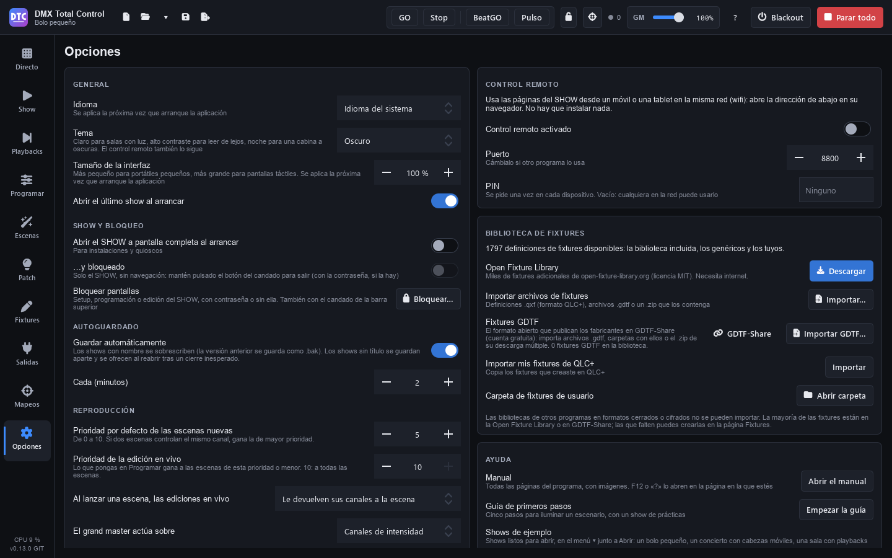

# Opciones

**Opciones** (F9) reúne los ajustes del programa. A la izquierda están los ajustes generales, el arranque, el bloqueo, la seguridad en el directo, el autoguardado, la reproducción y el audio; a la derecha, el control remoto, la biblioteca de fixtures, las actualizaciones, la ayuda y «Acerca de».

Los ajustes de esta página son del ordenador, no del show: valen para todos los shows que abras. Solo la parada de show (en [Seguridad en el directo](opciones.md#parada-de-show)) se guarda con el show.

## General

- **Idioma**: «Idioma del sistema», Español, English, Português, Français, Italiano o Deutsch. Se aplica la próxima vez que arranque el programa.
- **Tema**: **Oscuro**, **Claro**, **Alto contraste** o **Noche (atenuado)**. Cambia al momento. Claro, para salas con luz; Alto contraste, para leer de lejos; Noche, muy oscuro y en rojo, para una cabina a oscuras sin deslumbrarte. El [control remoto](remoto.md) sigue el mismo tema.
- **Tamaño de la interfaz**: de 80 % a 150 %, más pequeño para portátiles pequeños y más grande para pantallas táctiles. Se aplica la próxima vez que arranque el programa.
- **Abrir el último show al arrancar**.

> **Consejo:** el tema Claro va mejor en ensayos de día o al aire libre; Alto contraste, cuando hay mucha luz alrededor de la pantalla.

## SHOW y bloqueo

- **Abrir el SHOW a pantalla completa al arrancar**: para instalaciones y quioscos. El programa arranca en la página Show a pantalla completa.
- **…y bloqueado**: además arranca bloqueado: solo el SHOW, sin navegación. Para salir, mantén pulsado el botón del candado (con la contraseña, si la hay). Consulta [Show](show.md#pantalla-completa-y-bloqueo).
- **Bloquear pantallas**: **«Bloquear…»** / **«Desbloquear…»**. Es lo mismo que el candado de la barra superior.

### Bloquear pantallas

El bloqueo evita que algo cambie por error durante el show. Directo y el SHOW siguen funcionando, y los playbacks siguen sonando.

1. Pulsa el **candado** de la barra superior (o «Bloquear…» aquí).
2. Elige qué bloquear:
   - **Setup**: Patch, Fixtures, Salidas, Mapeos y Opciones. Tampoco se puede abrir ni crear otro show.
   - **Programación**: Programar y Escenas. En Playbacks no se puede grabar, actualizar ni asignar.
   - **Edición del SHOW**: las páginas del SHOW se usan, no se cambian.
3. Si quieres, escribe una **contraseña** (es opcional).
4. Pulsa **«Bloquear»**.

Las páginas bloqueadas llevan un candado en la barra lateral. Al abrir una, se pide la contraseña (si la hay) y se desbloquea todo. Para desbloquear, pulsa el candado de la barra superior. **«Quitar la contraseña»** está en la misma ventana, al bloquear.

## Seguridad en el directo

Lo que protege el show durante el directo (consulta [Seguridad en el directo](directo.md#seguridad-en-el-directo)):

- **Mantener el equipo despierto** (activado por defecto): mientras el programa está abierto, Windows no suspende el equipo ni apaga la pantalla. Al cerrar el programa, o al desactivarlo, Windows vuelve a hacerlo como siempre. No cambia nada de la configuración de Windows.
- **Modo show** (desactivado por defecto): cerrar el programa o abrir otro show pide mantener pulsado un botón. Bloquear el SHOW lo activa; desbloquearlo no lo quita. El escudo de la barra superior lo pone y lo quita igual (consulta [Modo show](directo.md#modo-show)).
- **Parar todo con fundido**: de 0 a 5 s (0 por defecto: al momento, como siempre). Las funciones bajan en ese tiempo; Esc dos veces, al momento. Durante 10 segundos, Ctrl+Z recupera lo que paró (consulta [Parar todo con fundido](directo.md#parar-todo-con-fundido)).
- **Desarmar los efectos sin uso tras**: de 0 a 120 minutos sin disparos (10 por defecto; 0, «Nunca»). Nunca mientras uno dispara (consulta [Efectos especiales protegidos](directo.md#efectos-especiales-protegidos)).
- **Funcionando con batería** y **La suspensión selectiva de USB está activada** solo aparecen cuando pasa. La primera dice cuánta batería queda; la segunda tiene **«Cómo quitarla»**, que abre la sección [Suspensión selectiva de USB](opciones.md#suspensión-selectiva-de-usb), más abajo.

### Parada de show

Qué ilumina la [parada de show](directo.md#parada-de-show) y a qué nivel. Esto sí se guarda con el show, en su sección de DMX Total Control (QLC+ no lo lee).

- **Fixtures**: **«Todas las luces»** (por defecto) o **«Estos grupos…»**, que abre la lista de los grupos de fixtures del show para marcarlos («Grupos que ilumina la parada de show»). Sin ninguno marcado, todas las luces. Un grupo eliminado se quita solo. De los grupos elegidos solo se iluminan las luces: su humo, sus hazers, sus estrobos y sus láseres, nunca.
- **Nivel**: de 0 a 100 % (100 por defecto).

Se iluminan las cabezas móviles, los escáneres, los PAR y washes, las barras LED, los blinders y los dimmers. Un dimmer genérico (Generic › Generic Dimmer) solo cuando su nombre dice que es una luz (PAR, FRESNEL, DIMMER, BLINDER, FOCO, FRONTAL, CONTRA, CENITAL, LUZ, SPOT, PC, SALA…) o su icono en el plano es el de una luz. Los que se llaman VIDEO, TRIGGER, DISPARADOR, RELÉ, MOTOR, PANTALLA, KABUKI, TELÓN… se quedan como están, también dentro de un grupo elegido; un PIRO… es un efecto especial protegido y se apaga. Para iluminar uno de ellos, dale un icono de luz en Patch › «Aspecto» › «Icono». Los dimmers de la biblioteca se iluminan como siempre.

### Suspensión selectiva de USB

Windows puede suspender un puerto USB que le parece sin uso para ahorrar energía, y con él la interfaz DMX: la salida se para en mitad del show. Es un ajuste del plan de energía de Windows. El programa solo lo lee al arrancar (y lo avisa con una barra azul y en esta página): nunca lo cambia. Para quitarla:

1. Abre el **Panel de control** › **Hardware y sonido** › **Opciones de energía**.
2. Junto al plan que usas, pulsa **«Cambiar la configuración del plan»** y después **«Cambiar la configuración avanzada de energía»**.
3. Abre **«Configuración de USB»** › **«Configuración de suspensión selectiva de USB»** y elige **«Deshabilitado»** en **«Con batería»** y en **«Con corriente alterna»** (sin batería, solo hay un valor).
4. Pulsa **«Aceptar»**.

Si la interfaz se sigue parando, abre el **Administrador de dispositivos** y, en las propiedades de cada **«Concentrador raíz USB»**, en la pestaña **«Administración de energía»**, quita **«Permitir que el equipo apague este dispositivo para ahorrar energía»**. Los nombres pueden cambiar un poco según la versión de Windows.

> **Sin probar con equipos reales:** los cambios de batería y de corriente, el porcentaje de batería, el efecto real de mantener el equipo despierto y la lectura de la suspensión selectiva de USB.

## Autoguardado

- **Guardar una copia de recuperación**, **Cada (minutos)**: de 1 a 60.

El autoguardado no toca el archivo del show: cada pocos minutos, si hay cambios sin guardar, guarda aparte una copia de recuperación, y el punto **●** sigue ahí. Solo **Guardar** escribe el archivo; la versión que había antes del primer guardado de cada sesión se conserva como `.bak`. La copia se borra al guardar, al cerrar (guardando o no) y al abrir otro show. Si el programa se cierra de forma inesperada, al volver a abrirlo te ofrece la copia («¿Recuperar el show sin guardar?») con el nombre del show y la hora de la copia: al recuperarla se abre ese show con sus cambios, todavía sin guardar; guárdalo para conservarlos. Mientras decides, el último show ya está abierto tal como estaba guardado (con «Abrir el último show al arrancar»): «Descartar» lo deja así. En la barra superior se ve la hora de la última copia («copia de recuperación…»); si falla (un disco lleno), aparece un aviso en rojo.

## Reproducción

- **Prioridad por defecto de las escenas nuevas**: de 0 a 10. Si dos escenas controlan el mismo canal, gana la de mayor prioridad (consulta [Prioridades](directo.md#prioridades)).
- **Prioridad de la edición en vivo**: lo que pongas en Programar gana a las escenas de esta prioridad o menor. Con 10, a todas las escenas.
- **Al lanzar una escena, las ediciones en vivo**:
  - **«Le devuelven sus canales a la escena»**: los canales que toca la escena dejan de estar en el programador.
  - **«Se mantienen siempre»**.
  - **«Se restablecen todas»**: el programador se vacía.
- **El grand master actúa sobre**: **«Canales de intensidad»** (la luz: los dimmers y los colores de los fixtures sin dimmer) o **«Todos los canales»**. Nunca baja los fixtures [protegidos del gran master](patch.md#límites).

## Audio

- **Entrada de audio**: el micrófono o la entrada de línea que escuchan **Pulso** y las matrices de audio. **«Predeterminada del sistema»** usa la que tenga el sistema operativo. Pulso cambia de entrada al momento; una matriz de audio que ya esté sonando, la próxima vez que arranque. Una entrada elegida que ahora no está conectada sale como «(no conectada)», y mientras tanto se usa la predeterminada.

## Shows recientes

La lista de los últimos shows abiertos (también en la flecha **▾** de la barra superior). **«Vaciar lista»** la borra.

## Control remoto

Para usar las páginas del SHOW desde un móvil o una tablet en la misma red wifi, sin instalar nada:

- **Control remoto activado**.
- **Puerto**: cámbialo si otro programa lo usa (por defecto, 8800). Si está ocupado, se avisa en rojo.
- **PIN**: se pide una vez en cada dispositivo. Vacío, cualquiera en la red puede usarlo.
- **Nombre en la red**: el móvil abre el remoto con `http://dmxtotalcontrol.local:8800/`, aunque cambie la dirección del ordenador (iPhone, iPad y móviles Android recientes). Si otro ordenador ya usa el nombre, este toma `dmxtotalcontrol-2`. Vacío, no hay nombre. Si el puerto de red 5353 no está disponible, o si otros ordenadores usan el nombre y del `-2` al `-9`, se avisa en rojo.
- Las **direcciones** que hay que abrir en el navegador del móvil, con un botón para copiarlas. Delante de cada una está el nombre de su red, como la llama Windows («Wi-Fi», «Ethernet 2»). Primero va la dirección **«Por nombre»**, luego la wifi, después el cable y al final los adaptadores virtuales y las VPN. La lista se actualiza sola unos segundos después de conectar o desconectar una red. Si el ordenador no está en ninguna red, en su lugar aparece un aviso.
- Un **código QR** de la dirección marcada con un borde (al principio, la primera numérica), para abrirla con la cámara del móvil. Haz clic en otra dirección para cambiarla. Si hay PIN, el código lo lleva y el móvil entra sin pedirlo. **«Más grande»** lo muestra en grande.
- Cuántos dispositivos están conectados.

Consulta [Control remoto](remoto.md).

## Biblioteca de fixtures

Indica cuántas definiciones de fixtures hay disponibles (la biblioteca incluida, los genéricos y los tuyos) y permite ampliarla:

- **Open Fixture Library**: **«Descargar»** (necesita internet). Ya descargada, se ve cuántos fixtures tiene y cuándo se descargó, y el botón pasa a ser **«Actualizar»**: trae los fixtures nuevos y los mejorados, y conserva tus fixtures y los que la biblioteca ya no tenga. Si hay novedades, se dice y el botón se resalta (consulta [Fixtures](fixtures.md#open-fixture-library)).
- **Importar archivos de fixtures**: **«Importar…»** definiciones `.qxf` (el formato de QLC+), archivos `.gdtf` o un `.zip` con ellos.
- **Fixtures GDTF**: **«GDTF-Share…»** busca, descarga e importa fixtures de GDTF-Share (consulta [Fixtures](fixtures.md#gdtf-share)); **«Importar GDTF…»** importa archivos, carpetas o el `.zip` de su descarga múltiple. Indica cuántos fixtures GDTF hay en la biblioteca.
- **Fixtures descargados de GDTF-Share**: aparece cuando los hay. **«Convertir otra vez»** los convierte de nuevo con esta versión del programa, desde el `.gdtf` guardado (consulta [Fixtures](fixtures.md#convertir-otra-vez)).
- **Revisiones más nuevas en GDTF-Share**: aparece cuando fixtures GDTF de la biblioteca tienen una revisión más nueva en GDTF-Share. **«Actualizar»** los muestra en GDTF-Share, donde **«Actualizar todos»** descarga la más nueva de cada uno y la convierte: los fixtures patcheados con ellos la reciben. Cuenta los que descargaste de GDTF-Share. Un archivo importado a mano cuenta si el texto de su última revisión coincide con una sola revisión de GDTF-Share. Se basa en la última lista de GDTF-Share que tiene el programa (consulta [Fixtures](fixtures.md#revisiones-más-nuevas)).
- **Importar mis fixtures de QLC+**: **«Importar»** copia los fixtures que creaste en QLC+.
- **Carpeta de fixtures de usuario**: **«Abrir carpeta»**.

Todo esto se explica en [Fixtures](fixtures.md).

## Actualizaciones

- **Buscar actualizaciones al arrancar**: una vez al día, en GitHub: el programa y, si descargaste la Open Fixture Library, si tiene fixtures nuevos (un aviso lo dice). Si guardaste tu cuenta de GDTF-Share, también se conecta a GDTF-Share y avisa si los fixtures que descargaste de allí tienen revisiones más nuevas (cada revisión se avisa una vez). No se descarga ni se instala nada sin preguntarte. Sin internet, no molesta.
- **Incluir versiones de prueba**: las novedades antes, menos probadas.

Debajo se ve el estado («Tienes la última versión», «Ya está disponible la versión…») y los botones:

- **«Buscar actualizaciones»**: comprueba ahora (también la Open Fixture Library).
- **«Novedades»**: lo nuevo de esa versión.
- **«Descargar e instalar»**: descarga el instalador y comprueba su huella SHA-256 antes de guardarlo. Si una versión no publica su huella, solo se puede descargar desde su página («Ver en GitHub»).
- **«Instalar ahora»**: el programa se cierra (antes pregunta si guardar el show), se instala la versión nueva y se vuelve a abrir.
- **«Al cerrar»** / **«Al cerrar no»**: instalarla cuando cierres el programa.
- **«Ver en GitHub»**: la página de la versión.

Cuando hay una versión nueva, aparece también un aviso encima de las páginas con los mismos botones. **«Más tarde»** quita el aviso para esa versión; sigue disponible aquí.

## Ayuda

- **Manual**: **«Abrir el manual»** abre este manual en su índice. F12 o el botón **«?»** de la barra superior lo abren en la página en la que estás. Sale en el idioma del programa (español, inglés, portugués, francés, italiano o alemán); las capturas son las de la versión en español.
- **Guía de primeros pasos**: **«Empezar la guía»** vuelve a abrir la guía (consulta [Primeros pasos](primeros-pasos.md#la-guía)).
- **Shows de ejemplo**: están en la flecha **▾** junto a «Abrir» de la barra superior, en «Ejemplos» (consulta [el índice](index.md#la-guía-y-los-shows-de-ejemplo)).

## Acerca de

La versión del programa, su licencia (software libre, Apache 2.0) y los créditos.
