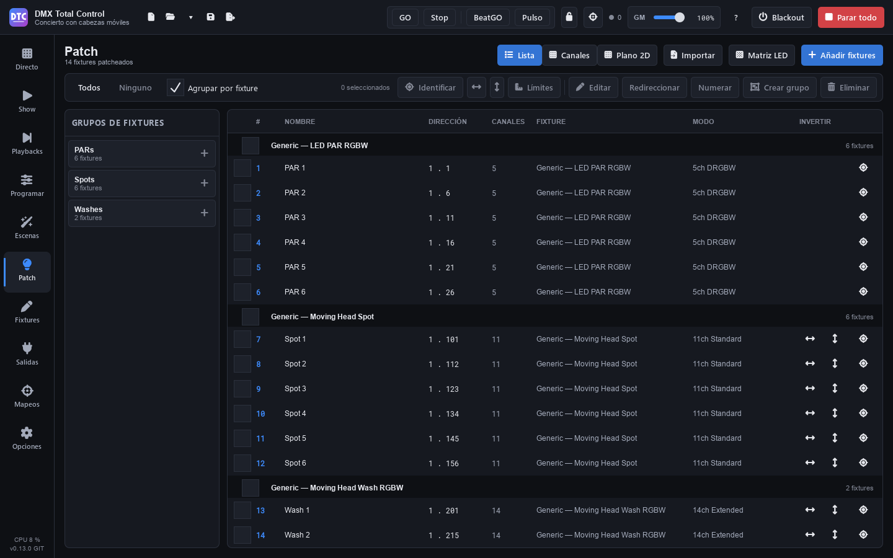

# Patch

**Patch** (F5) tiene los fixtures de tu montaje: qué son, en qué universo y dirección están, su número, los grupos de fixtures y dónde están en el escenario.

En la cabecera eliges la vista y tienes las herramientas para añadir:

- **«Lista»**: todos los fixtures por dirección.
- **«Canales»**: los 512 canales de cada universo, con los fixtures encima.
- **«Plano 2D»**: el escenario visto desde arriba.
- **«Importar»**, **«Matriz LED»** y **«Añadir fixtures»**.

## Añadir fixtures

1. Pulsa **«Añadir fixtures»**.
2. Elige el **Fabricante** (escribe en «Buscar fabricante…» para filtrar) y el **Modelo**.
3. En el panel **Patch**:
   - **Nombre**: el que verás en todo el programa (por defecto, el del modelo).
   - **Modo**: el modo DMX, con su número de canales.
   - **Cantidad**: cuántos iguales.
   - **Universo** y **Dirección**: la dirección se pone sola en la primera libre del universo.
   - **Separación**: canales libres entre un fixture y el siguiente.
   - Con más de uno, **«Crear un grupo con ellos»** y el nombre del **Grupo**.
4. Abajo se ve qué direcciones van a usar («Usa las direcciones 1 a 20»). Si no caben en lo que queda de universo, pasan al siguiente.
5. Pulsa **«Patchear fixture»** o **«Patchear N fixtures»**.

La ventana se queda abierta para seguir añadiendo, con la dirección ya en la siguiente libre. Si algo no se puede patchear (las direcciones están ocupadas, por ejemplo), el motivo aparece en rojo abajo. Pulsa **«Cerrar»** al terminar.

Para dimmers sueltos, elige **Generic › Generic Dimmer**: en lugar de modo, pides cuántos **Canales**.

> **Consejo:** si no encuentras tu fixture, descarga la [Open Fixture Library](fixtures.md#open-fixture-library), importa su GDTF o créalo en la página [Fixtures](fixtures.md).

## La lista

Columnas: casilla de selección, **#** (número), **NOMBRE**, **DIRECCIÓN** (universo . dirección), **CANALES**, **FIXTURE** (fabricante y modelo), **MODO**, **INVERTIR** (pan y tilt) y el botón de identificar.

- **«Agrupar por fixture»** los agrupa por modelo, con una casilla para seleccionar todos los de cada modelo. Un clic en la cabecera de un modelo lo pliega (oculta sus fixtures) o lo despliega.
- **Doble clic** en un fixture lo edita.

## Seleccionar

Las herramientas de la barra trabajan sobre la selección:

- **Clic** selecciona; **Ctrl+clic** añade o quita; **Mayús+clic** selecciona todos los fixtures desde el último que pulsaste hasta ese (en ese sentido, que es el orden de la selección), y **Ctrl+Mayús+clic** los añade. **«Todos»** y **«Ninguno»**.
- **«Identificar»**: los fixtures seleccionados parpadean en blanco para encontrarlos en el escenario. **«Dejar de identificar»** lo para (también se para al salir de la página). El botón de cada fila identifica solo ese fixture. La lista se queda donde estaba.
- **Invertir pan** e **invertir tilt** (los iconos de flechas): para los fixtures que lo tienen.
- **«Límites»**, **«Editar»**, **«Redireccionar»**, **«Numerar»**, **«Crear grupo»** y **«Eliminar»**: se explican a continuación.

## Direcciones y universos

- **Editar un fixture**: selecciona uno y pulsa **«Editar»** (o doble clic). Puedes cambiar **Nombre**, **Modo**, **Universo**, **Dirección** y **Número**, y pulsar **«Aplicar»**.
- **Redireccionar varios**: selecciónalos y pulsa **«Redireccionar»**. Elige **Universo**, **Dirección inicial** y **Separación**: reciben direcciones seguidas, en el orden de la lista.
- **Arrastrar en la vista Canales**: elige el universo arriba y arrastra un fixture a otra dirección. La sombra se ve en verde si cabe y en rojo si los canales no están libres. Arriba se ve cuántos de los 512 canales están en uso. Doble clic en un fixture lo edita.

Los universos se crean y se conectan a las interfaces en [Salidas](salidas.md).

## Números de fixture

Cada fixture tiene un **número**, que es el que usa la [línea de comandos](programar.md#línea-de-comandos) de Programar (`1 THRU 8 @ FULL`). Un fixture nuevo recibe el número siguiente al último.

- Cambia uno en **«Editar»** › **Número**.
- Para numerar varios seguidos, selecciónalos, pulsa **«Numerar»** y escribe el **Primer número**: se numeran por orden de dirección.

## Grupos de fixtures

Los grupos de fixtures sirven para seleccionar de un clic en Patch y en Programar (`GROUP 2` en la línea de comandos), y cada uno tiene su tira en el [mezclador](directo.md#mezclador). También se usan en el SHOW (rueda de color, rejilla XY, paletas, dimmer y velocidad de movimiento) y en los mapeos.

1. Selecciona los fixtures.
2. Pulsa **«Crear grupo»** y escribe su nombre (por ejemplo, `Wash frontal` o `Spots`).

El panel **«Grupos de fixtures»** de la izquierda los muestra con su número de fixtures. Un clic en un grupo selecciona sus fixtures; **Ctrl+clic** o **Mayús+clic** los añade. Clic derecho:

- **«Renombrar»**.
- **«Sustituir por la selección»**: el grupo pasa a tener los fixtures seleccionados.
- **«Guardar la selección aquí…»**: consulta [Selecciones](patch.md#selecciones).
- Patrones de selección, en el orden del grupo: **«Seleccionar los impares»**, **«Seleccionar los pares»**, **«Seleccionar en orden inverso»**, **«Seleccionar la primera mitad»**, **«Seleccionar la segunda mitad»**, **«Seleccionar de los extremos al centro»** y **«Seleccionar del centro a los extremos»**.
- **«Eliminar grupo»**.

### Selecciones

Una **selección** es una parte ordenada de un grupo: por ejemplo, los spots de un grupo de seis tomados de los extremos al centro. El orden importa, porque los abanicos y los FX lo siguen.

1. Selecciona los fixtures en el orden que quieras (o con un patrón del menú del grupo).
2. Pulsa el **+** del grupo (o «Guardar la selección aquí…») y escribe un nombre.

Las selecciones aparecen bajo su grupo. Un clic selecciona sus fixtures en su orden, aquí y en Programar. Clic derecho: **«Renombrar»** y **«Eliminar la selección»**. La flecha a la izquierda del grupo oculta o muestra sus selecciones.

## Plano 2D

El plano muestra el escenario visto desde arriba, con **PÚBLICO** abajo. Sirve para seleccionar en Programar, para ver lo que sale y para los efectos de color colocados en el plano.

En la cabecera del plano:

- **«Ancho (m)»** y **«Fondo (m)»**: el tamaño del escenario.
- **«Colocar automáticamente»**: reparte todos los fixtures.

Las herramientas (trabajan sobre la selección y en su orden):

- **«En vivo»**: muestra el color, el dimmer, el estrobo y el gobo de cada fixture, y cada píxel de las barras y matrices.
- **«Lazo»**: selecciona dibujando alrededor de los fixtures en lugar de con un recuadro.
- **«Seleccionar»**: clic o recuadro para seleccionar.
- **«Mover»**: arrastra los fixtures (se mueve toda la selección) o la vista.
- **«Cuadrícula»**: «Libre», 10 cm, 25 cm, 50 cm o 1 m: donde caen los fixtures al moverlos.
- **«Aspecto»**: cómo se ven los fixtures seleccionados: «Redondo», «Cuadrado» o «Rectángulo».
- **«Colocar»**: los coloca en «Línea», «Línea, de delante a atrás», «Círculo», «Rejilla, por filas», «Rejilla, en zigzag», «Rejilla, por columnas» o «Rejilla, en zigzag por columnas», con la **Separación (cm)** y las **Columnas** de al lado.
- **«Alinear»**: «Izquierda», «Centro», «Derecha», «Fondo», «Medio», «Frente», «Repartir a lo ancho» y «Repartir a lo hondo».
- **15°** (clic derecho: hacia el otro lado) y **90°**: giran la selección.
- **«Altura y orientación»**: dónde cuelgan las cabezas móviles seleccionadas, para [Follow](patch.md#altura-y-orientación-follow).

Las cabezas móviles llevan una pequeña flecha en el borde: hacia dónde miran. Los nombres de los fixtures muy juntos se ocultan para no pisarse: acerca el zoom para leerlos.

La **rueda** hace zoom, el **botón derecho** o el central arrastran la vista y un doble clic con ellos la centra. Los botones de la esquina también hacen zoom.

> **Consejo:** coloca los fixtures en el orden en que quieres que corran los efectos: selecciónalos de izquierda a derecha y usa «Colocar › Línea».

### Altura y orientación (Follow)

Para que [Follow](programar.md#follow-apuntar-a-un-punto) apunte bien todas las cabezas móviles a un punto, cada una necesita saber dónde está. Coloca las cabezas en el plano donde están de verdad, selecciónalas y pulsa **«Altura y orientación»**. Lo que cambies se aplica al momento a todas las seleccionadas y se guarda con el show:

| Campo | Qué es |
|---|---|
| **Altura** | A cuántos metros del suelo del escenario está el eje de la cabeza (sin ajustar: 4 m colgada, 0 m de pie). |
| **Montaje** | **«Colgada»** (de una vara o un truss, boca abajo) o **«De pie»** (en el suelo). |
| **Orientación** | Hacia dónde va el haz con el pan en el centro y el tilt inclinado hacia delante. 0° es hacia el público y gira en el sentido de las agujas del reloj; es el mismo giro que el de los botones 15° y 90°, y la flecha del plano lo muestra. |
| **Recorrido de pan** / **de tilt** | Los grados que recorre cada eje. «Su definición» usa los de la definición del fixture; si no los trae se usan 540° y 270°, y se avisa en naranja. |
| **Pan al revés** / **Tilt al revés** | Si con Follow una cabeza gira o se inclina hacia el lado contrario. Solo afecta a Follow; las inversiones del Patch están en [Límites](patch.md#límites). |

«(distintas)» indica que las cabezas seleccionadas no tienen el mismo valor; al cambiarlo, todas toman el nuevo.

## Límites

Selecciona fixtures y pulsa **«Límites»**:

- **Dimmer**, **Pan** y **Tilt**: el rango permitido, de 0 a 100 %. Por ejemplo, un dimmer que no pase del 80 % o un tilt que no apunte al público.
- **«Invertir pan»**, **«Invertir tilt»** e **«Intercambiar pan y tilt»** (para cabezas colgadas al revés o giradas).
- **«Restablecer»**: sin límites ni ejes invertidos o intercambiados.

Con un solo fixture, la lista **Canales** permite decidir para cada canal:

- **Fundidos**: si sigue los tiempos de fundido. Apagado, salta directamente a su valor (útil en ruedas de color y gobos).
- **Dimmer**: si lo escalan el gran master, los masters de grupo y los dimmers de escena.

Los límites actúan en la salida: escenas, efectos y edición en vivo conservan sus valores, pero lo que sale los respeta. Con varios fixtures se ven los valores del primero que tiene cada control, y lo que cambies se aplica a todos los que lo tienen.

## Matrices y tiras LED

**«Matriz LED»** patchea de una vez una matriz o una tira de píxeles:

1. **Nombre**, **Ancho (píxeles)** y **Alto (píxeles)** (alto 1 para una tira).
2. **Colores**: el orden de cada píxel (RGB, GRB, BGR, BRG, GBR, RBG o RGBW).
3. **Cableado**: «Filas», «Filas, en zigzag», «Columnas» o «Columnas, en zigzag».
4. **Píxel 1**: la esquina donde empieza («Arriba a la izquierda», etc.).
5. **Universo** y **Dirección**.
6. Comprueba el resumen y la vista previa del **orden de los píxeles**, y pulsa **«Patchear»**.

Se crea un fixture por línea de píxeles, un grupo para los efectos de color y su sitio en el plano. Si una línea necesita más de un universo, hazla más corta o cablea en el otro sentido.

## Importar de otro show

**«Importar»** trae a este show parte de otro (de DMX Total Control o de QLC+):

- **«Patch de otro show…»**: sus fixtures. Van a sus mismas direcciones si están libres; si no, a las siguientes.
- **«Escenas de otro show…»**: sus escenas, asignadas a los fixtures de este show que coinciden (por dirección y modelo, por nombre o por modelo). Entran en grupos con el mismo nombre.
- **«Patch y escenas de otro show…»**: las dos cosas.

## Eliminar fixtures

Selecciónalos y pulsa **«Eliminar»**. Se pregunta antes: sus valores se eliminan de todas las escenas.
