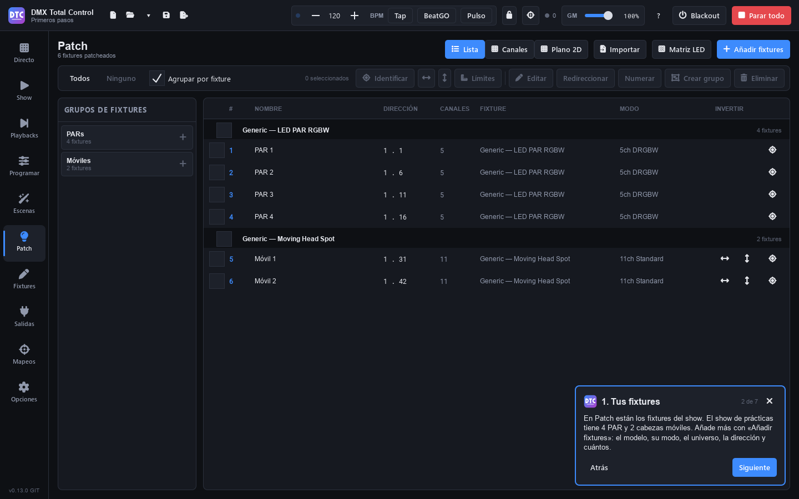

# Primeros pasos

## La guía

La primera vez que abres el programa aparece la **guía de primeros pasos**: una tarjeta abajo a la derecha con cinco pasos (tus fixtures, un look, una escena, Directo y los playbacks). **«Siguiente»** y **«Atrás»** cambian de paso y te llevan a la página de cada uno; las páginas se pueden usar mientras la tarjeta está abierta. La cierras con la **✕** y la vuelves a abrir en Opciones › Ayuda › **«Empezar la guía»**.

En el primer paso, **«Abrir el show de prácticas»** abre el ejemplo «Primeros pasos» (si tienes cambios sin guardar, antes pregunta si guardarlos). Ya tiene cuatro PAR LED RGBW en el grupo de fixtures `PARs`, dos cabezas móviles en `Móviles` y el grupo «Mis escenas» vacío en Directo, listo para tus escenas.

## La sesión completa

En esta primera sesión vas a hacer el camino completo: conectar la salida, patchear unos fixtures, montar un look en el programador, grabarlo como escena en un grupo, lanzarlo en Directo, grabar una cuelist en un playback y guardar el show. Te llevará unos veinte minutos.

Usaremos fixtures de la biblioteca genérica: cuatro PAR LED RGBW y dos cabezas móviles. Si tienes otros aparatos, busca su fabricante y modelo en lugar de los genéricos.

> **Consejo:** puedes seguir esta guía sin interfaz DMX conectada. Lo que sale se ve en Salidas › «Niveles DMX» y en el plano 2D de Programar.

> **Consejo:** con el show de prácticas abierto ya tienes los fixtures y el grupo: salta al paso 4 y usa el grupo de fixtures `Móviles` donde aquí pone `Cabezas`.

## 1. Conecta la salida

1. Conecta tu interfaz DMX USB al ordenador (o asegúrate de que el ordenador está en la misma red que tu nodo Art-Net o sACN).
2. Abre **Salidas** (F7).
3. En la fila del universo 1, abre el desplegable que pone «Sin conectar» y elige tu interfaz.
4. Si no aparece, pulsa **«Buscar de nuevo»**.

El universo conectado se marca en verde. Encontrarás más detalles en [Salidas](salidas.md).

## 2. Patchea unos fixtures

1. Abre **Patch** (F5) y pulsa **«Añadir fixtures»**.
2. En **Fabricante**, elige **Generic** (puedes escribir en «Buscar fabricante…»).
3. En **Modelo**, elige **LED PAR RGBW**.
4. En el panel **Patch** de la derecha:
   - **Modo**: «5ch DRGBW».
   - **Cantidad**: 4.
   - **Universo**: 1. La **Dirección** se pone sola en la primera libre.
   - Deja marcada **«Crear un grupo con ellos»** y escribe en **Grupo** el nombre `PARs`.
5. Pulsa **«Patchear 4 fixtures»**. Abajo verás qué direcciones usan.
6. Sin cerrar la ventana, elige ahora **Moving Head Spot**, modo «11ch Standard», cantidad 2, grupo `Cabezas`, y pulsa **«Patchear 2 fixtures»**.
7. Pulsa **«Cerrar»**.

> **Consejo:** pon en cada aparato la misma dirección DMX que muestra la lista del Patch. Para encontrar un aparato en el escenario, selecciónalo y pulsa **«Identificar»**: parpadea en blanco.

## 3. Crea un grupo en Directo

Las escenas se lanzan en Directo, organizadas en grupos. Crea uno antes de grabar:

1. Abre **Directo** (F1) y pulsa **«Nuevo grupo»**.
2. Haz clic en el nombre de la columna («Grupo 1»), bórralo, escribe `Mis escenas` y pulsa Intro.
3. En el desplegable de tiempo de crossfade de la columna (pone «Por escena»), elige **2 s**.

El grupo es **«Exclusiva»**: solo suena una escena a la vez y al pulsar otra hace un fundido cruzado.

## 4. Monta un look en el programador

1. Abre **Programar** (F3).
2. En el panel de fixtures, haz clic en la etiqueta del grupo **PARs**: se seleccionan los cuatro.
3. En el panel **Rápido**, pulsa **100%** junto al fader de **Dimmer**.
4. Haz clic en la muestra de color **roja**.

Los PAR se encienden en rojo en cuanto lo tocas: lo que pones en el programador sale al momento, por encima de todo.

> **Consejo:** lo mismo con la línea de comandos: escribe `GROUP 1 @ FULL` y pulsa Intro. `GROUP 1` es el primer grupo de fixtures. Consulta [la línea de comandos](programar.md#línea-de-comandos).

## 5. Graba la escena en el grupo

1. Pulsa **«Grabar…»** (arriba a la derecha).
2. En **Grabar en**, deja **«Escena nueva»**.
3. En **Nombre**, escribe `Rojo`.
4. En **Añadir al grupo**, elige **Mis escenas**.
5. Pulsa **«Grabar»**.

Graba un segundo look: con los PAR seleccionados y el dimmer al 100 %, haz clic en la muestra **azul**, pulsa **«Grabar…»**, nombre `Azul`, grupo **Mis escenas** y **«Grabar»**.

Antes de ir a Directo, pulsa **«Restablecer todo»** para vaciar el programador. Mientras el programador tiene valores, mandan sobre las escenas y no verías lo que lanzas.

> **Consejo:** en la ventana de grabar, marca **«Limpiar el programador después de grabar»** y el programador se vaciará solo cada vez que grabes. La opción se recuerda.

## 6. Lanza las escenas en Directo

1. Abre **Directo** (F1).
2. Pulsa **Rojo**: la ficha se ilumina con el color del grupo y los PAR entran en rojo.
3. Pulsa **Azul**: el grupo hace un crossfade de 2 segundos de rojo a azul.
4. Mueve el **Master** de la columna para bajar la intensidad de todo el grupo.
5. Vuelve a pulsar **Azul** para liberarla, o pulsa el cuadrado de la cabecera de la columna («Liberar este grupo»).

Más en [Directo](directo.md).

## 7. Graba una cuelist en un playback

Las cuelists avanzan cue a cue con GO. La forma más rápida de crear una es grabar directamente en un playback.

1. En **Programar**, haz clic en la etiqueta **Cabezas**.
2. Pulsa **«Beam on»** (dimmer al máximo y shutter abierto) y **«Centrar»** (pan y tilt al centro).
3. Abre **Playbacks** (F10) y pulsa **«Grabar»**: el botón parpadea en rojo.
4. Haz clic en el playback **1**, que está vacío: se crea una cuelist nueva con la cue 1.
5. Vuelve a **Programar**, abre **Features**, pestaña **Posición**, y arrastra la cruz de la rejilla XY a otro sitio.
6. En **Playbacks**, pulsa **«Grabar»** y haz clic otra vez en el playback 1: se graba la cue 2, solo con lo que ha cambiado (la posición).
7. Vuelve a **Programar** y pulsa **«Restablecer todo»**.
8. En **Playbacks**, haz clic en el nombre del playback 1 para seleccionarlo y pulsa **Espacio** (o el gran botón **GO**): suena la cue 1. Pulsa otra vez: pasa a la cue 2.

El fader del playback es su intensidad: si lo subes desde cero, la cuelist arranca. Más en [Playbacks](playbacks.md).

## 8. Guarda el show

1. Pulsa **Ctrl+S** (o el disquete de la barra superior).
2. Como es la primera vez, elige carpeta y nombre: se guarda como archivo `.qxw`.

A partir de aquí, Ctrl+S guarda en el mismo archivo y conserva como `.bak` la versión que había antes del primer guardado de cada sesión. Con el autoguardado activo (consulta [Opciones](opciones.md#autoguardado)), el programa guarda cada pocos minutos una copia de recuperación aparte, sin tocar tu archivo: si se cierra de forma inesperada, te ofrece recuperar los cambios.

## Y ahora…

- Monta tu pantalla de operación en el [Show](show.md).
- Aprende a usar [paletas](programar.md#paletas) y [FX](programar.md#fx) en el programador.
- Edita las cues, sus tiempos y su tracking en [Escenas](escenas.md#cuelists).
- Conecta un controlador MIDI en [Mapeos](mapeos.md).
