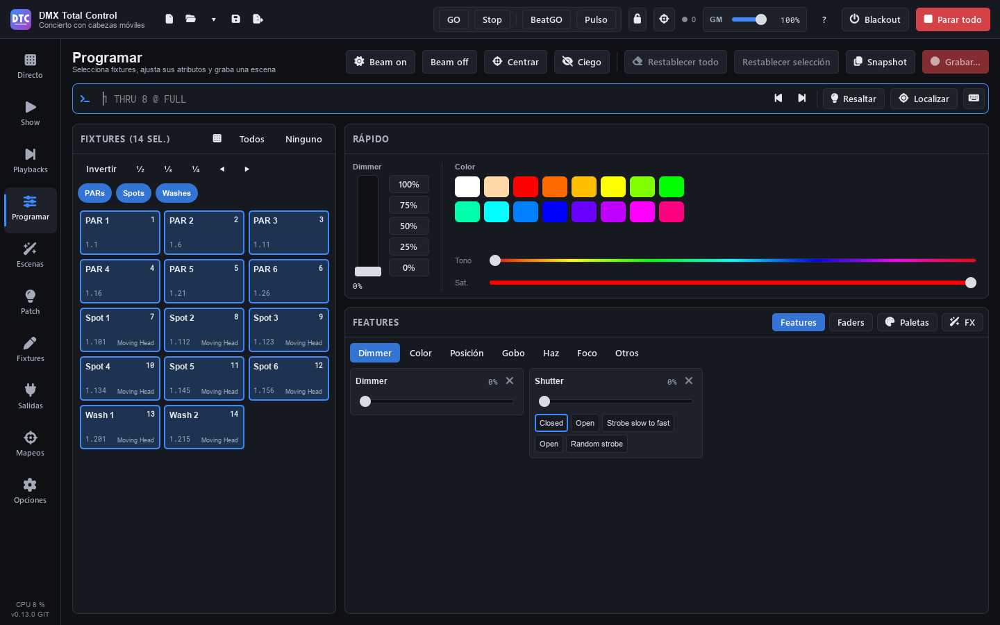

# Programar

**Programar** (F3) es el programador: seleccionas fixtures, les das dimmer, color, posición, gobos o cualquier otro canal, les pones FX y paletas, y lo grabas como escena, cuelist o cue.

Lo que pones en el programador **sale al momento y manda sobre todo** (escenas, grupos y playbacks) hasta que lo limpias. El subtítulo de la página te lo recuerda: «N canales en el programador: mandan sobre los playbacks hasta limpiarlos».

La página tiene, de arriba abajo: la cabecera con sus botones, la [línea de comandos](programar.md#línea-de-comandos), el panel de **fixtures** a la izquierda y, a la derecha, el panel **Rápido** y el panel de **Features / Faders / Paletas / FX**.

## La cabecera

- **«Beam on»**: dimmer al máximo y shutter abierto en la selección.
- **«Beam off»**: dimmer a cero en la selección.
- **«Centrar»**: pan y tilt al centro.
- **«Ciego»**: consulta [Ciego](programar.md#ciego).
- **«Restablecer todo»**: libera todas las ediciones en vivo (valores y FX). Las escenas vuelven a verse.
- **«Restablecer selección»**: libera solo las de los fixtures seleccionados.
- **«Snapshot»** y **«Grabar…»**: consulta [Grabar](programar.md#grabar).

En una ventana estrecha algunos botones muestran solo su icono; al pasar el ratón se ve su nombre.

## Seleccionar fixtures

El panel **«Fixtures (N sel.)»** muestra una ficha por fixture con su nombre, su número (para la línea de comandos), su dirección (universo.dirección) y su tipo.

- **Clic** en una ficha: selecciona solo esa.
- **Ctrl+clic**: la añade o la quita de la selección. **Mayús+clic**: selecciona todas las fichas desde la última que pulsaste hasta esa (en ese sentido, que es el orden de la selección); **Ctrl+Mayús+clic** las añade.
- **«Todos»** y **«Ninguno»**, en la cabecera del panel.
- **«Invertir»**: selecciona los que no lo estaban.
- **½**, **⅓**, **¼**: deja uno de cada dos, tres o cuatro.
- **◀ ▶**: desplaza la selección hacia la izquierda o la derecha.

**El orden importa**: el orden en que seleccionas los fixtures es el orden que siguen los abanicos, los FX y los Colour FX. En el plano 2D cada fixture seleccionado muestra su número de orden.

> **Consejo:** también puedes seleccionar escribiendo: `1 THRU 8` y Intro. Consulta [la línea de comandos](programar.md#línea-de-comandos).

### Grupos de fixtures y selecciones

Encima de las fichas aparecen los [grupos de fixtures](patch.md#grupos-de-fixtures) del Patch como etiquetas redondas:

- **Clic** en un grupo: selecciona sus fixtures. **Ctrl+clic** o **Mayús+clic**: los añade.
- La etiqueta se ilumina cuando todos sus fixtures están seleccionados. Al pasar el ratón se ve su número para la línea de comandos («GROUP 2 en la línea de comandos»).
- Las **selecciones** de un grupo (partes ordenadas, con su icono) seleccionan sus fixtures en su orden.
- Con muchos grupos se ven tres filas de etiquetas, que se desplazan con la rueda: **«Todos los grupos (N)»** las abre (hasta la mitad del panel) y **«Menos»** las recoge. Así las fichas de los fixtures siguen a la vista.

### Plano 2D

El botón de la rejilla en la cabecera del panel («Plano 2D») cambia las fichas por el plano del escenario:

- **Clic** en un fixture lo selecciona; **Ctrl+clic** o **Mayús+clic** lo añade o lo quita.
- **Arrastra** sobre el escenario vacío para seleccionar con un recuadro. Un clic en el vacío quita la selección.
- La **rueda** hace zoom; arrastrar con el **botón derecho** o el central mueve la vista, y un doble clic con esos botones la centra de nuevo.

En Programar el plano está siempre **en vivo**: cada fixture muestra su color, su dimmer, su estrobo (parpadea) y su gobo, y cada píxel de las barras y matrices. Los fixtures se colocan en el [plano 2D del Patch](patch.md#plano-2d).

## El panel Rápido

### Dimmer

El fader **Dimmer** y los botones **100%**, **75%**, **50%**, **25%** y **0%** dan intensidad a la selección.

### Color

Haz clic en una de las 16 muestras, o mueve **Tono** y **Sat.** El color se mezcla en los canales RGB (la parte blanca va al canal blanco si el fixture lo tiene) o CMY de cada fixture. Para las ruedas de color, usa sus presets en [Features](programar.md#features) › Color.

> **Consejo:** para un abanico de dimmer, usa la línea de comandos: `@ 0 THRU 100` va del 0 % en el primero al 100 % en el último. El abanico de la posición está en [Features › Posición](programar.md#posición-rejilla-xy-y-abanico).

## Features

**Features** muestra los canales de la selección por pestañas: **Dimmer**, **Color**, **Posición**, **Gobo**, **Haz**, **Foco** y **Otros**. Las pestañas sin canales en la selección están desactivadas.

Cada canal es una tarjeta con su nombre, su valor en %, un deslizador y sus **presets** como botones (con su color o la imagen de su gobo si el perfil los trae). Haz clic en un preset para ponerlo. La tarjeta se marca en naranja cuando el canal está en el programador; su **×** lo libera.

Los canales se agrupan **por función**, no por nombre: «Red», «R» o «Rojo» de fixtures distintos son el mismo control, y lo mismo con dimmer, pan/tilt, CMY, rueda de color, gobo, shutter, iris, zoom, foco, prisma… Cada cabeza de una barra conserva sus canales.

### Color: selector y favoritos

En la pestaña **Color**, el cuadro de la izquierda da el tono (de lado a lado) y la saturación (de arriba abajo). Arrastra la cruz para colocarla, o arrastra en otro sitio del cuadro para un ajuste fino.

Debajo, **«Favoritos»**: el **+** guarda el color actual; un clic en un favorito lo pone; clic derecho lo quita. Los favoritos sirven para todos los shows.

### Posición: rejilla XY y abanico

La pestaña **Posición** solo mueve el **pan** y el **tilt** (con sus canales finos, en 16 bits). La rotación continua de pan o tilt y su velocidad están en **Otros**.

- Arrastra la **cruz** para colocarla, o arrastra en otro sitio de la rejilla para un movimiento lento y fino.
- La barra de la izquierda es el **tilt** y la de abajo el **pan**.
- Con varios fixtures, cada uno es un punto en la rejilla.
- **«Centrar»** lleva pan y tilt al centro.

A la derecha está el **Abanico**: abre la posición de la selección, en su orden, cada fixture desde donde estaba.

- **«Abierto»**: de un extremo al otro (el primero a un lado, el último al otro, el del medio quieto).
- **«En V»**: los extremos se abren y el centro queda quieto.
- **«Desde el primero»**: el primero quieto y cada uno un poco más.
- **Pan** y **Tilt**: cuánto se abre cada uno (de −100 a 100 %; doble clic, a 0). Al 100 %, los extremos se mueven media rejilla.
- **«Sin abanico»**: los fixtures vuelven a donde estaban.
- El botón **«Abanico»** bajo la rejilla hace que arrastrar en ella abra el abanico en vez de mover: de lado, el pan; arriba y abajo, el tilt.

Si después mueves la cruz, el centro se mueve y el abanico se mantiene. Si la posición cambia por otro lado (una paleta, otra selección, «Restablecer todo»), el abanico vuelve a 0 y empieza de nuevo desde donde estén.

### Follow: apuntar a un punto

El botón **«Follow»** bajo la rejilla cambia el abanico por un plano del escenario. Haz clic o arrastra sobre él: **todas las cabezas móviles seleccionadas apuntan a ese punto**, cada una con su pan y su tilt, y una línea va de cada una al punto.

- **«Altura del punto»**: 0 m es el suelo; súbelo para apuntar, por ejemplo, a la cara de quien canta (1,6 m).
- Cada cabeza calcula su pan y su tilt con su sitio en el plano, su altura, si está colgada o de pie y hacia dónde mira. Todo eso se ajusta en [Patch › Plano 2D › «Altura y orientación»](patch.md#altura-y-orientación-follow).
- Al arrastrar, cada cabeza va por el camino corto desde donde apuntaba, sin dar la vuelta larga.
- Los valores quedan en el programador como cualquier pan y tilt: grábalos en una escena, una cue o una paleta.
- Debajo se indica cuántas apuntan, cuáles no llegan (se quedan lo más cerca que pueden), cuáles no traen el recorrido de pan y tilt en su definición (se usan 540° y 270°) y los escáneres, que no se mueven (su espejo no sigue esta geometría).
- Las inversiones, los límites y el intercambio de pan y tilt del [Patch](patch.md#límites) ya se tienen en cuenta.

Si mueves la cruz, el abanico o «Centrar», o cambias la selección, el punto desaparece.

> **Sin probar con equipos reales:** cada fabricante orienta sus cabezas a su manera. Si una apunta mal, ajusta su orientación o pon su pan o su tilt al revés en «Altura y orientación».

## Faders

**Faders** muestra cada canal de la selección como un fader vertical, con su nombre, su grupo y su valor (0–255). El botón de la lista abre sus **presets** («Nombre (mín–máx)») y la **×** lo libera.

> **Consejo:** después de hacer clic en un fader o un deslizador, las flechas ↑ ↓ lo mueven de uno en uno y RePág / AvPág de diez en diez. Doble clic lo devuelve a su valor de reposo (normalmente, cero).

## Ciego

Con **«Ciego»** activo, el programador edita **sin sacar nada a las luces**: el escenario sigue mostrando lo que suena y tú preparas el siguiente look. El subtítulo avisa: «Modo ciego: las luces no muestran lo que programas». Puedes grabar igual que siempre. Al desactivarlo, lo que hay en el programador sale.

## Resaltar y localizar

En la barra de la línea de comandos:

- **«Resaltar»**: la selección a tope en blanco abierto, por encima de todo, para ver qué fixtures son. No se graba. Vuelve a pulsar para quitarlo.
- **«Localizar»**: pone la selección a tope, en blanco abierto, centrada y con el haz abierto, **en el programador** (esos valores sí se graban).
- **◀ ▶** (PREV / NEXT): recorre la selección **de uno en uno**: solo queda seleccionado un fixture y se ve en cuál vas («2/8»). **«Todas»** vuelve a toda la selección (ALL).

## Paletas

Una **paleta** guarda un valor de intensidad, posición, color o haz para cada fixture, o **todo** a la vez. Las escenas, las cues y los pasos grabados con una paleta la usan **por referencia**: si actualizas la paleta, cambian solos (las ediciones en vivo también).

En **Paletas** hay cinco columnas: **Intensidad**, **Posición**, **Color**, **Haz** y **Todo**.

### Grabar una paleta

1. Selecciona fixtures y dales el valor (por ejemplo, un color).
2. En la columna **Color**, pulsa **«+ Grabar»**.

La paleta se crea con un nombre y un número («Color 1», COL 1). Desde ese momento, lo que grabes con ella la sigue.

### Paletas de todo

La columna **Todo** graba de una vez todos los valores que la selección tiene en el programador (dimmer, color, posición, gobos, zoom…), menos los canales de mantenimiento (lámpara, reset). Se crea como «Todo 1», PAL 1. Los valores que venían de otra paleta (por ejemplo, de POS 1) pasan a venir de esta: una paleta no guarda otras paletas.

Al ponerla, pone todo eso. En otro tipo de fixture, mezcla su color y el resto va por atributos, como las demás paletas. En la línea de comandos es `PAL 1` (o PALETA 1), porque `ALL` y `TODO` ya seleccionan todos los fixtures.

### Usar una paleta

Selecciona fixtures y haz clic en la paleta: se aplica a la selección. Una paleta se marca cuando está puesta en la selección (más fuerte si lo está en toda). En un fixture que no se grabó en la paleta, usa los valores de otro del mismo tipo (repartidos si es un abanico, ver abajo) o sus atributos: un color se mezcla en RGB o CMY, o va al hueco más parecido de la rueda de color.

También: `COL 2`, `POS 1`, `BEAM 3`, `INT 4` o `PAL 5` (la de todo) en la línea de comandos.

### Abanico en una paleta

Si grabas una paleta con valores distintos en cada fixture (un abanico de posición, una rampa de dimmer, un arcoíris), la paleta guarda el orden en que los seleccionaste. Al ponerla en fixtures que no se grabaron, el abanico **se reparte entre ellos en el orden de la selección**: el primero toma los valores del primero grabado, el último los del último, y los de en medio, lo que hay entre ellos. Pan, tilt, dimmer, colores y zoom pasan de forma suave; ruedas y gobos toman el valor del grabado más cercano. En otro tipo de fixture, el color es la mezcla que toca en su sitio y el resto viene del grabado más cercano.

Cada fixture recuerda su sitio en el abanico, aunque después pongas la paleta con otra selección. Las escenas, las cues y los pasos grabados con ella siguen a la paleta, y volver a ponerla da lo mismo. Para repartirla de otra forma, selecciona los fixtures en el nuevo orden y elige **«Repartir de nuevo por la selección»**. En un grupo del SHOW o de un mapeo, se reparte en el orden del grupo.

Una paleta grabada en un solo fixture de cada tipo, o con los mismos valores en todos, funciona igual que antes.

### El menú de una paleta

Clic derecho en una paleta:

- **«Aplicar a la selección»**.
- **«Cargar sus fixtures en el programador»**.
- **«Repartir de nuevo por la selección»**: da a los fixtures seleccionados un sitio nuevo en el abanico de la paleta, en el orden de la selección. Lo que los usa cambia también.
- **«Actualizar con el programador»**: añade o cambia los valores del programador en la paleta. Las escenas que la usan cambian también.
- **«Grabar encima»**: la graba de nuevo solo con lo que hay ahora.
- **«Renombrar…»**, **«Cambiar su número…»** y **«Eliminar»** (las escenas se quedan con los valores).

Un icono de enlace en la paleta indica que hay escenas que la usan; el texto al pasar el ratón dice cuántas, y en cuántos fixtures más se reparte.

> **Consejo:** las paletas se pueden poner en el [SHOW](show.md) (acción «Una paleta»), en el [control remoto](remoto.md) y en un [mapeo](mapeos.md), sobre sus fixtures o sobre un grupo, como edición en vivo. Alt+clic en una paleta la lleva al SHOW.

## FX

Un **FX** mueve un parámetro de la selección (el dimmer, el rojo, el zoom, pan y tilt juntos…) alrededor de su valor en el programador o, si no tiene valor, alrededor de lo que mandan las escenas de debajo. Suena al momento y se graba con la escena.

En **FX** hay tres zonas: los parámetros y los FX en marcha a la izquierda, los controles del FX en el centro y las macros a la derecha.

### Poner un FX

1. Selecciona fixtures.
2. En **Parámetro**, elige qué mover. Por defecto se elige el último parámetro que has tocado. Los que ya tienen un FX en la selección llevan la marca «FX».
3. Pulsa **«Empezar FX»**, o haz clic en una **macro**.
4. Ajusta los controles: el FX cambia en directo.

Los fixtures sin dimmer (solo RGB, RGBW…) también tienen **Dimmer**, marcado «virtual»: el FX atenúa su color como lo haría un dimmer, con todas sus cabezas a la vez. Las macros de intensidad (persecución, pulso, estrobo…) también funcionan en ellos. El CMY, las ruedas de color y los canales con la opción **Dimmer** apagada en el Patch no cambian. Es solo para los FX: el fader **Dimmer** del panel Rápido y `@` siguen sin dimmer en estos fixtures.

### Los controles del FX

- **La figura o el modo** (el dibujo de la izquierda): haz clic en él para elegir otro. Para pan/tilt hay **12 figuras** (círculo, ocho, cuadrado, triángulo, diamante, línea de pan, línea de tilt, diagonal, trébol, lissajous, ballyhoo y cruz). Para el resto, **22 modos**: la línea de puntos es el valor base y la onda va por encima, por debajo o a los dos lados; los modos 9 a 12 son para persecuciones, con paso.
- **Amplitud** (de 0 a 250 %). En pan/tilt, **«Amplitud pan»** y **«Amplitud tilt»** por separado.
- **Velocidad**, en BPM. **½** y **×2** la dividen o la doblan. **«BPM del show»** hace que siga el tempo del show (un fader o dial de BPM del SHOW, o un mapeo de BPM o Tap). Grabado en una escena FX, sigue en su lugar el ritmo que marques pulsando el botón de la escena, si lo tiene ([Directo](directo.md#ritmo-de-una-escena-con-pasos)). **«Multiplicador»**: de ×¼ a ×8.
- Solo pan/tilt: **«Invertir pan»**, **«Invertir tilt»**, **«Al revés»** y **«Girar»** (0–359°).
- Solo en un FX de dimmer con fixtures sin dimmer: **«Dimmer virtual»**, el nivel desde el que se atenúa su color (0–100 %). Con **«Auto»** es el de los dimmers del mismo FX o, si no hay, a tope. Al mover el nivel queda fijo; el botón de al lado vuelve a «Auto». El color de debajo (el del programador, el de la escena o lo que mandan las escenas de debajo) es su base, y un FX de color en el mismo fixture se suma.

### Timing del FX

Cómo se reparte el FX entre los fixtures:

- **«Ola por X»**: la forma se reparte entre X fixtures (o conjuntos), cada uno un poco más tarde.
- **«Paso por X»**: un fixture (o conjunto) detrás de otro, de X en X.
- **«Agrupar»**: «No», «Cada X», «Bloques de X», «Dividir en X», «Espejo» o «Por grupo» (de fixtures).
- **«Orden»**: «Selección», «Invertido», «Aleatorio» (con un botón para otro orden aleatorio) o «Por número».
- **«Espera»**: tiempo en la base después de cada pasada.
- **«Fase»**.

Para un desfase o un retardo propio de cada luminaria, consulta [«Por luminaria»](programar.md#desfase-y-retardo-por-luminaria).

Debajo, una vista previa animada dibuja cada fixture como se mueve.

### FX en marcha, enlazar y parar

- **«FX en marcha (N)»** lista los FX del programador. Un clic selecciona sus fixtures y su parámetro; la **×** lo para.
- **«Enlazar»**: los FX enlazados comparten la velocidad y el timing, y se paran juntos.
- **«Parar»** para el FX del parámetro elegido; **«Parar todos los FX»**, todos.

«Restablecer todo» también quita los FX del programador. «Parar todo» de la barra superior no los quita: son ediciones en vivo.

### FX propios de cada luminaria

Un FX sigue siendo **uno solo** aunque cambies parte de sus luminarias. Si seleccionas solo algunas de las luminarias de un FX y cambias la **forma, el tamaño, el sentido («Al revés»), las inversiones, el giro o la fase**, el cambio es **propio de esas luminarias**, sobre el mismo reloj: siguen sincronizadas con las demás. La **velocidad y el timing** son siempre de todo el FX.

- El panel avisa: «Este FX también está en otras luminarias…».
- Con todas sus luminarias seleccionadas, el cambio es del FX entero.
- Si seleccionas luminarias que no estaban en el FX, se unen a él. Dos FX del mismo parámetro seleccionados juntos se funden en uno, y cada luminaria conserva lo que hacía.
- En «FX en marcha» se ve cuántas tienen algo propio («N propias»).
- **«Como el resto»** quita lo propio de las seleccionadas: vuelven a hacer lo mismo que el FX.

### Desfase y retardo por luminaria

Debajo de los controles de un FX en marcha, **«Por luminaria»** (se despliega con su flecha) lista sus luminarias en el orden del FX: número, nombre, su sitio en la ola o en el paso, y dos casillas que cambias a mano. Las seleccionadas se ven resaltadas. Un cambio suena al momento, sobre el mismo reloj.

- **«Desfase»** (0–1440°): cuánto va por detrás de las demás en la ola. 360° es un ciclo entero y, en un FX con paso, un sitio. Se suma a la ola y a la fase.
- **«Retardo»** (hasta 60 s): cuánto tiempo después hace el FX. Al empezar el FX (al lanzar su escena o su cue, o un FX nuevo en el programador) espera ese tiempo en su base, así que las luminarias arrancan una detrás de otra. Después sigue ese tiempo por detrás. Va en segundos aunque el FX siga el BPM del show; para seguir el tempo, usa el desfase.
- **«Repartir el desfase…»** y **«Repartir el retardo…»** piden el valor de la última y reparten desde 0 entre las seleccionadas, en el orden del FX.
- **«Sin desfase ni retardo»** los quita de las seleccionadas.

Cambiar la fase o el timing los conserva, y «Como el resto» no los toca. No es lo mismo que la fase propia de unas luminarias: esa fase sustituye a la del FX; el desfase se suma a ella. Si pones un retardo más largo que el tiempo que lleva el FX en marcha, esa luminaria espera en su base hasta llegar a él. El desfase y el retardo se graban con la escena o la cue.

### El espejo

Si las luminarias que van al revés (o con el pan o el tilt invertido propio) están **todas en una mitad** del FX, cada una sigue la ola de su pareja del otro lado, así que la ola también sale en espejo. El panel lo indica con «Espejo: …».

Ejemplo con 6 beams en círculo con ola:

1. Selecciona los 6, elige **Pan / tilt**, pulsa **«Empezar FX»**, figura **Círculo** y **«Ola por X»** en «Todas».
2. Selecciona solo los 3 últimos y activa **«Al revés»**.

Los 3 últimos giran al revés y siguen la ola del 3.º, el 2.º y el 1.º: un espejo sincronizado. Si pones al revés alternos (2, 4 y 6) no es un espejo: cada uno conserva su sitio en la ola.

### Macros FX

A la derecha, las **macros FX** de fábrica por categorías: **Posición** (círculo, círculo en ola, ocho, ballyhoo, barrido de pan, can-can, pan en espejo, cuadrado, triángulo, trébol), **Intensidad** (ola de dimmer, persecución, aleatorio, pulso, respiración, estrobo, de fuera a dentro), **Color** (arcoíris, rojo / azul, fuego, cian / magenta) y **Haz** (zoom, iris, foco). Un clic aplica la macro a la selección.

**«Guardar como macro…»** guarda los FX del programador como una macro tuya, en **«Mías»**, para todos los shows. Clic derecho en una macro tuya: **«Renombrar»** o **«Eliminar»**.

Una macro tuya guarda lo que hacía cada luminaria del FX, por su sitio en él (el orden en que las seleccionaste):

- sus valores base: un abanico de posiciones, colores distintos;
- lo que hacía a su manera: la forma, el tamaño, el sentido, las inversiones (un espejo);
- su desfase y su retardo.

Al aplicarla, la primera luminaria seleccionada recibe lo de la primera, la segunda lo de la segunda, y así. Con más o menos luminarias, la primera y la última reciben lo de la primera y la última, y las de en medio se reparten: los abanicos y los retardos se estiran, y el espejo se mantiene. Las ruedas de color y de gobos, el prisma y el shutter no se reparten: cada luminaria toma el valor de su sitio más cercano. Si todas tenían los mismos valores y nada a su manera, la macro sirve para cualquier selección, como las de fábrica. Las macros guardadas luminaria a luminaria llevan la marca **1·2·3**; pasa el ratón por encima para ver cuántas luminarias tenían.

## Línea de comandos

La línea de comandos funciona como la de una consola. Al abrir Programar recibe el teclado: escribe y pulsa **Intro**. Al lado se ve qué ha hecho, o por qué no lo entiende.

| Comando | Qué hace |
|---|---|
| `1 THRU 8` | Selecciona los fixtures 1 a 8 (también `1 > 8` o `1 / 8`). `8 THRU 1`, en orden inverso. |
| `1 + 3 - 2` | Suma y quita. `1,3,5` es lo mismo que `1 + 3 + 5`. Empezar por `+ 5` o `- 5` cambia la selección que ya hay. |
| `GROUP 2` | El grupo de fixtures 2 (en el orden del Patch). `GROUP 1 THRU 3`: los grupos 1 a 3. |
| `ALL` | Todos los fixtures, por orden de número (después de NEXT / PREV, vuelve a toda la selección). |
| `@ 50` | Dimmer al 50 %. `@ 5` es 50 % (un dígito son decenas). |
| `@ FULL` / `@ OUT` | Dimmer a tope o a cero. `@ @` también es a tope. |
| `@ 0 THRU 100` | Abanico de dimmer, del 0 % en el primero al 100 % en el último. |
| `@ + 10` / `@ - 10` | Sube o baja el dimmer un 10 %. |
| `POS 1`, `COL 2`, `BEAM 3`, `INT 4`, `PAL 5` | Aplica la paleta de posición, color, haz, intensidad o de todo con ese número. |
| `LOCATE` | Localizar. |
| `HIGHLIGHT` | Resaltar (alterna). |
| `NEXT` / `PREV` | De una en una por la selección. |
| `REL` | Libera las ediciones de la selección. |
| `CLEAR` | Vacía el programador. |

Se pueden encadenar: `1 THRU 4 @ FULL COL 2` selecciona, pone el dimmer a tope y aplica la paleta de color 2.

Las palabras también valen en español: HASTA, GRUPO, TODO, LLENO, TOPE, CERO, INTENSIDAD, POSICION, COLOR, HAZ, PALETA, LIMPIAR, RESALTAR, LOCALIZAR, SIGUIENTE, ANTERIOR, LIBERAR, IR, ATRÁS, GRABAR, ACTUALIZAR, ELIMINAR… y abreviadas: THR, FL, GRP (o G), CLR, LOC, HI, SIG, ANT, REL.

### Comandos de cuelists

Actúan sobre la **cuelist seleccionada**: la del playback seleccionado, la que abriste en Escenas o la última que creaste.

| Comando | Qué hace |
|---|---|
| `GO` | La cue siguiente. |
| `BACK` | La cue anterior. |
| `GO CUE 3` | Salta a la cue 3. |
| `CUE 3` | Carga la cue 3 en el programador (lo que muestra el escenario en ella) para cambiarla. |
| `REC` | Graba la cue siguiente. `REC CUE 2.5` graba la cue 2.5 (entre la 2 y la 3). |
| `UPD` | Actualiza la cue cargada en el programador o, si no hay ninguna, la que suena. `UPD CUE 4`, la cue 4. |
| `DELETE CUE 4` | Elimina la cue 4 manteniendo el aspecto de las siguientes. |
| `PB 3` | Selecciona el playback 3 de la página actual (y su cuelist). |

Si un comando se para a medias (por ejemplo, no existe la paleta), lo que ya hizo queda hecho y en la línea solo queda la parte que falta por corregir.

### Historial y teclado en pantalla

- **↑ ↓** recorren los últimos comandos.
- **Esc** vacía la línea (con la línea vacía, Esc es «Parar todo»).
- El botón del **teclado** abre un teclado en pantalla para pantallas táctiles, con números, THRU, @, FULL, OUT, GROUP, INT, POS, COL, BEAM, PAL, HIGHLIGHT, REL, CLEAR, NEXT, PREV, ALL, LOCATE, CLR y las teclas de cuelists (CUE, el punto decimal, REC, UPD, GO, BACK, DELETE, PB). CLR vacía la línea; CLEAR, el programador. Se queda abierto mientras eliges fixtures.

## Grabar

### La ventana «Grabar»

Pulsa **«Grabar…»**:

1. En **Grabar en**, elige:
   - **«Escena nueva»**: una escena estática o, si el programador tiene FX, una escena FX con sus valores base y sus FX.
   - **«Nueva cuelist»**: el programador será la cue 1 de una cuelist nueva. Con **«Ponerla en el primer playback libre»** marcada, aparece también en Playbacks.
   - **Una cuelist que ya existe**: se graba como una cue suya. La cuelist seleccionada aparece elegida por defecto.
2. Escribe el **Nombre** (y, en una cue, el número en **Cue**: vacío, el siguiente; `2.5` va entre la 2 y la 3).
3. Para una escena o una cuelist nueva: **«Añadir al grupo»** (o «Sin grupo») y **«Prioridad (0-10)»**.
4. Para una cue: **«Solo esta cue (lo que cambia no pasa a las siguientes)»** y **«Todos los valores (bloqueo)»** (también los valores iguales a lo que hereda, para que se vea igual hagan lo que hagan las cues anteriores).
5. Pulsa **«Grabar»** (o «Grabar la cue N»).

Una cue guarda solo lo que el programador cambia respecto a lo que dejan en el escenario las cues anteriores. Si el número de cue ya existe, se pregunta qué hacer: **«Fusionar»** (el programador entra en la cue), **«Sustituir»** (la cue guarda solo lo del programador; mantiene su nombre y sus tiempos) o **«Insertar detrás»** (una cue nueva entre esta y la siguiente).

**«Limpiar el programador después de grabar»** vacía el programador después de cada grabación y actualización. La opción se recuerda.

### Snapshot

El menú **«Snapshot»** tiene:

- **«Guardar las ediciones en una escena»**: mete los valores del programador en una escena estática que ya existe.
- **«Todo lo que sale, en una escena nueva…»**: todo lo que muestran ahora las luces (escenas, ediciones en vivo y el mezclador, sin el gran master) pasa a ser una escena estática nueva, en cada fixture con luz. Si «Resaltar» está activo, hay que quitarlo antes («Quitar resaltado»).
- **«Solo las ediciones, en una escena nueva…»**.

### Editar escenas y cues

- **Una escena estática o FX**: desde Directo o Escenas, **«Editar en el programador»** la carga en el programador. Cambia lo que quieras y, en [Escenas](escenas.md), pulsa **«Guardar el programador en esta escena»**.
- **Una cue**: al cargarla (doble clic en la cue en Escenas, «Cargar», o `CUE 3`), aparece una barra «Editando la cue 3 de «Canción 1»». Cambia los valores y pulsa **«Actualizar ▾»**: **«Actualizar la cue 3 (sigue en las siguientes)»** o **«Solo esta cue (las siguientes mantienen su aspecto)»**. La **×** deja de editar la cue (el programador mantiene sus valores).

## Limpiar el programador

- **«Restablecer todo»** (o `CLEAR`): libera todo el programador, valores y FX.
- **«Restablecer selección»** (o `REL`): solo los fixtures seleccionados.
- La **×** de una tarjeta o de un fader: solo ese canal.

Qué pasa con la edición en vivo al lanzar una escena, y su prioridad frente a las escenas, se decide en [Opciones](opciones.md#reproducción).
