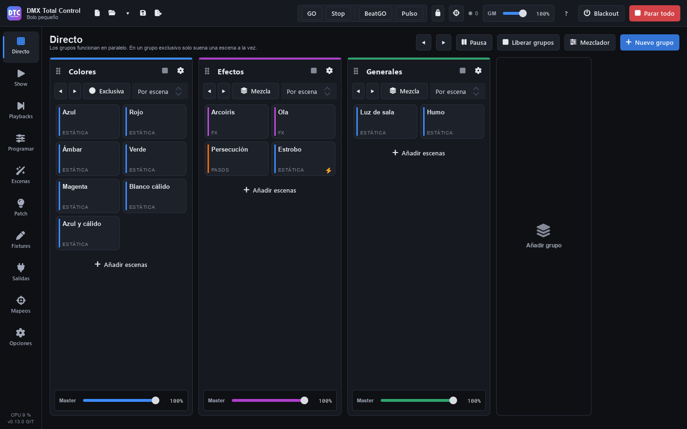

# Ao vivo

**Ao vivo** (F1) é a página para disparar cenas durante o show. As cenas são organizadas em **grupos**, que são colunas que funcionam em paralelo: cada grupo tem suas cenas, seu modo (exclusivo ou mistura), seu tempo de crossfade e seu master.

No cabeçalho da página você tem:

- **◀ ▶**: cena anterior ou próxima em cada grupo que está rodando (também com Ctrl+← e Ctrl+→).
- **“Pausar”** / **“Retomar”**: congela tudo o que está rodando e o retoma.
- **“Liberar grupos”**: para as cenas de todos os grupos.
- **“Mixer”**: muda para a vista do [mixer](directo.md#mixer). Um ponto laranja avisa que o mixer está alterando a saída.
- **“Novo grupo”**: adiciona uma coluna.

## Grupos

### Criar e organizar grupos

1. Pressione **“Novo grupo”** (ou o quadro “Adicionar grupo” no final das colunas).
2. Clique no nome da coluna para alterá-lo (por exemplo `Wash`, `Spots`, `Strobos`, `Efeitos`) e pressione Enter.

O botão da engrenagem de cada coluna abre o menu dela: **“Mudar cor”** (passa para a próxima cor), **“Mover para a esquerda”**, **“Mover para a direita”** e **“Excluir grupo”**. Você também pode arrastar o grupo pela alça que fica à esquerda do nome e soltá-lo sobre outro grupo para ocupar o lugar dele.

A seta **‹** ao lado do nome **recolhe** o grupo: ele vira uma faixa estreita com o nome e quantas cenas estão rodando, para dar espaço aos outros. As cenas dele continuam rodando. A seta **›** da faixa o expande. Isso é salvo com o show.

### Adicionar e ordenar cenas

1. Pressione **“Adicionar cenas”** no final da coluna.
2. Na lista, clique nas cenas que quiser (elas são marcadas com ✓). Você pode buscar por nome ou por pasta e vê-las por pastas ou por grupos.
3. Pressione **“Adicionar N”**. Com clique duplo em uma cena, ela é adicionada diretamente.

Para reordenar, passe o mouse sobre um cartão e arraste-o pela alça (à direita do cartão): solte-o sobre outra cena para colocá-lo antes dela, ou no espaço vazio da coluna para colocá-lo no final. Você pode soltá-lo em **outro grupo** e ele se move com suas opções. No menu do cartão (botão direito) você também tem **“Mover para cima”**, **“Mover para baixo”** e **“Remover do grupo”**.

> **Dica:** ao gravar a partir de Programar você pode colocar a cena diretamente em um grupo com “Adicionar ao grupo”. Veja [Gravar](programar.md#gravar).

## Disparar cenas

Clique em um cartão para disparar a cena; clique de novo para liberá-la. O cartão que está rodando fica com a cor do grupo e tem um ponto que pulsa.

Em cada cartão aparecem:

- O **nome** e, embaixo, o **tipo** de cena. Em uma cuelist que está rodando, a cue em que ela está (“Q 3 · Verso”). Depois, o [ritmo marcado](directo.md#ritmo-de-uma-cena-com-passos), se houver (“120 BPM”).
- **P7**, **P2**…: a prioridade, só quando não é a normal (5). Em laranja se for maior que 5.
- Um **raio**: é uma cena flash.
- Uma **barra dividida em duas** embaixo: uma cena com passos ou uma cuelist que está rodando; alterna a cada passo, no ritmo dela.

### Exclusivo ou mistura

O botão de cada coluna alterna entre:

- **“Exclusivo”**: só uma cena roda por vez. Ao disparar outra, faz crossfade para a nova.
- **“Mistura”**: as cenas se somam; você pode ter várias rodando ao mesmo tempo.

### Tempo de crossfade

A lista suspensa ao lado de “Exclusivo”/“Mistura” é o tempo de fade do grupo:

- **“Por cena”**: cada cena usa seus próprios fades de entrada e saída.
- **“Corte”**: sem fade.
- **0,5 s a 10 s**: esse tempo para todas as cenas do grupo, no lugar dos delas.

### Cena anterior e próxima

Os botões **◀ ▶** de cada coluna disparam a cena anterior ou a próxima do grupo, na ordem da coluna. Os do cabeçalho da página fazem o mesmo em todos os grupos que estão rodando.

### Cenas flash

Uma cena com **flash** roda só enquanto você mantém o cartão dela pressionado. Isso é ativado nas [propriedades](directo.md#propriedades-da-cena) com “Flash (roda enquanto pressionado)”.

### Cuelists em um grupo

Uma cuelist em um grupo é mais um cartão: o clique a liga e a desliga. O menu dela (botão direito) acrescenta **“GO (próxima cue)”**, **“Voltar (cue anterior)”** e **“Liberar a cuelist”**. Para operá-la com GO confortavelmente, coloque-a em um [playback](playbacks.md).

### Ritmo de uma cena com passos

As cenas com passos (sequências e chasers) e as cuelists seguem o ritmo em que você toca o cartão delas:

- Um clique a dispara ou a libera, como sempre.
- Com a cena rodando, toque o cartão dela **várias vezes seguidas** no ritmo da música, com menos de 2 segundos entre os toques. Cada toque passa para o próximo passo (em uma cuelist, dá um GO) e a cena continua sozinha nesse ritmo: um passo em cada batida, no lugar dos seus próprios tempos. O ritmo é a média dos últimos toques.
- Só contam os toques com a cena rodando: o toque que a dispara começa a contagem. Assim, mudar de cena em um grupo exclusivo e voltar não dá ritmo a nenhuma.
- Depois de uma pausa de mais de 2 segundos, um clique a libera. Para liberá-la logo depois de marcar o ritmo, espere 2 segundos.
- O ritmo que você marcou é reproduzido, também com uma **velocidade ao vivo** definida; se depois você mexe na velocidade, o ritmo acelera ou desacelera com ela. Em pausa, os toques não dão passos.
- O ritmo é salvo com a cena e é dela: ela também o segue quando roda em uma super cena ou em um playback. Nas [propriedades](directo.md#propriedades-da-cena) dela (e em [Cenas](escenas.md#como-a-cena-é-reproduzida)) você pode digitá-lo ou pressionar **“Remover”** para que ela volte aos seus tempos.

Funciona igual com os botões dela no [SHOW](show.md), com os mapeamentos de controladores e teclas no modo “Alternar” e com o [controle remoto](remoto.md).

#### GO e Stop

Os botões **GO** e **Stop** da barra superior (e da seção “Ritmo” do SHOW) mudam o que um toque em qualquer cena faz, para qualquer pessoa que a toque:

- **GO** ligado: tocar uma cena a **dispara**; em uma que já está rodando, cada toque dá um passo (em uma cuelist, um GO) e vários seguidos marcam o ritmo dela. Nunca a para, mesmo que você passe mais de 2 segundos sem tocar: assim você marca o tempo com calma.
- **Stop** ligado: tocar uma cena a **para**. Uma que não está rodando fica como está.
- Os dois desligados (pressione de novo o que está ligado): como sempre, um clique a dispara ou a libera.

As cenas flash continuam funcionando enquanto você as mantém pressionadas, em qualquer modo.

Enquanto roda, cada cartão de uma cena com passos ou de uma cuelist tem embaixo uma **barra do ritmo** dividida em duas: acende um lado e depois o outro a cada passo (em uma cuelist, a cada cue). Assim você vê em que ritmo cada uma vai. Os botões dela no SHOW, as tiras de playback e os botões no celular também têm essa barra.

## Masters

- **Master do grupo**: o controle deslizante “Master” no pé de cada coluna escala a intensidade de todas as suas cenas.
- **Grand master**: o “GM” da barra superior escala toda a saída. Em Opções você decide se ele atua só sobre os canais de intensidade ou sobre todos.
- **Dimmer ao vivo**: cada cena tem também seu próprio dimmer, nas propriedades dela, acima do master do grupo.

Os masters e o grand master não afetam os canais que têm a opção “Dimmer” desativada nos [limites do fixture](patch.md#limites).

## Propriedades da cena

Clique com o botão direito em um cartão e escolha **“Propriedades…”**.

| Campo | O que faz |
|---|---|
| **Nome** | O nome da cena. |
| **Fade in** / **Fade out** | Os tempos dela, em segundos. Se o grupo tiver um tempo de crossfade definido, esse é usado. |
| **Prioridade (0-10)** | Qual cena vence quando duas mexem no mesmo canal (veja [Prioridades](directo.md#prioridades)). |
| **Ao começar, liberar** | O que ela para ao iniciar: [modos de liberação](directo.md#modos-de-liberação-e-proteção). |
| **Protegida de liberações por** | Quais liberações ela ignora. |
| **Flash (roda enquanto pressionado)** | Transforma-a em cena flash. |
| **Dimmer ao vivo** | A intensidade dela, acima do master do grupo. |
| **Ritmo marcado** | Passos e cuelists: o [ritmo marcado](directo.md#ritmo-de-uma-cena-com-passos) com o cartão dela, em BPM. Digite-o ou pressione “Remover” para voltar aos tempos dela. Atua na hora. |
| **Velocidade ao vivo** | De ×0,1 a ×10 (cenas que se movem: passos, FX, cuelists…). |
| **Fase ao vivo** / **Tamanho ao vivo** | A fase (0–359°) e o tamanho (0–200 %) dos FX. |
| **Velocidade do fade** | Acelera ou desacelera os fades dela, de ×0,1 a ×10. |

Os controles deslizantes ao vivo atuam na hora, enquanto você os move, e mudam como a cena roda nesse grupo, não a cena gravada. Os outros campos são aplicados ao pressionar **“Aplicar”**.

O mesmo menu do cartão tem **“Abrir em Cenas”**, **“Editar no programador”** (cenas estáticas) e o submenu **“Prioridade: N”** para alterá-la sem abrir as propriedades.

## Prioridades

Cada cena tem uma prioridade de 0 a 10; as novas recebem a que você indicar em [Opções](opciones.md#reprodução) (5 por padrão).

- A cena de **maior prioridade manda em todos os canais que toca**, zeros incluídos: uma cena vermelha de prioridade 8 sobre uma azul de prioridade 5 dá vermelho, não magenta.
- Com a **mesma prioridade**, nos canais de intensidade (dimmer, RGB…) elas se misturam e vence o valor mais alto; nos outros canais vence a última cena disparada.
- Se você muda a prioridade de uma cena que está rodando, a mudança se aplica na hora.
- Ao liberar uma cena de maior prioridade com fade, ela faz um fade para o que está por baixo.
- **O programador manda sobre tudo**, intensidades incluídas. Em Opções você pode baixar a prioridade da edição ao vivo.

## Modos de liberação e proteção

**Ao começar, liberar** decide quais cenas param quando esta inicia:

- **“Padrão do grupo”**: em um grupo exclusivo, as outras do seu grupo; em um de mistura, nenhuma.
- **“Nenhum”**: não para nada.
- **“Seu grupo”**: as outras cenas do seu grupo.
- **“Todas as cenas”**: todas as outras.
- **“Os outros grupos”**: as cenas dos outros grupos.

**Protegida de liberações por** faz a cena ignorar essas liberações:

- **“Nenhum”**: ela é liberada como sempre.
- **“Tudo (só parada manual)”**: só você a para.
- **“O próprio grupo”**: ignora as do seu grupo.
- **“Os outros grupos”**: ignora as que vêm de outros grupos.

> **Dica:** coloque uma cena de ambiente com a proteção “Tudo (só parada manual)” e dispare por cima cenas com “Todas as cenas”: o ambiente fica.

## Pausar, liberar e parar

- **“Pausar”** congela tudo o que está rodando. **“Retomar”** o retoma.
- **“Liberar grupos”** para as cenas de todos os grupos; o quadrado de cada coluna, só as desse grupo.
- **“Parar tudo”** (Esc), na barra superior, para tudo o que está rodando, também fora dos grupos. Não esvazia o programador.
- **“Blackout”** (Ctrl+B) leva a saída ao preto sem parar nada.

## Mixer

O mixer atua sobre o que sai, por cima de cada cena e da edição ao vivo. Pressione **“Mixer”** para vê-lo: há uma tira para **“Todos os fixtures”** e uma para cada [grupo de fixtures](patch.md#grupos-de-fixtures).

Cada tira tem:

- Um **fader de dimmer** com sua porcentagem.
- **“Full”**: o grupo no máximo. **“Blackout”**: o grupo no preto.
- **“Matiz”** e **“Saturação”**: tingem a cor. **“Redefinir cor”** tira o tingimento.
- **“Strobo”** e sua velocidade, de 0,5 a 20 Hz.
- **“Flash”**: no máximo enquanto pressionado. **“Flash excl.”**: esse grupo no máximo e o resto no preto enquanto pressionado.
- **“Full excl.”**: esse grupo no máximo e o resto no preto.

Ctrl+clique em um botão de flash o deixa ligado até o próximo clique. **“Redefinir o mixer”** devolve tudo ao estado normal. A borda de uma tira fica laranja com um flash ou um full, e vermelha com blackout.

> **Dica:** o mixer também pode ser uma seção do [SHOW](show.md), e os faders e botões dele podem ser [mapeados](mapeos.md) para um controlador MIDI.

## Controles no SHOW e em controladores

Os cartões de cena, os masters dos grupos, os botões ◀ ▶ e de liberar de cada grupo, os do cabeçalho (◀ ▶, “Pausar” e “Liberar grupos”) e os controles do mixer:

- Com **Alt+clique** são copiados para a página do SHOW que estiver aberta (veja [Show](show.md#levar-qualquer-controle-para-o-show)).
- No modo Mapear podem ser atribuídos a um controlador (veja [Mapeamentos](mapeos.md#modo-mapear)).
