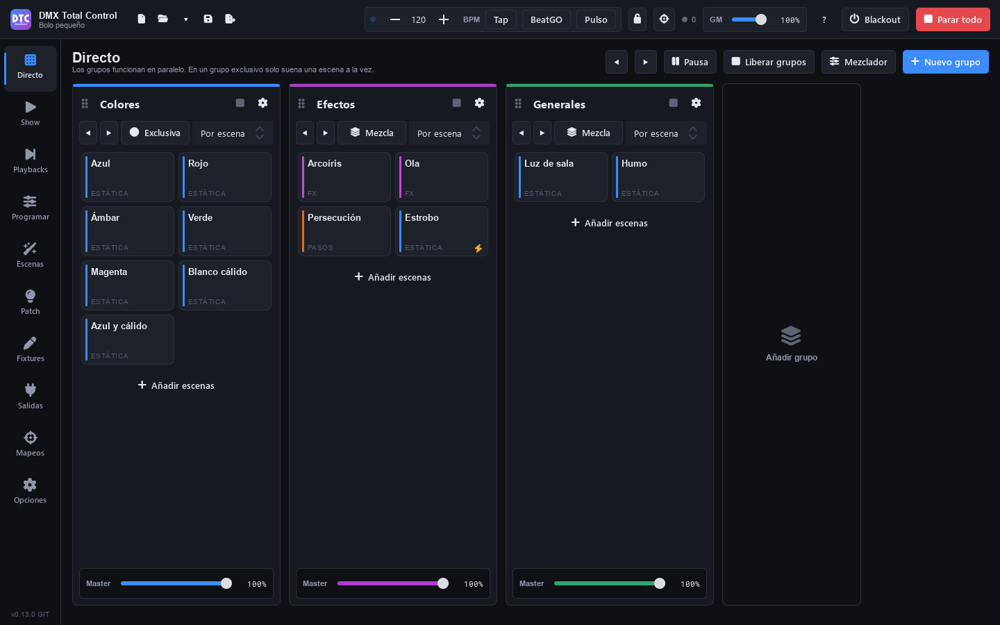

# Ao vivo

**Ao vivo** (F1) é a página para disparar cenas durante o show. As cenas são organizadas em **grupos**, que são colunas que funcionam em paralelo: cada grupo tem suas cenas, seu modo (exclusivo ou mistura), seu tempo de crossfade e seu master.

No cabeçalho da página você tem:

- **◀ ▶**: cena anterior ou próxima em cada grupo que está rodando (também com Ctrl+← e Ctrl+→).
- **“Pausar”** / **“Retomar”**: congela tudo o que está rodando e o retoma.
- **“Liberar grupos”**: para as cenas de todos os grupos.
- **“Recolher grupos”** / **“Expandir grupos”**: recolhe todas as colunas de uma vez, para ver todas; quando já estão todas recolhidas, expande todas.
- **“Mixer”**: muda para a vista do [mixer](directo.md#mixer). Um ponto laranja avisa que o mixer está alterando a saída.
- **“Novo grupo”**: adiciona uma coluna.

## Grupos

### Criar e organizar grupos

1. Pressione **“Novo grupo”** (ou o quadro “Adicionar grupo” no final das colunas).
2. Clique no nome da coluna para alterá-lo (por exemplo `Wash`, `Spots`, `Strobos`, `Efeitos`) e pressione Enter.

O botão da engrenagem de cada coluna abre o menu dela: **“Mudar cor”** (passa para a próxima cor), **“Mover para a esquerda”**, **“Mover para a direita”** e **“Excluir grupo”**. Você também pode arrastar o grupo pela alça que fica à esquerda do nome e soltá-lo sobre outro grupo para ocupar o lugar dele.

A seta **‹** ao lado do nome **recolhe** o grupo: ele vira uma faixa estreita com o nome e quantas cenas estão rodando, para dar espaço aos outros. As cenas dele continuam rodando. A seta **›** da faixa o expande. Isso é salvo com o show. Para recolher ou expandir todos de uma vez, use **“Recolher grupos”** / **“Expandir grupos”** no cabeçalho.

### Adicionar e ordenar cenas

1. Pressione **“Adicionar cenas”** no final da coluna.
2. Na lista, clique nas cenas que quiser (elas são marcadas com ✓). Você pode buscar por nome ou por pasta e vê-las por pastas ou por grupos.
3. Pressione **“Adicionar N”**. Com clique duplo em uma cena, ela é adicionada diretamente.

Para reordenar, passe o mouse sobre um cartão e arraste-o pela alça (à direita do cartão): solte-o sobre outra cena para colocá-lo antes dela, ou no espaço vazio da coluna para colocá-lo no final. Você pode soltá-lo em **outro grupo** e ele se move com suas opções. No menu do cartão (botão direito) você também tem **“Mover para cima”**, **“Mover para baixo”** e **“Remover do grupo”**.

> **Dica:** ao gravar a partir de Programar você pode colocar a cena diretamente em um grupo com “Adicionar ao grupo”. Veja [Gravar](programar.md#gravar).

## Disparar cenas

Clique em um cartão para disparar a cena (com **GO**, o modo em que o programa inicia). Para liberá-la, pressione o quadrado do cabeçalho do grupo (“Liberar este grupo”) ou mude para **Stop** e pressione-a. O cartão que está rodando fica com a cor do grupo e tem um ponto que pulsa.

Em cada cartão aparecem:

- O **nome** e, embaixo, o **tipo** de cena. Em uma cuelist que está rodando, a cue em que ela está (“Q 3 · Verso”). Depois, o [ritmo marcado](directo.md#ritmo-de-uma-cena-com-passos), se houver (“120 BPM”).
- **P7**, **P2**…: a prioridade, só quando não é a normal (5). Em laranja se for maior que 5.
- Um **raio**: é uma cena flash.
- Uma **barra dividida em duas** embaixo: uma cena com passos, uma cuelist ou um FX em “BPM do show” que está rodando; alterna a cada passo (em um FX, a cada batida), no ritmo dela.

### Exclusivo ou mistura

O botão de cada coluna alterna entre:

- **“Exclusivo”**: só uma cena roda por vez. Ao disparar outra, faz crossfade para a nova. Os [faders do SHOW](show.md#faders) que disparam cenas são a exceção: somam a deles, então você pode subir vários do mesmo grupo ao mesmo tempo.
- **“Mistura”**: as cenas se somam; você pode ter várias rodando ao mesmo tempo.

### Tempo de crossfade

A lista suspensa ao lado de “Exclusivo”/“Mistura” é o tempo de fade do grupo:

- **“Por cena”**: cada cena usa seus próprios fades de entrada e saída.
- **“Corte”**: sem fade.
- **0,5 s a 10 s**: esse tempo para todas as cenas do grupo, no lugar dos delas.
- Uma cena FX que sai continua se movendo enquanto faz o fade para o que está abaixo, com o crossfade do grupo ou com o seu próprio fade de saída (também com “Parar tudo com fade”).

### Cena anterior e próxima

Os botões **◀ ▶** de cada coluna disparam a cena anterior ou a próxima do grupo, na ordem da coluna. Os do cabeçalho da página fazem o mesmo em todos os grupos que estão rodando.

### Cenas flash

Uma cena com **flash** roda só enquanto você mantém o cartão dela pressionado. Isso é ativado nas [propriedades](directo.md#propriedades-da-cena) com “Flash (roda enquanto pressionado)”.

### Cuelists em um grupo

Uma cuelist em um grupo é mais um cartão: o clique a dispara (com **Stop**, a para). O menu dela (botão direito) acrescenta **“GO (próxima cue)”**, **“Voltar (cue anterior)”** e **“Liberar a cuelist”**. Para operá-la com GO confortavelmente, coloque-a em um [playback](playbacks.md).

### Ritmo de uma cena com passos

As cenas com passos (sequências e chasers), as cuelists e as cenas FX com FX em “BPM do show” seguem o ritmo em que você toca o cartão delas:

- Um clique a dispara (com **GO**, o modo em que o programa inicia; veja abaixo).
- Com a cena rodando, toque o cartão dela **várias vezes seguidas** no ritmo da música, com menos de 2 segundos entre os toques. Cada toque passa para o próximo passo (em uma cuelist, dá um GO) e a cena continua sozinha nesse ritmo: um passo em cada batida, no lugar dos seus próprios tempos. O ritmo é a média dos últimos toques. Um toque muito longe desse ritmo (no compasso seguinte, para voltar a acertá-la, ou depois de uma batida que você pulou) é uma batida que não o muda; dois seguidos assim que coincidem marcam um ritmo novo. Um toque que chega um pouco atrasado, logo depois do passo dessa batida (menos de meia batida), é esse mesmo passo: não dá outro, só acerta o ritmo.
- Só contam os toques com a cena rodando: o toque que a dispara começa a contagem. Assim, mudar de cena em um grupo exclusivo e voltar não dá ritmo a nenhuma.
- Depois de uma pausa de mais de 2 segundos, um clique dá um passo sem mudar o ritmo dela, e a cena continua tocando. Para pará-la, mude para **Stop** e pressione-a.
- O ritmo que você marcou é reproduzido, também com uma **velocidade ao vivo** definida; se depois você mexe na velocidade, o ritmo acelera ou desacelera com ela. Em pausa, os toques não dão passos.
- O ritmo é salvo com a cena e é dela: ela também o segue quando roda em uma super cena ou em um playback. Nas [propriedades](directo.md#propriedades-da-cena) dela (e em [Cenas](escenas.md#como-a-cena-é-reproduzida)) você pode digitá-lo ou pressionar **“Remover”** para que ela volte aos seus tempos.
- Em uma **cena FX**, o ritmo é o dos FX dela em **“BPM do show”**: o primeiro toque de uma série recomeça o ciclo deles (como ao dispará-la), e cada um dos seguintes os leva à batida mais próxima do relógio deles (uma sequência passa para o fixture seguinte; em ×¼, eles avançam um quarto de ciclo; um toque um compasso depois, à batida em que eles estão). Vários seguidos dão a eles um ciclo a cada batida (vezes o multiplicador), em vez do BPM do show. Os FX com uma velocidade própria não mudam. Sem ritmo marcado, ou depois de “Remover”, eles seguem o BPM e a batida do show: o Tap do show os coloca de novo nela, e um toque no cartão os tira dela até lá. Se você desligar “BPM do show” em todos os FX dela, a cena perde o ritmo marcado.

Funciona igual com os botões dela no [SHOW](show.md), com os mapeamentos de controladores e teclas no modo “Alternar” e com o [controle remoto](remoto.md).

#### GO e Stop

Os botões **GO** e **Stop** da barra superior (e da seção “Ritmo” do SHOW) decidem o que um toque em qualquer cena faz, para qualquer pessoa que a toque. Sempre há um dos dois ligado: o programa sempre inicia em **GO**, e pressionar o outro muda o modo:

- **GO** ligado: tocar uma cena a **dispara**; em uma que já está rodando, cada toque dá um passo (em uma cuelist, um GO; em uma cena FX, o primeiro recomeça o ciclo dos FX dela em “BPM do show” e os seguintes os levam à batida seguinte) e vários seguidos marcam o ritmo dela. Nunca a para, mesmo que você passe mais de 2 segundos sem tocar: assim você marca o tempo com calma.
- **Stop** ligado: tocar uma cena a **para**. Uma que não está rodando fica como está.
- Para liberar as cenas de um grupo sem mudar o modo, pressione o quadrado do cabeçalho dele (“Liberar este grupo”); **“Parar tudo”** (Esc) para tudo.

As cenas flash continuam funcionando enquanto você as mantém pressionadas, em qualquer modo.

Enquanto roda, cada cartão de uma cena com passos, de uma cuelist ou de uma cena FX com FX em “BPM do show” tem embaixo uma **barra do ritmo** dividida em duas: acende um lado e depois o outro a cada passo (em uma cuelist, a cada cue; em uma cena FX, a cada batida, um ciclo desses FX a ×1). Assim você vê em que ritmo cada uma vai. Os botões dela no SHOW, as tiras de playback e os botões no celular também têm essa barra.

## Masters

- **Master do grupo**: o controle deslizante “Master” no pé de cada coluna escala a intensidade de todas as suas cenas.
- **Grand master**: o “GM” da barra superior escala a luz de toda a saída: os dimmers e, nos fixtures sem dimmer, as cores deles. Não mexe na mistura de cor (ciano, magenta, amarelo, matiz e saturação) nem nas cores de um fixture ou de uma cabeça com dimmer próprio, que baixam com esse dimmer. Em Opções você decide se ele atua só sobre a intensidade ou sobre todos os canais. Não baixa os fixtures **protegidos do grand master** (nos [limites do fixture](patch.md#limites) ou no menu dele): a luz da plateia, um servidor de mídia, um hazer. Se houver algum, uma **âncora** ao lado de “GM” lembra disso (se a barra tiver espaço) e, ao passar o mouse, diz quantos são (“O grand master não baixa 3 fixtures protegidos dele”).
- **Dimmer ao vivo**: cada cena tem também seu próprio dimmer, nas propriedades dela, acima do master do grupo.

Os masters e o grand master não afetam os canais que têm a opção “Dimmer” desativada nos [limites do fixture](patch.md#limites). Se for o dimmer de um fixture, ele deixa de contar como dimmer próprio: o grand master passa a baixar as cores dele.

## Propriedades da cena

Clique com o botão direito em um cartão e escolha **“Propriedades…”**.

| Campo | O que faz |
|---|---|
| **Nome** | O nome da cena. |
| **Fade in** / **Fade out** | Os tempos dela, em segundos. Se o grupo tiver um tempo de crossfade definido, esse é usado. |
| **Prioridade (0-10)** | Qual cena vence quando duas mexem no mesmo canal (veja [Prioridades](directo.md#prioridades)). |
| **Ao começar, liberar** | O que ela para ao iniciar: [modos de liberação](directo.md#modos-de-liberação-e-proteção). |
| **Protegida de liberações por** | Quais liberações ela ignora. |
| **Flash (roda enquanto pressionado)** | Transforma-a em cena flash. |
| **Dimmer ao vivo** | A intensidade dela, acima do master do grupo. |
| **Ritmo marcado** | Passos, cuelists e cenas FX com FX em “BPM do show”: o [ritmo marcado](directo.md#ritmo-de-uma-cena-com-passos) com o cartão dela, em BPM. Digite-o ou pressione “Remover” para voltar aos tempos dela (em uma cena FX, ao BPM do show). Atua na hora. |
| **Velocidade ao vivo** | De ×0,1 a ×10 (cenas que se movem: passos, FX, cuelists…). |
| **Fase ao vivo** / **Tamanho ao vivo** | A fase (0–359°) e o tamanho (0–200 %) dos FX. |
| **Velocidade do fade** | Acelera ou desacelera os fades dela, de ×0,1 a ×10. |

Os controles deslizantes ao vivo atuam na hora, enquanto você os move, e mudam como a cena roda nesse grupo, não a cena gravada. Os outros campos são aplicados ao pressionar **“Aplicar”**.

O mesmo menu do cartão tem **“Abrir em Cenas”**, **“Editar no programador”** (cenas estáticas) e o submenu **“Prioridade: N”** para alterá-la sem abrir as propriedades.

## Prioridades

Cada cena tem uma prioridade de 0 a 10; as novas recebem a que você indicar em [Opções](opciones.md#reprodução) (5 por padrão).

- A cena de **maior prioridade manda em todos os canais que toca**, zeros incluídos: uma cena vermelha de prioridade 8 sobre uma azul de prioridade 5 dá vermelho, não magenta.
- Com a **mesma prioridade**, nos canais de intensidade (dimmer, RGB…) elas se misturam e vence o valor mais alto; nos outros canais vence a **última mudança**: a última cena disparada ou o último GO de uma cuelist que mudou esse canal. O que uma cuelist só mantém de cues anteriores ela não retoma.
- Se você muda a prioridade de uma cena que está rodando, a mudança se aplica na hora.
- Ao liberar uma cena de maior prioridade com fade, ela faz um fade para o que está por baixo.
- **O programador manda sobre tudo**, intensidades incluídas. Em Opções você pode baixar a prioridade da edição ao vivo.

## Modos de liberação e proteção

**Ao começar, liberar** decide quais cenas param quando esta inicia:

- **“Padrão do grupo”**: em um grupo exclusivo, as outras do seu grupo; em um de mistura, nenhuma.
- **“Nenhum”**: não para nada.
- **“Seu grupo”**: as outras cenas do seu grupo.
- **“Todas as cenas”**: todas as outras.
- **“Os outros grupos”**: as cenas dos outros grupos.

Quando um [fader do SHOW](show.md#faders) a dispara, ela não libera nada, seja qual for o modo: soma-se às outras. Com o botão dela, libera como sempre. E enquanto esse fader está levantado, nada a para, a não ser descê-lo até o fim.

**Protegida de liberações por** faz a cena ignorar essas liberações:

- **“Nenhum”**: ela é liberada como sempre.
- **“Tudo (só parada manual)”**: só você a para.
- **“O próprio grupo”**: ignora as do seu grupo.
- **“Os outros grupos”**: ignora as que vêm de outros grupos.

> **Dica:** coloque uma cena de ambiente com a proteção “Tudo (só parada manual)” e dispare por cima cenas com “Todas as cenas”: o ambiente fica.

## Pausar, liberar e parar

- **“Pausar”** congela tudo o que está rodando. **“Retomar”** o retoma.
- **“Liberar grupos”** para as cenas de todos os grupos; o quadrado de cada coluna, só as desse grupo. Durante 10 s, [“Recuperar o que estava tocando”](directo.md#recuperar-o-que-estava-tocando) dispara de novo o que “Liberar grupos” parou (o botão, ou um pad ou um botão do SHOW em “Todos os grupos”); não dá para recuperar o que é liberado em um só grupo (o quadrado dele, ou um pad ou um botão do SHOW desse grupo) nem por uma ação de uma cue.
- **“Parar tudo”** (Esc), na barra superior, para tudo o que está rodando, também fora dos grupos. Não esvazia o programador. Nem “Parar tudo” nem “Liberar grupos” param as cenas que um [fader do SHOW](show.md#faders) levantado segura: só descê-lo até o fim. Também desarma os [efeitos especiais](directo.md#efeitos-especiais-protegidos), e durante 10 s é possível [recuperar o que estava tocando](directo.md#recuperar-o-que-estava-tocando). Com [“Parar tudo com fade”](directo.md#parar-tudo-com-fade), as funções descem antes de parar.
- **“Blackout”** (Ctrl+B) leva a saída ao preto sem parar nada. As cabeças não se movem: o pan, o tilt, o zoom, o foco e os outros canais que não são luz ficam onde estão. Também desarma os efeitos especiais. Para baixar a luz aos poucos e terminar em Blackout, use um [“Fade para preto”](directo.md#fade-para-preto).

## Segurança durante o show

Para que um erro ou uma falha do computador não estrague o show: o [Modo show](directo.md#modo-show), os [efeitos especiais protegidos](directo.md#efeitos-especiais-protegidos), os [canais estacionados](directo.md#canais-estacionados), a [parada de show](directo.md#parada-de-show), [recuperar o que estava tocando](directo.md#recuperar-o-que-estava-tocando), [parar tudo com fade](directo.md#parar-tudo-com-fade) e o [fade para preto](directo.md#fade-para-preto). Os ajustes deles estão em [Opções › Segurança durante o show](opciones.md#segurança-durante-o-show).

> **Importante:** o computador nunca deve ser a única segurança de uma máquina de CO2, de chamas, de faíscas frias ou de confete. Configure as máquinas e os nós DMX para que se desliguem se perderem o sinal DMX (não para que mantenham o último valor), instale uma parada de emergência ou um botão de homem morto por hardware onde a máquina precisar e siga as normas do local e as instruções do fabricante. Se o programa travar ou o computador desligar, nenhum software consegue cortar um disparo: só o equipamento.

### Modo show

O **escudo** da barra superior, logo depois do cadeado, liga ou desliga o **Modo show** com um clique. Ligado, fica laranja, e a segunda linha do título começa com “Modo show ·”. Bloquear o SHOW (também ao iniciar com “…e bloqueado”) o liga sozinho; desbloqueá-lo não o desliga. Com o SHOW bloqueado, o escudo aparece, mas não pode ser clicado. É um ajuste do computador, não do show.

Com o Modo show ligado, estas ações pedem para manter um botão pressionado por 1,5 s (“Mantenha para fechar”, “Mantenha para abrir” ou “Mantenha para continuar”), mesmo sem alterações não salvas:

- fechar o programa (o × da janela, Alt+F4, a barra de tarefas) e instalar uma atualização;
- **Novo** e **Abrir** (também Ctrl+N e Ctrl+O), os shows recentes, os exemplos e o show de prática do guia;
- abrir um show pelo Explorador de Arquivos do Windows.

Soltar antes da hora, **“Cancelar”** ou Esc cancelam; Esc nessa janela nunca para o show. Também vale manter Espaço ou Enter pressionados (a repetição da tecla não conta). Depois, se houver alterações não salvas, vem “Salvar as alterações?” como sempre. Ao desligar o Windows ou sair da sessão com o Modo show ligado, a pergunta pode segurar o desligamento: feche o programa antes.

No Modo show, se o notebook passa para a bateria, uma barra vermelha “Funcionando na bateria: conecte o carregador” aparece em todas as páginas (também bloqueado e em tela cheia) até o carregador voltar; com 20 % ou menos, acrescenta “Bateria em N %”. A bateria é verificada a cada 30 s e a cada aviso de energia do Windows. Sem o Modo show, um aviso diz isso uma vez (e outra quando ficar pouca), e [Opções](opciones.md#segurança-durante-o-show) mostra.

Se o plano de energia do Windows tem a suspensão seletiva de USB ligada, ao iniciar uma barra azul avisa que a interface DMX pode parar, com **“Como desligá-la”** (abre [Suspensão seletiva de USB](opciones.md#suspensão-seletiva-de-usb)) e um × que a oculta até a próxima inicialização. O programa só lê esses ajustes do Windows: nunca os muda.

### Efeitos especiais protegidos

Um **efeito especial protegido** é um fixture que não pode disparar por engano. As máquinas de CO2, de chamas, de faíscas frias e de confete são protegidas sozinhas, e qualquer fixture pode ser protegido manualmente (veja [Patch › Efeitos especiais protegidos](patch.md#efeitos-especiais-protegidos)). Eles têm um escudo na lista e no plano do Patch.

- **Desarmados** (o programa sempre inicia assim), todos os seus canais saem em 0, toque o que tocar.
- **Armados**, só saem a partir de **cenas** (também flash), **cuelists**, **chasers**, **sequências**, **super cenas** e dos valores base das **cenas FX**. Assim você os dispara com um botão do SHOW em flash (dispara enquanto você o mantém), um cartão de Ao vivo, um pad da APC, um playback ou o [celular](remoto.md#segurança-no-celular).
- **Nunca** os disparam, nem armados: o programador, Identificar, Destacar, o mixer (Full, Flash, cor, strobo), os FX e suas macros, os Move FX, os Colour FX e os mapeamentos do plano, os Curve FX, os scripts nem uma entrada DMX que passa para a saída. O grand master não os escala.
- Os [limites](patch.md#limites) só contam enquanto disparam: em repouso sai sempre 0. Não inverta os canais de uma máquina de efeitos: um canal de disparo invertido só dispara com um valor que, invertido, acenda.
- Os canais de pan e tilt deles (os de uma cabeça de chamas) só saem armados e a partir dessas funções, sem tempo máximo; desarmados, em 0. Todos os outros, menos o de segurança, disparam e a eles se aplica o tempo máximo (veja [Patch › Efeitos especiais protegidos](patch.md#efeitos-especiais-protegidos)).

#### Armar efeitos

O botão **“Armar efeitos”** (com uma chama) fica na barra superior, ao lado de “Blackout”, só quando o show tem efeitos protegidos, também com o SHOW bloqueado. Um clique os arma e outro os desarma. Armados, o botão fica vermelho com o tempo que falta para que se desarmem sozinhos (“ARMADOS · 9:59”), e a borda pulsa enquanto um dispara. Em uma janela mais estreita aparece “Armar” ou só a chama: abaixo de 1450 px de largura, “Armar efeitos”, “Blackout” e “Parar tudo” ficam só com o ícone, e abaixo de uns 1200 px o número do que está rodando some e o grand master fica mais curto.

Armados, uma barra vermelha grande **“EFEITOS ARMADOS”** aparece em todas as páginas (também bloqueado e em tela cheia) com o que dispara (“Disparando: CO2 1”) ou o que espera ser solto, e um botão **“Desarmar”**.

A seta **▾** ao lado mostra se estão armados e quanto falta para que se desarmem sozinhos, **“Disparando agora”**, **“Esperam ser soltos”** (solte a cena, o botão ou o fader dele, a 0, e ele poderá disparar), **“Últimos disparos”** (nome · hora · segundos · como terminou: solto, cortado no seu tempo máximo, desarmado…), **“Abrir o registro”** e **“Ajustes de cada efeito: Patch”** (estes dois, não com o SHOW bloqueado).

Não se armam se nenhum fixture estiver protegido, com o Blackout ligado (“O Blackout está ligado: desligue-o para armar os efeitos especiais”) nem com a parada de show ativa. Também se armam com um [botão do SHOW](show.md#ações-de-um-botão), um [mapeamento](mapeos.md#controla) ou o [celular](remoto.md#segurança-no-celular).

#### Tempo máximo e espera mínima

- Um disparo dura enquanto a cena, o botão ou o fader dele o dão, no máximo o seu **tempo máximo** (por padrão: CO2 3 s, chamas 2 s, faíscas 5 s, confete 2 s). Ao chegar, é cortado, mesmo que você continue pressionando, e não volta até você soltar.
- Entre um disparo e o seguinte há uma **espera mínima** (1 s por padrão) desde que se solta. Um toque durante a espera não dispara depois: solte e pressione de novo.
- Armar enquanto uma cena ou um fader já dão valor ao efeito não o dispara: ele espera você soltar. Desarmar enquanto um dispara o corta, mesmo que você arme de novo na hora (ele não volta até você soltar); um controle que só arma não faz nada se eles já estão armados.
- O **canal de segurança**, se a máquina tiver um, só sai dentro dos seus valores enquanto o efeito está armado e disparando; senão, 0. Sozinho ele nunca dispara a máquina.
- Se o programa deixa de enviar quadros (está muito ocupado), cada universo corta mesmo assim um disparo no seu tempo, no máximo 40 ms atrasado.

#### Quando são desarmados

Eles se desarmam sozinhos:

- com **Parar tudo** (Esc, o botão, um pad, um botão do SHOW ou o celular) e com o **Blackout** (Ctrl+B, o botão, um botão do SHOW, um pad ou o celular; não o “Blackout” de uma tira do mixer);
- com a **parada de show**, um **fade para preto** (ao começar) e **recuperar o que estava tocando**;
- ao abrir ou começar **outro show**, e ao **fechar** o programa;
- depois de alguns **minutos sem disparos** (10 por padrão: “Desarmar os efeitos sem uso após”, em [Opções](opciones.md#segurança-durante-o-show)), nunca enquanto um dispara;
- ao remover ou desproteger o último efeito protegido, e **manualmente**.

Um aviso diz isso (“Efeitos especiais desarmados: Parar tudo”). Nunca são salvos armados. Um fader do SHOW que segura uma cena com um CO2 continua segurando-a depois do Esc, mas o CO2 fica em 0 até você descer o fader até o fim.

#### O registro de disparos

Cada sessão grava um arquivo em `%LOCALAPPDATA%\DMXTotalControl\DMX Total Control\effects-log` (“Abrir o registro” abre a pasta): cada disparo com a hora, o número e o nome do fixture, quanto durou e como terminou (solto, cortado no seu tempo máximo, desarmado, parada de show, estacionado, retirado), e quando os efeitos foram armados e desarmados, e por quê.

> **Não testado com equipamento real:** nada disso foi testado com máquinas de CO2, de chamas, de faíscas ou de confete, com os canais de segurança delas, com nós Art-Net ou sACN nem com o que fazem ao perder o sinal DMX. Teste com o seu equipamento, sem público e com a máquina sem carga, antes de usar em um show.

### Canais estacionados

Um canal **estacionado** sai sempre com um valor fixo, acima das cenas, do programador, do mixer, do grand master e de Parar tudo: o hazer a 30 % a noite toda, uma cabeça quebrada apagada e parada. Esc e Blackout nunca o desestacionam; com o Blackout, as intensidades dele se apagam, a não ser com “Também em blackout”. Estaciona-se no [Patch](patch.md#estacionar-canais) e em [Programar](programar.md#estacionar). Ao abrir um show com canais estacionados, eles se aplicam na hora, e um aviso diz quais (“2 fixtures estacionados: HAZER, Spot 3 (Patch)”).

### Parada de show

A **parada de show** é uma luz de segurança para parar o show e dar luz às pessoas: por cima de tudo, põe branco aberto nas luzes, apaga os strobos e os lasers, deixa as cabeças paradas e desarma os efeitos especiais.

Para **ativá-la ou tirá-la**, pressione **a tecla Pause duas vezes** (em menos de 2 s; não em um show que a tem mapeada, veja [Mapeamentos](mapeos.md#teclado)), ou **mantenha pressionado por 1 s** um botão do SHOW “Parada de show (manter 1 s)”, um pad ou uma tecla [mapeados](mapeos.md#controla), ou a mão da barra do [celular](remoto.md#segurança-no-celular). Um toque mais curto não faz nada, e um só toque na tecla Pause apenas avisa (“Parada de show: pressione Pause de novo para ativá-la”). Enquanto você mantém, uma barra laranja “Parada de show: continue mantendo…” se enche. Ativa, uma barra vermelha grande **“PARADA DE SHOW”** aparece em todas as páginas (também bloqueado e em tela cheia) com **“Mantenha para tirar”** (mantenha um segundo). Se o programa perde o teclado enquanto você mantém uma tecla mapeada (outra janela, um aviso do Windows), ela é solta e nada muda.

Enquanto está ativa:

- os efeitos especiais são desarmados (“…desarmados: parada de show”) e não podem ser armados (“A parada de show está ativa: tire-a para armar os efeitos especiais”);
- as luzes (moving heads, scanners, PARs e washes, barras de LED, blinders e dimmers) dos grupos escolhidos vão para **branco aberto** no nível escolhido: o dimmer no nível, o vermelho, o verde, o azul e o branco no máximo (sem dimmer, as cores no nível), CMY, âmbar e UV em 0, o shutter aberto, a roda de cores em branco ou aberta e os programas internos em “sem função”;
- os strobos se apagam (as intensidades em 0, ou todos os canais se não as tiverem) e os lasers vão a 0 em todos os canais (um laser DMX se apaga em 0: confira com o seu);
- todos os shutters se abrem (sem strobo; um canal de strobo “de lento a rápido” vai a 0) e o strobo do mixer para;
- os moving heads ficam onde estão (pan e tilt, também os finos);
- a fumaça, os hazers, os ventiladores, as bolhas, a neve, outros efeitos, os gobos, os prismas e o zoom ficam como estão, e os efeitos protegidos em 0.

Ela ganha do programador, do grand master, do Blackout (o resto fica no preto) e dos canais estacionados: um fixture estacionado apagado também se ilumina, e um hazer estacionado continua estacionado. Os [limites](patch.md#limites) continuam valendo (um dimmer invertido, um máximo). Quais fixtures ela ilumina e em que nível se escolhe em [Opções › Parada de show](opciones.md#parada-de-show).

- **Parar tudo** (Esc) durante a parada para as funções de baixo, e a parada continua.
- Ao **tirá-la**, o show fica como as funções dele tocam agora (continuaram tocando por baixo) e o strobo do mixer volta. Os efeitos continuam desarmados: arme-os manualmente; um CO2 segurado precisa ser solto antes.
- **Novo**, **Abrir** e fechar o programa a tiram. Nunca é salva ativa: depois de um fechamento inesperado ou de reiniciar, ative-a de novo.
- O registro dos efeitos da sessão anota “Parada de show ativada” e “Parada de show retirada”.

> **Não testado com equipamento real:** o branco aberto e os valores de shutter dos fixtures reais, que um laser fique apagado em 0, a tecla Pause dos teclados reais, os LEDs da APC e o celular em um wifi real.

### Recuperar o que estava tocando

Depois de **Parar tudo** (Esc, o botão, um pad, um botão do SHOW ou o celular) ou de **“Liberar grupos”** (todos os grupos, não um só), uma barra azul sob a barra superior diz o que parou (“Parado: 4 cenas e 1 cuelist · Recuperar o que estava tocando (Ctrl+Z)”; “Liberado: …” depois de “Liberar grupos”), com o botão **“Recuperar”**, uma faixa que se esvazia em 10 segundos e um × que a oculta até o próximo Parar tudo. Aparece também com o SHOW bloqueado. **Ctrl+Z** faz o mesmo em Ao vivo e no SHOW (não enquanto você o edita nem enquanto digita), e a barra só diz “(Ctrl+Z)” onde funciona. “Recuperar” ignora um toque no seu primeiro meio segundo (um segundo toque de pânico em Parar tudo).

Voltam, com um fade de 0,5 s:

- a cena que cada grupo tocava;
- as cenas disparadas a partir de botões do SHOW, de Cenas ou de playbacks;
- as cuelists, na cue em que estavam, com o nível do playback delas; uma cuelist em pausa volta em pausa.

Os FX e os passos começam o ciclo de novo, as funções em beats usam o próprio fade e as cuelists “Timecode” seguem o timecode delas. Não voltam: os flashes que estavam sendo mantidos (em Ao vivo, no SHOW, nos pads ou nos playbacks), as cenas que um fader do SHOW segura (nunca pararam), o programador, o mixer, o grand master, o armamento dos efeitos, os canais estacionados nem a parada de show.

Funciona uma vez, e um aviso diz o que voltou (“Recuperado: 4 cenas e 1 cuelist”). Outro Parar tudo dentro dos 10 s se soma ao primeiro (não o segundo Esc durante o fade de “Parar tudo com fade”); “Liberar grupos” guarda só os grupos, e um Parar tudo depois se soma. As funções excluídas nesse meio-tempo são puladas, e um show novo ou aberto o apaga.

Recuperar **nunca arma** os efeitos especiais: se estavam armados (depois de “Liberar grupos”, que não desarma, ou ao armá-los de novo depois de Parar tudo), primeiro os desarma (“Efeitos especiais desarmados: Recuperar o que estava tocando”). O que volta com um CO2 espera você soltar e fica em 0, também depois de armar de novo.

### Parar tudo com fade

Com **“Parar tudo com fade”** em [Opções](opciones.md#segurança-durante-o-show) (de 0 a 5 s; 0, na hora, como sempre), Parar tudo desce as funções nesse tempo. As cenas que os faders do SHOW seguram e os canais estacionados ficam; os efeitos protegidos se apagam na hora (são desarmados). Durante o fade, o botão “Parar tudo” tem uma faixa e diz “Fazendo o fade: Esc de novo para na hora”: **Esc de novo** para tudo na hora, também o que você disparou durante o fade. Depois é possível recuperar o que o primeiro Esc parou; o que você disparou durante o fade não volta.

### Fade para preto

Um **“Fade para preto”** (um [botão do SHOW](show.md#ações-de-um-botão) ou um [mapeamento](mapeos.md#controla), com o seu tempo: 3 s por padrão) desce as intensidades na saída nesse tempo e depois liga o Blackout, por exemplo no fim de um set. Por baixo, a luz volta ao máximo: ao desligar o Blackout, ela volta.

- Atua acima do grand master (também nos fixtures protegidos dele) e nos canais estacionados sem “Também em blackout”.
- Não toca nos estacionados com “Também em blackout”, no pan, no tilt nem em outros canais que não são luz, nem nos efeitos protegidos.
- Ao começar, desarma os efeitos especiais.
- Outro toque, ou o Blackout, o terminam na hora. Com o Blackout já ligado, não faz nada.
- Durante o fade, o botão “Blackout” tem uma faixa e diz “Fade para preto: no fim vem o Blackout (Blackout agora: na hora)”.

> **Não testado com equipamento real:** o Modo show (a bateria, o computador acordado, a suspensão de USB), Recuperar, Parar tudo com fade e o Fade para preto não foram testados com notebooks, interfaces DMX, LEDs da APC nem máquinas de efeitos reais.

## Mixer

O mixer atua sobre o que sai, por cima de cada cena e da edição ao vivo. Pressione **“Mixer”** para vê-lo: há uma tira para **“Todos os fixtures”** e uma para cada [grupo de fixtures](patch.md#grupos-de-fixtures).

Cada tira tem:

- Um **fader de dimmer** com sua porcentagem.
- **“Full”**: o grupo no máximo. **“Blackout”**: o grupo no preto, menos os efeitos especiais protegidos (nenhum botão do mixer os apaga nem os desarma).
- **“Matiz”** e **“Saturação”**: tingem a cor. **“Redefinir cor”** tira o tingimento.
- **“Strobo”** e sua velocidade, de 0,5 a 20 Hz.
- **“Flash”**: no máximo enquanto pressionado. **“Flash excl.”**: esse grupo no máximo e o resto no preto enquanto pressionado.
- **“Full excl.”**: esse grupo no máximo e o resto no preto.

Ctrl+clique em um botão de flash o deixa ligado até o próximo clique. **“Redefinir o mixer”** devolve tudo ao estado normal. A borda de uma tira fica laranja com um flash ou um full, e vermelha com blackout.

> **Dica:** o mixer também pode ser uma seção do [SHOW](show.md), e os faders e botões dele podem ser [mapeados](mapeos.md) para um controlador MIDI.

## Controles no SHOW e em controladores

Os cartões de cena, os masters dos grupos, os botões ◀ ▶ e de liberar de cada grupo, os do cabeçalho (◀ ▶, “Pausar” e “Liberar grupos”) e os controles do mixer:

- Com **Alt+clique** são copiados para a página do SHOW que estiver aberta (veja [Show](show.md#levar-qualquer-controle-para-o-show)).
- No modo Mapear podem ser atribuídos a um controlador (veja [Mapeamentos](mapeos.md#modo-mapear)).

Enquanto algum mapeamento usar “A cena selecionada”, ou no modo Mapear, o cartão da cena selecionada (a última que você tocou) tem uma barra fina na borda inferior (veja [Mapeamentos](mapeos.md#a-cena-selecionada)).
