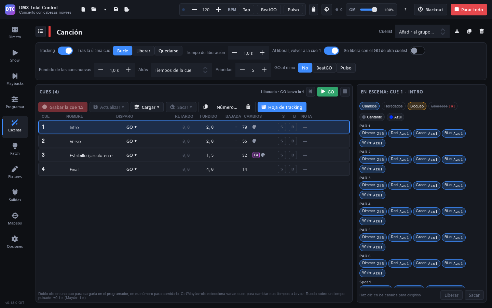

# Cenas

**Cenas** (F4) é a biblioteca de tudo o que você gravou: cenas estáticas, passos, FX, efeitos de cor, racks, super cenas e cuelists. À esquerda fica a lista; à direita, o editor da cena escolhida, diferente conforme o tipo.

Quase tudo é criado a partir do programador: os efeitos novos pegam os fixtures selecionados em [Programar](programar.md) e os passos e cues, os valores dele.

## A lista de cenas

- **“Buscar…”**: filtra por nome (ou pelo nome da pasta).
- **“Pastas”** / **“Grupos”**: ver as cenas por [pastas](escenas.md#pastas) ou pelos grupos de Ao vivo em que estão (“Sem grupo” para o resto).
- **Recolher tudo** / **Expandir tudo**: o botão da direita.
- **Filtro por tipo**: “Todos”, “Estática”, “Passos”, “Cuelists”, “FX”, “Colour FX”, “Racks” e “Super cenas”.
- **Ctrl+clique** e **Shift+clique** selecionam várias cenas para movê-las para uma pasta (“Para pasta…”).

Cada cena tem uma tarja com a cor do seu tipo. Clique em uma para abri-la no editor.

## Criar uma cena

Pressione **“Nova”**:

| Opção | O que cria |
|---|---|
| **Estática (a partir do programador)** | Uma cena estática com os valores do programador. |
| **Passos (programador = primeiro passo)** | Uma cena de passos. |
| **Cuelist (programador = cue 1)** | Uma cuelist. |
| **FX (no programador)** | Leva você a Programar › FX: os FX são feitos lá e gravados com “Gravar…”. |
| **Colour FX (fixtures selecionados)** | Um efeito de cor sobre os fixtures selecionados, na ordem deles. |
| **Mapeamento no plano 2D (fixtures selecionados)** | Um efeito de cor posicionado onde os fixtures estão no plano 2D. |
| **Rack de efeitos** | Um rack vazio. |
| **Super cena (linha do tempo com áudio)** | Uma super cena vazia. |
| **Importar de um arquivo…** | Cenas e efeitos exportados de outro show (veja [Importar e exportar](escenas.md#importar-e-exportar)). |

## O cabeçalho do editor

- **O nome**: clique para alterá-lo.
- **A pasta** (ícone de pasta): mover a cena para uma pasta.
- **“Testar”** / **“Parar”**: reproduz a cena agora, fora dos grupos. As cuelists têm seu próprio GO.
- **“Adicionar ao grupo…”**: adiciona a cena a um grupo de Ao vivo.
- **Converter em passos** (racks, FX, Colour FX, Move FX, Curve FX e chasers): grava um ciclo em uma nova cena de passos, só com os canais aos quais a cena dá um valor: os outros, mesmo que tenham um valor padrão (o pan ou o zoom no centro de muitos moving heads), não entram nos passos.
- **Converter em cuelist** (passos): veja [Cuelists](escenas.md#cuelists).
- **Exportar**, **“Duplicar”** e **“Excluir”** (a cena também é removida dos seus grupos e racks).

## Como a cena é reproduzida

Abaixo do cabeçalho fica o painel de reprodução. Ele mostra o que faz sentido para cada tipo:

- **“Fade in”** e **“Fade out”**.
- **“Tempo de ciclo”** (ou **“Tempo por passo”** em um Colour FX) e **“Velocidade”** (de um ciclo por minuto a dez por segundo; clique duplo: um ciclo por segundo), com **×½** e **×2**.
- **“Fade escalonado”** (estáticas e passos): cada fixture começa o fade este tempo depois do anterior, na ordem de seleção.
- **“Comandado por”**: **“Duração”** (os tempos normais), **“BPM”** (os tempos passam a beats e seguem o tempo do show, também os fades de cada passo; o tempo de crossfade de um grupo do Ao vivo e os fades dos blocos de uma super cena continuam em segundos), **“BeatGO”** ou **“Pulso”** (avança com o botão BeatGO ou com os picos da entrada de áudio). Com BeatGO ou Pulso, **“Divisões”** (/2, ×2).
- **“Ritmo marcado”** (sequências e chasers): o ritmo marcado tocando o botão dela várias vezes seguidas ([Ao vivo](directo.md#ritmo-de-uma-cena-com-passos)), em BPM. Enquanto ela o tiver, os passos dela vão nesse ritmo e não pelos seus tempos. **“Remover”** volta aos tempos dela. Com “BPM”, um beat é um passo desse ritmo: um fade de 0,5 b dura meio passo.
- **“Início”**: **“Reproduzindo”** ou **“Em pausa, pressione de novo para reproduzir”**.
- **“Reproduz”**: **“Sempre”** ou **“N vezes”**, **“e depois”** **“Liberá-la”** ou **“Manter o último quadro”**, **“e reproduzir”** “Nada”, “Próxima cena do grupo”, “Cena anterior do grupo” ou qualquer outra cena.

## Tipos de cena

### Estática

Guarda valores fixos. Mostra quantos canais e fixtures ela tem e as paletas que usa (“Usa estas paletas: quando elas mudam, a cena também muda”).

Para alterá-la:

1. Pressione **“Editar no programador”**: ela é carregada em Programar.
2. Mude o que quiser.
3. Volte para Cenas e pressione **“Salvar o programador nesta cena”**.

Se você salvar FX em uma cena estática, ela passa a ser uma cena FX.

### Passos

Uma sucessão de visuais, cada um com seu **fade in**, sua **espera** e seu **fade out**.

- **“Adicionar passo”**: o programador vira um novo passo depois do selecionado.
- **“Salvar no passo”**: salva o programador no passo selecionado.
- **“Carregar passo”** (ou clique duplo em um passo): leva-o ao programador para vê-lo e alterá-lo.
- **Duplicar**, **▲ ▼** para reordenar e **excluir** o passo.
- O botão **∞** da espera faz o passo esperar um GO (“Até o GO”).

**Ctrl+clique** e **Shift+clique** selecionam vários passos: ao mudar um tempo, ele muda em todos. Os passos aplicam as paletas por valor, não por referência.

### FX

Uma cena FX tem **valores base** e uma ou várias **camadas de FX**. Ela é criada gravando a partir do programador com FX (veja [FX](programar.md#fx)).

- À esquerda, a lista de FX: parâmetro, fixtures e velocidade. A lixeira remove uma camada.
- À direita, os controles da camada escolhida (os mesmos que em Programar) e a prévia animada dela. As mudanças aparecem ao vivo enquanto a cena roda.
- **“Vincular”**: as camadas vinculadas compartilham velocidade e timing.
- Se alguns fixtures fazem o FX do seu jeito, há um aviso: se você mudar aqui a forma, o tamanho, o sentido ou a fase, todos farão o mesmo.
- Para adicionar camadas ou alterar os valores base: **“Editar no programador”** e depois **“Salvar o programador nesta cena”**.

### Colour FX e mapeamentos no plano 2D

Um **Colour FX** é um efeito de pixel (mais de 60: degradês, fogo, meteoros, strobos, ondas…) que percorre os fixtures na ordem de seleção.

- **“Efeito”**: qual.
- **“Atua sobre”**: “Cor (RGB)”, “Branco”, “Âmbar”, “UV”, “Dimmer (valor)” ou “Shutter”.
- **“Cores”**: até 5, conforme o efeito. Clique em uma cor para mudá-la (amostras ou matiz), ou “Sem cor”.
- **“Texto”**: nos efeitos de texto, o texto que percorre os fixtures.
- **“Imagem”** e **“Animação”**: nos efeitos de imagem, o arquivo e “Fixa”, “Rolar para os lados”, “Rolar para cima e para baixo” ou “Animada (GIF)”.
- **“Disposição”**: **“Em fila”** (na ordem de seleção) ou **“No plano 2D”** (onde estão os fixtures).
- **“Parâmetros”**: os próprios de cada efeito.
- **“Usar a seleção do programador”**: troca os fixtures dele pelos selecionados.

No topo aparece a cor real de cada cabeça enquanto ele roda (pressione “Testar” para vê-la).

Um **mapeamento no plano 2D** é um Colour FX que já nasce com a disposição do plano: o efeito, o texto ou a imagem são posicionados sobre o palco tal como os fixtures estão.

### Move FX e Curve FX

São efeitos do módulo antigo: os **Move FX** movem pan/tilt com uma forma e os **Curve FX** dão uma onda (seno, triângulo, rampas, quadrada, aleatória, strobo…) a canais. Você os encontrará em shows antigos ou em shows do QLC+; eles já não são criados em “Nova”.

Eles continuam rodando igual e têm seu editor (forma, largura, altura, rotação, posição, fase, distribuição entre fixtures, simétrico, relativo…). Um aviso oferece **“Converter em FX”**: eles passam ao editor de FX, também no programador, e os grupos, botões do SHOW e mapeamentos os mantêm.

### Rack de efeitos

Várias cenas e efeitos que rodam juntos como um só, cada um nos seus fixtures.

- Em **“Adicionar”** (à direita), clique em uma cena para colocá-la no rack.
- Em **“No rack (N)”**, o **×** a remove.

Um rack não pode conter uma cena que o reproduza.

### Chasers

Os chasers de shows do QLC+ rodam normalmente, mas não têm editor. Você pode convertê-los em passos com o botão de converter do cabeçalho.

## Super cenas

Uma **super cena** é uma linha do tempo com faixas de cenas e de áudio. Ela é disparada como qualquer cena (em um grupo, no SHOW, com um mapeamento). O editor dela ocupa a página inteira; o botão da lista, no canto superior esquerdo, volta à lista de cenas.

### A barra de ferramentas

- **“Reproduzir”** / **“Parar”** (**Espaço**): a partir do cursor. **⏮** volta ao início. Ao lado aparece o tempo (e o compasso).
- **“Tempo”** / **“Compassos”**: a grade. Em compassos, o **BPM**, a fórmula de compasso (**4/4**, **3/4**, **2/4**) e **“Compasso 1 aqui”** para que o primeiro compasso comece no cursor e coincida com a música.
- **“Ajustar”**: os blocos e pontos se ajustam à grade.
- **“Fim aqui”**: a super cena termina no cursor (o **×** remove o marcador: ela termina com o último bloco). **“Loop”**: recomeça.
- **“+ Faixa”** e **“+ Áudio”** (um arquivo de áudio na faixa selecionada, no cursor).
- **“Valores estáticos”**: **“Pegar os valores do programador”** (rodam enquanto a super cena está em andamento) ou **“Limpar os valores estáticos”**.
- **Zoom** − e +.

### Colocar cenas na linha do tempo

1. Pressione **“+ Faixa”** se não houver nenhuma.
2. Arraste uma cena da lista da esquerda para uma faixa. Ou selecione uma faixa, posicione o cursor e dê um **clique duplo** na cena: ela é colocada no cursor.

Os blocos podem se sobrepor.

### Trabalhar com os blocos

- **Arraste** um bloco para movê-lo, também para outra faixa. Arraste as **bordas** dele para mudar a duração.
- Com o bloco selecionado, as **alças** dos cantos superiores são os fades de entrada e de saída dele.
- Ao alongar um bloco, a cena **se repete em loop** (aparecem marcas a cada volta) ou **se estica** para que um ciclo dure o bloco inteiro. Isso se muda no menu do bloco ou na barra de baixo (“Em loop” / “Esticada”).
- **Botão direito**: “Repetir a cena no bloco” / “Esticar a cena para caber no bloco”, “Duplicar”, “Bloquear” / “Desbloquear”, “Abrir a cena” e “Excluir”.
- **Clique duplo** em um bloco abre a cena dele. **Del** exclui o bloco selecionado.
- A barra de baixo mostra o bloco selecionado: **Início**, **Duração**, **Fade in**, **Fade out**.

### Áudio

Os blocos de áudio (wav, flac, ogg, aiff e mp3 se o sistema suportar) mostram sua **forma de onda**, que é calculada em segundo plano. É preciso uma faixa desbloqueada para adicioná-lo.

### Faixas e automação

No cabeçalho de cada faixa:

- **M**: silenciar (a faixa não toca).
- **Cadeado**: bloquear (os blocos e pontos dela não se movem).
- **D**: a linha de automação do **dimmer** (em uma faixa de áudio, o volume).
- **φ**: a linha de automação da **fase** dos seus efeitos.
- **⋯**: “Renomear” (também com clique duplo no nome), “Mover para cima”, “Mover para baixo”, “Limpar a automação desta linha” e “Excluir a faixa”.
- A seta da direita oculta ou mostra a faixa.

Em uma linha de automação: **clique** adiciona um ponto, **arrastar** o move, **clique duplo** o apaga e **botão direito** alterna entre reta e curva suave. Sem pontos, o dimmer fica no máximo e a fase em 0.

### Mover-se pela linha do tempo

- Clicar ou arrastar na **régua** move o cursor; **clique duplo** na régua reproduz a partir dali. Clicar em uma faixa vazia também move o cursor.
- **Ctrl+roda**: zoom. **Shift+roda**: deslocar-se no tempo. A roda sozinha sobe e desce pelas faixas.

## Cuelists

Uma **cuelist** é uma lista de cues que avançam com GO. Ela funciona com **tracking**: cada cue guarda **só o que muda** e o resto continua das cues anteriores. Um GO só muda os canais que mudam: sem quedas de luz e sem refazer o que não precisa.

As cuelists são gravadas a partir do programador, operadas em [Playbacks](playbacks.md) e editadas aqui.

### Opções da cuelist

No topo do editor:

- **“Tracking”**: ligado, cada cue guarda só o que muda. Desligado, cada cue por conta própria.
- **“Após a última cue”**: **“Loop”** (volta à primeira), **“Liberar”** ou **“Ficar”**.
- **“Tempo de liberação”**: o fade ao liberar a cuelist.
- **“Ao liberar, voltar à cue 1”**: depois de liberá-la, o GO recomeça pela primeira cue.
- **“Liberada pelo GO de outra cuelist”**: uma música que acaba quando a próxima começa.
- **“Fade das novas cues”**: o fade da primeira cue gravada; as seguintes pegam os tempos da anterior.
- **“Voltar”**: os tempos do BACK: **“Tempos da cue”** ou **“Tempo fixo”**.
- **“Prioridade”**.
- **“GO no ritmo”**: “Não”, “BeatGO” ou “Pulso” dão um GO em cada divisão.
- **“Ritmo marcado”**: o ritmo marcado tocando o botão dela várias vezes seguidas, em BPM: um GO em cada batida. Enquanto ela o tiver, os disparos Seguir e Esperar dela não contam. **“Remover”** volta aos tempos dela.

Em uma janela estreita, parte das opções se recolhe: **“Mais opções”** as mostra.

### A tabela de cues

| Coluna | O que é |
|---|---|
| **CUE** | O número. Aceita decimais: a 2.5 fica entre a 2 e a 3. Clique duplo para alterá-lo. Um lápis indica que a cue está carregada no programador. |
| **NOME** | O nome dela. |
| **DISPARO** | **GO** (espera um GO), **Seguir** (quando a cue anterior termina, mais um tempo) ou **Esperar** (um tempo depois do GO da cue anterior). |
| **ATRASO** | Quanto a cue espera antes de começar o fade. |
| **FADE** | O tempo de fade. |
| **DESCIDA** | O fade dos dimmers que descem. “=” é igual ao fade. |
| **MUDANÇAS** | Quantos canais ela muda, e as marcas **FX**, **[R]** (valores liberados) e o ícone de paleta se ela usa paletas. |
| **S** | **Pular** (só esta cue): o que ela muda não passa para as seguintes. |
| **B** | **Bloqueio**: Gravar e Atualizar guardam também os valores iguais aos que ela herda. |
| **NOTA** | Uma nota para você. |

Para mudar um tempo, clique nele e digite os segundos, ou use a **roda** do mouse sobre o tempo clicado: ±0,1 s (com Shift, 1 s). Com **Ctrl+clique** ou **Shift+clique** você seleciona várias cues e muda os tempos, o disparo ou as marcas delas juntos.

A cue que está rodando tem uma barra verde com o avanço do fade; a próxima, uma borda verde. No topo aparece o estado (“Q 3 · Verso ▸ 4” ou “Liberada · GO reproduz 1”) e os botões **Voltar**, **GO** e **liberar**, os mesmos do playback dela.

### Gravar e editar cues

- **“Gravar a cue N”**: o programador vira uma nova cue depois da selecionada, só com o que muda em relação ao que ela herda.
- **“Atualizar ▾”**: mescla o programador na cue selecionada: **“Atualizar a cue N (as seguintes acompanham)”** ou **“Só esta cue (as seguintes mantêm o visual)”**.
- **“Carregar ▾”** (ou clique duplo em uma cue): leva a cue ao programador: **“O que o palco mostra na cue N”** ou **“Só o que a cue N muda”**. Depois, atualize-a pela barra “Editando a cue…” de Programar.
- **“Tirar ▾”**: com os canais do programador, **“Tirar da cue N os canais do programador (voltam a herdar)”** ou **“[Liberar] os canais do programador na cue N”** (a partir dessa cue eles voltam ao que há por baixo: outras cenas ou o valor de repouso).
- **Copiar** para o final: **“Copiar o que a cue N muda”** ou **“Copiar todo o visual da cue N (cue de bloqueio)”**.
- **“Número…”**: outro número para a cue selecionada. Mover uma cue muda o que as cues seguintes herdam.
- **Excluir**: com **“Manter o visual das próximas cues”** marcada, o que a cue muda passa para a próxima e as seguintes ficam iguais.

Em uma lista estreita (ou em um idioma com palavras longas), “Atualizar”, “Carregar” e “Tirar” ficam só com o ícone e a seta **▾**; ao passar o mouse aparece o nome deles.

O botão direito em uma cue tem **“Ir para a cue N”**, as duas formas de carregar, **“Atualizar com o programador”**, **“Número…”** e **“Excluir…”**.

As cues podem usar **paletas por referência** e ter **camadas de FX**, que são herdadas de cue em cue.

### A planilha de tracking

**“Planilha de tracking”** mostra o que o palco tem na cue selecionada, fixture por fixture (“No palco: cue N”). Se a janela for larga, ela aparece sozinha ao lado das cues.

- As etiquetas coloridas dizem o que é cada valor: **“Mudanças”** (esta cue o muda), **“Herdados”** (vem de uma cue anterior, que é indicada: “Q2”), **“Bloqueio”** e **“Liberados”** (riscados, com [R]).
- No topo aparecem as paletas que a cue usa.
- Clique nos canais para escolhê-los e pressione **“Liberar”** (coloca-os em [RELEASE] a partir desta cue) ou **“Tirar”** (voltam a herdar das cues anteriores).

### Converter passos em cuelist

Em uma cena de passos, o botão **“Converter em cuelist”** do cabeçalho transforma cada passo em uma cue com o que muda em relação ao anterior; os passos com tempo se encadeiam com **Esperar**. Os grupos, botões do SHOW e mapeamentos dela passam a reproduzir a cuelist. Os passos deixam de existir.

## Pastas

As pastas organizam a lista de cenas (também no SHOW, nas super cenas, nos racks e ao adicionar cenas a um grupo).

- **Criar**: o botão de pasta com **+** ao lado da busca, ou **“Nova pasta…”** no menu de uma cena.
- **Colocar cenas**: arraste-as sobre a pasta, ou botão direito › **“Mover para a pasta”**. Funciona com várias cenas selecionadas.
- **Tirar**: botão direito › **“Tirar da pasta”**.
- **Renomear ou excluir**: o botão **⋯** da pasta (ou botão direito): **“Renomear a pasta”** e **“Excluir a pasta (as cenas dela ficam)”**.
- Clique no cabeçalho de uma pasta para recolhê-la ou expandi-la.

As pastas são salvas com o show.

## Importar e exportar

- **Exportar**: o botão de exportar do cabeçalho salva a cena em um arquivo `.dtcfx` (“Efeitos do DMX Total Control”) para carregá-la em outros shows. Funciona também com racks.
- **Importar**: **“Nova” › “Importar de um arquivo…”**. Os fixtures são pareados com os deste show; se algum do arquivo não estiver aqui, a parte dele é omitida e há um aviso.
- **As cenas de outro show inteiro**: em [Patch › Importar](patch.md#importar-de-outro-show), “Cenas de outro show…”.
