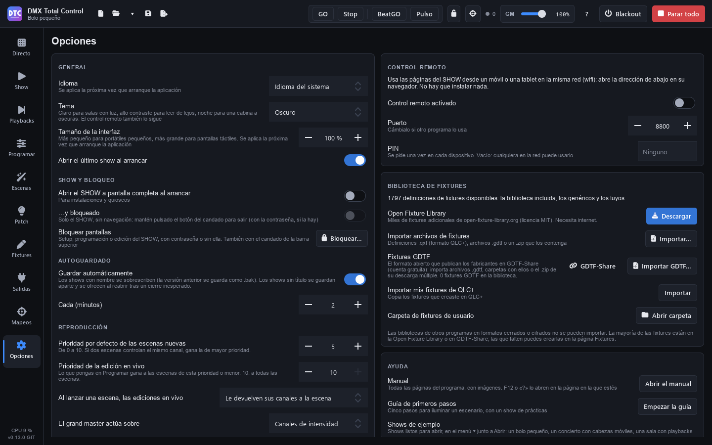

# Opções

**Opções** (F9) reúne os ajustes do programa. À esquerda ficam os ajustes gerais, a inicialização, o bloqueio, a segurança durante o show, o salvamento automático, a reprodução e o áudio; à direita, o controle remoto, a biblioteca de fixtures, as atualizações, a ajuda e “Sobre”.

Os ajustes desta página são do computador, não do show: valem para todos os shows que você abrir. Só a parada de show (em [Segurança durante o show](opciones.md#parada-de-show)) é salva com o show.

## Geral

- **Idioma**: “Idioma do sistema”, Español, English, Português, Français, Italiano ou Deutsch. É aplicado na próxima vez que o programa iniciar.
- **Tema**: **Escuro**, **Claro**, **Alto contraste** ou **Noite (atenuado)**. Muda na hora. Claro, para salas iluminadas; Alto contraste, para ler de longe; Noite, muito escuro e em vermelho, para uma cabine no escuro sem ofuscar você. O [controle remoto](remoto.md) segue o mesmo tema.
- **Tamanho da interface**: de 80 % a 150 %, menor para notebooks pequenos e maior para telas touch. É aplicado na próxima vez que o programa iniciar.
- **Abrir o último show ao iniciar**.

> **Dica:** o tema Claro funciona melhor em ensaios de dia ou ao ar livre; Alto contraste, quando há muita luz em volta da tela.

## SHOW e bloqueio

- **Abrir o SHOW em tela cheia ao iniciar**: para instalações e quiosques. O programa inicia na página Show em tela cheia.
- **…e bloqueado**: além disso, inicia bloqueado: só o SHOW, sem navegação. Para sair, mantenha pressionado o botão do cadeado (com a senha, se houver). Veja [Show](show.md#tela-cheia-e-bloqueio).
- **Bloquear telas**: **“Bloquear…”** / **“Desbloquear…”**. É o mesmo que o cadeado da barra superior.

### Bloquear telas

O bloqueio evita que algo mude por engano durante o show. A página Ao vivo e o SHOW continuam funcionando, e os playbacks continuam rodando.

1. Pressione o **cadeado** da barra superior (ou “Bloquear…” aqui).
2. Escolha o que bloquear:
   - **Configuração**: Patch, Fixtures, Saídas, Mapeamentos e Opções. Também não é possível abrir nem criar outro show.
   - **Programação**: Programar e Cenas. Em Playbacks não é possível gravar, atualizar nem atribuir.
   - **Edição do SHOW**: as páginas do SHOW são usadas, não alteradas.
3. Se quiser, digite uma **senha** (é opcional).
4. Pressione **“Bloquear”**.

As páginas bloqueadas têm um cadeado na barra lateral. Ao abrir uma, a senha é pedida (se houver) e tudo é desbloqueado. Para desbloquear, pressione o cadeado da barra superior. **“Remover a senha”** fica na mesma janela, ao bloquear.

## Segurança durante o show

O que protege o show durante o ao vivo (veja [Segurança durante o show](directo.md#segurança-durante-o-show)):

- **Manter o computador acordado** (ligado por padrão): enquanto o programa está aberto, o Windows não suspende o computador nem desliga a tela. Ao fechar o programa, ou ao desligar esta opção, o Windows volta a fazer isso como sempre. Nada muda na configuração do Windows.
- **Modo show** (desligado por padrão): fechar o programa ou abrir outro show pede para manter um botão pressionado. Bloquear o SHOW o liga; desbloqueá-lo não o desliga. O escudo da barra superior também o liga e o desliga (veja [Modo show](directo.md#modo-show)).
- **Parar tudo com fade**: de 0 a 5 s (0 por padrão: na hora, como sempre). As funções descem nesse tempo; Esc duas vezes, na hora. Durante 10 segundos, Ctrl+Z recupera o que parou (veja [Parar tudo com fade](directo.md#parar-tudo-com-fade)).
- **Desarmar os efeitos sem uso após**: de 0 a 120 minutos sem disparos (10 por padrão; 0, “Nunca”). Nunca enquanto um dispara (veja [Efeitos especiais protegidos](directo.md#efeitos-especiais-protegidos)).
- **Funcionando na bateria** e **A suspensão seletiva de USB está ligada** só aparecem quando acontece. A primeira diz quanta bateria resta; a segunda tem **“Como desligá-la”**, que abre a seção [Suspensão seletiva de USB](opciones.md#suspensão-seletiva-de-usb), mais abaixo.

### Parada de show

O que a [parada de show](directo.md#parada-de-show) ilumina e em que nível. Isto sim é salvo com o show, na seção do DMX Total Control (o QLC+ não lê isso).

- **Fixtures**: **“Todas as luzes”** (padrão) ou **“Estes grupos…”**, que abre a lista dos grupos de fixtures do show para marcá-los (“Grupos que a parada de show ilumina”). Sem nenhum marcado, todas as luzes. Um grupo excluído sai sozinho da lista. Dos grupos escolhidos só as luzes se iluminam: a fumaça, os hazers, os strobos e os lasers deles, nunca.
- **Nível**: de 0 a 100 % (100 por padrão).

Iluminam-se os moving heads, os scanners, os PARs e washes, as barras de LED, os blinders e os dimmers. Um dimmer genérico (Generic › Generic Dimmer) só quando o nome diz que é uma luz (PAR, FRESNEL, DIMMER, BLINDER, REFLETOR, LUZ, SPOT, CONTRA, LATERAL, PC, PÚBLICO…) ou o ícone dele no plano é o de uma luz. Os que se chamam VIDEO, TRIGGER, DISPARADOR, RELÉ, MOTOR, KABUKI… ficam como estão, também dentro de um grupo escolhido; um PIRO… é um efeito especial protegido e se apaga. Para iluminar um deles, dê a ele um ícone de luz em Patch › “Aparência” › “Ícone”. Os dimmers da biblioteca se iluminam como sempre.

### Suspensão seletiva de USB

O Windows pode suspender uma porta USB que parece ociosa para economizar energia, e com ela a interface DMX: a saída para no meio do show. É uma configuração do plano de energia do Windows. O programa só a lê ao iniciar (e avisa com uma barra azul e nesta página): nunca a muda. Para desligá-la:

1. Abra o **Painel de Controle** › **Hardware e Sons** › **Opções de Energia**.
2. Ao lado do plano que você usa, clique em **“Alterar configurações do plano”** e depois em **“Alterar configurações de energia avançadas”**.
3. Abra **“Configurações de USB”** › **“Configuração de suspensão seletiva de USB”** e escolha **“Desabilitado”** em **“Na bateria”** e em **“Conectado”** (sem bateria, há só um valor).
4. Clique em **“OK”**.

Se a interface continuar parando, abra o **Gerenciador de Dispositivos** e, nas propriedades de cada **“Hub raiz USB”**, na aba **“Gerenciamento de Energia”**, desmarque **“Permitir que o computador desligue o dispositivo para economizar energia”**. Os nomes podem mudar um pouco conforme a versão do Windows.

> **Não testado com equipamento real:** as mudanças de bateria e de energia, a porcentagem da bateria, o efeito real de manter o computador acordado e a leitura da suspensão seletiva de USB.

## Salvamento automático

- **Salvar uma cópia de recuperação**, **A cada (minutos)**: de 1 a 60.

O salvamento automático não mexe no arquivo do show: a cada poucos minutos, se houver alterações não salvas, ele salva à parte uma cópia de recuperação, e o ponto **●** continua lá. Só **Salvar** grava o arquivo; a versão que havia antes do primeiro salvamento de cada sessão é mantida como `.bak`. A cópia é apagada quando você salva, quando fecha (salvando ou não) e quando abre outro show. Se o programa fechar de forma inesperada, ao abri-lo de novo ele oferece a cópia (“Recuperar o show não salvo?”) com o nome do show e a hora da cópia: ao recuperá-la, abre-se esse show com as alterações, ainda não salvas; salve-o para mantê-las. Enquanto você decide, o último show já está aberto como estava salvo (com “Abrir o último show ao iniciar”): “Descartar” o deixa assim. Na barra superior aparece a hora da última cópia (“cópia de recuperação…”); se ela falhar (um disco cheio), aparece um aviso em vermelho.

## Reprodução

- **Prioridade padrão das novas cenas**: de 0 a 10. Se duas cenas controlam o mesmo canal, vence a de maior prioridade (veja [Prioridades](directo.md#prioridades)).
- **Prioridade das edições ao vivo**: o que você define em Programar vence as cenas desta prioridade ou menor. Com 10, todas as cenas.
- **Quando uma cena começa, as edições ao vivo**:
  - **“Devolvem os canais à cena”**: os canais que a cena toca deixam de estar no programador.
  - **“Ficam sempre”**.
  - **“São todas redefinidas”**: o programador é esvaziado.
- **O grand master atua sobre**: **“Canais de intensidade”** (a luz: os dimmers e as cores dos fixtures sem dimmer) ou **“Todos os canais”**.

## Áudio

- **Entrada de áudio**: o microfone ou a entrada de linha que o **Pulso** e as matrizes de áudio escutam. **“Padrão do sistema”** usa a que o sistema operacional tiver. O Pulso muda de entrada na hora; uma matriz de áudio que já esteja rodando, na próxima vez que iniciar. Uma entrada escolhida que agora não está conectada aparece como “(não conectada)”, e enquanto isso é usada a padrão.

## Shows recentes

A lista dos últimos shows abertos (também na seta **▾** da barra superior). **“Limpar lista”** a apaga.

## Controle remoto

Para usar as páginas do SHOW em um celular ou um tablet na mesma rede Wi-Fi, sem instalar nada:

- **Controle remoto ativado**.
- **Porta**: altere-a se outro programa a usar (por padrão, 8800). Se ela estiver ocupada, aparece um aviso em vermelho.
- **PIN**: é pedido uma vez em cada dispositivo. Vazio, qualquer pessoa na rede pode usá-lo.
- **Nome na rede**: o celular abre o remoto com `http://dmxtotalcontrol.local:8800/`, mesmo quando o endereço do computador muda (iPhone, iPad e celulares Android recentes). Se outro computador já usa o nome, este fica com `dmxtotalcontrol-2`. Vazio, não há nome. Se a porta de rede 5353 não estiver disponível, ou se outros computadores usam o nome e do `-2` ao `-9`, aparece um aviso em vermelho.
- Os **endereços** que devem ser abertos no navegador do celular, com um botão para copiá-los. Antes de cada um aparece o nome da sua rede, como o Windows a chama (“Wi-Fi”, “Ethernet 2”). Primeiro vem o endereço **“Pelo nome”**, depois o Wi-Fi, depois o cabo e por último os adaptadores virtuais e as VPNs. A lista se atualiza sozinha alguns segundos depois de conectar ou desconectar uma rede. Se o computador não estiver em nenhuma rede, aparece um aviso no lugar.
- Um **código QR** do endereço com a borda (no início, o primeiro numérico), para abri-lo com a câmera do celular. Clique em outro endereço para trocá-lo. Se houver PIN, o código o leva e o celular entra sem pedi-lo. **“Maior”** o mostra em tamanho grande.
- Quantos dispositivos estão conectados.

Veja [Controle remoto](remoto.md).

## Biblioteca de fixtures

Indica quantas definições de fixtures estão disponíveis (a biblioteca incluída, os genéricos e os seus) e permite ampliá-la:

- **Open Fixture Library**: **“Baixar”** (precisa de internet). Já baixada, aparece quantos fixtures ela tem e quando foi baixada, e o botão passa a ser **“Atualizar”**: traz os fixtures novos e os melhorados, e mantém os seus fixtures e os que a biblioteca não tiver mais. Se houver novidades, um aviso informa e o botão fica destacado (veja [Fixtures](fixtures.md#open-fixture-library)).
- **Importar arquivos de fixtures**: **“Importar…”** definições `.qxf` (o formato do QLC+), arquivos `.gdtf` ou um `.zip` com eles.
- **Fixtures GDTF**: **“GDTF-Share…”** busca, baixa e importa fixtures do GDTF-Share (veja [Fixtures](fixtures.md#gdtf-share)); **“Importar GDTF…”** importa arquivos, pastas ou o `.zip` do download múltiplo. Indica quantos fixtures GDTF há na biblioteca.
- **Fixtures baixados do GDTF-Share**: aparece quando há algum. **“Converter de novo”** os converte outra vez com esta versão do programa, a partir do `.gdtf` guardado (veja [Fixtures](fixtures.md#converter-de-novo)).
- **Revisões mais recentes no GDTF-Share**: aparece quando fixtures GDTF da biblioteca têm uma revisão mais recente no GDTF-Share. **“Atualizar”** os mostra no GDTF-Share, onde **“Atualizar todos”** baixa a mais recente de cada um e a converte: os fixtures patcheados com eles a recebem. Conta os que você baixou do GDTF-Share. Um arquivo importado à mão conta se o texto da última revisão dele coincide com uma única revisão do GDTF-Share. Usa a última lista do GDTF-Share que o programa tem (veja [Fixtures](fixtures.md#revisões-mais-recentes)).
- **Importar meus fixtures do QLC+**: **“Importar”** copia os fixtures que você criou no QLC+.
- **Pasta de fixtures do usuário**: **“Abrir pasta”**.

Tudo isso é explicado em [Fixtures](fixtures.md).

## Atualizações

- **Procurar atualizações ao iniciar**: uma vez por dia, no GitHub: o programa e, se você baixou a Open Fixture Library, se ela tem fixtures novos (um aviso informa). Se você salvou a sua conta do GDTF-Share, também entra no GDTF-Share e avisa se os fixtures que você baixou de lá têm revisões mais recentes (cada revisão é avisada uma vez). Nada é baixado nem instalado sem perguntar a você. Sem internet, não incomoda.
- **Incluir versões de teste**: as novidades antes, menos testadas.

Abaixo aparece o estado (“Você tem a versão mais recente”, “A versão … já está disponível”) e os botões:

- **“Procurar atualizações”**: verifica agora (também a Open Fixture Library).
- **“Novidades”**: o que há de novo nessa versão.
- **“Baixar e instalar”**: baixa o instalador e verifica o hash SHA-256 dele antes de salvá-lo. Se uma versão não publica o hash, ela só pode ser baixada pela página dela (“Abrir no GitHub”).
- **“Instalar agora”**: o programa fecha (antes pergunta se você quer salvar o show), a nova versão é instalada e ele abre de novo.
- **“Ao fechar”** / **“Não ao fechar”**: instalá-la quando você fechar o programa.
- **“Abrir no GitHub”**: a página da versão.

Quando há uma nova versão, aparece também um aviso acima das páginas com os mesmos botões. **“Mais tarde”** tira o aviso para essa versão; ela continua disponível aqui.

## Ajuda

- **Manual**: **“Abrir o manual”** abre este manual no índice. F12 ou o botão **“?”** da barra superior o abrem na página em que você está. Ele aparece no idioma do programa (espanhol, inglês, português, francês, italiano ou alemão); as capturas de tela são as da versão em espanhol.
- **Guia de primeiros passos**: **“Iniciar o guia”** abre o guia de novo (veja [Primeiros passos](primeros-pasos.md#o-guia)).
- **Shows de exemplo**: ficam na seta **▾** ao lado de “Abrir” da barra superior, em “Exemplos” (veja [o índice](index.md#o-guia-e-os-shows-de-exemplo)).

## Sobre

A versão do programa, a licença (software livre, Apache 2.0) e os créditos.
