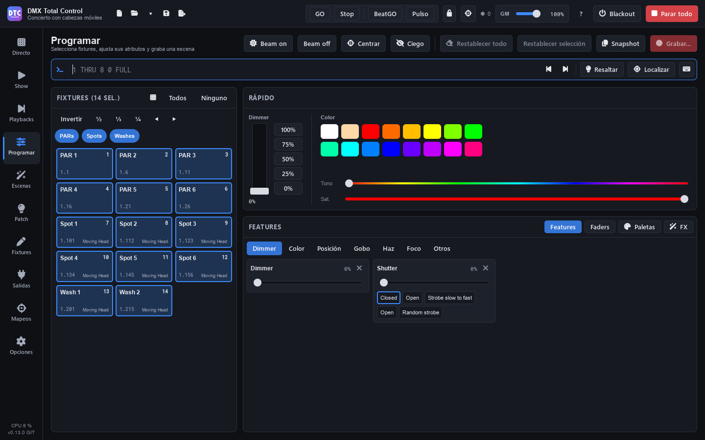

# Programar

**Programar** (F3) é o programador: você seleciona fixtures, dá a eles dimmer, cor, posição, gobos ou qualquer outro canal, aplica FX e paletas, e grava tudo como cena, cuelist ou cue.

O que você define no programador **sai na hora e manda sobre tudo** (cenas, grupos e playbacks) até você limpá-lo. O subtítulo da página lembra você disso: “N canais no programador — eles se sobrepõem aos playbacks até você limpá-los”.

A página tem, de cima para baixo: o cabeçalho com seus botões, a [linha de comando](programar.md#linha-de-comando), o painel de **fixtures** à esquerda e, à direita, o painel **Rápido** e o painel de **Features / Faders / Paletas / FX**.

## O cabeçalho

- **“Beam on”**: dimmer no máximo e shutter aberto na seleção.
- **“Beam off”**: dimmer em zero na seleção.
- **“Centralizar”**: pan e tilt no centro.
- **“Cego”**: veja [Cego](programar.md#cego).
- **“Redefinir tudo”**: libera todas as edições ao vivo (valores e FX). As cenas voltam a aparecer.
- **“Redefinir seleção”**: libera só as dos fixtures selecionados.
- **“Estacionar”**: estaciona na saída os valores do programador dos fixtures selecionados (veja [Estacionar](programar.md#estacionar)).
- **“Snapshot”** e **“Gravar…”**: veja [Gravar](programar.md#gravar).

Em uma janela estreita alguns botões mostram só o ícone; ao passar o mouse aparece o nome deles.

## Selecionar fixtures

O painel **“Fixtures (N sel.)”** mostra um cartão por fixture com o nome, o número (para a linha de comando), o endereço (universo.endereço) e o tipo dele.

- **Clique** em um cartão: seleciona só esse.
- **Ctrl+clique**: adiciona-o à seleção ou o tira dela. **Shift+clique**: seleciona todos os cartões desde o último que você clicou até esse (nesse sentido, que é a ordem da seleção); **Ctrl+Shift+clique** os adiciona.
- **“Todos”** e **“Nenhum”**, no cabeçalho do painel.
- **“Inverter”**: seleciona os que não estavam selecionados.
- **½**, **⅓**, **¼**: deixa um a cada dois, três ou quatro.
- **◀ ▶**: desloca a seleção para a esquerda ou a direita.

**A ordem importa**: a ordem em que você seleciona os fixtures é a ordem que seguem os leques, os FX e os Colour FX. No plano 2D cada fixture selecionado mostra seu número de ordem.

> **Dica:** você também pode selecionar digitando: `1 THRU 8` e Enter. Veja [a linha de comando](programar.md#linha-de-comando).

### Grupos de fixtures e seleções

Acima dos cartões aparecem os [grupos de fixtures](patch.md#grupos-de-fixtures) do Patch como etiquetas redondas:

- **Clique** em um grupo: seleciona os fixtures dele. **Ctrl+clique** ou **Shift+clique**: adiciona-os.
- A etiqueta se ilumina quando todos os fixtures dela estão selecionados. Ao passar o mouse aparece o número dela para a linha de comando (“GROUP 2 na linha de comando”).
- As **seleções** de um grupo (partes ordenadas, com seu ícone) selecionam os fixtures delas na sua ordem.
- Com muitos grupos aparecem três linhas de etiquetas, que rolam com a roda do mouse: **“Todos os grupos (N)”** as abre (até a metade do painel) e **“Menos”** as recolhe. Assim os cartões dos fixtures continuam à vista.

### Plano 2D

O botão da grade no cabeçalho do painel (“Plano 2D”) troca os cartões pelo plano do palco:

- **Clique** em um fixture o seleciona; **Ctrl+clique** ou **Shift+clique** o adiciona ou o tira.
- **Arraste** sobre o palco vazio para selecionar com um retângulo. Um clique no vazio tira a seleção.
- A **roda** do mouse faz zoom; arrastar com o **botão direito** ou o do meio move a vista, e um clique duplo com esses botões a centraliza de novo.

Em Programar o plano está sempre **ao vivo**: cada fixture mostra sua cor, seu dimmer, seu strobo (pisca) e seu gobo, e cada pixel das barras e matrizes. Os fixtures são posicionados no [plano 2D do Patch](patch.md#plano-2d). Os efeitos especiais protegidos têm o seu escudo e os fixtures estacionados o seu cadeado, como no Patch.

## O painel Rápido

### Dimmer

O fader **Dimmer** e os botões **100%**, **75%**, **50%**, **25%** e **0%** dão intensidade à seleção. Num fixture com vários dimmers dão intensidade ao seu dimmer principal e aos que são luz (cada cabeça, lâmpada, pixel ou fundo), não ao flash de um strobo, a um efeito, à fumaça de uma máquina com LEDs nem a um controle de lâmpada.

### Cor

Clique em uma das 16 amostras, ou mova **Matiz** e **Sat**. A cor é misturada nos canais RGB (a parte branca vai para o canal branco se o fixture o tiver) ou CMY de cada fixture. Para as rodas de cores, use os presets delas em [Features](programar.md#features) › Cor.

> **Dica:** para um leque de dimmer, use a linha de comando: `@ 0 THRU 100` vai de 0 % no primeiro a 100 % no último. O leque da posição fica em [Features › Posição](programar.md#posição-grade-xy-e-leque).

## Features

**Features** mostra os canais da seleção por abas: **Dimmer**, **Cor**, **Posição**, **Gobo**, **Feixe**, **Foco** e **Outros**. As abas sem canais na seleção ficam desativadas.

Cada canal é um cartão com o nome, o valor em %, um controle deslizante e os **presets** dele como botões (com a cor ou a imagem do gobo, se o perfil os trouxer). Clique em um preset para aplicá-lo. O cartão fica marcado em laranja quando o canal está no programador; o **×** dele o libera.

Os canais são agrupados **por função**, não por nome: “Red”, “R” ou “Vermelho” de fixtures diferentes são o mesmo controle, e o mesmo vale para dimmer, pan/tilt, CMY, roda de cores, gobo, shutter, iris, zoom, foco, prisma… Cada cabeça de uma barra mantém seus canais. Num fixture com vários dimmers, o que acompanha o dimmer dos outros fixtures é o seu dimmer principal.

### Cor: seletor e favoritos

Na aba **Cor**, o quadro da esquerda dá o matiz (de um lado ao outro) e a saturação (de cima para baixo). Arraste a cruz para posicioná-la, ou arraste em outro lugar do quadro para um ajuste fino.

Embaixo, **“Favoritos”**: o **+** salva a cor atual; um clique em um favorito a aplica; o botão direito o remove. Os favoritos servem para todos os shows.

### Posição: grade XY e leque

A aba **Posição** só move o **pan** e o **tilt** (com seus canais finos, em 16 bits). A rotação contínua de pan ou tilt e a velocidade dela ficam em **Outros**.

- Arraste a **cruz** para posicioná-la, ou arraste em outro lugar da grade para um movimento lento e fino.
- A barra da esquerda é o **tilt** e a de baixo, o **pan**.
- Com vários fixtures, cada um é um ponto na grade.
- **“Centralizar”** leva pan e tilt ao centro.

À direita fica o **Leque**: abre a posição da seleção, na ordem dela, cada fixture a partir de onde estava.

- **“Aberto”**: de uma ponta à outra (o primeiro para um lado, o último para o outro, o do meio parado).
- **“Em V”**: as pontas se abrem e o centro fica parado.
- **“A partir do primeiro”**: o primeiro parado e cada um um pouco mais.
- **Pan** e **Tilt**: quanto cada um se abre (de −100 a 100 %; clique duplo, para 0). Em 100 %, as pontas se movem meia grade.
- **“Sem leque”**: os fixtures voltam para onde estavam.
- O botão **“Leque”** sob a grade faz com que arrastar nela abra o leque em vez de mover: para os lados, o pan; para cima e para baixo, o tilt.

Se depois você mover a cruz, o centro se move e o leque se mantém. Se a posição mudar por outro caminho (uma paleta, outra seleção, “Redefinir tudo”), o leque volta a 0 e recomeça de onde os fixtures estiverem.

### Follow: apontar para um ponto

O botão **“Follow”** sob a grade troca o leque por um plano do palco. Clique ou arraste sobre ele: **todos os moving heads selecionados apontam para esse ponto**, cada um com seu pan e seu tilt, e uma linha vai de cada um até o ponto.

- **“Altura do ponto”**: 0 m é o chão; suba-a para apontar, por exemplo, para o rosto de quem canta (1,6 m).
- Cada cabeça calcula seu pan e seu tilt com seu lugar no plano, sua altura, se está pendurada ou em pé e para onde aponta. Tudo isso é ajustado em [Patch › Plano 2D › “Altura e orientação”](patch.md#altura-e-orientação-follow).
- Ao arrastar, cada cabeça vai pelo caminho curto a partir de onde apontava, sem dar a volta longa.
- Os valores ficam no programador como qualquer pan e tilt: grave-os em uma cena, uma cue ou uma paleta.
- Embaixo é indicado quantos apontam, quais não alcançam (ficam o mais perto que podem), quais não trazem o curso de pan e tilt na definição (são usados 540° e 270°) e os scanners, que não se movem (o espelho deles não segue esta geometria).
- As inversões, os limites e a troca de pan e tilt do [Patch](patch.md#limites) já são levados em conta.

Se você mover a cruz, o leque ou “Centralizar”, ou mudar a seleção, o ponto desaparece.

> **Não testado com equipamentos reais:** cada fabricante orienta seus moving heads do seu jeito. Se um apontar errado, ajuste a orientação dele ou marque “Pan invertido” ou “Tilt invertido” em “Altura e orientação”.

## Faders

**Faders** mostra cada canal da seleção como um fader vertical, com o nome, o grupo e o valor (0–255). O botão da lista abre os **presets** dele (“Nome (mín–máx)”) e o **×** o libera.

> **Dica:** depois de clicar em um fader ou um controle deslizante, as setas ↑ ↓ o movem de um em um e PgUp / PgDn de dez em dez. Clique duplo o devolve ao valor de repouso (normalmente, zero).

## Cego

Com **“Cego”** ativo, o programador edita **sem enviar nada para as luzes**: o palco continua mostrando o que está rodando e você prepara o próximo visual. O subtítulo avisa: “Cego: as luzes não mostram o que você programa”. Você pode gravar como sempre. Ao desativá-lo, o que está no programador sai.

## Efeitos especiais protegidos

O programador nunca envia um [efeito especial protegido](directo.md#efeitos-especiais-protegidos) (um CO2, uma chama…) para a saída, nem com os efeitos armados:

- Em uma seleção que mistura efeitos protegidos com outros fixtures, o programador não dá nada a eles: nem `@ FULL`, nem níveis, cores, faders, “Localizar”, “Beam on” ou “Beam off”, paletas “Tudo”, FX nem macros. Os faders deles não aparecem, então uma cena gravada a partir dessa seleção nunca os contém.
- Em uma seleção **só de efeitos protegidos**, os valores são guardados para que você possa programar uma cena de CO2, mas nunca saem, armados ou não. O subtítulo diz “N canais de efeitos especiais: são gravados, não saem”, e os faders e cartões deles têm um escudo vermelho “não sai”. A cena que você gravar os dispara a partir do SHOW, de um pad ou do celular com os efeitos armados.
- Ao carregar uma cena, um passo ou uma cue com um CO2, os valores dele ficam, e salvá-la de novo não os perde. Os FX dela sobre efeitos protegidos ficam salvos na cena, mas não tocam no programador.
- “Snapshot” os deixa de fora, mesmo disparando; “Destacar” nunca os acende. Os FX e as macros de FX nunca tocam neles, e um aviso diz isso (“1 efeito especial protegido fica fora do FX”). O Follow não aponta uma cabeça de chamas protegida que está selecionada com outros fixtures.

## Destacar e localizar

Na barra da linha de comando:

- **“Destacar”**: a seleção no máximo em branco aberto, por cima de tudo, para ver quais fixtures são. Não é gravado. Pressione de novo para desativar. Nunca acende os efeitos especiais protegidos.
- **“Localizar”**: coloca a seleção no máximo, em branco aberto, centralizada e com o feixe aberto, **no programador** (esses valores são gravados).
- **◀ ▶** (PREV / NEXT): percorre a seleção **um por vez**: só um fixture fica selecionado e aparece em qual você está (“2/8”). **“Todos”** volta à seleção inteira (ALL).

## Paletas

Uma **paleta** guarda um valor de intensidade, posição, cor ou feixe para cada fixture, ou **tudo** de uma vez. As cenas, as cues e os passos gravados com uma paleta a usam **por referência**: se você atualiza a paleta, eles mudam sozinhos (as edições ao vivo também).

Em **Paletas** há cinco colunas: **Intensidade**, **Posição**, **Cor**, **Feixe** e **Tudo**.

### Gravar uma paleta

1. Selecione fixtures e dê o valor a eles (por exemplo, uma cor).
2. Na coluna **Cor**, pressione **“+ Gravar”**.

A paleta é criada com um nome e um número (“Cor 1”, COL 1). A partir desse momento, o que você gravar com ela a segue.

### Paletas de tudo

A coluna **Tudo** grava de uma vez todos os valores que a seleção tem no programador (dimmer, cor, posição, gobos, zoom…), exceto os canais de manutenção (lâmpada, reset). Ela é criada como “Tudo 1”, PAL 1. Os valores que vinham de outra paleta (por exemplo, de POS 1) passam a vir desta: uma paleta não guarda outras paletas.

Ao aplicá-la, ela põe tudo isso. Em outro tipo de fixture, mistura sua cor e o resto vai por atributos, como as outras paletas. Na linha de comando é `PAL 1` (ou PALETA 1), porque `ALL` e `TODO` já selecionam todos os fixtures.

### Usar uma paleta

Selecione fixtures e clique na paleta: ela é aplicada à seleção. Uma paleta fica marcada quando está aplicada na seleção (mais forte se estiver em toda ela). Em um fixture que não foi gravado na paleta, ela usa os valores de outro do mesmo tipo (distribuídos se for um leque, veja abaixo) ou os atributos dele: uma cor é misturada em RGB ou CMY, ou vai para a posição mais parecida da roda de cores.

Também: `COL 2`, `POS 1`, `BEAM 3`, `INT 4` ou `PAL 5` (a de tudo) na linha de comando.

### Leque em uma paleta

Se você gravar uma paleta com valores diferentes em cada fixture (um leque de posição, uma rampa de dimmer, um arco-íris), a paleta guarda a ordem em que você os selecionou. Ao aplicá-la em fixtures que não foram gravados, o leque **é distribuído entre eles na ordem da seleção**: o primeiro recebe os valores do primeiro gravado, o último os do último, e os do meio, o que fica entre eles. Pan, tilt, dimmer, cores e zoom passam de forma suave; rodas e gobos recebem o valor do gravado mais próximo. Em outro tipo de fixture, a cor é a mistura no lugar dele e o resto vem do gravado mais próximo.

Cada fixture lembra o seu lugar no leque, mesmo que depois você aplique a paleta com outra seleção. As cenas, as cues e os passos gravados com ela seguem a paleta, e aplicá-la de novo dá os mesmos valores. Para distribuí-la de outra forma, selecione os fixtures na nova ordem e escolha **“Distribuir de novo pela seleção”**. Em um grupo do SHOW ou de um mapeamento, ela é distribuída na ordem do grupo.

Uma paleta gravada em um só fixture de cada tipo, ou com os mesmos valores em todos, funciona como antes.

### O menu de uma paleta

Botão direito em uma paleta:

- **“Aplicar à seleção”**.
- **“Carregar seus fixtures no programador”**.
- **“Distribuir de novo pela seleção”**: dá aos fixtures selecionados um lugar novo no leque da paleta, na ordem da seleção. O que os usa também muda.
- **“Atualizar com o programador”**: adiciona ou muda os valores do programador na paleta. As cenas que a usam também mudam.
- **“Gravar por cima”**: grava a paleta de novo só com o que há agora.
- **“Renomear…”**, **“Alterar o número…”** e **“Excluir”** (as cenas ficam com os valores).

Um ícone de link na paleta indica que há cenas que a usam; o texto ao passar o mouse diz quantas, e em quantos fixtures a mais ela é distribuída.

> **Dica:** as paletas podem ser colocadas no [SHOW](show.md) (ação “Uma paleta”), no [controle remoto](remoto.md) e em um [mapeamento](mapeos.md), sobre os fixtures delas ou sobre um grupo, como edição ao vivo. Alt+clique em uma paleta a leva para o SHOW.

## FX

Um **FX** move um parâmetro da seleção (o dimmer, o vermelho, o zoom, pan e tilt juntos…) em torno do valor dele no programador ou, se não tiver valor, em torno do que as cenas abaixo enviam. Ele roda na hora e é gravado com a cena. Um FX sem valor base fica acima das cenas estáticas da mesma prioridade, mesmo que você as dispare depois. Em um fixture com várias cabeças (uma barra de pixels, um blinder de duas lâmpadas), se o parâmetro não tiver um canal do fixture inteiro, todas as cabeças o fazem ao mesmo tempo, como um só lugar da onda.

Em **FX** há três zonas: os parâmetros e os FX rodando à esquerda, os controles do FX no centro e as macros à direita.

### Aplicar um FX

1. Selecione fixtures.
2. Em **Parâmetro**, escolha o que mover. Por padrão é escolhido o último parâmetro que você tocou. Os que já têm um FX na seleção têm a marca “FX”. **Pan / tilt** e **Pan** ou **Tilt** movem os mesmos canais: ao iniciar um, esses fixtures saem do outro.
3. Pressione **“Iniciar FX”**, ou clique em uma **macro**.
4. Ajuste os controles: o FX muda ao vivo.

Os fixtures sem dimmer (só RGB, RGBW…) também têm **Dimmer**, marcado “virtual”: o FX atenua a cor deles como um dimmer faria, com todas as cabeças ao mesmo tempo. As macros de intensidade (sequência, pulso, strobo…) também funcionam neles. O CMY, as rodas de cor e os canais com a opção **Dimmer** desligada no Patch não mudam. É só para os FX: o fader **Dimmer** do painel Rápido e `@` continuam sem dimmer nesses fixtures.

Se um fixture tem vários dimmers próprios (um strobo com o seu flash e uma aura de cor, um wash com um dimmer de fundo, uma máquina de fumaça com LEDs), **Dimmer** é o seu dimmer principal, não o do flash, do fundo ou da fumaça: ele é reconhecido pelo nome (“Master dimmer”, “Dimmer”, “Aura dimmer”…), mesmo que não seja o primeiro canal. Os outros costumam aparecer em **Parâmetro** com o nome do seu canal, cada um com o seu próprio FX. As paletas de intensidade e os Colour FX que atuam sobre “Dimmer (valor)” também usam o principal.

### Os controles do FX

- **A figura ou o modo** (o desenho da esquerda): clique nele para escolher outro. Para pan/tilt há **12 figuras** (círculo, oito, quadrado, triângulo, diamante, linha de pan, linha de tilt, diagonal, trevo, lissajous, ballyhoo e cruz). Para o resto, **22 modos**: a linha pontilhada é o valor base e a onda vai por cima, por baixo ou dos dois lados; os modos 9 a 12 são para perseguições, com passo. Os modos com uma seta (←) vão do último fixture ao primeiro: 2, 4, 6, 8, 10, 12, 14 e 20 (o 14 é o 7 ao contrário).
- **Amplitude** (de 0 a 250 %). Em pan/tilt, **“Amplitude pan”** e **“Amplitude tilt”** separadamente.
- **Velocidade**, em BPM. **½** e **×2** a dividem ou a dobram. **“BPM do show”** faz com que ela siga o tempo e a batida do show (um fader ou dial de BPM do SHOW, ou um mapeamento de BPM ou Tap): os FX em “BPM do show”, disparados a qualquer momento, vão na mesma batida que os chases e as cenas em modo BPM, e cada toque do Tap os coloca de novo nela. Gravado em uma cena FX, ele segue em vez disso o ritmo que você marcar tocando o botão da cena, se ela tiver um ([Ao vivo](directo.md#ritmo-de-uma-cena-com-passos)), e o painel avisa. **“Multiplicador”**: de ×⅛ a ×8, com ×⅓ e ×⅔; um valor que não está na lista (de um Move FX convertido) aparece como é.
- Só pan/tilt: **“Inverter pan”**, **“Inverter tilt”**, **“Ao contrário”** e **“Girar”** (0–359°).
- Só em um FX de dimmer com fixtures sem dimmer: **“Dimmer virtual”**, o nível a partir do qual a cor deles é atenuada (0–100 %). Com **“Auto”** é o dos dimmers do mesmo FX ou, se não houver, o máximo. Ao mover o nível, ele fica fixo; o botão ao lado volta para “Auto”. A cor de baixo (a do programador, a da cena ou o que as cenas abaixo enviam) é a base, e um FX de cor no mesmo fixture se soma a ela.

### Timing do FX

Como o FX é distribuído entre os fixtures:

- **“Onda por X”**: a forma se espalha por X fixtures (ou conjuntos), cada um um pouco depois.
- **“Passo por X”**: um fixture (ou conjunto) depois do outro, de X em X.
- **“Agrupar”**: “Não”, “A cada X”, “Blocos de X”, “Dividir em X” (X partes, que diferem no máximo em um fixture), “De fora para dentro” ou “Por grupo” (de fixtures).
  - **“De fora para dentro”** junta o primeiro e o último fixture, depois o segundo e o penúltimo, e assim até o centro: a onda ou o passo vão de fora para dentro. X é quantos fixtures cada conjunto tem, metade de cada ponta (com 2, o primeiro com o último). Não inverte nada; para um espelho, consulte [“O espelho”](programar.md#o-espelho). É salvo como o antigo “Espelho”, então os shows de antes soam igual.
  - **“Por grupo”** usa os grupos do Patch que dividem os fixtures do FX sem se sobrepor. Um grupo que tem todos não conta (por exemplo, um com todos os beams ao lado dos grupos de cada fileira). Se puderem ser divididos de várias formas, ganha a que dá mais grupos, depois a que deixa menos fixtures soltos, depois a de grupos menores e, por último, a ordem dos grupos no Patch. Um fixture que não está em nenhum desses grupos forma um conjunto sozinho. “Por fixture” mostra o grupo de cada um.
- **“Ordem”**: “Seleção”, “Invertido”, “Aleatório” (com um botão para outra ordem aleatória) ou “Por número” (pelos números de fixture do Patch).
- **“Espera”**: tempo na base depois de cada passada. Em “BPM do show”, a passada com a espera dura o número inteiro de batidas mais próximo (pelo menos a passada sem espera), então cada passada começa em uma batida. Fora da batida do show (velocidade própria ou ritmo marcado), uma mudança de velocidade, BPM ou multiplicador continua de onde está na passada; na batida do show, um multiplicador novo o coloca de novo na batida.
- **“Fase”**.

Para uma defasagem ou um atraso próprio de cada fixture, veja [“Por fixture”](programar.md#defasagem-e-atraso-por-fixture).

Embaixo, uma prévia animada desenha cada fixture enquanto ele se move: com o FX rodando, onde ele realmente está, com a velocidade de movimento do SHOW e os atrasos dele.

### FX rodando, vincular e parar

- **“FX rodando (N)”** lista os FX do programador. Um clique seleciona os fixtures e o parâmetro de um FX; o **×** para o FX inteiro, com os FX vinculados a ele, e não muda a seleção.
- **“Vincular”**: os FX vinculados compartilham a velocidade e o timing, andam no mesmo relógio e param juntos. Um FX que você vincula depois vai para onde estão os que já estavam vinculados. “Vincular” o junta ao grupo de vínculo de outro FX da seleção ou, se não houver, ao último que você vinculou; uma macro com vários FX vinculados forma um grupo próprio, separado dos seus. Com vários grupos, “FX rodando” mostra o número de cada um. A velocidade de movimento do SHOW vai para o grupo inteiro de um FX de pan/tilt.
- **“Parar”** tira os fixtures selecionados do FX (com todos, o FX inteiro) e também dos FX vinculados a ele; um FX vinculado em outros fixtures continua (o **×** de “FX rodando” para tudo); **“Parar todos os FX”** para todos.
- Um FX novo começa no relógio do que já está tocando. Em fixtures que saem de um FX rodando do mesmo parâmetro (uma macro sobre parte dele), ele continua de onde esse FX estava. Em outros fixtures, se outro FX do parâmetro anda na mesma velocidade e com o mesmo multiplicador, ele vai para onde esse está: assim “Inverter pan” num segundo grupo dá um espelho em fase. Um FX com atrasos começa do 0.

“Redefinir tudo” também tira os FX do programador. “Parar tudo” da barra superior não os tira: eles são edições ao vivo.

### FX próprios de cada fixture

Um FX continua sendo **um só** mesmo que você mude parte dos fixtures dele. Se você selecionar só alguns dos fixtures de um FX e mudar a **forma, o tamanho, o sentido (“Ao contrário”), as inversões, o giro ou a fase**, a mudança é **própria desses fixtures**, sobre o mesmo relógio: eles continuam sincronizados com os outros. A **velocidade e o timing** são sempre do FX inteiro.

- O painel avisa: “Este FX também está em outros fixtures…”.
- Com todos os fixtures dele selecionados, a mudança é do FX inteiro.
- Se os fixtures selecionados não fazem todos o mesmo, **“Inverter pan”**, **“Inverter tilt”** e **“Ao contrário”** aparecem pela metade (com meia barra de cor embaixo) e um clique os ativa em todos; a figura ou o modo, a amplitude, o giro e a fase dizem “vários”.
- Se você selecionar fixtures que não estavam em nenhum FX do parâmetro, eles se juntam ao FX (ao primeiro, se houver vários), cada um no seu lugar pelo número de fixture. Se a seleção abrange vários FX do mesmo parâmetro (por exemplo, um por fileira), o painel avisa (“A seleção abrange N FX”) e uma mudança vai para cada um: cada FX mantém sua onda e seu espelho. **“Unir em um FX”** junta todos em um, no relógio do primeiro: cada fixture mantém sua forma, mas não seu lugar na onda do FX dele.
- Em “FX rodando” aparece quantos têm algo próprio (“N próprios”).
- **“Como o resto”** tira o que é próprio dos selecionados: eles voltam a fazer o mesmo que o FX.

### Defasagem e atraso por fixture

Embaixo dos controles de um FX rodando, **“Por fixture”** (abra com a sua seta) lista os fixtures dele na ordem do FX: número, nome, o lugar dele na onda ou no passo (com “Agrupar: Por grupo”, também o grupo do seu conjunto), e dois campos que você muda à mão. Os selecionados aparecem destacados. Uma mudança soa na hora, sobre o mesmo relógio.

- **“Defasagem”** (0–1440°): quanto ele vai atrás dos outros na onda. 360° é um ciclo inteiro e, num FX com passo, um lugar. Soma-se à onda e à fase.
- **“Atraso”** (até 60 s): quanto mais tarde ele faz o FX. Quando o FX começa (ao lançar a cena ou a cue dele, ou um FX novo no programador), ele espera esse tempo na base, então os fixtures arrancam um depois do outro. Depois ele continua esse tempo atrás. Fica em segundos mesmo que o FX siga o BPM do show; para seguir o tempo, use a defasagem.
- **“Distribuir a defasagem…”** e **“Distribuir o atraso…”** pedem o valor do último e distribuem a partir de 0 entre os selecionados, na ordem do FX.
- **“Sem defasagem nem atraso”** os tira dos selecionados.
- **“Reordenar por número”** coloca os fixtures do FX na ordem dos seus números do Patch, por exemplo se um ficou no fim de uma fileira. Os lugares deles na onda e os seus pares do espelho a seguem.

Mudar a fase ou o timing os mantém, e “Como o resto” não mexe neles. Não é o mesmo que a fase própria de alguns fixtures: essa fase substitui a do FX; a defasagem se soma a ela. Se você puser um atraso maior que o tempo que o FX está rodando, esse fixture espera na base até chegar a ele. A defasagem e o atraso são gravados com a cena ou a cue.

### O espelho

Se os fixtures com o pan invertido próprio (ou que vão ao contrário, ou com o tilt invertido próprio) estiverem **todos em uma metade** do FX, cada um segue a onda do seu par do outro lado, então a onda também sai em espelho. O painel indica isso com “Espelho: …”.

Exemplo com 6 beams em círculo com onda:

1. Selecione os 6, escolha **Pan / tilt**, pressione **“Iniciar FX”**, figura **Círculo** e **“Onda por X”** em “Todos”.
2. Selecione só os 3 últimos e ative **“Inverter pan”**.

Os 3 últimos se movem em espelho dos 3 primeiros e seguem a onda do 3.º, do 2.º e do 1.º: um espelho sincronizado, com qualquer figura. **“Ao contrário”** só dá um espelho nas figuras simétricas em pan (círculo, quadrado, triângulo, diamante, trevo e linha de pan); em um oito, uma diagonal, um lissajous, uma linha de tilt, um ballyhoo ou uma cruz, cada fixture ao contrário sobe quando o seu par desce, e o painel não diz “Espelho”. Se você inverter fixtures alternados (2, 4 e 6) não é um espelho: cada um mantém seu lugar na onda.

A inversão de pan ou de tilt do Patch (em [“Limites”](patch.md#limites)) é uma correção física, para moving heads pendurados ao contrário ou girados: faz com que se movam como os outros, então não conta para o espelho do FX. O espelho se faz no FX.

Um FX tem um só espelho, entre as suas duas metades. Para um espelho dentro de cada fileira, com uma onda em cada fileira, faça um FX por fileira e vincule-os (**“Vincular”**): cada um com sua onda e sua metade invertida, todos no mesmo relógio.

### Macros de FX

À direita, as **macros de FX** de fábrica por categorias: **Posição** (círculo, círculo em onda, oito, ballyhoo, varredura de pan, can-can, pan em espelho, quadrado, triângulo, trevo), **Intensidade** (onda de dimmer, sequência, aleatório, pulso, respiração, strobo, de fora para dentro), **Cor** (arco-íris, vermelho / azul, fogo, ciano / magenta) e **Feixe** (zoom, iris, foco). Um clique aplica a macro à seleção. “Pan em espelho” inverte o pan da segunda metade da seleção: um espelho com qualquer número de cabeças. As de cor apagam o que não movem: o branco, o âmbar e o UV (e o amarelo em ciano / magenta), para que um branco abaixo não as deixe pastel.

**“Salvar como macro…”** salva os FX do programador como uma macro sua, em **“Minhas”**, para todos os shows. Botão direito em uma macro sua: **“Renomear”** ou **“Excluir”**. Dois FX do mesmo parâmetro (um círculo em alguns fixtures e um oito em outros) entram como um só, cada fixture com o seu; se não iam na mesma velocidade ou com o mesmo timing, a macro fica com os do primeiro e avisa.

Uma macro sua guarda o que cada fixture do FX fazia, pelo lugar dele no FX (a ordem em que você os selecionou):

- os valores base dele: um leque de posições, cores diferentes;
- o que ele fazia do seu próprio jeito: a forma, o tamanho, o sentido, as inversões (um espelho);
- a defasagem e o atraso dele.

Ao aplicá-la, o primeiro fixture selecionado recebe o do primeiro, o segundo o do segundo, e assim por diante. Com mais ou menos fixtures, o primeiro e o último recebem o do primeiro e do último, e os do meio se distribuem: os leques, os atrasos e as metades se esticam, e o espelho se mantém. O que se repete a cada 2 ou 3 fixtures (um sim e outro não ao contrário, duas cores alternadas) se repete igual com qualquer número de fixtures. As rodas de cor e de gobos, o prisma e o shutter não se distribuem: cada fixture pega o valor do lugar mais próximo. Se todos tinham os mesmos valores e nada do seu próprio jeito, a macro serve para qualquer seleção, como as de fábrica. As macros salvas fixture por fixture levam a marca **1·2·3**; passe o mouse por cima para ver quantos fixtures elas tinham.

## Linha de comando

A linha de comando funciona como a de uma mesa de luz. Ao abrir Programar ela recebe o teclado: digite e pressione **Enter**. Ao lado aparece o que ela fez, ou por que não entendeu.

| Comando | O que faz |
|---|---|
| `1 THRU 8` | Seleciona os fixtures 1 a 8 (também `1 > 8` ou `1 / 8`). `8 THRU 1`, em ordem inversa. |
| `1 + 3 - 2` | Soma e tira. `1,3,5` é o mesmo que `1 + 3 + 5`. Começar com `+ 5` ou `- 5` muda a seleção que já existe. |
| `GROUP 2` | O grupo de fixtures 2 (na ordem do Patch). `GROUP 1 THRU 3`: os grupos 1 a 3. |
| `ALL` | Todos os fixtures, por ordem de número (depois de NEXT / PREV, volta à seleção inteira). |
| `@ 50` | Dimmer em 50 %. `@ 5` é 50 % (um dígito são dezenas). |
| `@ FULL` / `@ OUT` | Dimmer no máximo ou em zero. `@ @` também é no máximo. |
| `@ 0 THRU 100` | Leque de dimmer, de 0 % no primeiro a 100 % no último. |
| `@ + 10` / `@ - 10` | Sobe ou desce o dimmer 10 %. |
| `POS 1`, `COL 2`, `BEAM 3`, `INT 4`, `PAL 5` | Aplica a paleta de posição, cor, feixe, intensidade ou de tudo com esse número. |
| `LOCATE` | Localizar. |
| `HIGHLIGHT` | Destacar (alterna). |
| `NEXT` / `PREV` | Um por vez pela seleção. |
| `REL` | Libera as edições da seleção. |
| `CLEAR` | Esvazia o programador. |

É possível encadear: `1 THRU 4 @ FULL COL 2` seleciona, coloca o dimmer no máximo e aplica a paleta de cor 2.

As palavras também funcionam em espanhol: HASTA, GRUPO, TODO, LLENO, TOPE, CERO, INTENSIDAD, POSICION, COLOR, HAZ, PALETA, LIMPIAR, RESALTAR, LOCALIZAR, SIGUIENTE, ANTERIOR, LIBERAR, IR, ATRÁS, GRABAR, ACTUALIZAR, ELIMINAR… e abreviadas: THR, FL, GRP (ou G), CLR, LOC, HI, SIG, ANT, REL.

### Comandos de cuelists

Atuam sobre a **cuelist selecionada**: a do playback selecionado, a que você abriu em Cenas ou a última que você criou.

| Comando | O que faz |
|---|---|
| `GO` | A próxima cue. |
| `BACK` | A cue anterior. |
| `GO CUE 3` | Salta para a cue 3. |
| `CUE 3` | Carrega a cue 3 no programador (o que o palco mostra nela) para alterá-la. |
| `REC` | Grava a próxima cue. `REC CUE 2.5` grava a cue 2.5 (entre a 2 e a 3). |
| `UPD` | Atualiza a cue carregada no programador ou, se não houver nenhuma, a que está rodando. `UPD CUE 4`, a cue 4. |
| `DELETE CUE 4` | Exclui a cue 4 mantendo o visual das seguintes. |
| `PB 3` | Seleciona o playback 3 da página atual (e a cuelist dele). |

Se um comando para no meio (por exemplo, a paleta não existe), o que ele já fez fica feito e na linha fica só a parte que falta corrigir.

### Histórico e teclado na tela

- **↑ ↓** percorrem os últimos comandos.
- **Esc** esvazia a linha (com a linha vazia, Esc é “Parar tudo”).
- O botão do **teclado** abre um teclado na tela para telas touch, com números, THRU, @, FULL, OUT, GROUP, INT, POS, COL, BEAM, PAL, HIGHLIGHT, REL, CLEAR, NEXT, PREV, ALL, LOCATE, CLR e as teclas de cuelists (CUE, o ponto decimal, REC, UPD, GO, BACK, DELETE, PB). CLR esvazia a linha; CLEAR, o programador. Ele fica aberto enquanto você escolhe fixtures.

## Gravar

### A janela “Gravar”

Pressione **“Gravar…”**:

1. Em **Gravar em**, escolha:
   - **“Nova cena”**: uma cena estática ou, se o programador tiver FX, uma cena FX com seus valores base e seus FX.
   - **“Nova cuelist”**: o programador será a cue 1 de uma nova cuelist. Com **“Colocá-la no primeiro playback livre”** marcada, ela também aparece em Playbacks.
   - **Uma cuelist que já existe**: o programador é gravado como uma cue dela. A cuelist selecionada aparece escolhida por padrão.
2. Digite o **Nome** (e, em uma cue, o número em **Cue**: vazio, o próximo; `2.5` fica entre a 2 e a 3).
3. Para uma cena ou uma cuelist nova: **“Adicionar ao grupo”** (ou “Sem grupo”) e **“Prioridade (0-10)”**.
4. Para uma cue: **“Só esta cue (o que ela muda não passa para as seguintes)”** e **“Todos os valores (cue de bloqueio)”** (também os valores iguais ao que ela herda, para que fique igual façam o que fizerem as cues anteriores).
5. Pressione **“Gravar”** (ou “Gravar a cue N”).

Uma cue guarda só o que o programador muda em relação ao que as cues anteriores deixam no palco. Se o número de cue já existir, o programa pergunta o que fazer: **“Mesclar”** (o programador entra na cue), **“Substituir”** (a cue guarda só o que está no programador; mantém o nome e os tempos dela) ou **“Inserir depois”** (uma nova cue entre esta e a seguinte).

**“Limpar o programador depois de gravar”** esvazia o programador depois de cada gravação e atualização. A opção fica memorizada.

### Snapshot

O menu **“Snapshot”** tem:

- **“Salvar as edições em uma cena”**: coloca os valores do programador em uma cena estática que já existe. Os FX não entram (uma cena estática não os tem) e um aviso diz isso; para guardá-los, use **“Gravar…”**.
- **“Tudo o que está no palco, em uma nova cena…”**: tudo o que as luzes mostram agora (cenas, edições ao vivo e o mixer, sem o grand master) vira uma nova cena estática, em cada fixture com luz. Se “Destacar” estiver ativo, é preciso desativá-lo antes (“Desativar destaque”). Deixa de fora os efeitos especiais protegidos, mesmo que estejam disparando.
- **“Só as edições, em uma nova cena…”**: também com FX (a nova cena é uma cena FX).

### Editar cenas e cues

- **Uma cena estática ou FX**: na página Ao vivo ou em Cenas, **“Editar no programador”** a carrega no programador. Mude o que quiser e, em [Cenas](escenas.md), pressione **“Salvar o programador nesta cena”**.
- **Uma cue**: ao carregá-la (clique duplo na cue em Cenas, “Carregar”, ou `CUE 3`), aparece uma barra “Editando a cue 3 de “Música 1””. Mude os valores e pressione **“Atualizar ▾”**: **“Atualizar a cue 3 (as seguintes acompanham)”** ou **“Só esta cue (as seguintes mantêm o visual)”**. O **×** para de editar a cue (o programador mantém os valores).

## Limpar o programador

- **“Redefinir tudo”** (ou `CLEAR`): libera todo o programador, valores e FX.
- **“Redefinir seleção”** (ou `REL`): só os fixtures selecionados.
- O **×** de um cartão ou de um fader: só esse canal.

O que acontece com a edição ao vivo ao disparar uma cena, e a prioridade dela frente às cenas, é decidido em [Opções](opciones.md#reprodução).

## Estacionar

**“Estacionar”**, no cabeçalho (depois de “Redefinir seleção”), estaciona os valores que o programador tem nos fixtures selecionados: eles passam para a saída com os seus [limites](patch.md#limites) (sem o grand master), acima de tudo, e o programador os solta. Os valores dos outros fixtures continuam no programador, e os FX do programador não são estacionados. Fica desativado se a seleção não tem valores. Se depois você mudar os limites, o que está estacionado não muda. Um efeito especial protegido é estacionado apagado. Para desestacionar, use o menu do fixture no Patch (botão direito): veja [Estacionar canais](patch.md#estacionar-canais).
