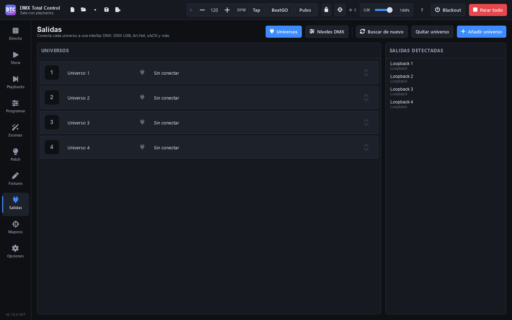

# Salidas

**Salidas** (F7) conecta cada **universo** del show (512 canales DMX) a una **interfaz**: una interfaz DMX USB, un nodo Art-Net o una salida sACN. También tiene el monitor de [niveles DMX](salidas.md#niveles-dmx), que muestra en vivo lo que sale.

En la cabecera:

- **«Universos»** / **«Niveles DMX»**: las dos vistas de la página.
- **«Buscar de nuevo»**: vuelve a buscar las interfaces conectadas.
- **«Quitar universo»** y **«Añadir universo»**.

## Conectar un universo

1. Conecta la interfaz al ordenador (o a la red, para Art-Net y sACN).
2. Si no aparece en **«Salidas detectadas»**, pulsa **«Buscar de nuevo»**.
3. En la fila del universo, abre el desplegable (pone «Sin conectar») y elige la salida.

Cada salida aparece con el nombre de su tipo y el de la interfaz o la red: «DMX USB — …», «ArtNet — …», «E1.31 — …» (E1.31 es sACN). El universo conectado se marca en verde. Para desconectarlo, elige «Sin conectar».

La conexión se recuerda para la próxima vez que abras el programa.

> **Consejo:** las interfaces DMX USB basadas en chips FTDI necesitan sus drivers. Si no los tienes, el instalador del programa ofrece al terminar la página para descargarlos.

## Universos

- **«Añadir universo»** añade uno al final. Al patchear eliges en qué universo va cada fixture.
- Haz clic en el **nombre** de un universo para cambiarlo (el nombre se guarda con el show).
- **«Quitar universo»** quita el **último** (siempre queda uno). Si tiene fixtures patcheados, no se puede: muévelos a otro universo o elimínalos antes en el Patch. Si es la entrada de un controlador, se pregunta antes, porque ese controlador dejará de funcionar hasta que lo vuelvas a activar en Mapeos.

## Niveles DMX

**«Niveles DMX»** muestra los 512 canales de un universo tal como salen del programa, con todo aplicado (escenas, programador, mezclador, gran master, límites…):

- Elige el **Universo** en el desplegable.
- Cada casilla tiene el número de canal y su valor (0–255). **«Mostrar en %»** cambia a porcentaje.
- Las casillas con borde pertenecen a un fixture. Pasa el ratón por un canal para ver de qué fixture es («Nombre — canal N»).

> **Consejo:** si un fixture no responde, mira aquí si su canal se mueve. Si se mueve, el problema está en el cable, en la dirección del aparato o en la interfaz; si no, en el patch o en lo que estás lanzando.

El mismo monitor puede ser una sección del [SHOW](show.md) («Niveles DMX»).

## Entrada DMX

Una interfaz con entrada DMX (o una mesa conectada a ella) sirve para controlar el programa: se activa como dispositivo en [Mapeos](mapeos.md#dispositivos).
